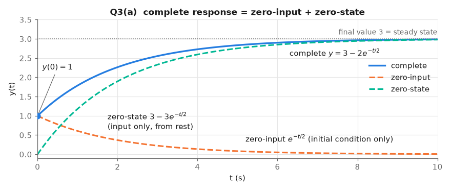
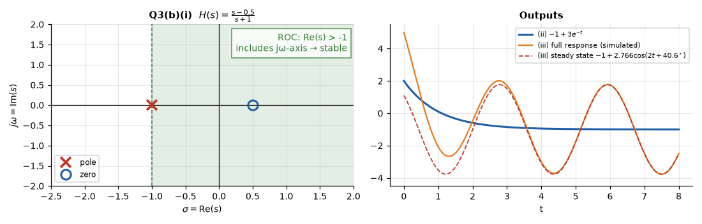
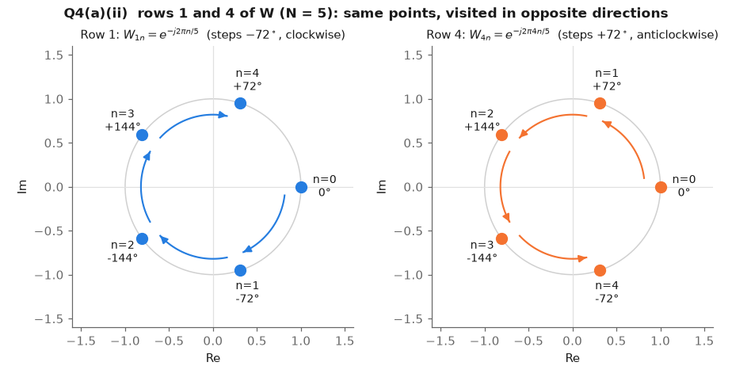

# SC3102 Past Paper Solutions: Semester 1, AY2023/24 (Nov/Dec 2023)

Paper: `../CE3102-23S1(1).pdf` · 4 questions × 25 marks · 2 hours · all questions compulsory

These are my own worked solutions; there is no official answer key. Every numerical answer was re-checked by
computer (numerical integration and convolution, fast Fourier transforms, `sympy` Laplace inverses, and running each difference equation).
Most figures come from `make_figures.py`; `23S1_Q3a_split.png` and `23S1_Q4a_rows.png` were drawn separately
for this write-up. Slide references use PDF page numbers in `SC3102/Slides/`.
The whole-course map is in [00_Exam_Guide.md](00_Exam_Guide.md).

**How each part is laid out.** Every part has two blocks, in this order:
1. **Exam answer:** what to write on the paper. The question, what's given and asked, each step with the rule it uses, the boxed answer, and a one-line check.
2. **Explanation:** why each step works, what the ideas mean, common traps, and links to other parts. Read it after the exam answer.

<b>Answer key: final answers only (open after attempting)</b>

| Part | Final answer |
|---|---|
| 1(a)(i) | $x(t+3)=x(t)$ (re-index $m=n-1$), so $T_0=3$ s |
| 1(a)(ii) | Over one period, $+1$ on $(-1,0)$, $-1$ on $(0,1)$, $0$ on $(1,2)$. $P=2/3$, $E=\infty$, so it's a **power signal** |
| 1(b) | $y=20\cos(200\pi t-\frac{\pi}{4})+20\cos(400\pi t+\frac{\pi}{4})$. Lines of amplitude 10 at $\pm100,\pm200$ Hz, power $\lvert c\rvert^2=100$ each (total 400) |
| 1(c) | Time-invariant but **not linear**, so **not LTI** |
| 2(a) | $0$ for $t<5$; $\frac45(e^{-15}-e^{-5(t-2)})$ on $[5,7)$; $\frac45(e^{-5(t-4)}-e^{-5(t-2)})$ on $[7,8)$; $\frac45(e^{-5(t-4)}-e^{-30})$ on $[8,10)$; $0$ for $t\ge10$ |
| 2(b) | $y=0.2\cos(4t-53.13^\circ)-0.1170\sin(8t-69.44^\circ)$ |
| 2(c) | $X(f)=4\,\mathrm{sinc}(4f)+2\,\mathrm{sinc}(4f-2)+2\,\mathrm{sinc}(4f+2)=\dfrac{\sin(4\pi f)\,(8f^2-1)}{\pi f\,(4f^2-1)}$ |
| 3(a) | $y(t)=(3-2e^{-t/2})\,u(t)$ |
| 3(b)(i) | Zero at $s=0.5$, pole at $s=-1$, ROC $\mathrm{Re}(s)>-1$. **Stable** |
| 3(b)(ii) | $y(t)=(-1+3e^{-t})\,u(t)$ |
| 3(b)(iii) | $y_{ss}(t)=-1+2.766\cos(2t+40.6^\circ)$ |
| 4(a)(i) | $W_{kn}=e^{-j2\pi kn/5}=1\angle(-72^\circ\cdot kn)$ (matrix below) |
| 4(a)(ii) | Row 4 = complex conjugate of row 1 (same frequency, opposite rotation), so $c_4=c_1^\ast$ for real $x$ |
| 4(b)(i) | $y_{ss}=3H(1)=3(0.6)=1.8$ |
| 4(b)(ii) | $y[n]=[\,\underbrace{1.8}_{\text{steady}}+\underbrace{1.2(-0.75)^{n-2}}_{\text{transient}}\,]\,u[n-2]$ |

---

## Question 1 (Signals)

> *"Consider the signal $x(t)=\sum_{n=-\infty}^{\infty}g(t-3n)$, where $g(t)$ is an arbitrary function of time."*

### 1(a)(i) Prove $x(t)=\sum_{n=-\infty}^{\infty}g(t-3n)$ is periodic; find $T_0$ (5 marks)

**Topic:** definition of periodicity (Signals p.9–10). You must show $x(t+T)=x(t)$ for **all** $t$.

#### Exam answer

> *"(i) Based on fundamental principles, prove that the signal $x(t)$ is periodic. Calculate its fundamental period."*

**Given:** $x(t)=\sum_{n=-\infty}^{\infty}g(t-3n)$, with $g$ any function of time.
**Asked:** a proof that some $T>0$ gives $x(t+T)=x(t)$ for all $t$, and the smallest such $T$ (the fundamental period $T_0$).

**Definition used** (Signals p.9–10): $x$ is periodic if some $T>0$ gives $x(t+T)=x(t)$ for **all** $t$. The fundamental period $T_0$ is the smallest such $T$.

1. **What term $n$ is (time shift).** $g(t-3n)$ is $g$ moved right by $3n$. So $x$ is copies of $g$ placed every 3 s: $\dots,\ g(t+3),\ g(t),\ g(t-3),\ g(t-6),\ \dots$
2. **Test $T=3$** (put $t+3$ in place of $t$):
   $$x(t+3)=\sum_{n=-\infty}^{\infty}g(t+3-3n).$$
   Factor the argument: $t+3-3n=t-3n+3=t-3(n-1)$. So
   $$x(t+3)=\sum_{n=-\infty}^{\infty}g\big(t-3(n-1)\big).$$
3. **Re-index** with $m=n-1$. As $n$ runs over all integers ($\dots,-1,0,1,2,\dots$), so does $m$, so the sum contains exactly the same terms:
   $$x(t+3)=\sum_{m=-\infty}^{\infty}g(t-3m)=x(t)\quad\text{for all }t.$$
   So $x$ is periodic, and 3 is a period.
4. **Fundamental period.** All we know is that the copies are 3 apart; $g$ itself is arbitrary. So no smaller shift is guaranteed to work, and the fundamental period is the copy spacing.

$$\boxed{x(t)\text{ is periodic, with fundamental period }T_0=3\text{ s (for a general }g)}$$

**Check** with the $g$ of part (ii) ($+1$ on $(-1,0)$): $x(-0.5)=g(-0.5)=1$, and at $t=2.5$ only the $n=1$ copy is on, so $x(2.5)=g(2.5-3)=g(-0.5)=1$ ✓.

*(Fine print: for special choices of $g$ the true $T_0$ can be smaller; see the Explanation. Part (ii) proves $T_0=3$ for its $g$.)*

#### Explanation

- **What the definition asks.** "Periodic" means: slide the whole graph left by $T$ and it lands exactly on itself, at *every* $t$. One matching point isn't enough. That's why steps 2–3 work with a general $t$ instead of checking a few values.
- **Reading the sum, with numbers.** $n$ is only a counter. Take the $g$ of part (ii), which lives on $(-1,1)$:
  - $n=0$: $g(t)$, on $(-1,1)$;
  - $n=1$: $g(t-3)$, on when $-1<t-3<1$, i.e. on $(2,4)$;
  - $n=-1$: $g(t+3)$, on $(-4,-2)$.

  So term $n$ is the same shape sitting at $3n$. (In general $g(t-c)$ is $g$ moved right by $c$, because at $t=c$ it gives $g(0)$.)
- **Why the re-index works, with numbers.** Adding 3 to $t$ moves every copy 3 to the *left*: the copy at 3 lands on 0, the copy at 0 lands on $-3$, and so on. The set of copy positions $\{\dots,-3,0,3,6,\dots\}$ is the same set afterwards. That is all "$m=n-1$" says.
- **Why $n$ must run over all integers.** With $\sum_{n\ge0}$ only, there would be no copy at $-3$, so $x(-3.5)=0$ while $x(-3.5+3)=x(-0.5)=1$. The signal would have a start, and a periodic signal can't have one.
- **Why "for a general $g$" (the fine print).** If $g$ already repeats inside itself, the copies can merge into a faster pattern. Example: $g(t)=\Pi(t)+\Pi(t-1.5)$, two unit boxes 1.5 apart. Copy $n$ puts boxes at $3n$ and $3n+1.5$, so $x$ has a box at every multiple of 1.5: $\dots,0,1.5,3,4.5,\dots$ Then $T_0=1.5$, not 3. Nothing like this happens for a typical $g$, so 3 is the expected answer. (The sum must also be finite at each $t$; that's automatic when $g$ is zero outside a finite interval, as in (ii).)
- **Trap:** writing "$T_0=3$ because the copies are 3 apart" without steps 2–3. "Based on fundamental principles" means the marks are for the substitution and the re-index.
- **Link:** 25S1 Q1(a)(i) is the same proof with $\sum_np(t-4n)$. There the pulse shape was known, so it could also rule out every smaller period, as (ii) does here.

### 1(a)(ii) $g(t)=u(t+1)-2u(t)+u(t-1)$: sketch $x(t)$; power signal? (7 marks)

**Topic:** singularity functions (Signals p.43–52), power signals (Signals p.17–21).

#### Exam answer

> *"(ii) If $g(t)=u(t+1)-2u(t)+u(t-1)$, where $u(t)$ is a unit step function, sketch the signal $x(t)$. Determine whether the signal $x(t)$ satisfies the conditions of a power signal or not."*

**Given:** $g(t)=u(t+1)-2u(t)+u(t-1)$ and $x(t)=\sum_ng(t-3n)$. **Asked:** a sketch of $x$, and whether $x$ is a power signal.

1. **Read off $g$.** Each $u(t-c)$ switches on (from 0 to 1) at $t=c$. Add the three steps interval by interval:

   | interval | $u(t+1)$ | $-2u(t)$ | $u(t-1)$ | $g(t)$ |
   |---|---|---|---|---|
   | $t<-1$ | 0 | 0 | 0 | $0+0+0=$ **0** |
   | $-1<t<0$ | 1 | 0 | 0 | $1+0+0=$ **+1** |
   | $0<t<1$ | 1 | −2 | 0 | $1-2+0=$ **−1** |
   | $t>1$ | 1 | −2 | 1 | $1-2+1=$ **0** |

   So $g$ is a $+1$ box on $(-1,0)$ followed by a $-1$ box on $(0,1)$. It is 2 s wide.
2. **Place the copies (time shift).** Copy $n$, $g(t-3n)$, is $+1$ on $(3n-1,\,3n)$ and $-1$ on $(3n,\,3n+1)$. Copy $n$ ends at $3n+1$; copy $n+1$ starts at $3(n+1)-1=3n+2$. That leaves a 1 s gap, so there is **no overlap**. One period, on $[-1,2)$: $+1$ on $(-1,0)$, $-1$ on $(0,1)$, $0$ on $(1,2)$.

   

3. **The fundamental period is 3 for this $g$.** $x=+1$ exactly on the intervals $(3n-1,\,3n)$: each is 1 long, with gaps between them. A period $T$ must carry the whole block $(-1,0)$ onto $+1$ values, i.e. onto one block $(3n-1,\,3n)$ of the same length. So $T=3n$, and the smallest positive choice is $T_0=3$. (For example $T=1$ fails: $x(-0.5)=1$ but $x(0.5)=-1$.)
4. **Definitions** (Signals p.17; Transforms p.57):
   - energy $E=\displaystyle\int_{-\infty}^{\infty}|x(t)|^2dt$; average power $P=\displaystyle\lim_{T\to\infty}\frac1T\int_{-T/2}^{T/2}|x(t)|^2dt$;
   - for a periodic signal this average equals the average over one period: $P=\dfrac{1}{T_0}\displaystyle\int_{\text{one period}}|x(t)|^2dt$;
   - power signal: $0<P<\infty$ (and then $E=\infty$).
5. **Energy.** One period contributes $\int_{-1}^{2}|x|^2dt=1^2\cdot1+(-1)^2\cdot1+0^2\cdot1=1+1+0=2$. There are infinitely many periods, so $E=2+2+2+\dots=\infty$. It is not an energy signal.
6. **Power** over the period $[-1,2)$, split where $x$ changes value:
   $$P=\frac13\left[\int_{-1}^{0}(1)^2dt+\int_{0}^{1}(-1)^2dt+\int_{1}^{2}0^2\,dt\right]=\frac13\big[1\cdot1+1\cdot1+0\big]=\frac23.$$

$$\boxed{P=\tfrac23\approx0.667,\ \ E=\infty,\ \text{ so }x(t)\text{ is a power signal}}$$

**Check:** a different one-period window, $[0,3)$, holds $-1$ on $(0,1)$, $0$ on $(1,2)$ and $+1$ on $(2,3)$, so $P=\frac13(1+0+1)=\frac23$ ✓. Numerically integrating $x^2$ over $[-1,2)$ and dividing by 3 also gives $0.6667$ ✓.

#### Explanation

- **Reading the steps, with numbers.** At $t=-0.5$ only $u(t+1)$ is on, so $g=1$. At $t=0.5$, $u(t+1)=1$ and $u(t)=1$, so $g=1-2(1)=-1$. At $t=1.5$ all three are on: $1-2+1=0$. The "$-2u(t)$" is a drop of 2 at $t=0$, taking the level from $+1$ down to $-1$; the last step brings it back up to 0.
- **The jump points don't matter.** At exactly $t=0$, $g(0)=u(1)-2u(0)+u(-1)=1-2+0=-1$ (taking $u(0)=1$). A single point has no width, so it adds nothing to any integral and is invisible in a sketch.
- **What the marker looks for in the sketch:** the levels $\pm1$ labelled, the breakpoints at $\dots,-1,0,1,2,3,\dots$, the zero gaps, and $T_0=3$ marked (the shaded band in the figure).
- **What average power means.** Energy is the total of "signal squared" over time. Power is energy per second, averaged over a long time. Every period of a periodic signal is identical, so the average over one period equals the average over all time. That's why any window of length 3 gives the same answer (the Check).
- **Why square first.** Power doesn't care about sign: $(-1)^2=1$, so the $-1$ box carries as much power as the $+1$ box.
- **Why $E=\infty$, with numbers.** After $N$ periods the energy is $2N$: 20 after 10 periods, 200 after 100. It grows without limit, while the average $\frac{2N}{3N}=\frac23$ stays fixed.
- **The three classes:**
  - energy signal: $E$ finite, so $P=0$ (e.g. one copy of $g$ alone: $E=1+1=2$, $P=0$);
  - power signal: $P$ finite and nonzero, so $E=\infty$ (every nonzero periodic signal; Signals p.17 says "periodic and random signals are power signals");
  - neither: $P=\infty$ (e.g. $e^{t}$).
- **Traps:**
  - averaging $x$ instead of $x^2$: $\frac13(1-1+0)=0$. That's the mean value (the constant, zero-frequency level), not the power;
  - dividing by the width of $g$ (2) instead of the period (3): gives $1$;
  - drawing the copies touching (spacing 2): the spacing is 3, so there's a 1 s gap.

### 1(b) Double-sided amplitude and power spectra of $y(t)=40\sin(100\pi t+\frac{3\pi}{4})\cos(300\pi t)$ (6 marks)

**Topic:** spectra (Signals p.37–42), power spectral density (Transforms p.57–61).

#### Exam answer

> *"Sketch the double-sided amplitude and power spectra for the following signal: $y(t)=40\sin\!\left(100\pi t+\frac{3\pi}{4}\right)\cos(300\pi t)$"*

**Given:** $y(t)$, a product of two sinusoids. **Asked:** the double-sided amplitude spectrum ($|c_k|$ against $f$) and power spectrum ($|c_k|^2$ against $f$).

1. **Product-to-sum identity:** $\sin A\cos B=\tfrac12\big[\sin(A+B)+\sin(A-B)\big]$, with $A=100\pi t+\frac{3\pi}{4}$ and $B=300\pi t$:
   - $A+B=100\pi t+300\pi t+\frac{3\pi}{4}=400\pi t+\frac{3\pi}{4}$;
   - $A-B=100\pi t-300\pi t+\frac{3\pi}{4}=-200\pi t+\frac{3\pi}{4}$.

   So
   $$y=40\cdot\tfrac12\Big[\sin\!\big(400\pi t+\tfrac{3\pi}{4}\big)+\sin\!\big(-200\pi t+\tfrac{3\pi}{4}\big)\Big]=20\sin\!\big(400\pi t+\tfrac{3\pi}{4}\big)+20\sin\!\big(-200\pi t+\tfrac{3\pi}{4}\big).$$
2. **Make the second frequency positive** with $\sin(-\theta)=-\sin\theta$, taking $\theta=200\pi t-\frac{3\pi}{4}$:
   $$\sin\!\big(-200\pi t+\tfrac{3\pi}{4}\big)=\sin\!\big(-(200\pi t-\tfrac{3\pi}{4})\big)=-\sin\!\big(200\pi t-\tfrac{3\pi}{4}\big).$$
3. **Convert to cosines** (the course reads spectra from $a\cos(2\pi ft+\theta)$, Signals p.37–39), using $\sin\phi=\cos(\phi-\frac\pi2)$ and $-\sin\phi=\cos(\phi+\frac\pi2)$:
   - $20\sin(400\pi t+\frac{3\pi}{4})=20\cos(400\pi t+\frac{3\pi}{4}-\frac{2\pi}{4})=20\cos(400\pi t+\frac{\pi}{4})$;
   - $-20\sin(200\pi t-\frac{3\pi}{4})=20\cos(200\pi t-\frac{3\pi}{4}+\frac{2\pi}{4})=20\cos(200\pi t-\frac{\pi}{4})$.

   Reading off $f$ from $2\pi f$: $200\pi=2\pi(100)$ and $400\pi=2\pi(200)$, so
   $$\boxed{y(t)=20\cos\!\big(2\pi(100)t-\tfrac{\pi}{4}\big)+20\cos\!\big(2\pi(200)t+\tfrac{\pi}{4}\big)}$$
4. **Split each cosine into two lines** with Euler's formula (Signals p.38):
   $$a\cos(2\pi f_0t+\theta)=\tfrac a2e^{j\theta}e^{j2\pi f_0t}+\tfrac a2e^{-j\theta}e^{-j2\pi f_0t}.$$
   Each cosine gives a line of size $\frac a2=\frac{20}{2}=10$ at $+f_0$ (phase $+\theta$) and at $-f_0$ (phase $-\theta$):

   | $f$ (Hz) | −200 | −100 | +100 | +200 |
   |---|---|---|---|---|
   | amplitude $\lvert c_k\rvert$ | 10 | 10 | 10 | 10 |
   | phase | $-\pi/4$ | $+\pi/4$ | $-\pi/4$ | $+\pi/4$ |
   | power $\lvert c_k\rvert^2$ | 100 | 100 | 100 | 100 |

5. **Power spectrum** (Transforms p.59): each line carries power $|c_k|^2=10^2=100$:
   $$\boxed{S_y(f)=100\big[\delta(f-100)+\delta(f+100)+\delta(f-200)+\delta(f+200)\big]}$$

**Check (Parseval):** total power $=\sum|c_k|^2=4\times100=400$. In time, a cosine of amplitude $a$ has power $\frac{a^2}{2}$, so $\frac{20^2}{2}+\frac{20^2}{2}=200+200=400$ ✓. A fast Fourier transform (FFT) of $y$ also gives lines of size 10 at $\pm100$ and $\pm200$ Hz, with the phases in the table, and nothing at 50 or 150 Hz ✓.

#### Explanation

- **Why product-to-sum first.** A spectrum lists the sinusoids that *add up* to the signal. A product isn't in that form, so you convert it to a sum before reading off any lines.
- **Where the identity comes from.** The angle-sum formulas are $\sin(A+B)=\sin A\cos B+\cos A\sin B$ and $\sin(A-B)=\sin A\cos B-\cos A\sin B$. Add them: the $\cos A\sin B$ terms cancel, leaving $2\sin A\cos B$. Divide by 2.
- **The modulation picture.** $\sin(100\pi t+\dots)$ is a 50 Hz tone; $\cos(300\pi t)$ is 150 Hz. Multiplying them moves the 50 Hz tone to $150\pm50$, i.e. 100 and 200 Hz. **Neither 50 nor 150 Hz appears in the answer**: that's the main trap.
- **Why each line is half the amplitude.** $\cos\theta=\frac{e^{j\theta}+e^{-j\theta}}{2}$, so one real cosine of amplitude 20 is two spinning arrows of length 10 turning in opposite directions. At $t=0$ the 100 Hz pair gives $10e^{-j\pi/4}+10e^{j\pi/4}=20\cos(\frac\pi4)=14.14$, which is $20\cos(-\frac\pi4)$ ✓: the two halves add back to the real value.
- **The symmetry pattern.** For a real signal $c_{-k}=c_k^\ast$: the amplitude spectrum is even (same height at $\pm f$) and the phase spectrum is odd (opposite signs at $\pm f$). Use it to check your table.
- **Why convert sine to cosine.** The phase in a spectrum is measured for $\cos$. Leaving $20\sin(400\pi t+\frac{3\pi}{4})$ and reading $\frac{3\pi}{4}$ as its phase would be off by $\frac\pi2$.
- **Power from the lines (Parseval).** The average of $y^2$ equals the sum of $|c_k|^2$ over all lines. The "power spectrum" just draws each $|c_k|^2$ at its frequency; it's the amplitude spectrum squared.
- **Traps:**
  - lines of height 20 on a double-sided plot (that's the single-sided height);
  - reading $300\pi$ as 300 Hz: $\omega=2\pi f$, so $300\pi$ rad/s is $f=150$ Hz;
  - power 400 per line (squaring the single-sided amplitude): each line is $10^2=100$.

### 1(c) Is $y(t)=2\sin(x(t))$ LTI? (7 marks)

**Topic:** linearity and time invariance tests (Systems p.11–19).

#### Exam answer

> *"The output of a system corresponds to an input signal $x(t)$ is represented as follows: $y(t)=2\sin\big(x(t)\big)$. Can we classify the system as a linear time invariant (LTI) system? Justify your answer."*

**Given:** the input–output rule $y(t)=2\sin\big(x(t)\big)$. **Asked:** is it linear? time-invariant? So is it a linear time-invariant (LTI) system?

**Definitions** (Systems p.11, 13):
- **Linear:** inputs $x_1\mapsto y_1$, $x_2\mapsto y_2$ imply $a_1x_1+a_2x_2\mapsto a_1y_1+a_2y_2$ for all inputs and constants.
- **Time-invariant:** if $x(t)\mapsto y(t)$, then $x(t-t_0)\mapsto y(t-t_0)$ for every delay $t_0$.

1. **Linearity, general form.** Let $y_1=2\sin x_1(t)$ and $y_2=2\sin x_2(t)$. The input $a_1x_1+a_2x_2$ gives
   $$y_3(t)=2\sin\big(a_1x_1(t)+a_2x_2(t)\big),$$
   but linearity needs $a_1y_1+a_2y_2=2a_1\sin x_1(t)+2a_2\sin x_2(t)$. The sine of a sum is not the sum of sines ($\sin(A+B)=\sin A\cos B+\cos A\sin B$), so these differ in general.
2. **Counterexample (homogeneity with $a=2$).** Take the constant input $x_1(t)=\frac\pi2$: $y_1=2\sin\frac\pi2=2(1)=2$. Double it: $2x_1=\pi$ gives $2\sin\pi=2(0)=0$. Linearity requires $2y_1=4$. Since $0\ne4$, the system is **not linear**.
3. **Time invariance.** Feed in the delayed input $x_2(t)=x(t-t_0)$. Its output is
   $$y_2(t)=2\sin\big(x_2(t)\big)=2\sin\big(x(t-t_0)\big).$$
   The original output delayed (replace every $t$ by $t-t_0$) is $y(t-t_0)=2\sin\big(x(t-t_0)\big)$. They are equal for every $t$ and $t_0$, so the system **is time-invariant**.

$$\boxed{\text{Time-invariant but not linear, so the system is not LTI}}$$

**Check (time invariance with numbers):** input $x(t)=t$ gives $y(t)=2\sin t$. Delay the input by 1: $x(t-1)=t-1$ gives $2\sin(t-1)$, which is $y(t-1)$ ✓.

#### Explanation

- **LTI means both tests pass** (Systems p.20). One failure is enough to say "not LTI", but a full answer states the result of both tests.
- **Disprove with one example, prove with algebra.** A single counterexample kills linearity. Time invariance has to hold for *every* input and delay, so it's shown with a general $x$ and $t_0$ (step 3).
- **Choose the counterexample carefully.** "Zero in gives zero out" passes here ($2\sin0=0$), so that quick test can't catch it. Badly chosen numbers can also hide the failure: $x_1=x_2=\pi$ gives $2\sin(2\pi)=0$ and $y_1+y_2=0+0=0$, which agrees. Pick an input where $\sin$ is clearly curved, like $\frac\pi2$.
- **Why it looks linear for small inputs.** For small $x$, $\sin x\approx x$, so $y\approx2x$:
  - $x=0.1$: $y=0.1997$ (vs $2x=0.2$, nearly linear);
  - $x=1$: $y=1.683$ (vs 2);
  - $x=2$: $y=1.819$ (vs 4).

  The output can never leave $[-2,2]$, so large inputs get squashed: a "soft limiter".
- **Why it's time-invariant.** The rule has no explicit $t$ in it: it only looks at the input's current value. Compare $y(t)=t\,x(t)$, which is time-varying: input $u(t)$ gives $t\,u(t)$; the delayed input $u(t-1)$ gives $t\,u(t-1)$, but $y(t-1)=(t-1)u(t-1)$. At $t=2$ these are $2$ and $1$.
- **What "not LTI" costs.** There is no impulse response or frequency response. Feeding in $2\cos t$ gives (computed numerically) $2.31\cos t-0.52\cos3t+0.03\cos5t+\dots$: new frequencies $3$ and $5$ rad/s appear. An LTI system can only scale and shift the frequencies already present.
- **Other properties (extra, not asked):** memoryless (uses only $x(t)$ now), causal, and bounded-input bounded-output stable ($|y|\le2$ always).
- **Link:** the concept log's list of non-LTI systems ($y=x^2$, $y[n]=n\,x[n]$, $y=x[2n]$, $2\sin x$).

---

## Question 2 (Systems and Fourier transforms)

### 2(a) Graphical convolution: $h(t)=4e^{-5t}[u(t-3)-u(t-6)]$, $x(t)=\Pi\left(\frac{t-3}{2}\right)$ (9 marks)

**Topic:** graphical convolution (Systems p.37–42). This is the same question as **Tutorial 3 Ex 3(f)**, and the
official tutorial answer key has the wrong case boundaries: see [Tutorial3_Solutions.md](../../Tut/Part1/Tutorial3_Solutions.md).

#### Exam answer

> *"A system has an impulse response $h(t)=4e^{-5t}\big[u(t-3)-u(t-6)\big]$, where $u(t)$ is a unit step function. Using graphical approach, obtain the system response corresponding to the input signal $x(t)=\Pi\left(\frac{t-3}{2}\right)$, where $\Pi(\cdot)$ is a rectangular function. Show the steps clearly."*

**Given:** $h(t)$ and $x(t)$ above. **Asked:** $y=x\ast h$ by flip-and-slide, with the steps shown.

1. **Sketch both signals.**
   - $h$: $u(t-3)-u(t-6)$ is 1 on $[3,6)$ and 0 elsewhere, so $h(t)=4e^{-5t}$ for $3\le t<6$ and 0 otherwise. Its largest value is $h(3)=4e^{-15}=1.22\times10^{-6}$, and it decays from there.
   - $x$: $\Pi\left(\frac{t-3}{2}\right)$ is a box of height 1, centre 3, width 2, so it is 1 on $[3-1,\,3+1]=[2,4]$.
2. **Convolution integral; keep $h$ fixed, flip and slide the box:**
   $$y(t)=\int_{-\infty}^{\infty}h(\tau)\,x(t-\tau)\,d\tau.$$
   $x(t-\tau)=1$ when $2\le t-\tau\le4$. Subtract $t$ from all three parts: $2-t\le-\tau\le4-t$. Multiply by $-1$, which reverses the inequalities: $t-2\ge\tau\ge t-4$. So the flipped box sits on
   $$\tau\in[\,t-4,\ t-2\,].$$
3. **Overlap with $h$'s support $[3,6]$:** lower limit $\max(3,\,t-4)$, upper limit $\min(6,\,t-2)$. Inside the overlap the box is 1, so the integrand is just $4e^{-5\tau}$.
4. **Antiderivative** with $\int e^{a\tau}d\tau=\frac{e^{a\tau}}{a}$, $a=-5$: $\int4e^{-5\tau}d\tau=\frac{4e^{-5\tau}}{-5}=-\frac45e^{-5\tau}$. So for limits $p$ to $q$ (upper limit first, then the lower):
   $$\int_p^q4e^{-5\tau}d\tau=-\tfrac45e^{-5q}-\Big(-\tfrac45e^{-5p}\Big)=\tfrac45\big(e^{-5p}-e^{-5q}\big).$$
5. **Breakpoints:** the box's right end $t-2$ reaches 3 at $t=5$; its left end $t-4$ reaches 3 at $t=7$; the right end reaches 6 at $t=8$; the left end reaches 6 at $t=10$.
6. **Case by case** (substitute $p$ and $q$ into step 4; note $5\cdot3=15$ and $5\cdot6=30$):

   | Case | Picture | Limits $[p,q]$ | $y(t)$ |
   |---|---|---|---|
   | $t<5$ | box entirely left of 3 ($t-2<3$) | none | $0$ |
   | $5\le t<7$ | box entering | $[3,\ t-2]$ | $\frac45\left(e^{-15}-e^{-5(t-2)}\right)$ |
   | $7\le t<8$ | box fully inside | $[t-4,\ t-2]$ | $\frac45\left(e^{-5(t-4)}-e^{-5(t-2)}\right)$ |
   | $8\le t<10$ | box leaving | $[t-4,\ 6]$ | $\frac45\left(e^{-5(t-4)}-e^{-30}\right)$ |
   | $t\ge10$ | box entirely right of 6 ($t-4\ge6$) | none | $0$ |

$$\boxed{y(t)=\begin{cases}0,&t<5\\[2pt]\frac45\left(e^{-15}-e^{-5(t-2)}\right),&5\le t<7\\[2pt]\frac45\left(e^{-5(t-4)}-e^{-5(t-2)}\right),&7\le t<8\\[2pt]\frac45\left(e^{-5(t-4)}-e^{-30}\right),&8\le t<10\\[2pt]0,&t\ge10\end{cases}}$$

**Checks:**
- **Joins:** at $t=7$ both neighbouring formulas give $\frac45(e^{-15}-e^{-25})=2.447\times10^{-7}$ (the peak); at $t=8$ both give $\frac45(e^{-20}-e^{-30})=1.65\times10^{-9}$; at $t=5$ and $t=10$ the formulas give $\frac45(e^{-15}-e^{-15})=0$ and $\frac45(e^{-30}-e^{-30})=0$ ✓.
- **Start, end, length:** the output starts at $3+2=5$ (start of $h$ + start of $x$) and ends at $6+4=10$ (end of $h$ + end of $x$), so it lasts $3+2=5$ ✓.
- **Area:** area of $y$ = (area of $h$) × (area of $x$) $=\frac45(e^{-15}-e^{-30})\times2=4.894\times10^{-7}$; integrating the boxed $y$ numerically gives the same ✓. A direct numerical convolution at $t=6$ gives $2.431\times10^{-7}$, matching $\frac45(e^{-15}-e^{-20})$ ✓.

#### Explanation

- **What graphical convolution does.** For each output time $t$: flip one signal, slide it to position $t$, multiply by the other, and take the area. Each $t$ gives one number. The cases are just the different ways the box can overlap $h$'s window: none, entering, inside, leaving, none.
- **Why flip the box.** $x\ast h=h\ast x$, so either signal can be flipped. Flipping the box is easier because it's 1 wherever it's on, so the integrand is just $h(\tau)$. The flipped box is symmetric, so flipping doesn't change its shape; only where it sits, $[t-4,t-2]$, matters.
- **Check the window with a number.** At $t=6$ the formula says the box is on $[2,4]$. Directly: $x(6-\tau)=1$ needs $2\le6-\tau\le4$, i.e. $2\le\tau\le4$ ✓. The overlap with $[3,6]$ is $[3,4]$, matching the $t=6$ panel of the figure.
- **Why the numbers are so small.** $e^{-5t}$ has already decayed a lot by $t=3$: $e^{-15}=3.06\times10^{-7}$. The question is correct as written; don't "fix" it. In the exam, draw the shape and label the breakpoints 5, 7, 8 and 10.
- **Why this shape.** $h$ drops by a factor $e^{-5}=0.0067$ every second, so nearly all of its area sits in $[3,3.5]$.
  - Entering ($5\le t<7$): once the box covers that early part, the area hardly grows. Already $y(5.5)=2.246\times10^{-7}$, 92% of the peak.
  - Inside ($7\le t<8$): the box's left edge passes 3 and cuts off the big early part of $h$, so $y$ falls fast: $y(7.5)=2.0\times10^{-8}$.
  - Leaving ($8\le t<10$): only the tiny tail of $h$ is left.
- **Traps:**
  - writing the limits backwards ($[t-2,\,t-4]$) after the inequality flip;
  - using $e^{-5t}$ instead of $e^{-5\tau}$ inside the integral ($t$ is fixed during the integration; $\tau$ is the variable);
  - dropping the factor 4, or the minus sign from dividing by $-5$;
  - a wrong breakpoint: Tutorial 3's official key has this error (see the link in the Topic line).

### 2(b) $h(t)=e^{-3t}u(t)$, $x(t)=\cos 4t-\sin 8t$: output by frequency-domain analysis (5 marks)

**Topic:** an LTI system's response to sinusoids, i.e. the frequency response (Systems p.49–52, Transforms p.62).
A sinusoid of frequency $\omega$ comes out scaled by $|H(\omega)|$ and shifted by $\angle H(\omega)$.

#### Exam answer

> *"Let $h(t)=e^{-3t}u(t)$ be the impulse response of a linear time invariant system. Using frequency domain analysis, obtain the system output corresponding to the input $x(t)=\cos(4t)-\sin(8t)$. Note: $e^{-at}u(t)\Leftrightarrow\frac{1}{a+j\omega}$."*

**Given:** a linear time-invariant (LTI) system with $h(t)=e^{-3t}u(t)$; input $x(t)=\cos4t-\sin8t$. **Asked:** $y(t)$ via the frequency response.

**Rule used** (Systems p.50–52): for an LTI system, $A\cos(\omega_0t+\theta)\mapsto A\,|H(\omega_0)|\cos\big(\omega_0t+\theta+\angle H(\omega_0)\big)$, and the same for $\sin$.

1. **Frequency response** (the given pair with $a=3$):
   $$H(\omega)=\frac{1}{3+j\omega}.$$
2. **At $\omega=4$:** $H(4)=\dfrac{1}{3+j4}$.
   - Magnitude, using $\left|\frac1z\right|=\frac{1}{|z|}$ and $|a+jb|=\sqrt{a^2+b^2}$: $|3+j4|=\sqrt{3^2+4^2}=\sqrt{9+16}=\sqrt{25}=5$, so $|H(4)|=\frac15=0.2$.
   - Angle, using $\angle\frac1z=-\angle z$: $3+j4$ is in the first quadrant, so $\angle(3+j4)=\tan^{-1}\frac43=53.13^\circ$, and $\angle H(4)=-53.13^\circ$ ($-0.927$ rad).
3. **At $\omega=8$:** $H(8)=\dfrac{1}{3+j8}$.
   - $|3+j8|=\sqrt{9+64}=\sqrt{73}=8.544$, so $|H(8)|=\frac{1}{8.544}=0.1170$.
   - $\angle(3+j8)=\tan^{-1}\frac83=69.44^\circ$, so $\angle H(8)=-69.44^\circ$ ($-1.212$ rad).
4. **Linearity:** each input term passes through on its own:
   - $\cos4t\mapsto0.2\cos(4t-53.13^\circ)$;
   - $-\sin8t\mapsto-0.1170\sin(8t-69.44^\circ)$.

$$\boxed{y(t)=0.2\cos(4t-53.13^\circ)-0.1170\sin(8t-69.44^\circ)}$$

(The input is an everlasting sinusoid, so this is the whole output; there's no transient.)

**Check by the differential equation.** $H=\frac{1}{3+j\omega}$ means $(j\omega+3)Y=X$, i.e. $y'+3y=x$. Take the first term, $y_1=0.2\cos(4t-\varphi)$ with $\varphi=53.13^\circ$, so $\cos\varphi=0.6$ and $\sin\varphi=0.8$. Chain rule: $y_1'=-0.8\sin(4t-\varphi)$. Then
$$y_1'+3y_1=0.6\cos(4t-\varphi)-0.8\sin(4t-\varphi)=\cos\varphi\cos(4t-\varphi)-\sin\varphi\sin(4t-\varphi)=\cos(4t-\varphi+\varphi)=\cos4t\ ✓$$
using $\cos(A+B)=\cos A\cos B-\sin A\sin B$. (A numerical simulation of $y'+3y=x$ also matches the boxed $y$ to $2\times10^{-7}$ once the start-up has died out.)

#### Explanation

- **Why "sinusoid in, scaled sinusoid out".** Feed $e^{j\omega t}$ into the convolution integral and split the exponent with $e^{a+b}=e^ae^b$:
  $$\int h(\tau)e^{j\omega(t-\tau)}d\tau=\int h(\tau)e^{j\omega t}e^{-j\omega\tau}d\tau=e^{j\omega t}\int h(\tau)e^{-j\omega\tau}d\tau=H(\omega)\,e^{j\omega t}.$$
  The output is the input times one complex number $H(\omega)$. Since $h$ is real, the real part gives $\cos\omega t\mapsto|H|\cos(\omega t+\angle H)$. A sine is a cosine shifted by $90^\circ$ ($\sin\theta=\cos(\theta-90^\circ)$), so it gets the same gain and phase.
- **What the numbers say: a low-pass filter.** $|H(0)|=\frac13=0.333$, $|H(4)|=0.2$, $|H(8)|=0.117$. Higher frequencies are weakened more and delayed more in phase ($-53^\circ$ vs $-69^\circ$).
- **Why there's no transient.** The input has no $u(t)$: it has been running forever, so there's no switch-on moment to recover from. If the input were $\cos(4t)\,u(t)$, the output would carry an extra $Ke^{-3t}$ term that dies out (that's what the simulation in the Check starts with).
- **$\omega$, not $f$.** $\cos(4t)$ has $\omega=4$ rad/s, which is what goes into $\frac{1}{3+j\omega}$. Using $\frac{1}{3+j2\pi f}$ with $f=4$ would be wrong.
- **Units.** $4t$ is in radians, so the phase can be written $-0.927$ rad. Writing $-53.13^\circ$ is common and fine if you're consistent.
- **Traps:**
  - applying $H(4)$ to the $\sin8t$ term (each term needs $H$ at its *own* frequency);
  - dropping the minus sign in front of $\sin8t$;
  - adding the phase with the wrong sign: $\angle H=-\tan^{-1}\frac{\omega}{3}$ is negative (a lag).

### 2(c)(i) Fourier transform of $x(t)=\Pi(t/4)\,[1+\cos\pi t]$ by the convolution theorem (6 marks)

**Topic:** multiplication ↔ convolution (Transforms p.33), and convolving with impulses = shifting (Transforms p.46–47).

> **Note on the paper's hint:** it says $\mathrm{sinc}(x)=\frac{\sin x}{x}$, but the pair $\Pi(t/T)\leftrightarrow T\,\mathrm{sinc}(fT)$ is only true with the course's definition $\mathrm{sinc}(x)=\frac{\sin\pi x}{\pi x}$ (Transforms p.21). That's the definition used below.

#### Exam answer

> *"Let $x(t)=\Pi\left(\frac{t}{4}\right)\big[1+\cos(\pi t)\big]$ represent a raised cosine pulse used in communication applications. (i) Find the Fourier transform of $x(t)$ using convolution theorem. Note: $\Pi\left(\frac tT\right)\Leftrightarrow T\,\mathrm{sinc}(fT)$, where $\mathrm{sinc}(x)=\frac{\sin(x)}{x}$, and $\cos(2\pi f_0t)\Leftrightarrow\frac12\big[\delta(f-f_0)+\delta(f+f_0)\big]$."*

**Given:** $x(t)=\Pi(t/4)\,[1+\cos\pi t]$ and the two hint pairs. **Asked:** $X(f)$ using the convolution theorem.

1. **Split into a product:** $x=x_1\cdot x_2$ with $x_1=\Pi(t/4)$ (1 on $|t|\le2$) and $x_2=1+\cos\pi t$.
2. **Convolution theorem, multiplication form** (Transforms p.33): a product in time is a convolution in frequency:
   $$X(f)=X_1(f)\ast X_2(f).$$
3. **$X_1$** (pair with $T=4$): $X_1(f)=4\,\mathrm{sinc}(4f)$.
4. **$X_2$** (linearity, one term at a time):
   - the constant 1 is the zero-frequency case: $1\leftrightarrow\delta(f)$;
   - $\cos\pi t=\cos\big(2\pi\cdot\tfrac12\cdot t\big)$, so $f_0=\frac12$ and $\cos\pi t\leftrightarrow\frac12\delta(f-\frac12)+\frac12\delta(f+\frac12)$.

   So $X_2(f)=\delta(f)+\tfrac12\delta(f-\tfrac12)+\tfrac12\delta(f+\tfrac12)$.
5. **Convolve, one impulse at a time** (distributive property, then the shifting property $X_1(f)\ast\delta(f-f_0)=X_1(f-f_0)$):
   $$X(f)=4\,\mathrm{sinc}(4f)+\tfrac12\cdot4\,\mathrm{sinc}\big(4(f-\tfrac12)\big)+\tfrac12\cdot4\,\mathrm{sinc}\big(4(f+\tfrac12)\big).$$
   Expand the brackets: $4(f-\frac12)=4f-2$ and $4(f+\frac12)=4f+2$. So
   $$X(f)=4\,\mathrm{sinc}(4f)+2\,\mathrm{sinc}(4f-2)+2\,\mathrm{sinc}(4f+2).$$
6. **Simplify** (optional, but it makes (ii) easy to compare). Write each term with $\mathrm{sinc}(u)=\frac{\sin\pi u}{\pi u}$:
   - $4\,\mathrm{sinc}(4f)=\dfrac{4\sin(4\pi f)}{4\pi f}=\dfrac{\sin(4\pi f)}{\pi f}$;
   - $2\,\mathrm{sinc}(4f-2)=\dfrac{2\sin(4\pi f-2\pi)}{\pi(4f-2)}$. Sine repeats every $2\pi$, so $\sin(4\pi f-2\pi)=\sin(4\pi f)$; and $\frac{2}{4f-2}=\frac{1}{2f-1}$. So this term is $\dfrac{\sin(4\pi f)}{\pi(2f-1)}$;
   - in the same way, $2\,\mathrm{sinc}(4f+2)=\dfrac{\sin(4\pi f)}{\pi(2f+1)}$.

   Take out the common factor $\frac{\sin4\pi f}{\pi}$:
   $$X(f)=\frac{\sin4\pi f}{\pi}\left[\frac1f+\frac{1}{2f-1}+\frac{1}{2f+1}\right].$$
   Combine the last two over the common denominator $(2f-1)(2f+1)=4f^2+2f-2f-1=4f^2-1$; the numerator is $(2f+1)+(2f-1)=4f$. Then add $\frac1f$ over the denominator $f(4f^2-1)$:
   $$\frac1f+\frac{4f}{4f^2-1}=\frac{(4f^2-1)+4f\cdot f}{f(4f^2-1)}=\frac{8f^2-1}{f(4f^2-1)}.$$

$$\boxed{X(f)=4\,\mathrm{sinc}(4f)+2\,\mathrm{sinc}(4f-2)+2\,\mathrm{sinc}(4f+2)=\frac{\sin(4\pi f)\,(8f^2-1)}{\pi f\,(4f^2-1)}}$$

**Check at $f=0$:** a transform at $f=0$ is the area under the signal. From the sum form, $X(0)=4\,\mathrm{sinc}(0)+2\,\mathrm{sinc}(-2)+2\,\mathrm{sinc}(2)=4(1)+0+0=4$ (sinc is 0 at every nonzero integer). In time: $\int_{-2}^{2}(1+\cos\pi t)\,dt=\left[t+\frac{\sin\pi t}{\pi}\right]_{-2}^{2}=\left(2+\frac{\sin2\pi}{\pi}\right)-\left(-2+\frac{\sin(-2\pi)}{\pi}\right)=2+0+2-0=4$ ✓.

#### Explanation

- **Why the convolution theorem helps here.** $1+\cos\pi t$ transforms into just three impulses, and convolving with an impulse only *places a copy*. So the "convolution" needs no integral: you write down three shifted, scaled copies of $4\,\mathrm{sinc}(4f)$.
- **Why $X_1\ast\delta(f-f_0)=X_1(f-f_0)$ (sifting).** $\int X_1(\nu)\,\delta(f-\nu-f_0)\,d\nu$: the impulse is zero except where $\nu=f-f_0$, so the integral picks out $X_1(f-f_0)$.
- **Reading the picture.** The figure's right panel shows the three copies: height 4 at $f=0$ (dashed grey), height 2 at $f=\pm\frac12$ (dashed orange), and their sum (solid). The window is 4 s long and the cosine has period 2 s, so $x$ has two humps (left panel). Some values:
  - $X(0.5)=4\,\mathrm{sinc}(2)+2\,\mathrm{sinc}(0)+2\,\mathrm{sinc}(4)=0+2+0=2$ (the cosine's line);
  - the first zero is at $f=0.25$, where every term has an integer sinc argument ($\mathrm{sinc}(1)$, $\mathrm{sinc}(-1)$, $\mathrm{sinc}(3)$), so all are 0;
  - another zero is at $f=1/\sqrt8=0.354$, where $8f^2-1=0$.

  (The figure's title calls the region out to $|f|=0.5$ the main lobe; strictly, the central lobe ends at the first zero, $|f|=0.25$.)
- **Why the hint's sinc must be $\frac{\sin\pi x}{\pi x}$.** The true transform of $\Pi(t/4)$ is $\int_{-2}^{2}e^{-j2\pi ft}dt=\frac{\sin4\pi f}{\pi f}$ (derived in (ii)). At $f=0.25$ this is $\frac{\sin\pi}{\pi/4}=0$. With $\mathrm{sinc}(x)=\frac{\sin\pi x}{\pi x}$: $4\,\mathrm{sinc}(1)=\frac{4\sin\pi}{\pi}=0$ ✓. With the hint's $\frac{\sin x}{x}$: $4\frac{\sin1}{1}=3.37$ ✗. In the exam, use the course definition and add a one-line note.
- **Traps:**
  - forgetting the $\frac12$ on the cosine's impulses (giving 4 instead of 2 on the shifted copies);
  - taking $f_0=\pi$: $\cos\pi t$ has $\omega=\pi$ rad/s, i.e. $f_0=\frac{\pi}{2\pi}=\frac12$ Hz;
  - writing $\mathrm{sinc}(4f-\frac12)$: the shift applies to $f$ *before* multiplying by 4, so it's $\mathrm{sinc}\big(4(f-\frac12)\big)=\mathrm{sinc}(4f-2)$.

### 2(c)(ii) Verify with $X(f)=\int x(t)e^{-j2\pi ft}dt$ (5 marks)

#### Exam answer

> *"(ii) Verify the results obtained in Q2(c)(i) using the following relation: $X(f)=\int_{-\infty}^{\infty}x(t)e^{-j2\pi ft}dt$"*

**Given:** $x(t)=\Pi(t/4)[1+\cos\pi t]$ and the definition of the Fourier transform. **Asked:** compute $X(f)$ directly and show it matches (i).

1. **Limits.** $x=0$ outside $[-2,2]$ and $\Pi=1$ inside, so
   $$X(f)=\int_{-2}^{2}\big(1+\cos\pi t\big)e^{-j2\pi ft}\,dt.$$
2. **Euler's formula:** $\cos\pi t=\tfrac12\big(e^{j\pi t}+e^{-j\pi t}\big)$. Multiply into $e^{-j2\pi ft}$ term by term, merging exponents with $e^ae^b=e^{a+b}$:
   - $1\cdot e^{-j2\pi ft}=e^{-j2\pi ft}$;
   - $\tfrac12e^{j\pi t}e^{-j2\pi ft}=\tfrac12e^{-j2\pi ft+j\pi t}=\tfrac12e^{-j2\pi(f-\frac12)t}$ (check: $-j2\pi(f-\frac12)t=-j2\pi ft+j\pi t$ ✓);
   - $\tfrac12e^{-j\pi t}e^{-j2\pi ft}=\tfrac12e^{-j2\pi(f+\frac12)t}$.

   So, with $I(\nu)=\int_{-2}^{2}e^{-j2\pi\nu t}dt$:
   $$X(f)=I(f)+\tfrac12I\big(f-\tfrac12\big)+\tfrac12I\big(f+\tfrac12\big).$$
3. **Evaluate $I(\nu)$** for $\nu\ne0$ with $\int e^{at}dt=\frac{e^{at}}{a}$, $a=-j2\pi\nu$; plug in the upper limit, then the lower:
   $$I(\nu)=\left[\frac{e^{-j2\pi\nu t}}{-j2\pi\nu}\right]_{-2}^{2}=\frac{e^{-j4\pi\nu}-e^{j4\pi\nu}}{-j2\pi\nu}.$$
   Euler: $e^{j\theta}-e^{-j\theta}=2j\sin\theta$, so $e^{-j\theta}-e^{j\theta}=-2j\sin\theta$. With $\theta=4\pi\nu$:
   $$I(\nu)=\frac{-2j\sin(4\pi\nu)}{-j2\pi\nu}=\frac{\sin(4\pi\nu)}{\pi\nu}=4\cdot\frac{\sin(\pi\cdot4\nu)}{\pi\cdot4\nu}=4\,\mathrm{sinc}(4\nu).$$
   (At $\nu=0$: $I(0)=\int_{-2}^{2}1\,dt=4=4\,\mathrm{sinc}(0)$, so the formula holds there too.)
4. **Substitute** $\nu=f$, $f-\frac12$, $f+\frac12$:
   $$X(f)=4\,\mathrm{sinc}(4f)+\tfrac12\cdot4\,\mathrm{sinc}\big(4(f-\tfrac12)\big)+\tfrac12\cdot4\,\mathrm{sinc}\big(4(f+\tfrac12)\big)=4\,\mathrm{sinc}(4f)+2\,\mathrm{sinc}(4f-2)+2\,\mathrm{sinc}(4f+2).$$

$$\boxed{X(f)=4\,\mathrm{sinc}(4f)+2\,\mathrm{sinc}(4f-2)+2\,\mathrm{sinc}(4f+2),\ \text{identical to (i)}\ ✓}$$

**Check:** numerically integrating $\int_{-2}^{2}(1+\cos\pi t)e^{-j2\pi ft}dt$ gives $2.9012$, $-0.2729$, $0.8130$, $-0.3128$ at $f=0.1,\ 0.3,\ 0.7,\ 1.3$, matching both forms of the boxed answer ✓.

#### Explanation

- **Why Euler first.** $\cos\pi t\cdot e^{-j2\pi ft}$ is awkward to integrate as it stands. Writing the cosine as two exponentials turns everything into exponentials, and each one integrates in one line.
- **The two routes are the same idea.** In (i), the cosine became two impulses at $\pm\frac12$ Hz that shifted the sinc. In (ii), the factors $e^{\pm j\pi t}$ shifted $f$ to $f\mp\frac12$ inside the integral. That's the frequency-shift (modulation) property, seen from the time side.
- **Where $\frac{-2j}{-2j}$ goes.** $\frac{-2j\sin\theta}{-j2\pi\nu}$: the $-2j$ on top and the $-2j$ inside $-j2\pi\nu=-2j\cdot\pi\nu$ cancel, leaving $\frac{\sin\theta}{\pi\nu}$. Getting a leftover $j$ is the usual slip.
- **Why the answer is real.** Split $e^{-j2\pi ft}=\cos(2\pi ft)-j\sin(2\pi ft)$. $x$ is even ($x(-t)=x(t)$) and $\sin$ is odd, so their product is odd and integrates to 0 over $[-2,2]$. A real, even signal has a real, even transform; a leftover imaginary part would be an error.
- **This is the "gate" derivation.** Step 3 is the general result $\int_{-T/2}^{T/2}e^{-j2\pi ft}dt=T\,\mathrm{sinc}(fT)$ with $T=4$, one of the two first-principles derivations worth knowing by heart (the other is $\int_0^\infty e^{-at}e^{-j2\pi ft}dt=\frac{1}{a+j2\pi f}$).
- **Trap:** the sign of the limits. Upper minus lower is $e^{-j4\pi\nu}-e^{+j4\pi\nu}$; swapping them flips the sign of the whole answer.

---

## Question 3 (Laplace transform)

### 3(a) $2y'(t)+y(t)=3u(t)$, $y(0)=1$ (7 marks)

**Topic:** unilateral Laplace transform with initial conditions, $\mathcal L\{y'\}=sY-y(0^-)$ (L6 `lecture(5)` p.42–43).

#### Exam answer

> *"Consider an ordinary differential equation $2y'(t)+y(t)=3u(t)$ with initial condition $y(0)=1$. Find $y(t)$ using Laplace transform."*

**Given:** the ordinary differential equation (ODE) $2y'+y=3u(t)$ and the initial condition $y(0)=1$. **Asked:** $y(t)$ for $t\ge0$.

**Method:** the unilateral Laplace transform, whose derivative rule carries the initial condition (L6 p.42–43):
$$\mathcal L\{y'\}=sY(s)-y(0),\qquad\mathcal L\{u(t)\}=\frac1s.$$

1. **Transform term by term:**
   - $\mathcal L\{2y'\}=2\big[sY-y(0)\big]=2\big[sY-1\big]=2sY-2$;
   - $\mathcal L\{y\}=Y$;
   - $\mathcal L\{3u(t)\}=\frac3s$.
2. **Substitute into the ODE:**
   $$2sY-2+Y=\frac3s.$$
3. **Collect the $Y$ terms on the left** and move $-2$ to the right (it changes sign):
   $$2sY+Y=\frac3s+2\quad\Longrightarrow\quad Y(2s+1)=\frac3s+2.$$
4. **One fraction on the right:** $\frac3s+2=\frac3s+\frac{2s}{s}=\frac{2s+3}{s}$. Divide by $(2s+1)$:
   $$Y(s)=\frac{2s+3}{s(2s+1)}.$$
5. **Make the leading coefficients 1** (divide top and bottom by 2): $\frac{2s+3}{2}=s+\frac32$ and $\frac{s(2s+1)}{2}=s\big(s+\frac12\big)$, so
   $$Y(s)=\frac{s+\frac32}{s\big(s+\frac12\big)}.$$
6. **Partial fractions:** $\dfrac{s+\frac32}{s(s+\frac12)}=\dfrac As+\dfrac{B}{s+\frac12}$. Cover-up method:
   - $A$: cover $s$, set $s=0$: $A=\dfrac{0+\frac32}{0+\frac12}=\dfrac{3/2}{1/2}=3$;
   - $B$: cover $s+\frac12$, set $s=-\frac12$: $B=\dfrac{-\frac12+\frac32}{-\frac12}=\dfrac{1}{-1/2}=-2$.

   So $Y(s)=\dfrac3s-\dfrac{2}{s+\frac12}$.
7. **Invert** with $u(t)\leftrightarrow\frac1s$ and $e^{at}u(t)\leftrightarrow\frac{1}{s-a}$ (L5 p.72), here $a=-\frac12$:

$$\boxed{y(t)=\big(3-2e^{-t/2}\big)\,u(t)}$$

**Checks** (substitute back):
- $y(0)=3-2e^{0}=3-2=1$ ✓
- Chain rule: $y'=-2\cdot\left(-\tfrac12\right)e^{-t/2}=e^{-t/2}$. Then $2y'+y=2e^{-t/2}+3-2e^{-t/2}=3$ ✓ (for $t>0$, where $u(t)=1$).
- Recombine step 6: $\frac3s-\frac{2}{s+\frac12}=\frac{3(s+\frac12)-2s}{s(s+\frac12)}=\frac{s+\frac32}{s(s+\frac12)}$ ✓.

#### Explanation

- **What the initial condition is.** The value the output already has at $t=0$, before the input acts (for example a capacitor already charged to 1 V). A first-order ODE needs exactly one; it fixes the one constant in front of $e^{-t/2}$. Same equation, $y(0)=0$ instead: $y=3-3e^{-t/2}$.
- **Why the derivative rule has $-y(0)$ (integration by parts).** $\mathcal L\{y'\}=\int_0^\infty y'(t)e^{-st}dt$. Integration by parts, $\int fg'=\big[fg\big]-\int f'g$, with $f=e^{-st}$, $g'=y'$, so $f'=-se^{-st}$ and $g=y$:
  $$\int_0^\infty e^{-st}y'(t)\,dt=\Big[e^{-st}y(t)\Big]_0^\infty-\int_0^\infty(-s)e^{-st}y(t)\,dt=\big(0-y(0)\big)+sY(s).$$
  (Upper limit: $e^{-st}y\to0$ for large enough $\mathrm{Re}(s)$. Lower limit: $e^0y(0)=y(0)$, subtracted. The two minus signs in front of the last integral make a plus.)
  Numeric check with this answer: $Y=\frac3s-\frac{2}{s+\frac12}$, so $sY-1=3-\frac{2s}{s+\frac12}-1=2-\frac{2s}{s+\frac12}=\frac{2(s+\frac12)-2s}{s+\frac12}=\frac{1}{s+\frac12}$, which is the transform of $e^{-t/2}=y'$ ✓.
- **Split by cause: zero-input + zero-state** (figure below). Step 3's $Y(2s+1)=\frac3s+2$ splits as
  $$Y=\underbrace{\frac{2}{2s+1}}_{\text{from }y(0)}+\underbrace{\frac{3}{s(2s+1)}}_{\text{from the input}}.$$
  - Zero-input: $\frac{2}{2s+1}=\frac{1}{s+\frac12}\leftrightarrow e^{-t/2}$.
  - Zero-state: $\frac{3}{s(2s+1)}=\frac{3/2}{s(s+\frac12)}$. Cover-up gives $\frac{3/2}{1/2}=3$ and $\frac{3/2}{-1/2}=-3$, so it is $\frac3s-\frac{3}{s+\frac12}\leftrightarrow3-3e^{-t/2}$.
  - Sum: $e^{-t/2}+3-3e^{-t/2}=3-2e^{-t/2}$ ✓.
- **Split by shape and by time.** Forced part $3$ (copies the step's shape: try $y=K$, then $2(0)+K=3$, so $K=3$); natural part $-2e^{-t/2}$ (from the pole at $s=-\frac12$, the root of $2s+1$). The pole is in the left half-plane, so the natural part dies out: here transient $=-2e^{-t/2}$ and steady state $=3$.
- **With numbers.** The time constant is 2 s: $y(2)=3-2e^{-1}=2.26$, $y(6)=3-2e^{-3}=2.90$, heading to 3.
- **Final value check (extra, not asked).** $\lim_{s\to0}sY=\lim_{s\to0}\frac{s+\frac32}{s+\frac12}=\frac{3/2}{1/2}=3$ ✓. The final value theorem is allowed here because $sY$'s only pole ($-\frac12$) is in the left half-plane.
- **Traps:**
  - writing $2sY-1$: the 2 multiplies the whole bracket, $2\big[sY-1\big]=2sY-2$;
  - the cover-up with leading coefficient 2: covering $(2s+1)$ in $\frac{2s+3}{s(2s+1)}$ at $s=-\frac12$ gives $\frac{2}{-1/2}=-4$, i.e. $\frac{-4}{2s+1}=\frac{-2}{s+\frac12}$. Same answer, but it's easy to forget the 2. Step 5 avoids this.

### 3(b) $H(s)=\dfrac{s-0.5}{s+1}$, causal, zero initial conditions

> *"Given a continuous-time causal LTI system with the following transfer function $H(s)=\frac{s-0.5}{s+1}$ and zero initial conditions, answer the following questions:"*

#### (i) Pole-zero diagram, ROC, stability (6 marks)
**Topic:** ROC of rational transforms and stability (L5 `lecture(4)` p.39, 57; L6 `lecture(5)` p.36–38).

##### Exam answer

> *"(i) Sketch the pole and zero diagram with region of convergence (ROC) and hence determine the stability of the system."*

**Given:** $H(s)=\frac{s-0.5}{s+1}$, causal. **Asked:** the pole-zero plot with the region of convergence (ROC), and stability.

1. **Zero** (numerator $=0$, L5 p.57): $s-0.5=0\Rightarrow s=0.5$. Mark ○.
2. **Pole** (denominator $=0$): $s+1=0\Rightarrow s=-1$. Mark ×.
3. **ROC.** Causal means $h(t)=0$ for $t<0$ (right-sided), so the ROC is everything to the right of the rightmost pole (L5 p.39; L6 p.36–37): $\mathrm{Re}(s)>-1$.
4. **Stability.** A linear time-invariant system is bounded-input bounded-output (BIBO) stable exactly when its ROC contains the imaginary axis $\mathrm{Re}(s)=0$ (L6 p.38). Since $0>-1$, the line $\mathrm{Re}(s)=0$ is inside $\mathrm{Re}(s)>-1$.

$$\boxed{\text{zero }s=0.5,\ \text{pole }s=-1,\ \text{ROC }\mathrm{Re}(s)>-1\ \text{(contains the }j\omega\text{-axis), so the system is stable}}$$

5. **Sketch:** axes $\sigma=\mathrm{Re}(s)$ and $j\omega=\mathrm{Im}(s)$; × at $-1$, ○ at $0.5$; the half-plane right of the dashed line $\sigma=-1$ shaded and labelled "ROC: $\mathrm{Re}(s)>-1$" (left panel below).

**Check (time domain).** Long division: $s-0.5=(s+1)-1.5$, so $H=1-\frac{1.5}{s+1}$ and $h(t)=\delta(t)-1.5e^{-t}u(t)$. Then $\int|h|\,dt=1+1.5\int_0^\infty e^{-t}dt=1+1.5(1)=2.5<\infty$ ✓ (absolutely integrable, i.e. stable).

##### Explanation

- **What poles and zeros are.** A zero is an $s$ where $H=0$ ($H(0.5)=\frac{0}{1.5}=0$); a pole is an $s$ where $H$ blows up ($H(-0.99)=\frac{-1.49}{0.01}=-149$).
- **Where the ROC comes from.** The pole at $-1$ means $h$ contains $e^{-t}u(t)$. Its transform $\int_0^\infty e^{-t}e^{-st}dt$ converges only if the fade $e^{-\sigma t}$ ($\sigma=\mathrm{Re}(s)$) is strong enough: at $\sigma=-0.5$ the integrand behaves like $e^{-0.5t}$ (area 2, fine); at $\sigma=-2$ it behaves like $e^{t}$ (infinite). The edge is $\sigma=-1$, the pole.
- **Why "contains the imaginary axis" means stable.** On $\mathrm{Re}(s)=0$, $|e^{-st}|=|e^{-j\omega t}|=1$, so convergence there is exactly $\int|h|\,dt<\infty$, the stability condition. For a causal system this is the same as "every pole has negative real part".
- **The zero in the right half-plane doesn't matter for stability.** Only poles decide stability. A right-half-plane zero makes the system "non-minimum phase": its step response starts off in the wrong direction (see (ii): it starts at $+2$ and settles at $-1$).
- **Traps:**
  - shading left of the pole (that's the anti-causal choice);
  - calling the system unstable because of the zero at $+0.5$;
  - drawing the zero as × (crosses are poles, circles are zeros).

#### (ii) Output for $x(t)=2u(t)$ (6 marks)

##### Exam answer

> *"(ii) Find the output signal $y(t)$ (including transient) given the input signal $x(t)=2u(t)$."*

**Given:** $H(s)$, zero initial conditions, $x(t)=2u(t)$. **Asked:** $y(t)$, with its transient.

1. **Input transform:** $X(s)=\mathcal L\{2u(t)\}=\dfrac2s$.
2. **Zero initial conditions, so $Y=HX$:**
   $$Y(s)=\frac{s-0.5}{s+1}\cdot\frac2s=\frac{2(s-0.5)}{s(s+1)}.$$
3. **Partial fractions:** $\dfrac{2(s-0.5)}{s(s+1)}=\dfrac As+\dfrac{B}{s+1}$. Cover-up method:
   - $A$: cover $s$, set $s=0$: $A=\dfrac{2(0-0.5)}{0+1}=\dfrac{-1}{1}=-1$;
   - $B$: cover $s+1$, set $s=-1$: $B=\dfrac{2(-1-0.5)}{-1}=\dfrac{2(-1.5)}{-1}=\dfrac{-3}{-1}=3$.
4. **Invert** (causal system, so right-sided pairs: $\frac1s\leftrightarrow u(t)$, $\frac{1}{s+1}\leftrightarrow e^{-t}u(t)$):
   $$Y=-\frac1s+\frac{3}{s+1}\ \leftrightarrow\ -u(t)+3e^{-t}u(t).$$

$$\boxed{y(t)=\big(-1+3e^{-t}\big)\,u(t):\quad\text{transient }3e^{-t}u(t),\ \ \text{steady state }-u(t)}$$

**Checks:**
- Recombine: $-\frac1s+\frac{3}{s+1}=\frac{-(s+1)+3s}{s(s+1)}=\frac{2s-1}{s(s+1)}=\frac{2(s-0.5)}{s(s+1)}$ ✓.
- Initial value theorem: $y(0^+)=\lim_{s\to\infty}sY=\lim_{s\to\infty}\frac{2(s-0.5)}{s+1}$. Divide top and bottom by $s$: $\frac{2(1-0.5/s)}{1+1/s}\to\frac{2(1)}{1}=2$. The formula gives $-1+3=2$ ✓.
- Steady state: $2H(0)=2\cdot\frac{0-0.5}{0+1}=-1$ ✓.

##### Explanation

- **Why $Y=HX$.** "Zero initial conditions" means no stored energy, so the output is caused by the input alone and the transfer function applies directly.
- **Transient vs steady state, with numbers.** $3e^{-t}$ is $3,\ 1.10,\ 0.41,\ 0.15$ at $t=0,1,2,3$: it dies out, so it's the transient. $-1$ stays forever: the steady state, equal to the input level 2 times the zero-frequency gain $H(0)=-0.5$.
- **Natural vs forced.** The $e^{-t}$ term comes from the system's pole at $-1$ (natural); the constant comes from the input's pole at $s=0$ (forced). The system is stable, so here transient = natural and steady state = forced.
- **Why $y$ jumps to 2 at $t=0$.** $H(\infty)=1$, so part of the input passes straight through: $h(t)=\delta(t)-1.5e^{-t}u(t)$ (from (i)'s check). Convolving by hand confirms the answer: $\delta\ast2u=2u(t)$, and $-1.5e^{-t}u\ast2u=-3\int_0^te^{-\tau}d\tau=-3\big[-e^{-\tau}\big]_0^t=-3(1-e^{-t})$. Sum: $2-3+3e^{-t}=-1+3e^{-t}$ ✓.
- **The "wrong-way" start.** The output jumps to $+2$ but ends at $-1$ (blue curve in the right panel of the figure in (i)). Starting off opposite to where you end up is the signature of the right-half-plane zero.
- **Traps:**
  - forgetting the 2 in $X=\frac2s$;
  - the sign of $B$: $2(-1.5)=-3$, and $\frac{-3}{-1}=+3$.

#### (iii) Steady state for $x(t)=2u(t)+3\cos(2t)u(t)$ (6 marks)
**Topic:** sinusoidal steady state via $H(j\omega)$ (L6 `lecture(5)` p.24). This is valid because the system is stable, so every transient term $e^{-t}$ dies.

##### Exam answer

> *"(iii) If the input signal is changed to $x(t)=2u(t)+3\cos(2t)u(t)$, determine the steady state output signal $y(t)$."*

**Given:** $H(s)$, stable (from (i)); $x(t)=2u(t)+3\cos(2t)u(t)$. **Asked:** the steady-state output.

**Rule used** (L6 p.23–24): for a stable system, each input term settles to its own steady state, found from $H(j\omega)$ at that term's frequency; by linearity, add them.

1. **Constant term** (zero frequency, $\omega=0$): $2u(t)\mapsto2H(0)=2\cdot\dfrac{0-0.5}{0+1}=-1$ (as in (ii)).
2. **Cosine term** ($\omega=2$): put $s=j2$:
   $$H(j2)=\frac{j2-0.5}{j2+1}=\frac{-0.5+j2}{1+j2}.$$
   Multiply top and bottom by the conjugate $1-j2$, expanding term by term and using $j^2=-1$:
   - bottom: $(1+j2)(1-j2)=1-j2+j2-j^2\cdot4=1-(-1)4=1+4=5$;
   - top: $(-0.5+j2)(1-j2)=-0.5+j1+j2-j^2\cdot4=-0.5+j3+4=3.5+j3$.

   So $H(j2)=\dfrac{3.5+j3}{5}=0.7+j0.6$.
3. **Polar form:** $|H(j2)|=\sqrt{0.7^2+0.6^2}=\sqrt{0.49+0.36}=\sqrt{0.85}=0.9220$. Both parts are positive (first quadrant), so $\angle H(j2)=\tan^{-1}\frac{0.6}{0.7}=40.60^\circ$ ($0.709$ rad).
4. **Scale and shift:** $3\cos2t\mapsto3(0.9220)\cos(2t+40.60^\circ)=2.766\cos(2t+40.6^\circ)$.
5. **Add** (linearity):

$$\boxed{y_{ss}(t)=-1+2.766\cos(2t+40.6^\circ)}$$

**Check (polar route):** $|H(j2)|=\frac{|-0.5+j2|}{|1+j2|}=\frac{\sqrt{0.25+4}}{\sqrt{1+4}}=\frac{2.0616}{2.2361}=0.9220$ ✓. Angles: $-0.5+j2$ is in the **second** quadrant, so $\angle(-0.5+j2)=180^\circ-\tan^{-1}\frac{2}{0.5}=180^\circ-75.96^\circ=104.04^\circ$; $\angle(1+j2)=\tan^{-1}2=63.43^\circ$; difference $104.04^\circ-63.43^\circ=40.60^\circ$ ✓.

##### Explanation

- **Why only $H(j\omega)$ is needed.** Switching the input on at $t=0$ creates a transient from the system's pole, $Ke^{-t}$, and it dies because the system is stable. What's left is each input sinusoid scaled by $|H|$ and shifted by $\angle H$ (the same reason as 2(b)). The "$u(t)$" in the input only affects the transient.
- **The full response (extra, not asked).** Partial fractions on $Y=H(s)\left[\frac2s+\frac{3s}{s^2+4}\right]$ give
  $$y(t)=-1+3.9e^{-t}+2.1\cos2t-1.8\sin2t,\quad t\ge0.$$
  The last two terms are $R\cos(2t+\varphi)$ with $R=\sqrt{2.1^2+1.8^2}=\sqrt{4.41+3.24}=\sqrt{7.65}=2.766$ and $\varphi=\tan^{-1}\frac{1.8}{2.1}=40.6^\circ$ ✓ (from $\cos(2t+\varphi)=\cos2t\cos\varphi-\sin2t\sin\varphi$). The transient $3.9e^{-t}$ is down to $0.026$ by $t=5$; the right panel of the figure in (i) shows the full response (solid orange) merging into the steady state (dashed).
- **Steady state need not be constant** (L6 p.23–24): here it keeps oscillating at 2 rad/s around $-1$.
- **The quadrant trap.** A calculator gives $\tan^{-1}\frac{2}{-0.5}=\tan^{-1}(-4)=-75.96^\circ$, but the point $(-0.5,\,2)$ is up and to the left (second quadrant), so its angle is $180^\circ-75.96^\circ=104.04^\circ$. Using $-75.96^\circ$ gives a phase of $-139.4^\circ$, which is wrong. The conjugate method in step 2 avoids the problem.
- **Phase lead.** The angle is positive, so the output peaks *before* the input (a lead). The zero at $+0.5$ adds $+104^\circ$ and the pole at $-1$ subtracts $63^\circ$.
- **Traps:**
  - using $H(2)$ instead of $H(j2)$: $H(2)=\frac{1.5}{3}=0.5$ is not the frequency response; $s=j\omega$;
  - adding the constant and cosine amplitudes ($-1+2.766$) into one number: they are different frequencies and stay separate.

---

## Question 4 (Discrete time: DTFS, difference equations, Z)

### 4(a)(i) DTFS analysis matrix $W$ for $N=5$, with $c=\frac1N Wx$, in polar form (5 marks)

**Topic:** DFT/DTFS as a matrix (L1 `lecture.pdf` p.40–53; L2 `lecture(1).pdf` p.13). In the current slides $W=G^{H}$.
This paper puts the $1/N$ in the analysis equation; the current slides put it in synthesis. $W$ is the same either way.

#### Exam answer

> *"With respect to the discrete-time Fourier series (DTFS), answer the following questions: (i) Evaluate the DTFS analysis matrix $W$ for $N=5$, specifically, $c=\frac1NWx$, where $c$ is the DTFS coefficient vector and $x$ is the input vector. Express the elements of $W$ in polar form."* (Rows and columns are numbered from 0.)

**Given:** $N=5$ and $c=\frac1NWx$. **Asked:** all 25 entries $W_{kn}$ in polar form.

1. **Analysis equation of the discrete-time Fourier series (DTFS):** $c_k=\dfrac1N\displaystyle\sum_{n=0}^{N-1}x[n]\,e^{-j2\pi kn/N}$. In matrix form, $c_k$ is row $k$ of $W$ times the column $x$, so
   $$W_{kn}=e^{-j2\pi kn/N}\qquad(\text{row }k,\ \text{column }n).$$
2. **Put in $N=5$.** $\frac{2\pi}{5}$ rad $=\frac{360^\circ}{5}=72^\circ$, so
   $$W_{kn}=e^{-j2\pi kn/5}=1\angle(-72^\circ\cdot kn).$$
   Every entry has magnitude 1, since $|e^{j\theta}|=\sqrt{\cos^2\theta+\sin^2\theta}=1$.
3. **Reduce the angles.** $e^{-j2\pi\cdot5/5}=e^{-j2\pi}=1$, so only $kn\bmod5$ matters:

   | $k\backslash n$ | 0 | 1 | 2 | 3 | 4 |
   |---|---|---|---|---|---|
   | 0 | 0 | 0 | 0 | 0 | 0 |
   | 1 | 0 | 1 | 2 | 3 | 4 |
   | 2 | 0 | 2 | 4 | $6\to1$ | $8\to3$ |
   | 3 | 0 | 3 | $6\to1$ | $9\to4$ | $12\to2$ |
   | 4 | 0 | 4 | $8\to3$ | $12\to2$ | $16\to1$ |

   and each remainder gives one angle (adding $360^\circ$ where it helps):
   - $0\to0^\circ$;
   - $1\to-72^\circ$;
   - $2\to-144^\circ$;
   - $3\to-216^\circ+360^\circ=+144^\circ$;
   - $4\to-288^\circ+360^\circ=+72^\circ$.
4. **Fill in the matrix:**

$$
\boxed{W=\begin{bmatrix}
1\angle0^\circ & 1\angle0^\circ & 1\angle0^\circ & 1\angle0^\circ & 1\angle0^\circ\\
1\angle0^\circ & 1\angle{-72^\circ} & 1\angle{-144^\circ} & 1\angle144^\circ & 1\angle72^\circ\\
1\angle0^\circ & 1\angle{-144^\circ} & 1\angle72^\circ & 1\angle{-72^\circ} & 1\angle144^\circ\\
1\angle0^\circ & 1\angle144^\circ & 1\angle{-72^\circ} & 1\angle72^\circ & 1\angle{-144^\circ}\\
1\angle0^\circ & 1\angle72^\circ & 1\angle144^\circ & 1\angle{-144^\circ} & 1\angle{-72^\circ}
\end{bmatrix}}
$$

(In radians the angles are $0,\ \mp\frac{2\pi}{5},\ \mp\frac{4\pi}{5}$.)

**Check:** one entry the long way, $k=3$, $n=4$: $-72^\circ\times12=-864^\circ$, and $-864^\circ+720^\circ=-144^\circ$, matching the table ($12\to2\to-144^\circ$) ✓. Also $\frac15Wx$ equals `numpy`'s fast Fourier transform divided by 5 for a test vector, and $WW^H=5I$ ✓.

#### Explanation

- **What $W$ does.** Row $k$ is a "probe" at frequency $\Omega_k=\frac{2\pi k}{5}$ rad/sample. Multiplying it into $x$ measures how much of that frequency $x$ contains. Example: $x=[1,2,3,4,5]$ gives $c=[3,\ -0.5+0.688j,\ -0.5+0.162j,\ -0.5-0.162j,\ -0.5-0.688j]$. Row 0 is all ones, so $c_0=\frac{1+2+3+4+5}{5}=3$, the average (zero-frequency) level ✓.
- **Why only $kn\bmod5$ matters.** $e^{-j2\pi m}=\cos(2\pi m)-j\sin(2\pi m)=1$ for any whole number $m$. So adding 5 to $kn$ multiplies the entry by $e^{-j2\pi}=1$: whole extra turns don't change where the arrow points.
- **Rectangular form, if you want it:** $1\angle-72^\circ=\cos72^\circ-j\sin72^\circ=0.309-j0.951$ and $1\angle-144^\circ=-0.809-j0.588$.
- **Patterns that catch slips.**
  - $W$ is symmetric ($W_{kn}=W_{nk}$, because $kn=nk$).
  - Row 0 and column 0 are all $1\angle0^\circ$.
  - Every row except row 0 sums to 0 (the five arrows are spread evenly round the circle).
- **Link to the current slides.** L1 p.52–55 write the analysis as $X=G^Hx$ with no $\frac1N$, and put $\frac1N$ in the synthesis $x=\frac1NGX$. This paper moves the $\frac1N$ to the analysis side. Either way the matrix itself is $W=G^H$, with entries $e^{-j2\pi kn/N}$; only the scaling of $c$ changes. L2 p.13 shows the discrete-time Fourier series uses the same equations as the discrete Fourier transform (DFT).
- **Traps:**
  - using $e^{+j2\pi kn/N}$ (that's the synthesis matrix $G$);
  - writing magnitude $\frac15$ for each entry (the $\frac1N$ is outside $W$);
  - leaving angles like $-288^\circ$ unreduced (correct, but harder to compare rows).

### 4(a)(ii) Rows 1 and 4: characteristics and relationship (5 marks)

#### Exam answer

> *"(ii) Describe the characteristic of row 1 and row 4 of matrix $W$. Explain their relationships (if any). Note: Assume row index begins from row 0 in this question."*

**Given:** $W$ from (i). **Asked:** describe rows 1 and 4, and how they're related.

1. **Row 1:** $W_{1n}=e^{-j2\pi n/5}=1\angle(-72^\circ n)$, $n=0,\dots,4$:
   $$[\,1\angle0^\circ,\ 1\angle{-72^\circ},\ 1\angle{-144^\circ},\ 1\angle144^\circ,\ 1\angle72^\circ\,].$$
   All magnitudes are 1. The phase drops by $72^\circ$ each sample: a phasor turning **clockwise**, one full turn in 5 samples. Its frequency is $\Omega_1=\frac{2\pi}{5}$ rad/sample (one cycle per 5 samples).
2. **Row 4:** $W_{4n}=e^{-j2\pi\cdot4n/5}$. Write $4=5-1$ and split the exponent ($e^{a+b}=e^ae^b$):
   $$e^{-j2\pi(5-1)n/5}=e^{-j2\pi n}\cdot e^{+j2\pi n/5}=1\cdot e^{j2\pi n/5},$$
   since $e^{-j2\pi n}=1$ for whole $n$. So
   $$[\,1\angle0^\circ,\ 1\angle72^\circ,\ 1\angle144^\circ,\ 1\angle{-144^\circ},\ 1\angle{-72^\circ}\,].$$
   All magnitudes are 1. The phase rises by $72^\circ$ each sample: the same speed, turning **anticlockwise**. Its frequency $\Omega_4=\frac{8\pi}{5}$ is the same as $\frac{8\pi}{5}-2\pi=-\frac{2\pi}{5}$: the **negative-frequency twin** of row 1.
3. **Relationship:** conjugating row 1 flips the sign of every angle: $W_{1n}^\ast=\big(e^{-j2\pi n/5}\big)^\ast=e^{+j2\pi n/5}=W_{4n}$. So
   $$\boxed{\text{row }4=(\text{row }1)^\ast:\ \text{same unit-magnitude points, visited in the opposite direction (frequencies }\pm\tfrac{2\pi}{5})}$$
   In general row $N-k$ is the conjugate of row $k$ (L1 p.38). You can also see it as row 1's entries 1–4 in reverse order.
4. **Consequences:**
   - **For real $x$, $c_4=c_1^\ast$.** $c_4=\frac15\sum_nx[n]W_{4n}=\frac15\sum_nx[n]W_{1n}^\ast=\Big(\frac15\sum_nx[n]W_{1n}\Big)^\ast=c_1^\ast$. (The conjugate of a sum is the sum of the conjugates, and $x[n]^\ast=x[n]$ because $x$ is real.) Equal magnitudes, opposite phases.
   - **Together they make one real sinusoid.** In the synthesis $x[n]=\sum_kc_ke^{j2\pi kn/5}$, the $k=1$ and $k=4$ terms add to $c_1e^{j2\pi n/5}+c_1^\ast e^{-j2\pi n/5}=2\,\mathrm{Re}\{c_1e^{j2\pi n/5}\}=2|c_1|\cos\!\big(\tfrac{2\pi n}{5}+\angle c_1\big)$.
   - **They are still orthogonal.** $\sum_nW_{1n}W_{4n}^\ast=\sum_ne^{-j2\pi n/5}e^{-j2\pi n/5}=\sum_{n=0}^{4}e^{-j4\pi n/5}$. Finite geometric series with $q=e^{-j4\pi/5}\ne1$: $\frac{1-q^5}{1-q}=\frac{1-e^{-j4\pi}}{1-q}=\frac{1-1}{1-q}=0$.

**Check** with $x=[1,2,3,4,5]$: $c_1=-0.5+0.688j$ and $c_4=-0.5-0.688j$, conjugates ✓. Entry by entry: $W_{11}=0.309-0.951j$ and $W_{41}=0.309+0.951j$ ✓.

#### Explanation

- **Why $-288^\circ$ per step is the same as $+72^\circ$ (aliasing).** In discrete time you only see the arrow at whole-number steps. Turning $-288^\circ$ lands in exactly the same place as turning $+72^\circ$, because they differ by a full $360^\circ$. So "4 cycles per 5 samples" looks identical to "$-1$ cycle per 5 samples". In general $-k\equiv N-k$.
- **Why a real signal needs both rows.** $\cos\frac{2\pi n}{5}=\frac12e^{j2\pi n/5}+\frac12e^{-j2\pi n/5}$. Computing $c=\frac15Wx$ for $x[n]=\cos\frac{2\pi n}{5}$ gives $c_1=c_4=0.5$ and every other $c_k=0$. One spinning arrow is complex; a real cosine is two arrows spinning in opposite directions, and rows 1 and 4 detect one each.
- **Saving work.** For real $x$ you only compute $c_0$, $c_1$, $c_2$; then $c_3=c_2^\ast$ and $c_4=c_1^\ast$ for free. It's the same symmetry as the discrete Fourier transform's $X[N-k]=X[k]^\ast$ (25S1 Q4(b)).
- **The finite geometric series needs no $|q|<1$.** $\sum_{n=0}^{N-1}q^n=\frac{1-q^N}{1-q}$ holds for any $q\ne1$, because the sum has finitely many terms. (The $|q|<1$ condition is only for infinite sums.) The same formula shows each row $k\ne0$ sums to 0: $q=e^{-j2\pi k/5}$ and $q^5=e^{-j2\pi k}=1$.
- **The figure.** Both rows visit the same five points on the unit circle; row 1 goes clockwise ($n=0\to1\to2$ at $0^\circ,-72^\circ,-144^\circ$), row 4 anticlockwise ($0^\circ,+72^\circ,+144^\circ$).
- **Trap:** describing row 4 as "a higher frequency, 4 cycles". On 5 samples it can't be told apart from $-1$ cycle, which is why it pairs with row 1.

### 4(b) $y[n]=x[n]+0.05x[n-1]-0.75y[n-1]$, causal and relaxed

> *"The following difference equation $y[n]=x[n]+0.05x[n-1]-0.75y[n-1]$ describes a causal discrete-time LTI system, where $x[n]$, $y[n]$ indicate the input, output values at time $n$, respectively. Assume the system is relaxed, answer the following questions:"*

**Set-up for (i) and (ii): the transfer function** (L4 `lecture(3).pdf` p.29). "Relaxed" means zero initial conditions.
1. **Transform both sides** with linearity and the delay property $x[n-1]\leftrightarrow z^{-1}X(z)$, $y[n-1]\leftrightarrow z^{-1}Y(z)$:
   $$Y=X+0.05z^{-1}X-0.75z^{-1}Y.$$
2. **Move the $Y$ term left** (add $0.75z^{-1}Y$ to both sides) and factor:
   $$Y+0.75z^{-1}Y=X+0.05z^{-1}X\quad\Longrightarrow\quad Y\big(1+0.75z^{-1}\big)=X\big(1+0.05z^{-1}\big).$$
3. **Divide, then multiply top and bottom by $z$:**
   $$H(z)=\frac{Y}{X}=\frac{1+0.05z^{-1}}{1+0.75z^{-1}}=\frac{z+0.05}{z+0.75},\qquad\text{pole }-0.75,\ \text{zero }-0.05.$$
4. **Stability.** Causal gives the region of convergence (ROC) $|z|>0.75$, which contains the unit circle $|z|=1$. So the system is **stable**, its frequency response $H(e^{j\Omega})$ exists, and a steady state exists.

#### (i) Steady state for $x[n]=3u[n]$ by frequency-domain analysis (6 marks)

##### Exam answer

> *"(i) Using the frequency domain analysis, find the steady state response of the system for $x[n]=3u[n]$."*

**Given:** $H(z)=\frac{z+0.05}{z+0.75}$, stable; $x[n]=3u[n]$. **Asked:** the steady-state output.

1. **Frequency of the input.** After switch-on, $3u[n]$ is the constant $3=3\cos(0\cdot n)$: frequency $\Omega=0$, which is the point $z=e^{j0}=1$ on the unit circle.
2. **Frequency response at $\Omega=0$:**
   $$H(e^{j0})=H(1)=\frac{1+0.05}{1+0.75}=\frac{1.05}{1.75}=0.6.$$
   It's real and positive, so the gain is $0.6$ and the phase is 0.
3. **Scale the input level:** $y_{ss}=3\times H(1)=3\times0.6=1.8$.

$$\boxed{y_{ss}[n]=1.8}$$

**Check** (run the difference equation at steady state): if $y$ settles to a constant $c$ while $x=3$, then $c=3+0.05(3)-0.75c$, so $c+0.75c=3+0.15$, i.e. $1.75c=3.15$ and $c=1.8$ ✓. Running the recursion from rest gives $3,\ 0.9,\ 2.475,\ 1.294,\ 2.180,\ 1.515,\ 2.014,\ 1.640,\dots$, closing in on 1.8 ✓.

##### Explanation

- **Why $H(1)$.** An input $z_0^n$ gives the output $H(z_0)\,z_0^n$. A constant is $1^n$, so it comes out multiplied by $H(1)$, the zero-frequency gain. Direct check: try $x[n]=1$, $y[n]=K$ in the equation: $K=1+0.05-0.75K$, so $1.75K=1.05$ and $K=0.6=H(1)$.
- **Why stability matters.** The full output also contains the system's own mode $(-0.75)^n$: $1,\ -0.75,\ 0.5625,\ -0.42,\dots$ It dies because $|-0.75|<1$, leaving only $1.8$. With a pole outside the unit circle that term would grow and there would be no steady state.
- **Why the recursion overshoots back and forth.** The pole is negative, so the transient flips sign every sample: the output goes above 1.8, then below, then above, each time closer.
- **Final value theorem (extra, not asked).** $\lim_{z\to1}(z-1)Y(z)=\lim_{z\to1}(z-1)H(z)\frac{3z}{z-1}=3H(1)=1.8$ ✓. It applies because the only other pole ($-0.75$) is inside the unit circle.
- **Trap:** using $z=0$ for "zero frequency". $H(0)=\frac{0.05}{0.75}=0.067$ is meaningless here; zero frequency is $\Omega=0$, i.e. $z=e^{j0}=1$.

#### (ii) $y[n]$ for $x[n]=3u[n-2]$ by Z-transform; transient and steady parts (9 marks)

##### Exam answer

> *"(ii) Using Z-transform, find $y[n]$ for $x[n]=3u[n-2]$. Identify the terms corresponding to the transient and steady state responses."*

**Given:** $H(z)=\frac{z+0.05}{z+0.75}$, relaxed (zero initial conditions), $x[n]=3u[n-2]$. **Asked:** $y[n]$, with its transient and steady-state terms labelled.

1. **Input transform.** $u[n]\leftrightarrow\frac{z}{z-1}$ (L3 `lecture(2).pdf` p.69). The delay property, $x[n-2]\leftrightarrow z^{-2}X(z)$, gives
   $$X(z)=3z^{-2}\cdot\frac{z}{z-1}.$$
2. **Output** ($Y=HX$, zero initial conditions):
   $$Y(z)=\frac{z+0.05}{z+0.75}\cdot3z^{-2}\cdot\frac{z}{z-1}=z^{-2}\,W(z),\qquad W(z)=\frac{3z(z+0.05)}{(z-1)(z+0.75)}.$$
   $W(z)$ is the output for the undelayed input $3u[n]$.
3. **Partial fractions on $\frac{W(z)}{z}$** ($W$ has the same power, $z^2$, on top and bottom, so divide by $z$ first):
   $$\frac{W(z)}{z}=\frac{3(z+0.05)}{(z-1)(z+0.75)}=\frac{A}{z-1}+\frac{B}{z+0.75}.$$
   Cover-up method:
   - $A$: cover $z-1$, set $z=1$: $A=\dfrac{3(1+0.05)}{1+0.75}=\dfrac{3.15}{1.75}=1.8$;
   - $B$: cover $z+0.75$, set $z=-0.75$: $B=\dfrac{3(-0.75+0.05)}{-0.75-1}=\dfrac{3(-0.7)}{-1.75}=\dfrac{-2.1}{-1.75}=1.2$.
4. **Multiply back by $z$ and invert** with $\frac{z}{z-p}\leftrightarrow p^nu[n]$ (L3 p.69). The system is causal and the input is right-sided, so every piece is right-sided; for the second piece $p=-0.75$, since $z+0.75=z-(-0.75)$:
   $$W(z)=1.8\,\frac{z}{z-1}+1.2\,\frac{z}{z+0.75}\ \leftrightarrow\ w[n]=\big[1.8+1.2(-0.75)^n\big]u[n].$$
   *(Extra, not asked: the region of convergence is $|z|>1$, the overlap of the system's $|z|>0.75$ and the input's $|z|>1$.)*
5. **Undo the $z^{-2}$ (delay by 2):** $y[n]=w[n-2]$. Replace **every** $n$ by $n-2$, including inside $u$:

$$\boxed{y[n]=\big[\,1.8+1.2(-0.75)^{n-2}\,\big]\,u[n-2]}$$

- **Steady state:** $1.8\,u[n-2]$. It comes from the input's pole at $z=1$, and matches (i): the same value, 2 samples later.
- **Transient:** $1.2(-0.75)^{n-2}u[n-2]$. It comes from the system's pole at $-0.75$; it decays because $|-0.75|<1$ and alternates in sign because the pole is negative.

**Checks:**
- **Recursion** with $x=0,0,3,3,3,\dots$ from rest:
  - $y[0]=0$ and $y[1]=0$ (no input yet);
  - $y[2]=x[2]+0.05x[1]-0.75y[1]=3+0-0=3$; formula: $1.8+1.2(-0.75)^0=1.8+1.2=3$ ✓;
  - $y[3]=3+0.05(3)-0.75(3)=3+0.15-2.25=0.9$; formula: $1.8+1.2(-0.75)=1.8-0.9=0.9$ ✓;
  - $y[4]=3+0.15-0.75(0.9)=3.15-0.675=2.475$; formula: $1.8+1.2(0.5625)=1.8+0.675=2.475$ ✓.
- **Recombine step 3:** $\frac{1.8}{z-1}+\frac{1.2}{z+0.75}=\frac{1.8(z+0.75)+1.2(z-1)}{(z-1)(z+0.75)}=\frac{1.8z+1.35+1.2z-1.2}{(\cdot)}=\frac{3z+0.15}{(\cdot)}=\frac{3(z+0.05)}{(z-1)(z+0.75)}$ ✓.

##### Explanation

- **Why solve for $3u[n]$ and then shift.** Time invariance: delaying the input by 2 delays the output by 2, and $z^{-2}$ is that delay written in the $z$-domain. Doing the undelayed problem first keeps the partial fractions to two simple poles.
- **Why divide by $z$ first.** The table pairs have the form $\frac{z}{z-p}$. $W(z)$ has $z^2$ on top and bottom, so splitting it directly needs an extra constant term. Splitting $\frac{W}{z}$ (top power now lower) and multiplying back by $z$ lands straight on $\frac{z}{z-p}$ pieces. A constant term in a transform would invert to $\delta[n]$; here $\frac{W}{z}$ has no $\frac1z$ piece (the $z$ on top cancelled), so there's no $\delta[n]$.
- **The long-division alternative.** $(z-1)(z+0.75)=z^2+0.75z-z-0.75=z^2-0.25z-0.75$. Dividing $3z^2+0.15z$ by it gives $3$ remainder $0.9z+2.25$, so $W=3+\frac{0.9z+2.25}{(z-1)(z+0.75)}$. Cover-up on the remainder gives $\frac{1.8}{z-1}-\frac{0.9}{z+0.75}$, and with $\frac{1}{z-p}\leftrightarrow p^{n-1}u[n-1]$: $w[n]=3\delta[n]+1.8u[n-1]-0.9(-0.75)^{n-1}u[n-1]$. Same numbers ($w[0]=3$, $w[1]=1.8-0.9=0.9$), more work.
- **The third inversion method: series expansion** (L3 p.59–63). Long division of $Y$ in powers of $z^{-1}$ gives $Y=3z^{-2}+0.9z^{-3}+2.475z^{-4}+1.294z^{-5}+\dots$, and the coefficient of $z^{-n}$ is $y[n]$: the recursion's numbers again.
- **The three splits coincide here.** The system is relaxed, so zero-input $=0$ and the whole output is zero-state. It is stable, so transient = natural (system pole $-0.75$) and steady state = forced (input pole $1$).
- **How fast the transient dies:** $1.2,\ -0.9,\ 0.675,\ -0.506,\ 0.380,\dots$ for $n=2,3,4,5,6$; ten samples in it is $0.068$ (the dashed line in the figure is the steady state 1.8).
- **Trap: shifting only the exponent.** Writing $[1.8+1.2(-0.75)^{n-2}]u[n]$ would give $y[0]=1.8+1.2(-0.75)^{-2}=1.8+1.2(1.778)=3.93$, but the input hasn't started at $n=0$, so $y[0]$ must be 0. The $u[n-2]$ is part of the shift.
