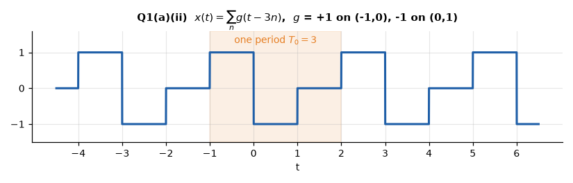
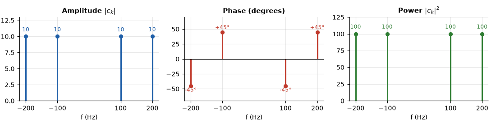
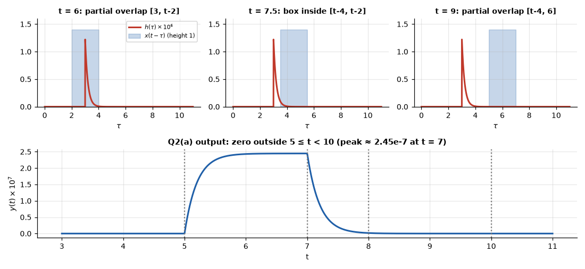
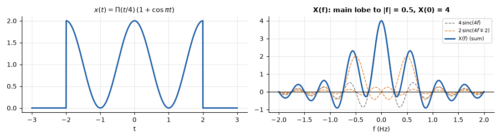
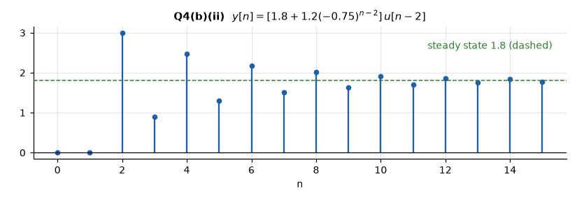

# SC3102 Past Paper Solutions: Semester 1, AY2023/24 (Nov/Dec 2023)

Paper: `../CE3102-23S1(1).pdf` · 4 questions × 25 marks · 2 hours · all questions compulsory

These are my own worked solutions; there is no official answer key. Every numerical answer was re-checked by
computer (numerical convolution, FFT, `sympy` Laplace inverses, and simulating each difference equation), and
the figures in `figs/` are drawn from the final formulas (`make_figures.py`).
Slide references use the PDF page number in `SC3102/Slides/`. The whole-course map is in [00_Exam_Guide.md](00_Exam_Guide.md).

<b>Answer key: final answers only (open after attempting)</b>

| Part | Final answer |
|---|---|
| 1(a)(i) | $x(t+3)=x(t)$ (re-index $m=n-1$), so $T_0=3$ s |
| 1(a)(ii) | Over one period, $+1$ on $(-1,0)$, $-1$ on $(0,1)$, $0$ on $(1,2)$. $P=2/3$, $E=\infty$, so it's a **power signal** |
| 1(b) | $y=20\cos(200\pi t-\frac{\pi}{4})+20\cos(400\pi t+\frac{\pi}{4})$. Lines of amplitude 10 at $\pm100,\pm200$ Hz, power $\lvert c\rvert^2=100$ each (total 400) |
| 1(c) | Time-invariant but **not linear**, so **not LTI** |
| 2(a) | $0$ for $t<5$; $\frac45(e^{-15}-e^{-5(t-2)})$ on $[5,7)$; $\frac45(e^{-5(t-4)}-e^{-5(t-2)})$ on $[7,8)$; $\frac45(e^{-5(t-4)}-e^{-30})$ on $[8,10)$; $0$ for $t\ge10$ |
| 2(b) | $y=0.2\cos(4t-53.13^\circ)-0.1170\sin(8t-69.44^\circ)$ |
| 2(c) | $X(f)=4\,\mathrm{sinc}(4f)+2\,\mathrm{sinc}(4f-2)+2\,\mathrm{sinc}(4f+2)=\dfrac{\sin(4\pi f)\,(8f^2-1)}{\pi f\,(4f^2-1)}$ |
| 3(a) | $y(t)=(3-2e^{-t/2})\,u(t)$ |
| 3(b)(i) | Zero at $s=0.5$, pole at $s=-1$, ROC $\mathrm{Re}(s)>-1$. **Stable** |
| 3(b)(ii) | $y(t)=(-1+3e^{-t})\,u(t)$ |
| 3(b)(iii) | $y_{ss}(t)=-1+2.766\cos(2t+40.6^\circ)$ |
| 4(a)(i) | $W_{kn}=e^{-j2\pi kn/5}=1\angle(-72^\circ\cdot kn)$ (matrix below) |
| 4(a)(ii) | Row 4 = complex conjugate of row 1 (same frequency, opposite rotation), so $c_4=c_1^*$ for real $x$ |
| 4(b)(i) | $y_{ss}=3H(1)=3(0.6)=1.8$ |
| 4(b)(ii) | $y[n]=[\,\underbrace{1.8}_{\text{steady}}+\underbrace{1.2(-0.75)^{n-2}}_{\text{transient}}\,]\,u[n-2]$ |

---

## Question 1 (Signals)

### 1(a)(i) Prove $x(t)=\sum_{n=-\infty}^{\infty}g(t-3n)$ is periodic; find $T_0$ (5 marks)

**Topic:** definition of periodicity (Signals p.9–10). You must show $x(t+T)=x(t)$ for **all** $t$.

1. Shift the whole signal by 3:
   $$x(t+3)=\sum_{n=-\infty}^{\infty}g(t+3-3n)=\sum_{n=-\infty}^{\infty}g\big(t-3(n-1)\big).$$
2. Let $m=n-1$. As $n$ runs over every integer, so does $m$, so the sum is unchanged:
   $$x(t+3)=\sum_{m=-\infty}^{\infty}g(t-3m)=x(t)\quad\text{for all }t.$$
3. So $x$ is periodic with period 3. For an **arbitrary** $g$, no smaller shift is guaranteed to work: the copies of $g$ are placed 3 apart and nothing else is known about $g$.

**Answer:** periodic, with fundamental period $T_0=3$ s.

> Fine print: for special choices of $g$, $T_0$ can be smaller (for example, if $g$ is constant, $x$ is constant). Part (ii) confirms $T_0=3$ for the given $g$.

### 1(a)(ii) $g(t)=u(t+1)-2u(t)+u(t-1)$: sketch $x(t)$; power signal? (7 marks)

**Topic:** singularity functions (Signals p.43–52), power signals (Signals p.17–21).

1. **Read off $g$** by adding the steps left to right:

   | interval | $u(t+1)$ | $-2u(t)$ | $u(t-1)$ | $g(t)$ |
   |---|---|---|---|---|
   | $t<-1$ | 0 | 0 | 0 | 0 |
   | $-1<t<0$ | 1 | 0 | 0 | **+1** |
   | $0<t<1$ | 1 | −2 | 0 | **−1** |
   | $t>1$ | 1 | −2 | 1 | 0 |

   So $g$ is a $+1$ box on $(-1,0)$ followed by a $-1$ box on $(0,1)$. It's 2 s wide.
2. **Place copies every 3 s.** The width is 2 and the spacing is 3, so the copies **don't overlap** and there's a 1 s gap of zeros between them. One period, on $[-1,2)$, is $+1$, then $-1$, then $0$.

   

3. **Energy:** each period contributes $\int|x|^2=1+1=2$, and there are infinitely many periods, so $E=\infty$. It can't be an energy signal.
4. **Power** (periodic, so average over one period):
   $$P=\frac{1}{T_0}\int_{-1}^{2}|x(t)|^2dt=\frac13\big(1^2\cdot1+(-1)^2\cdot1+0\big)=\frac23.$$

**Answer:** $0<P=\tfrac23<\infty$, so $x(t)$ **is a power signal**. (Every periodic, non-zero signal is a power signal, as on Signals p.17.)

### 1(b) Double-sided amplitude and power spectra of $y(t)=40\sin(100\pi t+\frac{3\pi}{4})\cos(300\pi t)$ (6 marks)

**Topic:** spectra (Signals p.37–42), power spectral density (Transforms p.57–61).

1. **Product to sum.** Use $\sin A\cos B=\tfrac12[\sin(A+B)+\sin(A-B)]$:
   $$y=20\sin\!\big(400\pi t+\tfrac{3\pi}{4}\big)+20\sin\!\big(-200\pi t+\tfrac{3\pi}{4}\big)=20\sin\!\big(400\pi t+\tfrac{3\pi}{4}\big)-20\sin\!\big(200\pi t-\tfrac{3\pi}{4}\big).$$
2. **Convert to cosines** (the course writes spectra from $a\cos(\omega t+\theta)$; Signals p.39):
   - $20\sin(400\pi t+\frac{3\pi}{4})=20\cos(400\pi t+\frac{3\pi}{4}-\frac{\pi}{2})=20\cos(400\pi t+\frac{\pi}{4})$.
   - $-20\sin\phi=20\cos(\phi+\frac{\pi}{2})$, so $-20\sin(200\pi t-\frac{3\pi}{4})=20\cos(200\pi t-\frac{\pi}{4})$.
   $$\boxed{y(t)=20\cos\!\big(2\pi(100)t-\tfrac{\pi}{4}\big)+20\cos\!\big(2\pi(200)t+\tfrac{\pi}{4}\big)}$$
3. **Split into the double-sided spectrum.** $a\cos(\omega t+\theta)=\frac a2e^{j\theta}e^{j\omega t}+\frac a2e^{-j\theta}e^{-j\omega t}$, so each cosine gives two lines of height $a/2=10$:

   | $f$ (Hz) | −200 | −100 | +100 | +200 |
   |---|---|---|---|---|
   | amplitude $\lvert c_k\rvert$ | 10 | 10 | 10 | 10 |
   | phase | $-\pi/4$ | $+\pi/4$ | $-\pi/4$ | $+\pi/4$ |
   | power $\lvert c_k\rvert^2$ | 100 | 100 | 100 | 100 |

4. **Power spectrum:** $S_y(f)=\sum|c_k|^2\delta(f-f_k)=100[\delta(f\pm100)+\delta(f\pm200)]$ (Transforms p.59).
   **Check with Parseval:** total power $=\sum|c_k|^2=400$, which equals $\frac{20^2}{2}+\frac{20^2}{2}=400$ ✓.

> **Trap:** there is no line at 50 or 150 Hz. The product shifts the 50 Hz sine to $150\pm50$ Hz.

### 1(c) Is $y(t)=2\sin(x(t))$ LTI? (7 marks)

**Topic:** linearity and time invariance tests (Systems p.11–19).

1. **Linearity: fails.** Let $y_1=2\sin x_1$ and $y_2=2\sin x_2$. The input $a_1x_1+a_2x_2$ gives
   $$2\sin(a_1x_1+a_2x_2)\neq a_1\,2\sin x_1+a_2\,2\sin x_2\quad\text{in general.}$$
   *Counterexample:* $x(t)=\frac{\pi}{2}$ gives $y=2$. Doubling the input to $x=\pi$ gives $y=2\sin\pi=0\neq4$. Homogeneity fails.
2. **Time invariance: holds.** Feed in $x(t-t_0)$. The output is $2\sin(x(t-t_0))$, which is exactly $y(t-t_0)$. The system has no explicit $t$ in it.

**Answer:** time-invariant but **nonlinear, so not LTI**. (It's also memoryless, causal and BIBO stable, since $|y|\le2$.)

---

## Question 2 (Systems and Fourier transforms)

### 2(a) Graphical convolution: $h(t)=4e^{-5t}[u(t-3)-u(t-6)]$, $x(t)=\Pi\left(\frac{t-3}{2}\right)$ (9 marks)

**Topic:** graphical convolution (Systems p.37–42). This is the same question as **Tutorial 3 Ex 3(f)**, and the
official tutorial answer key has the wrong case boundaries: see [Tutorial3_Solutions.md](../../Tut/Part1/Tutorial3_Solutions.md).

1. **Sketch both signals.** $h$ is a decaying exponential on $[3,6)$ only. Its largest value is $4e^{-15}\approx1.2\times10^{-6}$ at $\tau=3$. The input $x$ is a box of height 1, centred at 3 with width 2, so it occupies $[2,4]$.
2. **Keep $h(\tau)$ fixed; flip and slide $x$.** Use $y(t)=\int h(\tau)\,x(t-\tau)\,d\tau$. Since $x(t-\tau)=1$ when $2\le t-\tau\le4$, the flipped box sits on
   $$\tau\in[\,t-4,\;t-2\,].$$
3. **Overlap with $h$'s support $[3,6]$:** the lower limit is $\max(3,t-4)$ and the upper limit is $\min(6,t-2)$. Here is one case per arrangement, using $\int4e^{-5\tau}d\tau=-\frac45e^{-5\tau}$:

   | Case | Picture | Limits | $y(t)$ |
   |---|---|---|---|
   | $t<5$ | box entirely left of 3 ($t-2<3$) | none | $0$ |
   | $5\le t<7$ | box entering | $[3,\ t-2]$ | $\frac45\left(e^{-15}-e^{-5(t-2)}\right)$ |
   | $7\le t<8$ | box fully inside | $[t-4,\ t-2]$ | $\frac45\left(e^{-5(t-4)}-e^{-5(t-2)}\right)$ |
   | $8\le t<10$ | box leaving | $[t-4,\ 6]$ | $\frac45\left(e^{-5(t-4)}-e^{-30}\right)$ |
   | $t\ge10$ | box entirely right of 6 ($t-4\ge6$) | none | $0$ |

4. **Sanity checks.** The output starts at $t=3+2=5$ (the start of $h$ plus the start of $x$) and ends at $6+4=10$ (the end of $h$ plus the end of $x$), and the duration is $3+2=5$ ✓. Each piece agrees with its neighbour at the boundaries (for example, at $t=7$ both formulas give $\frac45(e^{-15}-e^{-25})$).

> The numbers are tiny ($\sim10^{-7}$) because $e^{-5t}$ has already decayed by $t=3$. That's expected; don't "fix" it. In the exam, draw the shape and label the breakpoints 5, 7, 8 and 10.

### 2(b) $h(t)=e^{-3t}u(t)$, $x(t)=\cos 4t-\sin 8t$: output by frequency-domain analysis (5 marks)

**Topic:** an LTI system's response to sinusoids, i.e. the frequency response (Systems p.49–52, Transforms p.62).
A sinusoid of frequency $\omega$ comes out scaled by $|H(\omega)|$ and shifted by $\angle H(\omega)$.

1. $H(\omega)=\mathcal F\{e^{-3t}u(t)\}=\dfrac{1}{3+j\omega}$ (the given pair with $a=3$).
2. At $\omega=4$: $H=\dfrac{1}{3+j4}$, so $|H|=\dfrac15=0.2$ and $\angle H=-\tan^{-1}\frac43=-53.13^\circ=-0.927$ rad.
3. At $\omega=8$: $H=\dfrac{1}{3+j8}$, so $|H|=\dfrac{1}{\sqrt{73}}=0.1170$ and $\angle H=-\tan^{-1}\frac83=-69.44^\circ=-1.212$ rad.
4. Apply each gain to its own term (by linearity):
   $$\boxed{y(t)=0.2\cos(4t-53.13^\circ)-0.1170\sin(8t-69.44^\circ)}$$

(The input is an everlasting sinusoid, so this is the whole output. There's no transient.)

### 2(c)(i) Fourier transform of $x(t)=\Pi(t/4)\,[1+\cos\pi t]$ by the convolution theorem (6 marks)

**Topic:** multiplication ↔ convolution (Transforms p.33), and convolving with impulses = shifting (Transforms p.46–47).

> **Note on the paper's hint:** it says $\mathrm{sinc}(x)=\frac{\sin x}{x}$, but the pair $\Pi(t/T)\leftrightarrow T\,\mathrm{sinc}(fT)$ is only true with the course's definition $\mathrm{sinc}(x)=\frac{\sin\pi x}{\pi x}$ (Transforms p.21). That's the definition used below.

1. **Product in time ⇒ convolution in frequency:** $X(f)=\mathcal F\{\Pi(t/4)\}*\mathcal F\{1+\cos\pi t\}$.
2. $\mathcal F\{\Pi(t/4)\}=4\,\mathrm{sinc}(4f)$ (the pair with $T=4$).
3. $\cos\pi t=\cos(2\pi\cdot\tfrac12\,t)$, so $f_0=\tfrac12$. Then $\mathcal F\{1+\cos\pi t\}=\delta(f)+\tfrac12\delta(f-\tfrac12)+\tfrac12\delta(f+\tfrac12)$.
4. Convolving with $\delta(f-f_0)$ shifts the function to $f_0$:
   $$X(f)=4\,\mathrm{sinc}(4f)+2\,\mathrm{sinc}\big(4(f-\tfrac12)\big)+2\,\mathrm{sinc}\big(4(f+\tfrac12)\big).$$
5. **Simplify** (optional, but it makes (ii) easy to compare). Since $\sin(4\pi f\mp2\pi)=\sin4\pi f$:
   $$X(f)=\frac{\sin4\pi f}{\pi}\left[\frac1f+\frac{1}{2f-1}+\frac{1}{2f+1}\right]=\boxed{\frac{\sin(4\pi f)\,(8f^2-1)}{\pi f\,(4f^2-1)}}$$
   **Check:** $X(0)=4$, which equals the area $\int_{-2}^{2}(1+\cos\pi t)\,dt=4$ ✓.

### 2(c)(ii) Verify with $X(f)=\int x(t)e^{-j2\pi ft}dt$ (5 marks)

1. $x$ is non-zero only on $[-2,2]$, so
   $$X(f)=\int_{-2}^{2}e^{-j2\pi ft}dt+\tfrac12\int_{-2}^{2}e^{-j2\pi(f-\frac12)t}dt+\tfrac12\int_{-2}^{2}e^{-j2\pi(f+\frac12)t}dt,$$
   after writing $\cos\pi t=\frac12(e^{j\pi t}+e^{-j\pi t})$.
2. Each integral has the form $\int_{-2}^{2}e^{-j2\pi\nu t}dt=\dfrac{e^{-j4\pi\nu}-e^{j4\pi\nu}}{-j2\pi\nu}=\dfrac{\sin(4\pi\nu)}{\pi\nu}=4\,\mathrm{sinc}(4\nu)$.
3. Using $\nu=f$, $f-\frac12$ and $f+\frac12$:
   $$X(f)=4\,\mathrm{sinc}(4f)+\tfrac12\cdot4\,\mathrm{sinc}\big(4(f-\tfrac12)\big)+\tfrac12\cdot4\,\mathrm{sinc}\big(4(f+\tfrac12)\big),$$
   which is identical to (i) ✓. (It was also checked numerically at $f=0.1,0.3,0.7,1.3$.)

---

## Question 3 (Laplace transform)

### 3(a) $2y'(t)+y(t)=3u(t)$, $y(0)=1$ (7 marks)

**Topic:** unilateral Laplace transform with initial conditions, $\mathcal L\{y'\}=sY-y(0^-)$ (L6 `lecture(5)` p.42–43).

1. Transform both sides:
   $$2\big(sY(s)-1\big)+Y(s)=\frac3s.$$
2. Solve for $Y$:
   $$Y(s)(2s+1)=\frac3s+2\;\Rightarrow\;Y(s)=\frac{2s+3}{s(2s+1)}=\frac{s+\frac32}{s\,(s+\frac12)}.$$
3. Partial fractions, $\frac{A}{s}+\frac{B}{s+1/2}$:
   - $A=\left.\frac{s+3/2}{s+1/2}\right|_{s=0}=\frac{3/2}{1/2}=3$
   - $B=\left.\frac{s+3/2}{s}\right|_{s=-1/2}=\frac{1}{-1/2}=-2$
4. Invert:

**Answer:** $\boxed{y(t)=(3-2e^{-t/2})\,u(t)}$

**Checks:** $y(0)=3-2=1$ ✓. $y'=e^{-t/2}$, so $2y'+y=2e^{-t/2}+3-2e^{-t/2}=3$ ✓.

### 3(b) $H(s)=\dfrac{s-0.5}{s+1}$, causal, zero initial conditions

#### (i) Pole-zero diagram, ROC, stability (6 marks)
**Topic:** ROC of rational transforms and stability (L5 `lecture(4)` p.39, 57; L6 `lecture(5)` p.36–38).

1. Zero: $s-0.5=0$ gives $s=0.5$. Pole: $s+1=0$ gives $s=-1$.
2. **Causal** ⇒ the ROC is the right half-plane to the right of the rightmost pole: $\mathrm{Re}(s)>-1$.
3. **Stable** ⇔ the ROC contains the $j\omega$-axis. Here $-1<0$, so it does. (Equivalently: a causal system is stable when all poles are in the left half-plane.)

**Answer:** stable. The zero in the right half-plane does **not** affect stability (it only makes the system "non-minimum phase").

#### (ii) Output for $x(t)=2u(t)$ (6 marks)
1. $X(s)=\frac2s$, so $Y(s)=H(s)X(s)=\dfrac{2(s-0.5)}{s(s+1)}$.
2. Partial fractions: $A=\left.\frac{2(s-0.5)}{s+1}\right|_{0}=-1$ and $B=\left.\frac{2(s-0.5)}{s}\right|_{-1}=\frac{2(-1.5)}{-1}=3$.
3. $Y=-\frac1s+\frac{3}{s+1}$, which inverts to

**Answer:** $\boxed{y(t)=(-1+3e^{-t})\,u(t)}$. The transient is $3e^{-t}$; the steady state is $-1$.

**Checks:** the steady state is $2H(0)=2(-0.5)=-1$ ✓, and $y(0^+)=2H(\infty)=2$ ✓ (initial value theorem).

#### (iii) Steady state for $x(t)=2u(t)+3\cos(2t)u(t)$ (6 marks)
**Topic:** sinusoidal steady state via $H(j\omega)$ (L6 `lecture(5)` p.24). This is valid because the system is stable, so every transient term $e^{-t}$ dies.

1. DC part: $2H(0)=2\cdot\frac{-0.5}{1}=-1$.
2. The cosine at $\omega=2$:
   $$H(j2)=\frac{-0.5+j2}{1+j2},\quad|H|=\frac{\sqrt{0.25+4}}{\sqrt{1+4}}=\sqrt{0.85}=0.9220,$$
   $$\angle H=\angle(-0.5+j2)-\angle(1+j2)=(180^\circ-75.96^\circ)-63.43^\circ=40.60^\circ\;(0.709\text{ rad}).$$
   (The numerator is in the 2nd quadrant, so its angle is $180^\circ-\tan^{-1}4$, not $-\tan^{-1}4$.)
3. Combine:

**Answer:** $\boxed{y_{ss}(t)=-1+2.766\cos(2t+40.6^\circ)}$, since $3\times0.922=2.766$.

---

## Question 4 (Discrete time: DTFS, difference equations, Z)

### 4(a)(i) DTFS analysis matrix $W$ for $N=5$, with $c=\frac1N Wx$, in polar form (5 marks)

**Topic:** DFT/DTFS as a matrix (L1 `lecture.pdf` p.40–53; L2 `lecture(1).pdf` p.13). In the current slides $W=G^{H}$.
This paper puts the $1/N$ in the analysis equation; the current slides put it in synthesis. $W$ is the same either way.

1. Row $k$, column $n$: $W_{kn}=e^{-j2\pi kn/5}=1\angle\!\left(-\frac{2\pi}{5}kn\right)=1\angle(-72^\circ\cdot kn)$.
2. Angles repeat every $360^\circ$, so only $kn\bmod5$ matters: $0\to0^\circ$, $1\to-72^\circ$, $2\to-144^\circ$, $3\to-216^\circ\equiv+144^\circ$, $4\to-288^\circ\equiv+72^\circ$.

$$
W=\begin{bmatrix}
1\angle0^\circ & 1\angle0^\circ & 1\angle0^\circ & 1\angle0^\circ & 1\angle0^\circ\\
1\angle0^\circ & 1\angle{-72^\circ} & 1\angle{-144^\circ} & 1\angle144^\circ & 1\angle72^\circ\\
1\angle0^\circ & 1\angle{-144^\circ} & 1\angle72^\circ & 1\angle{-72^\circ} & 1\angle144^\circ\\
1\angle0^\circ & 1\angle144^\circ & 1\angle{-72^\circ} & 1\angle72^\circ & 1\angle{-144^\circ}\\
1\angle0^\circ & 1\angle72^\circ & 1\angle144^\circ & 1\angle{-144^\circ} & 1\angle{-72^\circ}
\end{bmatrix}
$$

(In radians the angles are $0,\ \mp\frac{2\pi}{5},\ \mp\frac{4\pi}{5}$.)

### 4(a)(ii) Rows 1 and 4: characteristics and relationship (5 marks)

- **Row 1:** $e^{-j2\pi n/5}$, $n=0..4$. All entries have magnitude 1, and the phase steps by $-72^\circ$ each sample (a phasor turning clockwise once over the 5 samples). It picks out the harmonic $\Omega_1=2\pi/5$.
- **Row 4:** $e^{-j2\pi 4n/5}=e^{-j2\pi(5-1)n/5}=e^{+j2\pi n/5}$. Its phase steps by $+72^\circ$, the same speed in the opposite direction. So $\Omega_4=8\pi/5\equiv-2\pi/5$: it's the **negative-frequency twin** of row 1.
- **Relationship:** $\text{row }4=(\text{row }1)^*$, and in general $W_{N-k,n}=W_{k,n}^*$. You can also see it as row 4 = row 1 with entries 1–4 in reverse order.
- **Consequences:**
  - For real $x$, $c_4=c_1^*$ (conjugate symmetry): equal magnitudes, opposite phases. Together they make one real sinusoid $2|c_1|\cos(\frac{2\pi}{5}n+\angle c_1)$.
  - Rows 1 and 4 are orthogonal: $\sum_n e^{-j2\pi n/5}\big(e^{j2\pi n/5}\big)^*=\sum_n e^{-j4\pi n/5}=0$.
  - Each row (other than row 0) sums to 0.

### 4(b) $y[n]=x[n]+0.05x[n-1]-0.75y[n-1]$, causal and relaxed

First get the transfer function (L4 `lecture(3).pdf` p.29). Transform with $x[n-1]\to z^{-1}X$:
$$H(z)=\frac{1+0.05z^{-1}}{1+0.75z^{-1}}=\frac{z+0.05}{z+0.75},\qquad\text{pole }-0.75,\ \text{zero }-0.05.$$
Causal gives ROC $|z|>0.75$, which contains the unit circle, so the system is **stable** and its frequency response exists.

#### (i) Steady state for $x[n]=3u[n]$ by frequency-domain analysis (6 marks)
1. A step settles to a constant, which is the frequency $\Omega=0$, i.e. $z=e^{j0}=1$.
2. $H(e^{j0})=H(1)=\dfrac{1+0.05}{1+0.75}=\dfrac{1.05}{1.75}=0.6$.
3. $y_{ss}=3\times0.6=$ **1.8**.

#### (ii) $y[n]$ for $x[n]=3u[n-2]$ by Z-transform; transient and steady parts (9 marks)
1. Delay property: $X(z)=3z^{-2}\dfrac{z}{z-1}$, so $Y(z)=z^{-2}\,W(z)$ with
   $$W(z)=\frac{3z(z+0.05)}{(z-1)(z+0.75)}\quad(\text{the response to the undelayed }3u[n]).$$
2. Partial fractions on $W(z)/z$:
   $$\frac{W(z)}{z}=\frac{3(z+0.05)}{(z-1)(z+0.75)}=\frac{A}{z-1}+\frac{B}{z+0.75}$$
   - $A=\frac{3(1.05)}{1.75}=1.8$
   - $B=\frac{3(-0.7)}{-1.75}=1.2$
3. So $W(z)=1.8\frac{z}{z-1}+1.2\frac{z}{z+0.75}$, which gives $w[n]=[1.8+1.2(-0.75)^n]u[n]$ (ROC $|z|>1$, so right-sided).
4. $z^{-2}$ means a delay of 2:

**Answer:** $\boxed{y[n]=\big[\,1.8+1.2(-0.75)^{n-2}\,\big]\,u[n-2]}$
- **Steady state:** $1.8\,u[n-2]$. It matches (i): the same final value, just 2 samples later.
- **Transient:** $1.2(-0.75)^{n-2}u[n-2]$. It decays because $|-0.75|<1$, and it alternates in sign because the pole is negative.

**Check by recursion:** $y[0]=y[1]=0$, $y[2]=3$, $y[3]=3+0.15-2.25=0.9$. The formula gives $1.8+1.2=3$ ✓ and $1.8-0.9=0.9$ ✓.

