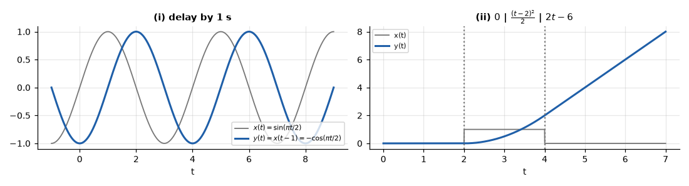
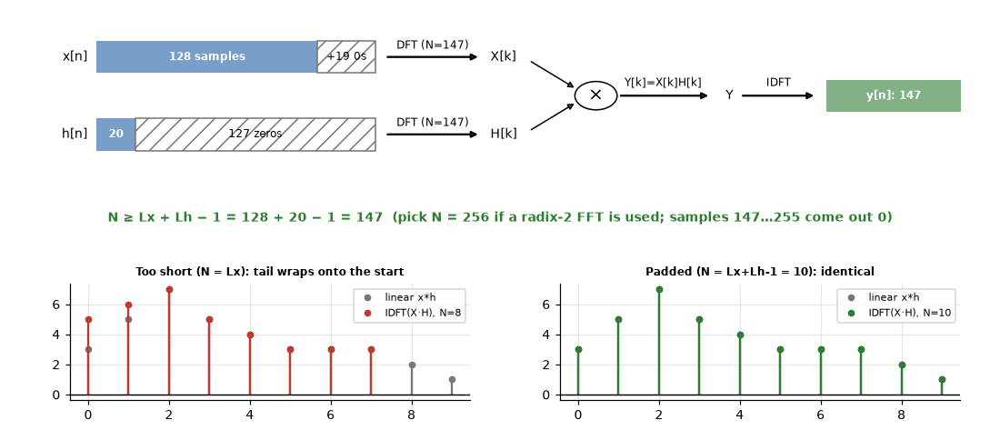
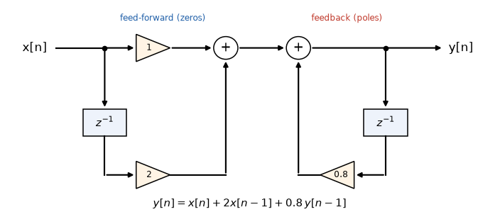

# SC3102 Past Paper Solutions: Semester 2, AY2023/24 (Apr/May 2024)

Paper: `../CE3102-23S2.pdf` · 4 questions × 25 marks · 2 hours · all questions compulsory

These are my own worked solutions; there is no official answer key. All numbers were re-checked by computer, and
the figures in `figs/` are generated from the final formulas (`make_figures.py`). Slide references use PDF page
numbers in `SC3102/Slides/`. The whole-course map is in [00_Exam_Guide.md](00_Exam_Guide.md).

<b>Answer key: final answers only (open after attempting)</b>

| Part | Final answer |
|---|---|
| 1(a) | Periodic: $e^{j100\pi T}=1\Rightarrow T=k/50$, so $T_0=1/50=0.02$ s |
| 1(b)(i) | $x(t)=r(t+2)-r(t)-4u(t-2)+r(t-2)-r(t-4)+u(t-4)+u(t-6)-2u(t-7)$ |
| 1(b)(ii) | $E=\frac83+8+\frac83+2+4=\frac{58}{3}\approx19.33$, finite and non-zero, so an **energy signal** ($P=0$) |
| 1(c) | **Valid**: even, $x(0)=5\ge\lvert x(\tau)\rvert$, $S(f)=3\delta(f)+\delta(f-f_0)+\delta(f+f_0)\ge0$ |
| 2(a) | **Nonlinear** (because of $K\ne0$) and **time-variant** (because of $g(t)$) |
| 2(b)(i) | $y(t)=\sin\left(\frac{\pi(t-1)}{2}\right)=-\cos\left(\frac{\pi t}{2}\right)$ |
| 2(b)(ii) | $0$ for $t<2$; $\frac{(t-2)^2}{2}$ for $2\le t<4$; $2t-6$ for $t\ge4$ |
| 2(c) | $X(f)=\frac{AT}{2}\{\mathrm{sinc}[T(f-f_c)]+\mathrm{sinc}[T(f+f_c)]\}$: two sinc lobes of peak $AT/2$ at $\pm f_c$, nulls at $\pm f_c\pm k/T$ |
| 3(a) | $h(t)=\frac12e^{-1.5t}u(t)$ |
| 3(b)(i) | Zero at $s=0$, pole at $s=-1.5$, ROC $\mathrm{Re}(s)>-1.5$. **Stable** |
| 3(b)(ii) | $y(t)=2\delta(t)+3e^{-1.5t}u(t)$ |
| 3(c) | $X(s)=\int_0^\infty x(t)e^{-st}dt$ is the CTFT of $x(t)e^{-\sigma t}u(t)$; $X(\omega)=X(s)\vert_{s=j\omega}$ if the $j\omega$-axis is in the ROC |
| 4(a) | Zero-pad both to $N\ge128+20-1=147$, then DFT, multiply, IDFT. Without padding, the last 19 samples wrap onto the first 19 |
| 4(b) | $x[n]=\{1,\,-2,\,3,\,1\}$ |
| 4(c)(i) | $y[n]=x[n]+2x[n-1]+0.8y[n-1]$ (Direct Form I diagram below) |
| 4(c)(ii) | $y[n]=-5\delta[n]+7(0.8)^nu[n]$, so $y[0..4]=2,\ 5.6,\ 4.48,\ 3.584,\ 2.8672$ |

---

## Question 1 (Signals)

### 1(a) Is $x(t)=e^{j100\pi t}$ periodic? Find $T_0$ (5 marks)

**Topic:** definition of periodicity (Signals p.9–12, 34–35).

1. Periodic means there is a $T>0$ with $x(t+T)=x(t)$ for all $t$:
   $$e^{j100\pi(t+T)}=e^{j100\pi t}\,e^{j100\pi T}=e^{j100\pi t}\iff e^{j100\pi T}=1.$$
2. $e^{j\theta}=1$ exactly when $\theta=2\pi k$. So $100\pi T=2\pi k$, giving $T=\dfrac{k}{50}$ for $k=1,2,\dots$
3. The smallest positive value is at $k=1$.

**Answer:** periodic, $T_0=\frac{1}{50}=0.02$ s ($f_0=50$ Hz). It's a rotating phasor that completes one turn every 0.02 s.

### 1(b)(i) Express Figure Q1(b) with singularity functions (7 marks)

**Topic:** building signals from steps and ramps (Signals p.43–52).
**Method:** walk from left to right. Every **corner** adds a ramp $\Delta(\text{slope})\cdot r(t-t_0)$, and every **jump** adds a step $\Delta(\text{value})\cdot u(t-t_0)$.

Reading the figure: a ramp from $(-2,0)$ up to $(0,2)$; flat at 2 until $t=2$; a drop to $-2$; a ramp back up to $(4,0)$; a jump to 1, which holds until $t=6$; a jump to 2, which holds until $t=7$; then back to 0.

| $t_0$ | What happens | Term |
|---|---|---|
| −2 | slope $0\to1$ | $+r(t+2)$ |
| 0 | slope $1\to0$ | $-r(t)$ |
| 2 | jump $2\to-2$ (size −4), slope $0\to1$ | $-4u(t-2)+r(t-2)$ |
| 4 | slope $1\to0$, jump $0\to1$ | $-r(t-4)+u(t-4)$ |
| 6 | jump $1\to2$ | $+u(t-6)$ |
| 7 | jump $2\to0$ | $-2u(t-7)$ |

**Answer:**
$$\boxed{x(t)=r(t+2)-r(t)-4u(t-2)+r(t-2)-r(t-4)+u(t-4)+u(t-6)-2u(t-7)}$$

**Check** a point in each interval:
- $t=1$: $3-1=2$ ✓
- $t=3$: $5-3-4+1=-1$ ✓ (halfway up the ramp from −2 to 0)
- $t=5$: $7-5-4+3-1+1=1$ ✓
- $t=8$: $10-8-4+6-4+1+1-2=0$ ✓

The figure below is plotted straight from the expression.

### 1(b)(ii) Prove it's an energy signal (7 marks)

**Topic:** energy and power (Signals p.17–21). Energy signal ⇔ $0<E<\infty$.

$$E=\int_{-\infty}^{\infty}|x(t)|^2dt=\underbrace{\int_{-2}^{0}(t+2)^2dt}_{8/3}+\underbrace{\int_{0}^{2}2^2dt}_{8}+\underbrace{\int_{2}^{4}(t-4)^2dt}_{8/3}+\underbrace{\int_{4}^{6}1^2dt}_{2}+\underbrace{\int_{6}^{7}2^2dt}_{4}$$

- $\int_{-2}^{0}(t+2)^2dt=\left[\frac{(t+2)^3}{3}\right]_{-2}^{0}=\frac83$
- $\int_2^4(t-4)^2dt=\left[\frac{(t-4)^3}{3}\right]_2^4=0-\frac{(-2)^3}{3}=\frac83$

$$E=\frac83+8+\frac83+2+4=\frac{58}{3}\approx19.33$$

**Answer:** $0<E=\frac{58}{3}<\infty$, so it **is an energy signal**. Its power is $P=\lim_{T\to\infty}E/T=0$. (A signal that is bounded and lasts a finite time always has finite energy.)

### 1(c) Is $x(\tau)=3+2\cos(2\pi f_0\tau)$ a valid autocorrelation function? (6 marks)

**Topic:** properties of autocorrelation (Signals p.28), and Wiener–Khinchin: $R\leftrightarrow S$ with $S(f)\ge0$ (Transforms p.57–61).

Check each condition:
1. **Even:** $x(-\tau)=3+2\cos(-2\pi f_0\tau)=x(\tau)$ ✓
2. **Maximum at the origin:** $x(0)=3+2=5$, and $1\le x(\tau)\le5$ for all $\tau$, so $|x(\tau)|\le x(0)$ ✓
3. **Non-negative power spectral density:**
   $$S(f)=\mathcal F\{x(\tau)\}=3\delta(f)+2\cdot\tfrac12[\delta(f-f_0)+\delta(f+f_0)]=3\delta(f)+\delta(f-f_0)+\delta(f+f_0).$$
   Every weight ($3, 1, 1$) is positive, so $S(f)\ge0$ ✓
4. **Periodic with period $1/f_0$:** this is allowed. The autocorrelation of a periodic signal is periodic (Signals p.28).

**Answer:** **valid.** In fact it's the autocorrelation of $x(t)=\sqrt3+2\cos(2\pi f_0t+\theta)$, because $R=(\sqrt3)^2+\frac{2^2}{2}\cos(2\pi f_0\tau)=3+2\cos(2\pi f_0\tau)$.

---

## Question 2 (Systems and Fourier transforms)

### 2(a) $y(t)=g(t)\,x(t)+K$: linear? time-invariant? (7 marks)

**Topic:** this combines the two slide examples $y=g(t)x(t)$ (Systems p.18) and $y=x(t)+K$ (Systems p.19).

1. **Linearity.** Let $y_1=gx_1+K$ and $y_2=gx_2+K$. The input $a_1x_1+a_2x_2$ gives
   $$y_0=g(a_1x_1+a_2x_2)+K,\qquad a_1y_1+a_2y_2=g(a_1x_1+a_2x_2)+(a_1+a_2)K.$$
   These differ whenever $K\neq0$. (A quick test: a linear system must give zero output for zero input, but here $x=0$ gives $y=K$.) So it's **nonlinear**. It would be linear only if $K=0$.
2. **Time invariance.** Delay the input: $x(t-t_0)\mapsto g(t)\,x(t-t_0)+K$. Delay the output: $y(t-t_0)=g(t-t_0)\,x(t-t_0)+K$. These are equal for every $x$ only if $g(t)=g(t-t_0)$ for all $t_0$, i.e. $g$ is constant. For an arbitrary $g(t)$ the system is **time-variant**.

**Answer:** nonlinear (when $K\ne0$) and time-variant (unless $g$ is constant).

### 2(b)(i) $h(t)=\delta(t-1)$, $x(t)=\sin(\pi t/2)$ (5 marks)

**Topic:** convolving with a shifted impulse just shifts the signal (Signals p.56–57): $x(t)*\delta(t-t_0)=x(t-t_0)$.

$$y(t)=x(t-1)=\sin\!\left(\frac{\pi t}{2}-\frac{\pi}{2}\right)=\boxed{-\cos\!\left(\frac{\pi t}{2}\right)}$$
(The system is a pure 1 s delay.)

### 2(b)(ii) $h(t)=t\,u(t)$, $x(t)=u(t-2)-u(t-4)$ (5 marks)

**Topic:** convolution integral (Systems p.30–32, 40–42).

1. $y(t)=\int x(\tau)\,h(t-\tau)\,d\tau=\int_2^4(t-\tau)\,u(t-\tau)\,d\tau$. The factor $u(t-\tau)$ keeps only $\tau<t$.
2. **$t<2$:** no overlap, so $y=0$.
3. **$2\le t<4$:** $\tau$ runs from 2 to $t$:
   $$y=\int_2^t(t-\tau)\,d\tau=\left[-\frac{(t-\tau)^2}{2}\right]_2^t=\frac{(t-2)^2}{2}.$$
4. **$t\ge4$:** $\tau$ runs over the whole box:
   $$y=\int_2^4(t-\tau)\,d\tau=2t-\frac{16-4}{2}=2t-6.$$

**Answer:** $y(t)=\begin{cases}0,&t<2\\ \frac{(t-2)^2}{2},&2\le t<4\\ 2t-6,&t\ge4\end{cases}$

**Shortcut check:** $u*r=\frac{t^2}{2}u(t)$, so $y=\frac12(t-2)^2u(t-2)-\frac12(t-4)^2u(t-4)$. At $t=4$ both pieces give 2 ✓.

### 2(c) Amplitude spectrum of the RF pulse in Figure Q2(c) (8 marks)

**Topic:** the modulation (frequency-shifting) theorem. This is exactly the slide example on Transforms p.39–41, 46–47.

The figure shows the pulse $A\,\Pi(t/T)$ multiplied by $\cos(2\pi f_ct)$, with output amplitude $A$:
$$x(t)=A\,\Pi\!\left(\tfrac tT\right)\cos(2\pi f_ct).$$

1. **Euler:** $\cos(2\pi f_ct)=\frac12\left(e^{j2\pi f_ct}+e^{-j2\pi f_ct}\right)$, so
   $$x(t)=\frac A2\left[\Pi\!\left(\tfrac tT\right)e^{j2\pi f_ct}+\Pi\!\left(\tfrac tT\right)e^{-j2\pi f_ct}\right].$$
2. **Pulse transform:** $\Pi(t/T)\leftrightarrow T\,\mathrm{sinc}(fT)$.
3. **Frequency shift:** $e^{j2\pi f_1t}x(t)\leftrightarrow X(f-f_1)$, applied with $f_1=\pm f_c$, plus linearity:
   $$\boxed{X(f)=\frac{AT}{2}\Big\{\mathrm{sinc}\big[T(f-f_c)\big]+\mathrm{sinc}\big[T(f+f_c)\big]\Big\}}$$
4. **Amplitude spectrum:** $|X(f)|=\frac{AT}{2}\big|\mathrm{sinc}[T(f-f_c)]+\mathrm{sinc}[T(f+f_c)]\big|$. For an RF pulse $f_c\gg1/T$, so the two lobes barely overlap and near $\pm f_c$ you get $|X(f)|\approx\frac{AT}{2}\big|\mathrm{sinc}[T(f\mp f_c)]\big|$:
   - peaks of $\dfrac{AT}{2}$ at $f=\pm f_c$
   - zeros at $f=\pm f_c\pm\dfrac kT$, $k=1,2,\dots$
   - main-lobe width $\dfrac2T$; side lobes decay like $1/|f|$

> The text says the sinusoid has "amplitude $A$" too. If you take that literally, $x(t)=A^2\Pi(t/T)\cos(2\pi f_ct)$ and every height becomes $\frac{A^2T}{2}$. The figure (unit cosine, output peak $A$) matches the slide version above, so state your assumption in one line in the exam.

---

## Question 3 (Laplace transform)

### 3(a) Impulse response of $2y'(t)+3y(t)=x(t)$ (6 marks)

**Topic:** the impulse response of an LCCDE (L6 `lecture(5)` p.25–31). Use zero initial conditions and $x=\delta$, so $X=1$.

1. Transform: $2sY+3Y=X$, so $H(s)=\dfrac{Y}{X}=\dfrac{1}{2s+3}=\dfrac{1/2}{s+1.5}$.
2. Pole at $s=-1.5$. Take the causal choice (ROC $\mathrm{Re}(s)>-1.5$), because the ODE is solved forward in time.
3. $\frac{1}{s+a}\leftrightarrow e^{-at}u(t)$ gives the answer.

**Answer:** $\boxed{h(t)=\tfrac12e^{-1.5t}u(t)}$. This choice is causal and also stable (the pole is in the left half-plane).

### 3(b) $H(s)=\dfrac{2s}{s+1.5}$, causal

#### (i) Pole-zero diagram, ROC, stability (6 marks)
- Zero at $s=0$ (the origin); pole at $s=-1.5$.
- Causal ⇒ ROC $\mathrm{Re}(s)>-1.5$, which includes the $j\omega$-axis ⇒ **stable**.
- The zero at $s=0$ makes $H(0)=0$: the system blocks DC, i.e. it's a **high-pass** filter, with $H(j\infty)=2$.

#### (ii) Output for $x(t)=3u(t)+\delta(t)$ (6 marks)
1. $X(s)=\dfrac3s+1=\dfrac{s+3}{s}$.
2. $Y(s)=\dfrac{2s}{s+1.5}\cdot\dfrac{s+3}{s}=\dfrac{2(s+3)}{s+1.5}$. The $s$ cancels.
3. The degree of the top equals the degree of the bottom, so divide first: $\dfrac{2(s+3)}{s+1.5}=2+\dfrac{2(3-1.5)}{s+1.5}=2+\dfrac{3}{s+1.5}$.
4. Invert: $2\leftrightarrow2\delta(t)$ and $\frac{3}{s+1.5}\leftrightarrow3e^{-1.5t}u(t)$.

**Answer:** $\boxed{y(t)=2\delta(t)+3e^{-1.5t}u(t)}$. The transient is $3e^{-1.5t}$, and the steady state is 0, because DC is blocked: $H(0)=0$.

**Cross-check by superposition:**
- Response to $\delta$: $h=\mathcal L^{-1}\{2-\frac{3}{s+1.5}\}=2\delta(t)-3e^{-1.5t}u(t)$.
- Response to $3u$: $\mathcal L^{-1}\{\frac{6}{s+1.5}\}=6e^{-1.5t}u(t)$.
- Sum: $2\delta(t)+3e^{-1.5t}u(t)$ ✓

### 3(c) Contrast the CTFT and the Laplace transform of $x(t)u(t)$; relate them in the s-plane (7 marks)

**Topic:** L5 `lecture(4)` p.5–19 (the exponential-weighting derivation and the CTFT connection).

| | CTFT | (Unilateral) Laplace |
|---|---|---|
| Definition for $x(t)u(t)$ | $X(\omega)=\displaystyle\int_0^\infty x(t)e^{-j\omega t}dt$ | $X(s)=\displaystyle\int_0^\infty x(t)e^{-st}dt,\quad s=\sigma+j\omega$ |
| Basis signals | undamped phasors $e^{j\omega t}$ | damped/growing phasors $e^{st}=e^{\sigma t}e^{j\omega t}$ |
| Variable | 1-D: real $\omega$ | 2-D: complex $s$ (the s-plane) |
| Exists when | $x$ is absolutely integrable | $\mathrm{Re}(s)$ lies in the ROC |
| Handles $u(t)$, $e^{2t}u(t)$, $t\,u(t)$? | no (or only with impulses) | yes, with a suitable ROC |
| Initial conditions | no | yes: $\mathcal L\{x'\}=sX-x(0^-)$ |

**How they connect:**
1. $X(s)=\displaystyle\int_0^\infty\big[x(t)e^{-\sigma t}\big]e^{-j\omega t}dt$. So **the Laplace transform is the CTFT of the weighted signal $x(t)e^{-\sigma t}u(t)$**. The factor $e^{-\sigma t}$ tames growth, which is why more signals have a Laplace transform.
2. Each vertical line $\mathrm{Re}(s)=\sigma$ in the s-plane is the CTFT of one weighted version of $x$. The ROC is the set of $\sigma$ values where this converges. For a causal $x(t)u(t)$ it's a right half-plane, $\mathrm{Re}(s)>\sigma_0$, to the right of the rightmost pole.
3. Setting $\sigma=0$ gives back the CTFT: $X(\omega)=X(s)\big|_{s=j\omega}$. **This is valid only if the $j\omega$-axis lies inside the ROC** (L5 p.17–19).
4. **Pole positions:** left half-plane ⇒ the term decays; on the $j\omega$-axis ⇒ it persists (a sinusoid or a constant); right half-plane ⇒ it grows. For a causal LTI system: CTFT/frequency response exists ⇔ ROC contains the $j\omega$-axis ⇔ all poles are in the left half-plane ⇔ BIBO stable.

**Examples:**
- $e^{-t}u(t)$: $X(s)=\frac{1}{s+1}$, ROC $\sigma>-1$, which contains the axis, so $X(\omega)=\frac{1}{1+j\omega}$.
- $e^{2t}u(t)$: $X(s)=\frac{1}{s-2}$, ROC $\sigma>2$, which misses the axis, so there is no CTFT.
- $u(t)$: $\frac1s$, ROC $\sigma>0$. The boundary *is* the axis, so the CTFT exists only in the generalised sense (with $\frac12\delta(f)$), not by substituting $s=j\omega$.

---

## Question 4 (Discrete time: DFT, Z, block diagrams)

### 4(a) Linear convolution using the DFT, with zero padding: $x$ has 128 samples, $h$ has 20 (7 marks)

**Topic:** circular vs linear convolution (L2 `lecture(1).pdf` p.14–80; padding on p.58 and the conclusion on p.79).

1. **Target length.** The linear convolution of lengths $L_x$ and $L_h$ has $L_x+L_h-1=128+20-1=\mathbf{147}$ samples.
2. **Why padding is needed.** Multiplying $N$-point DFTs, $X[k]H[k]$, gives **circular** convolution of period $N$. If $N<147$, the output samples beyond $N-1$ wrap around and add onto the start (time-domain aliasing).
3. **Procedure:**
   1. Choose $N\ge147$. (For example $N=147$; with a radix-2 FFT use $N=256$.)
   2. Zero-pad $x$ to length $N$ (append $N-128$ zeros, i.e. 19 for $N=147$) and $h$ to length $N$ (append $N-20$, i.e. 127).
   3. Compute $X[k]=\mathrm{DFT}_N\{x_{pad}\}$ and $H[k]=\mathrm{DFT}_N\{h_{pad}\}$.
   4. Multiply point by point: $Y[k]=X[k]H[k]$, $k=0,\dots,N-1$.
   5. Compute $y[n]=\mathrm{IDFT}_N\{Y[k]\}$. Samples $0..146$ are $x*h$; any extra samples (when $N>147$) are 0.
4. **What goes wrong without padding** ($N=128$): $y_{circ}[n]=\sum_m y_{lin}[n+128m]$. The 19 tail samples $y[128..146]$ land on $y[0..18]$, so only samples $19..127$ are correct.
5. **Why bother:** with an FFT the cost grows like $N\log_2N$ (three FFTs plus $N$ multiplies), while direct convolution costs $L_x\times L_h$ multiplies. For these sizes the direct method ($128\times20=2560$) is actually cheaper. The FFT route wins when **both** sequences are long, e.g. $10^4\times10^4$.

### 4(b) Find $x[n]$ from $X[k]=\{3,\ -2+3j,\ 5,\ -2-3j\}$ (6 marks)

**Topic:** the 4-point IDFT (L1 `lecture.pdf` p.53–56): $x[n]=\frac14\sum_{k=0}^{3}X[k]\,e^{j2\pi kn/4}=\frac14\sum_kX[k]\,j^{kn}$.
Powers of $j$: $j^0=1$, $j^1=j$, $j^2=-1$, $j^3=-j$.

| $n$ | $\frac14\big[X_0+X_1j^n+X_2(-1)^n+X_3(-j)^n\big]$ | $x[n]$ |
|---|---|---|
| 0 | $\frac14[3+(-2+3j)+5+(-2-3j)]=\frac44$ | **1** |
| 1 | $\frac14[3+(-2+3j)j-5+(-2-3j)(-j)]=\frac14[3+(-3-2j)-5+(-3+2j)]$ | **−2** |
| 2 | $\frac14[3-(-2+3j)+5-(-2-3j)]=\frac{12}{4}$ | **3** |
| 3 | $\frac14[3+(-2+3j)(-j)-5+(-2-3j)j]=\frac14[3+(3+2j)-5+(3-2j)]$ | **1** |

**Answer:** $\boxed{x[n]=\{1,\,-2,\,3,\,1\}}$

**Checks:**
- $X[3]=X[1]^*$, so $x$ must be real ✓
- $X[0]=\sum x=3$ ✓
- $X[1]=1-2(-j)+3(-1)+1(j)=-2+3j$ ✓

### 4(c) $H(z)=\dfrac{z+2}{z-0.8}$, causal and relaxed

#### (i) Direct Form I block diagram (5 marks)
1. Rewrite in powers of $z^{-1}$: $H(z)=\dfrac{1+2z^{-1}}{1-0.8z^{-1}}$.
2. Cross-multiply: $Y(1-0.8z^{-1})=X(1+2z^{-1})$.
3. Back to time: $\boxed{y[n]=x[n]+2x[n-1]+0.8\,y[n-1]}$.
4. **Direct Form I:** first the feed-forward (FIR) section, built from delayed inputs (gains $b_0=1$, $b_1=2$; these make the zeros). Then the feedback section, built from delayed outputs (gain $0.8$; this makes the pole). DF-I uses separate delays for $x$ and for $y$: 2 delays here.

> Block diagrams don't appear in the current Part 2 slides (I couldn't find one). This part comes from the older syllabus, so it's lower priority. It's still easy marks if it appears: just read the coefficients off the difference equation.

#### (ii) Response to $x[n]=2\delta[n]$, and $y[0..4]$ (7 marks)
1. $X(z)=2$, so $Y(z)=2H(z)=\dfrac{2(z+2)}{z-0.8}$.
2. Partial fractions on $Y/z$:
   $$\frac{Y}{z}=\frac{2(z+2)}{z(z-0.8)}=\frac{A}{z}+\frac{B}{z-0.8},\qquad A=\frac{2(2)}{-0.8}=-5,\quad B=\frac{2(2.8)}{0.8}=7.$$
3. $Y(z)=-5+7\dfrac{z}{z-0.8}$, with ROC $|z|>0.8$ (causal). Invert using $1\leftrightarrow\delta[n]$ and $\frac{z}{z-a}\leftrightarrow a^nu[n]$:

**Answer:** $\boxed{y[n]=-5\delta[n]+7(0.8)^nu[n]}$

| $n$ | 0 | 1 | 2 | 3 | 4 |
|---|---|---|---|---|---|
| $y[n]$ | $-5+7=$ **2** | **5.6** | **4.48** | **3.584** | **2.8672** |

**Check by recursion** with $y[n]=0.8y[n-1]+x[n]+2x[n-1]$:
- $y[0]=2$
- $y[1]=0.8(2)+0+2(2)=5.6$
- $y[2]=0.8(5.6)=4.48$ ✓

