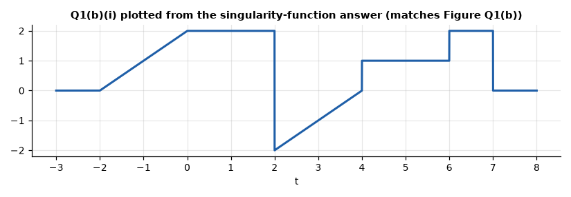
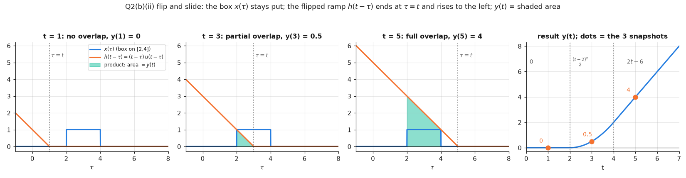
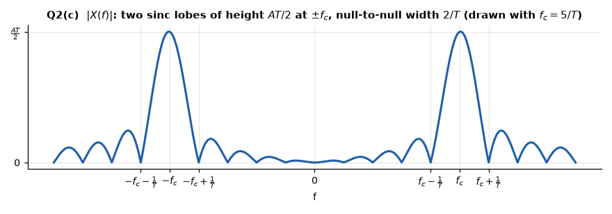
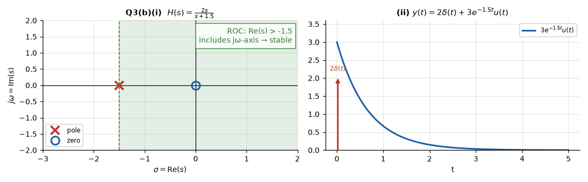
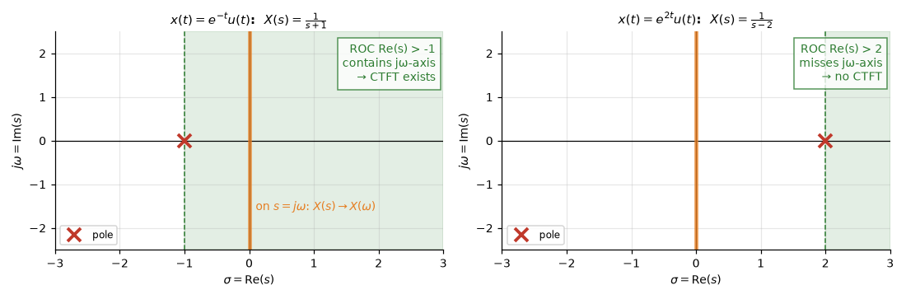
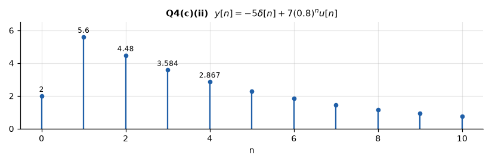

# SC3102 Past Paper Solutions: Semester 2, AY2023/24 (Apr/May 2024)

Paper: `../CE3102-23S2.pdf` · 4 questions × 25 marks · 2 hours · all questions compulsory

These are my own worked solutions; there is no official answer key. All numbers were re-checked by computer.
Most figures come from `make_figures.py`; `23S2_Q2b_slide.png` was drawn separately for this write-up.
Slide references use PDF page numbers in `SC3102/Slides/`. The whole-course map is in [00_Exam_Guide.md](00_Exam_Guide.md).

**How each part is laid out.** Every part has two blocks, in this order:
1. **Exam answer:** what to write on the paper. The question, what's given and asked, each step with the rule it uses, the boxed answer, and a one-line check.
2. **Explanation:** why each step works, what the ideas mean, common traps, and links to other parts. Read it after the exam answer.

<b>Answer key: final answers only (open after attempting)</b>

| Part | Final answer |
|---|---|
| 1(a) | Periodic: $e^{j100\pi T}=1\Rightarrow T=k/50$, so $T_0=1/50=0.02$ s |
| 1(b)(i) | $x(t)=r(t+2)-r(t)-4u(t-2)+r(t-2)-r(t-4)+u(t-4)+u(t-6)-2u(t-7)$ |
| 1(b)(ii) | $E=\frac83+8+\frac83+2+4=\frac{58}{3}\approx19.33$, finite and non-zero, so an **energy signal** ($P=0$) |
| 1(c) | **Valid**: even, $x(0)=5\ge\lvert x(\tau)\rvert$, $S(f)=3\delta(f)+\delta(f-f_0)+\delta(f+f_0)\ge0$ |
| 2(a) | **Nonlinear** (because of $K\ne0$) and **time-variant** (because of $g(t)$) |
| 2(b)(i) | $y(t)=\sin\left(\frac{\pi(t-1)}{2}\right)=-\cos\left(\frac{\pi t}{2}\right)$ |
| 2(b)(ii) | $0$ for $t<2$; $\frac{(t-2)^2}{2}$ for $2\le t<4$; $2t-6$ for $t\ge4$ |
| 2(c) | $X(f)=\frac{AT}{2}\{\mathrm{sinc}[T(f-f_c)]+\mathrm{sinc}[T(f+f_c)]\}$: two sinc lobes of peak $AT/2$ at $\pm f_c$, nulls at $\pm f_c\pm k/T$ |
| 3(a) | $h(t)=\frac12e^{-1.5t}u(t)$ |
| 3(b)(i) | Zero at $s=0$, pole at $s=-1.5$, ROC $\mathrm{Re}(s)>-1.5$. **Stable** |
| 3(b)(ii) | $y(t)=2\delta(t)+3e^{-1.5t}u(t)$ |
| 3(c) | $X(s)=\int_0^\infty x(t)e^{-st}dt$ is the CTFT of $x(t)e^{-\sigma t}u(t)$; $X(\omega)=X(s)\vert_{s=j\omega}$ if the $j\omega$-axis is in the ROC |
| 4(a) | Zero-pad both to $N\ge128+20-1=147$, then DFT, multiply, IDFT. Without padding, the last 19 samples wrap onto the first 19 |
| 4(b) | $x[n]=\{1,\,-2,\,3,\,1\}$ |
| 4(c)(i) | $y[n]=x[n]+2x[n-1]+0.8y[n-1]$ (Direct Form I diagram below) |
| 4(c)(ii) | $y[n]=-5\delta[n]+7(0.8)^nu[n]$, so $y[0..4]=2,\ 5.6,\ 4.48,\ 3.584,\ 2.8672$ |

---

## Question 1 (Signals)

### 1(a) Is $x(t)=e^{j100\pi t}$ periodic? Find $T_0$ (5 marks)

**Topic:** definition of periodicity (Signals p.9–12, 34–35).

#### Exam answer

> *"Using the definition of periodicity, check if the signal $x(t)=e^{j100\pi t}$, where $j=\sqrt{-1}$, is periodic or not. If the signal is periodic, determine its fundamental period $T_0$."*

**Given:** $x(t)=e^{j100\pi t}$. **Asked:** is there a $T>0$ with $x(t+T)=x(t)$ for all $t$? If so, the smallest one, $T_0$.

**Definition used** (Signals p.9–10): $x$ is periodic if some $T>0$ gives $x(t+T)=x(t)$ for **all** $t$. The fundamental period $T_0$ is the smallest such $T$.

1. **Put $t+T$ in place of $t$:**
   $$x(t+T)=e^{j100\pi(t+T)}=e^{j100\pi t+j100\pi T}.$$
2. **Split the exponent** with the exponent rule $e^{a+b}=e^ae^b$:
   $$x(t+T)=e^{j100\pi t}\cdot e^{j100\pi T}=x(t)\,e^{j100\pi T}.$$
3. **Condition.** We need $x(t)\,e^{j100\pi T}=x(t)$ for all $t$. Since $|x(t)|=1$, $x(t)$ is never 0, so divide both sides by it:
   $$e^{j100\pi T}=1.$$
4. **Solve with Euler's formula** $e^{j\theta}=\cos\theta+j\sin\theta$. We need $\cos(100\pi T)=1$ and $\sin(100\pi T)=0$. That happens exactly when the angle is a whole number of turns:
   $$100\pi T=2\pi k\quad\Longrightarrow\quad T=\frac{2\pi k}{100\pi}=\frac{k}{50},\qquad k=1,2,3,\dots$$
5. **Smallest positive value:** $k=1$.

$$\boxed{\text{Periodic, with }T_0=\tfrac{1}{50}=0.02\text{ s}\quad(f_0=50\text{ Hz},\ \omega_0=100\pi\text{ rad/s})}$$

**Check:** $x(0)=e^{0}=1$ and $x(0.02)=e^{j100\pi(0.02)}=e^{j2\pi}=\cos2\pi+j\sin2\pi=1$ ✓. A smaller value fails: $T=0.01$ gives $e^{j\pi}=\cos\pi+j\sin\pi=-1\ne1$.

#### Explanation

- **What the signal is.** $e^{j\theta}=\cos\theta+j\sin\theta$ is the point at angle $\theta$ on a circle of radius 1. Here the angle is $\theta=100\pi t$, which grows steadily with time. So $x(t)$ is an arrow of length 1 spinning anticlockwise at $100\pi$ rad/s, a "rotating phasor" (Signals p.34).
- **The arrow at a few times:**

  | $t$ (s) | 0 | 0.005 | 0.01 | 0.015 | 0.02 |
  |---|---|---|---|---|---|
  | angle $100\pi t$ | $0$ | $\pi/2$ | $\pi$ | $3\pi/2$ | $2\pi$ |
  | $x(t)$ | $1$ | $j$ | $-1$ | $-j$ | $1$ |

  It is back at the start after one full turn, at $t=0.02$.
- **The general formula.** One turn is $2\pi$ rad and the arrow turns $\omega_0=100\pi$ rad every second, so one turn takes $T_0=\dfrac{2\pi}{\omega_0}=\dfrac{2\pi}{100\pi}=0.02$ s. Step 4 is this formula derived from the definition.
- **Why $e^{j\theta}=1$ needs $\theta=2\pi k$.** The real part $\cos\theta$ equals 1 only at $\theta=0,\pm2\pi,\pm4\pi,\dots$, and at those angles $\sin\theta=0$ too.
- **Why dividing by $x(t)$ is allowed.** $|e^{j\theta}|=\sqrt{\cos^2\theta+\sin^2\theta}=\sqrt1=1$, so $x(t)$ is never 0.
- **Why $k=1$ gives the fundamental period.** Every $T=\frac{k}{50}$ is a period: $0.02,\ 0.04,\ 0.06,\dots$ The fundamental period is the smallest positive one. ($k=0$ gives $T=0$, which the definition excludes.)
- **Real and imaginary parts.** $x(t)=\cos(100\pi t)+j\sin(100\pi t)$. Both parts have period $0.02$ s, so they repeat together.
- **When it would not be periodic:**
  - add a real part to the exponent: $e^{(-1+j100\pi)t}$ shrinks, $|x(0)|=1$ but $|x(0.02)|=e^{-0.02}=0.980$;
  - in discrete time, $e^{j\Omega n}$ is periodic only when $\frac{\Omega}{2\pi}$ is a fraction (rational). $e^{jn}$ ($\Omega=1$) never repeats. In continuous time any $e^{j\omega_0t}$ with $\omega_0\ne0$ is periodic.
- **Trap:** stopping at "it's a complex exponential, so it's periodic". The question says "using the definition", so the marks are for steps 1–4.

### 1(b)(i) Express Figure Q1(b) with singularity functions (7 marks)

**Topic:** building signals from steps and ramps (Signals p.43–52).

#### Exam answer

> *"Express the signal $x(t)$ in Figure Q1(b) in terms of singularity functions."*

**Given:** the graph in Figure Q1(b). **Asked:** $x(t)$ as a sum of shifted unit steps $u(t-t_0)$ and unit ramps $r(t-t_0)=(t-t_0)\,u(t-t_0)$.

**Reading the figure** (left to right):
- $t<-2$: 0.
- $-2\le t<0$: a straight line from $(-2,0)$ to $(0,2)$, slope $\frac{2-0}{0-(-2)}=\frac22=1$.
- $0\le t<2$: flat at 2.
- at $t=2$: drops from 2 to $-2$.
- $2\le t<4$: a straight line from $(2,-2)$ to $(4,0)$, slope $\frac{0-(-2)}{4-2}=\frac22=1$.
- at $t=4$: jumps to 1, then flat at 1 until $t=6$.
- at $t=6$: jumps to 2, then flat at 2 until $t=7$.
- at $t=7$: drops to 0, and stays 0.

**Method** (bookkeeping, walking left to right). At each time $t_0$:
- a **change of slope** from $m_1$ to $m_2$ adds $(m_2-m_1)\,r(t-t_0)$;
- a **jump** from value $v_1$ to $v_2$ adds $(v_2-v_1)\,u(t-t_0)$.

| $t_0$ | slope change | jump | terms added |
|---|---|---|---|
| −2 | $0\to1$: $+1$ | none | $+r(t+2)$ |
| 0 | $1\to0$: $-1$ | none | $-r(t)$ |
| 2 | $0\to1$: $+1$ | $2\to-2$: $-4$ | $-4u(t-2)+r(t-2)$ |
| 4 | $1\to0$: $-1$ | $0\to1$: $+1$ | $-r(t-4)+u(t-4)$ |
| 6 | none | $1\to2$: $+1$ | $+u(t-6)$ |
| 7 | none | $2\to0$: $-2$ | $-2u(t-7)$ |

Add every term:
$$\boxed{x(t)=r(t+2)-r(t)-4u(t-2)+r(t-2)-r(t-4)+u(t-4)+u(t-6)-2u(t-7)}$$

**Check** one point in each piece. Once switched on, $r(t-t_0)$ equals $t-t_0$ and $u(t-t_0)$ equals 1:
- $t=1$: only $r(t+2)=3$ and $-r(t)=-1$ are on: $3-1=2$ ✓
- $t=3$: $r(5)-r(3)-4+r(1)=5-3-4+1=-1$ ✓ (halfway up the ramp from −2 to 0)
- $t=5$: $7-5-4+3-1+1=1$ ✓
- $t=6.5$: $8.5-6.5-4+4.5-2.5+1+1=2$ ✓
- $t=8$: $10-8-4+6-4+1+1-2=0$ ✓

The figure below is plotted straight from the boxed expression.

#### Explanation

- **The two building blocks.**
  - $u(t-t_0)$ is 0 before $t_0$ and 1 after. It adds a **jump** of height 1 at $t_0$.
  - $r(t-t_0)=(t-t_0)\,u(t-t_0)$ is 0 before $t_0$, then rises with slope 1. It adds a **bend** (the slope goes up by 1) at $t_0$, with no jump, because it starts from 0.
  - A number in front scales the jump or the slope change.
- **Why "change of slope", not "new slope".** A ramp, once on, keeps rising forever. At $t=0$ the signal goes flat, so the slope must drop from 1 to 0. That needs $-r(t)$ to cancel the earlier $r(t+2)$. Check for $t\ge0$: $r(t+2)-r(t)=(t+2)-t=2$, a constant ✓.
- **A jump and a bend at the same time** ($t=2$ and $t=4$): add both terms. At $t=2$ the value falls by 4 **and** the slope rises from 0 to 1.
- **Jump size = new value − old value** at that instant. At $t=7$: $0-2=-2$. At $t=4$: the ramp has just reached 0, then the signal is 1, so $1-0=+1$.
- **Same signal written with "gates"** (also acceptable). A gate $u(t-a)-u(t-b)$ is 1 on $[a,b)$ and 0 elsewhere, so multiply each piece's formula by its gate:
  $$x=(t+2)[u(t+2)-u(t)]+2[u(t)-u(t-2)]+(t-4)[u(t-2)-u(t-4)]+[u(t-4)-u(t-6)]+2[u(t-6)-u(t-7)].$$
  At $t=3$ only the third gate is on: $3-4=-1$ ✓. (Checked numerically: identical to the boxed answer everywhere.) The boxed form is shorter and is what "singularity functions" usually means.
- **Traps:**
  - the sign inside the shift: $r(t+2)$ starts at $t=-2$ (where $t+2=0$), not at $+2$;
  - writing the second ramp as $r(t-2)-2$: the "$-2$" would then be present for **all** $t$, including before $t=2$. The jump must be a step, $-4u(t-2)$, which only switches on at $t=2$;
  - forgetting to cancel a ramp: without $-r(t-4)$ the signal would keep rising after $t=4$.
- **Link:** (ii) integrates $x^2$ piece by piece, using the same reading of the graph.

### 1(b)(ii) Prove it's an energy signal (7 marks)

**Topic:** energy and power (Signals p.17–21). Energy signal ⇔ $0<E<\infty$.

#### Exam answer

> *"Prove that the signal given in Figure Q1(b) is an energy signal."*

**Given:** $x(t)$ from (i). **Asked:** show that $0<E<\infty$.

**Definitions** (Signals p.17): energy $E=\displaystyle\int_{-\infty}^{\infty}|x(t)|^2dt$. An energy signal has $0<E<\infty$, and then its power $P=0$.

1. **Split at the breakpoints.** $x=0$ outside $[-2,7)$, so only that interval contributes. $x$ is real, so $|x|^2=x^2$:
   $$E=\int_{-2}^{0}(t+2)^2dt+\int_{0}^{2}2^2dt+\int_{2}^{4}(t-4)^2dt+\int_{4}^{6}1^2dt+\int_{6}^{7}2^2dt.$$
   (On $[2,4)$ the line with slope 1 through $(4,0)$ is $x=t-4$. Check: at $t=2$, $2-4=-2$ ✓.)
2. **First ramp.** Substitute $v=t+2$, so $dv=dt$; $t=-2$ gives $v=0$ and $t=0$ gives $v=2$:
   $$\int_{-2}^{0}(t+2)^2dt=\int_0^2v^2\,dv=\left[\frac{v^3}{3}\right]_0^2=\frac{2^3}{3}-\frac{0^3}{3}=\frac83.$$
3. **Second ramp.** Substitute $w=t-4$, so $dw=dt$; $t=2$ gives $w=-2$ and $t=4$ gives $w=0$:
   $$\int_{2}^{4}(t-4)^2dt=\int_{-2}^{0}w^2\,dw=\left[\frac{w^3}{3}\right]_{-2}^{0}=\frac{0^3}{3}-\frac{(-2)^3}{3}=0-\frac{-8}{3}=\frac83.$$
4. **Flat pieces** (constant × length):
   - $\int_0^2 2^2\,dt=4\times2=8$
   - $\int_4^6 1^2\,dt=1\times2=2$
   - $\int_6^7 2^2\,dt=4\times1=4$
5. **Add:**
   $$E=\frac83+8+\frac83+2+4=\frac{16}{3}+14=\frac{16}{3}+\frac{42}{3}=\frac{58}{3}\approx19.33.$$
6. **Power.** $P=\displaystyle\lim_{T\to\infty}\frac1T\int_{-T/2}^{T/2}|x|^2dt$. Once $T/2>7$ the integral is always $\frac{58}{3}$, so $P=\displaystyle\lim_{T\to\infty}\frac{58/3}{T}=0$.

$$\boxed{E=\tfrac{58}{3}\approx19.33:\ 0<E<\infty,\text{ so }x(t)\text{ is an energy signal (and }P=0)}$$

**Check:** numerically integrating $x(t)^2$ from the boxed expression in (i) gives $19.333$ ✓.

#### Explanation

- **What energy means.** Square the signal, then take the total area. Squaring makes the negative stretch count positively, the way a negative voltage still heats a resistor.
- **Why $E$ had to be finite.** The signal is bounded ($|x|\le2$) and lasts a finite time (from $-2$ to $7$, i.e. 9 s). So $E\le2^2\times9=36$. A bounded signal of finite duration always has finite energy. That's the one-line reason; the calculation gives the exact value.
- **Why $E>0$ is part of the proof.** The definition says *nonzero* finite energy. The zero signal has $E=0$ and isn't called an energy signal. Here $E=\frac{58}{3}>0$.
- **Why $P=0$, with numbers.** Power is energy divided by the window length. The window keeps growing but the energy stops at $\frac{58}{3}$: $T=100$ gives $P=0.193$; $T=1000$ gives $0.0193$; the limit is 0. A power signal such as $\cos t$ keeps adding energy every period instead.
- **The negative piece still counts.** On $[2,4)$, $x<0$, but $x^2>0$: at $t=3$, $x=-1$ and $x^2=1$. If you forget to square, you get the net area of the five pieces, $2+4-2+2+2=8$ (the two ramps are triangles of area $\frac12\times2\times2=2$, the second one below the axis), which is not the energy.
- **Squaring the ramp the long way** (to check step 2). Expand first: $(t+2)^2=t^2+4t+4$. Then
  $$\int_{-2}^{0}(t^2+4t+4)\,dt=\left[\frac{t^3}{3}+2t^2+4t\right]_{-2}^{0}=0-\left(\frac{-8}{3}+8-8\right)=\frac83\ ✓.$$
  The trap is writing $(t+2)^2=t^2+4$.
- **Shortcut for a straight piece** from 0 to height $a$ over a length $L$: $\int x^2=\frac{a^2L}{3}$. Both ramps have $a=2$ (in size) and $L=2$: $\frac{4\times2}{3}=\frac83$ ✓.
- **Link:** 25S1 Q1(a)(iii) is the power version (a periodic signal, so divide by the period).

### 1(c) Is $x(\tau)=3+2\cos(2\pi f_0\tau)$ a valid autocorrelation function? (6 marks)

**Topic:** properties of autocorrelation (Signals p.26–28), and Wiener–Khinchin: $R\leftrightarrow S$ with $S(f)\ge0$ (Transforms p.57–61).

#### Exam answer

> *"Determine whether or not $x(\tau)=3+2\cos(2\pi f_0\tau)$ is a valid autocorrelation function. Note: $\cos(2\pi f_0\tau)\overset{FT}{\Leftrightarrow}\frac12[\delta(f-f_0)+\delta(f+f_0)]$, where $\delta(f)$ is unit impulse function."*

**Given:** $x(\tau)=3+2\cos(2\pi f_0\tau)$ and the cosine Fourier pair. **Asked:** can this be the autocorrelation $R(\tau)$ of some signal?

**Conditions an autocorrelation $R(\tau)$ of a real signal must satisfy** (Signals p.26–28, Transforms p.57–61):
1. **Even:** $R(-\tau)=R(\tau)$.
2. **Maximum at the origin:** $|R(\tau)|\le R(0)$, where $R(0)$ is the average power, so $R(0)\ge0$.
3. **Non-negative power spectral density (PSD)** (Wiener–Khinchin theorem): $S(f)=\mathcal F\{R(\tau)\}\ge0$ for every $f$. This is the decisive test.
4. **Periodic part:** if the signal has a periodic part, $R$ has a periodic part with the same period (allowed).

**Check each one:**
1. **Even.** Replace $\tau$ by $-\tau$ and use $\cos(-\theta)=\cos\theta$:
   $$x(-\tau)=3+2\cos(-2\pi f_0\tau)=3+2\cos(2\pi f_0\tau)=x(\tau)\ ✓$$
2. **Maximum at the origin.** $x(0)=3+2\cos0=3+2=5$. Since $-1\le\cos\le1$, $3-2\le x(\tau)\le3+2$, i.e. $1\le x(\tau)\le5$. So $|x(\tau)|\le5=x(0)$ ✓
3. **Spectrum.** Linearity, the pair $1\leftrightarrow\delta(f)$, and the given cosine pair:
   $$S(f)=3\,\mathcal F\{1\}+2\,\mathcal F\{\cos(2\pi f_0\tau)\}=3\delta(f)+2\cdot\tfrac12\big[\delta(f-f_0)+\delta(f+f_0)\big]=3\delta(f)+\delta(f-f_0)+\delta(f+f_0).$$
   Three impulses with areas $3$, $1$, $1$, all positive. So $S(f)\ge0$ for every $f$ ✓
4. **Periodicity.** $x(\tau)$ repeats every $1/f_0$. That's allowed: it means the signal contains a sinusoid at $f_0$ ✓

$$\boxed{\text{Valid: even, }x(0)=5\ge|x(\tau)|,\text{ and }S(f)=3\delta(f)+\delta(f-f_0)+\delta(f+f_0)\ge0}$$

**Check (power two ways):** $R(0)$ is the power, and so is the total area under $S$. $R(0)=5$ and $3+1+1=5$ ✓.

*(Extra, not asked:)* one signal with this autocorrelation is $s(t)=\sqrt3+2\cos(2\pi f_0t+\theta)$, for any phase $\theta$ (derived in the Explanation).

#### Explanation

- **What autocorrelation measures.** $R(\tau)$ compares a signal with a copy of itself shifted by $\tau$: multiply them and average over time. For a power signal, $R(\tau)=\displaystyle\lim_{T\to\infty}\frac1T\int_{-T/2}^{T/2}s(t)\,s(t-\tau)\,dt$. A large $R(\tau)$ means "still alike after a shift of $\tau$".
- **Why each condition holds for every real signal:**
  - *Even:* shifting the copy by $-\tau$ is the same comparison as shifting the original by $+\tau$. (Substitute $t'=t+\tau$ in the integral.)
  - *Peak at 0:* a signal matches itself best with no shift. Small discrete example: $s=[1,2,3]$ gives $R=[3,8,14,8,3]$ for shifts $-2..2$. The peak $14=1^2+2^2+3^2$ is at shift 0, and the list is symmetric.
  - *Spectrum $\ge0$:* $R\leftrightarrow|X(f)|^2$, and a squared size can't be negative. A power *per hertz* can't be negative.
- **Why condition 3 is the decisive one.** Conditions 1 and 2 can pass while 3 fails. The box $\Pi(\tau)$ is even with its peak 1 at $\tau=0$, but its transform is $\mathrm{sinc}(f)$, and $\mathrm{sinc}(1.5)=\frac{\sin(1.5\pi)}{1.5\pi}=\frac{-1}{4.712}=-0.212<0$. So $\Pi(\tau)$ is **not** a valid autocorrelation. Always check the spectrum.
- **Where $3\delta(f)$ comes from.** A constant is a component at frequency 0. By duality with $\delta(t)\leftrightarrow1$, $1\leftrightarrow\delta(f)$. So the constant 3 becomes an impulse of area 3 at $f=0$.
- **An invalid twin, with numbers.** $3-2\cos(2\pi f_0\tau)$ is even, but $x(0)=3-2=1$ while $x\big(\frac{1}{2f_0}\big)=3-2\cos\pi=5>1$, so condition 2 fails. Its spectrum $3\delta(f)-\delta(f-f_0)-\delta(f+f_0)$ has negative weights, so condition 3 fails too.
- **Finding a signal with this $R$ (the extra line).** Try $s(t)=a+b\cos(2\pi f_0t+\theta)$, multiply $s(t)\,s(t-\tau)$, and average over one period, term by term:
  - $a\cdot a=a^2$: a constant, so its average is $a^2$;
  - the cross terms $a\,b\cos(\dots)$: a cosine averages to 0 over a period;
  - $b^2\cos(2\pi f_0t+\theta)\cos(2\pi f_0(t-\tau)+\theta)$: product-to-sum, $\cos A\cos B=\frac12[\cos(A-B)+\cos(A+B)]$. Here $A-B=2\pi f_0\tau$ (no $t$ in it), and $\cos(A+B)$ oscillates in $t$ and averages to 0. So the average is $\frac{b^2}{2}\cos(2\pi f_0\tau)$.

  So $R(\tau)=a^2+\frac{b^2}{2}\cos(2\pi f_0\tau)$. Match: $a^2=3$ gives $a=\sqrt3$; $\frac{b^2}{2}=2$ gives $b^2=4$, $b=2$. The phase $\theta$ drops out. Numerical check ($f_0=1$, $\theta=0.7$): the average of $s^2$ is $5.000$, and $R(0.25)=3.000=3+2\cos\frac\pi2$ ✓.
- **Reading the numbers.** The total power $R(0)=5$ splits into DC (zero-frequency) power $(\sqrt3)^2=3$ and cosine power $\frac{2^2}{2}=2$. The PSD shows the same split: 3 at $f=0$, and $1+1$ at $\pm f_0$.
- **Traps:** checking only "even" and "max at 0"; forgetting the $\delta(f)$ from the constant.
- **Link:** 25S1 Q1(b) is the same four-condition test with three terms.

---

## Question 2 (Systems and Fourier transforms)

### 2(a) $y(t)=g(t)\,x(t)+K$: linear? time-invariant? (7 marks)

**Topic:** the linearity and time-invariance tests (Systems p.11–13). This combines the two slide examples $y=g(t)x(t)$ (Systems p.18) and $y=x(t)+K$ (Systems p.19).

#### Exam answer

> *"Let the system response corresponding to an input $x(t)$ is given as follows: $y(t)=g(t)x(t)+K$ where $g(t)$ is an arbitrary function of time and $K$ is a constant. Determine whether the given system is linear and/or time-invariant."*

**Given:** $y(t)=g(t)\,x(t)+K$, with $g$ arbitrary and $K$ a constant. **Asked:** is it linear? is it time-invariant?

**Linearity test** (Systems p.11–12): the response to $a_1x_1+a_2x_2$ must equal $a_1y_1+a_2y_2$, for all inputs and all constants $a_1,a_2$.

1. **Responses to two inputs:** $y_1(t)=g(t)x_1(t)+K$ and $y_2(t)=g(t)x_2(t)+K$.
2. **Response to the combination** $x_3=a_1x_1+a_2x_2$ (put $x_3$ into the rule, then expand the bracket):
   $$y_3(t)=g(t)\big[a_1x_1(t)+a_2x_2(t)\big]+K=a_1g(t)x_1(t)+a_2g(t)x_2(t)+K.$$
3. **The same combination of the outputs** (expand each bracket):
   $$a_1y_1+a_2y_2=a_1\big[gx_1+K\big]+a_2\big[gx_2+K\big]=a_1gx_1+a_2gx_2+(a_1+a_2)K.$$
4. **Compare** (subtract; the $g$ terms cancel):
   $$y_3-(a_1y_1+a_2y_2)=K-(a_1+a_2)K=K\,(1-a_1-a_2).$$
   This is not zero in general: $a_1=2$, $a_2=0$ gives $-K$. So for $K\ne0$ the system is **nonlinear**. (For $K=0$ the difference is always 0, and the system would be linear.)

**Time-invariance test** (Systems p.13): delay the input by $t_0$, and compare with the output delayed by $t_0$.

5. **Response to the delayed input** $x(t-t_0)$. Put it into the rule; $g(t)$ belongs to the system and keeps its own $t$:
   $$y_d(t)=g(t)\,x(t-t_0)+K.$$
6. **The delayed output.** Replace every $t$ in $y(t)$ by $t-t_0$:
   $$y(t-t_0)=g(t-t_0)\,x(t-t_0)+K.$$
7. **Compare.** They are equal for every input only if $g(t)=g(t-t_0)$ for all $t$ and $t_0$, i.e. only if $g$ is a constant. For an arbitrary $g(t)$ they differ, so the system is **time-variant**.

$$\boxed{\text{Nonlinear (because }K\ne0\text{) and time-variant (because }g(t)\text{ changes with time)}}$$

**Numerical counterexamples** (take $g(t)=t$, $K=1$):
- Linearity: input $x=1$ gives $y=t+1$, so $y(3)=4$. Input $x=2$ gives $y=2t+1$, so $y(3)=7$. A linear system would give $2\times4=8$ ✗.
- Time invariance: input $u(t-1)$ gives $t\,u(t-1)+1$, which is $2+1=3$ at $t=2$. The delayed output $y(t-1)=(t-1)\,u(t-1)+1$ is $1+1=2$ at $t=2$ ✗.

#### Explanation

- **What "linear" means.** Two rules together: doubling the input doubles the output (homogeneity), and the response to a sum is the sum of the responses (additivity). A quick consequence: zero input must give zero output (take $a_1=a_2=0$). Here $x=0$ gives $y=K$, so for $K\ne0$ it fails immediately. That's the fastest argument; steps 1–4 are the formal proof.
- **Why "$+K$" breaks linearity but not time invariance.** $K$ is added once, whatever the input, so it doesn't double when the input doubles. But it is the same at every moment (no clock involved), so on its own it doesn't break time invariance. That is the slide example $y=x+K$ (Systems p.19): time-invariant but nonlinear.
- **Why $g(t)$ breaks time invariance but not linearity.** $g(t)$ is a gain that depends on the clock. Multiplying by it is still linear (double $x$, double $g\,x$). But the gain an input meets depends on *when* it arrives: a pulse at $t=1$ meets $g(1)$, the same pulse at $t=2$ meets $g(2)$. That is the slide example $y=g(t)x$ (Systems p.18): linear but time-variant. Think of a volume knob that someone keeps turning.
- **All four cases:**

  | | $K=0$ | $K\ne0$ |
  |---|---|---|
  | $g$ constant | linear, time-invariant (a plain amplifier) | nonlinear, time-invariant |
  | $g$ changes with $t$ | linear, time-variant | nonlinear, time-variant (this question) |

- **The time-invariance trap.** In step 5 only the input is delayed; $g(t)$ is part of the system, so it is **not** shifted. In step 6 the whole output is delayed, so every $t$ becomes $t-t_0$, including the one inside $g$. Shifting $g$ in step 5 would make the two sides equal and wrongly "prove" time invariance.
- **Why it matters.** Only a linear time-invariant system has an impulse response $h(t)$ and a transfer function, so only then does $y=x\ast h$ work. Part (b) relies on that.
- **Write-up template:** definition → apply it → conclude → a numerical counterexample when it fails.
- **Links:** 25S2 Q2(a), 24S1 Q2(a) and 23S1 Q1(c) use the same tests.

### 2(b)(i) $h(t)=\delta(t-1)$, $x(t)=\sin(\pi t/2)$ (5 marks)

**Topic:** convolving with a shifted impulse just shifts the signal (Signals p.56–57): $x(t)\ast\delta(t-t_0)=x(t-t_0)$.

#### Exam answer

> *"Determine the output of each of the following LTI systems for the following impulse response $h(t)$ and input $x(t)$. (i) $h(t)=\delta(t-1)$, $x(t)=\sin\left(\frac{\pi t}{2}\right)$"*

**Given:** a linear time-invariant system with impulse response $h(t)=\delta(t-1)$; input $x(t)=\sin\left(\frac{\pi t}{2}\right)$. **Asked:** $y=x\ast h$.

1. **Convolution integral** (output of a linear time-invariant system, Systems p.31–32):
   $$y(t)=\int_{-\infty}^{\infty}x(\tau)\,h(t-\tau)\,d\tau=\int_{-\infty}^{\infty}\sin\!\left(\frac{\pi\tau}{2}\right)\delta(t-\tau-1)\,d\tau.$$
2. **Sifting property** (Signals p.56): $\delta(t-\tau-1)$ is zero except where $t-\tau-1=0$, i.e. at $\tau=t-1$, and it has area 1. So the integral picks out the rest of the integrand at $\tau=t-1$:
   $$y(t)=\sin\!\left(\frac{\pi(t-1)}{2}\right)=x(t-1).$$
3. **Simplify.** Expand the bracket: $\frac{\pi(t-1)}{2}=\frac{\pi t}{2}-\frac{\pi}{2}$. Then use $\sin(A-B)=\sin A\cos B-\cos A\sin B$ with $\cos\frac\pi2=0$ and $\sin\frac\pi2=1$:
   $$\sin\!\left(\frac{\pi t}{2}-\frac{\pi}{2}\right)=\sin\frac{\pi t}{2}\cdot0-\cos\frac{\pi t}{2}\cdot1=-\cos\!\left(\frac{\pi t}{2}\right).$$

$$\boxed{y(t)=\sin\!\left(\frac{\pi(t-1)}{2}\right)=-\cos\!\left(\frac{\pi t}{2}\right)}$$

**Check:** at $t=0$: $x(-1)=\sin(-\frac\pi2)=-1$ and $-\cos0=-1$ ✓. At $t=2$: $x(1)=\sin\frac\pi2=1$ and $-\cos\pi=1$ ✓. (Plot: left panel of the figure in (ii).)

#### Explanation

- **What this system does.** $h(t)=\delta(t-1)$ says "a kick at time 0 comes out at time 1, unchanged". Every input is a sum of kicks, so every input comes out 1 s late. The system is a pure 1-second delay.
- **Convolving with $\delta$ is not multiplying by $\delta$:**
  - multiplying samples: $x(t)\cdot\delta(t-1)=x(1)\,\delta(t-1)=1\cdot\delta(t-1)$, a single impulse;
  - convolving shifts: $x(t)\ast\delta(t-1)=x(t-1)$, the whole sine moved right by 1.
- **The delay as a phase shift.** The sine has period $\frac{2\pi}{\pi/2}=4$ s. A 1 s delay is a quarter of a period, i.e. $90°$ ($\frac\pi2$ rad) of lag, and a sine lagged by $90°$ is $-\cos$. In the frequency domain, $H(f)=e^{-j2\pi f\cdot1}$ has size 1 (amplitude unchanged) and phase $-2\pi f$; the sine's frequency is $f=\frac14$ Hz, giving phase $-\frac\pi2$ ✓.
- **Trap: shifting the wrong way.** $x(t+1)=\sin\!\left(\frac{\pi t}{2}+\frac\pi2\right)=+\cos\frac{\pi t}{2}$ is an *advance*. A delay ($t-1$) moves the graph to the right: the peak at $t=1$ moves to $t=2$.
- **Link:** 25S1 Q2(b) is the same rule with three impulses.

### 2(b)(ii) $h(t)=t\,u(t)$, $x(t)=u(t-2)-u(t-4)$ (5 marks)

**Topic:** convolution integral (Systems p.30–32, 40–42).

#### Exam answer

> *"(ii) $h(t)=tu(t)$, $x(t)=u(t-2)-u(t-4)$"*

**Given:** $h(t)=t\,u(t)$ (a ramp that starts at $t=0$) and $x(t)=u(t-2)-u(t-4)$ (a box of height 1 on $[2,4)$). **Asked:** $y=x\ast h$.

1. **Convolution integral:**
   $$y(t)=\int_{-\infty}^{\infty}x(\tau)\,h(t-\tau)\,d\tau.$$
2. **Insert the signals.** $x(\tau)=1$ only for $2\le\tau<4$, so the limits become 2 and 4. $h(t-\tau)=(t-\tau)\,u(t-\tau)$, and $u(t-\tau)=1$ only when $\tau\le t$:
   $$y(t)=\int_{2}^{4}(t-\tau)\,u(t-\tau)\,d\tau.$$
   The integrand is nonzero only where $\tau$ is in $[2,4]$ **and** $\tau\le t$. That gives three cases, depending on where $t$ is compared with 2 and 4.
3. **Case $t<2$ (no overlap).** Every $\tau$ in $[2,4]$ is bigger than $t$, so $u(t-\tau)=0$ and $y=0$.
4. **Case $2\le t<4$ (partial overlap).** $\tau$ runs from 2 up to $t$. Integrate with respect to $\tau$ ($t$ is a constant inside the integral):
   $$y=\int_2^t(t-\tau)\,d\tau=\Big[t\tau-\frac{\tau^2}{2}\Big]_{\tau=2}^{\tau=t}.$$
   - Upper limit $\tau=t$: $t\cdot t-\frac{t^2}{2}=t^2-\frac{t^2}{2}=\frac{t^2}{2}$.
   - Lower limit $\tau=2$: $2t-\frac{2^2}{2}=2t-2$.
   - Subtract: $\frac{t^2}{2}-(2t-2)=\frac{t^2}{2}-2t+2=\frac{t^2-4t+4}{2}=\frac{(t-2)^2}{2}$, using $(t-2)^2=t^2-4t+4$.
5. **Case $t\ge4$ (full overlap).** $\tau$ runs over the whole box, from 2 to 4:
   $$y=\int_2^4(t-\tau)\,d\tau=\Big[t\tau-\frac{\tau^2}{2}\Big]_2^4=\Big(4t-\frac{16}{2}\Big)-\Big(2t-\frac42\Big)=(4t-8)-(2t-2)=2t-6.$$

$$\boxed{y(t)=\begin{cases}0,&t<2\\[2pt]\dfrac{(t-2)^2}{2},&2\le t<4\\[6pt]2t-6,&t\ge4\end{cases}}$$

**Checks:**
- The pieces join up: at $t=2$, $\frac{0^2}{2}=0$ ✓; at $t=4$, $\frac{(4-2)^2}{2}=2$ and $2(4)-6=2$ ✓.
- **Shortcut by linearity and time invariance.** The ramp system's response to $u(t)$ is $\int_0^t\tau\,d\tau=\frac{t^2}{2}$ for $t\ge0$. The input is $u(t-2)-u(t-4)$, so
  $$y=\frac{(t-2)^2}{2}u(t-2)-\frac{(t-4)^2}{2}u(t-4).$$
  For $t\ge4$: $\frac{(t^2-4t+4)-(t^2-8t+16)}{2}=\frac{4t-12}{2}=2t-6$ ✓.

#### Explanation

- **The flip-and-slide picture** (first figure). As a function of $\tau$, $h(t-\tau)=(t-\tau)\,u(t-\tau)$ is the ramp flipped so that it rises to the **left**, with its corner at $\tau=t$: it is 0 at $\tau=t$, 1 at $\tau=t-1$, 3 at $\tau=t-3$. As $t$ grows the corner slides right over the fixed box, and $y(t)$ is the area under (box × flipped ramp):
  - $t=1$: the ramp lives on $\tau<1$ and the box on $[2,4)$. No overlap, so $y=0$.
  - $t=3$: overlap $[2,3]$, where the ramp falls from $3-2=1$ to $0$. A triangle of area $\frac12\times1\times1=0.5$, and $\frac{(3-2)^2}{2}=0.5$ ✓.
  - $t=5$: the whole box is covered, and the ramp there falls from $5-2=3$ to $5-4=1$. A trapezoid of area $\frac{3+1}{2}\times2=4$, and $2(5)-6=4$ ✓.
- **Why a parabola, then a straight line.** While the box is entering, both the overlap width and the ramp height grow with $t$, so the area grows like $t^2$. Once the whole box is inside, each extra second lifts the ramp by 1 over a box of width 2, adding 2 to the area: slope 2.
- **What $2t-6$ means.** For $t\ge4$, split the integral: $\int_2^4(t-\tau)\,d\tau=t\int_2^4d\tau-\int_2^4\tau\,d\tau=2t-6=2(t-3)$. The finished box acts like a single kick of size 2 (its area) at its centre $t=3$, so the output is $2\,h(t-3)=2(t-3)$. Check: $y(5)=2\times2=4$ ✓.
- **Why $y$ grows for ever.** $h=t\,u(t)$ never dies away. Its Laplace transform is $\frac{1}{s^2}$ (a double pole at 0), and $\int_0^\infty|h|\,dt=\int_0^\infty t\,dt=\infty$, so the system is unstable: the bounded box gives an unbounded output.
- **Reading the limits off the steps.** The box needs $\tau\ge2$ and $\tau<4$; $u(t-\tau)$ needs $\tau\le t$. So the lower limit is 2 and the upper limit is $\min(t,4)$. If the upper limit is below the lower one, there's no overlap and $y=0$.
- **Either signal can be flipped** ($x\ast h=h\ast x$). Flipping the box instead: $y=\int_0^\infty\tau\,x(t-\tau)\,d\tau$, where $x(t-\tau)=1$ for $t-4<\tau\le t-2$. For $2\le t<4$ that's $\int_0^{t-2}\tau\,d\tau=\frac{(t-2)^2}{2}$ ✓.
- **Quick support check:** the output starts at (start of $x$) + (start of $h$) $=2+0=2$ ✓.
- **Traps:**
  - treating $t$ as the integration variable (it's $\tau$; $t$ is fixed while you integrate);
  - writing $\frac{t^2}{2}$ instead of $\frac{(t-2)^2}{2}$ (that's the response to a box starting at 0);
  - forgetting the middle case.
- **Link:** Systems p.40–42 works a box-and-box example through the same cases; 23S1 Q2(a) is a harder graphical one.

### 2(c) Amplitude spectrum of the RF pulse in Figure Q2(c) (8 marks)

**Topic:** the modulation (frequency-shifting) theorem. This is exactly the slide example on Transforms p.39–41, 46–47 (property p.32; the pulse pair p.27–28).

#### Exam answer

> *"A rectangular pulse from $-\frac T2$ to $+\frac T2$ of amplitude $A$ is modulated by a sinusoidal wave of amplitude $A$ and frequency $f_c$ as shown in Figure Q2(c). ... Using the properties of Fourier transforms, obtain the amplitude spectrum of the output signal $x(t)$. Note: $e^{j2\pi f_1t}x(t)\overset{FT}{\Leftrightarrow}X(f-f_1)$ ... and $\Pi\left(\frac tT\right)\overset{FT}{\Leftrightarrow}T\,\mathrm{sinc}(fT)$, where $\mathrm{sinc}(x)=\frac{\sin(x)}{x}$."*

**Given:** the figure: a pulse of height $A$ on $[-\frac T2,\frac T2]$, multiplied by $\cos(2\pi f_ct)$, giving an output that peaks at $A$. **Asked:** the amplitude spectrum $|X(f)|$ of the radio-frequency (RF) pulse.

**Assumption** (state it in one line): follow the figure, which multiplies by a unit cosine and shows output height $A$:
$$x(t)=A\,\Pi\!\left(\frac tT\right)\cos(2\pi f_ct).$$

1. **Euler's formula:** $\cos\theta=\frac{e^{j\theta}+e^{-j\theta}}{2}$, so
   $$x(t)=\frac A2\,\Pi\!\left(\frac tT\right)e^{j2\pi f_ct}+\frac A2\,\Pi\!\left(\frac tT\right)e^{-j2\pi f_ct}.$$
2. **Pulse transform** (given pair): $\Pi\!\left(\frac tT\right)\leftrightarrow T\,\mathrm{sinc}(fT)$, with $\mathrm{sinc}(u)=\dfrac{\sin(\pi u)}{\pi u}$. (The paper prints $\frac{\sin x}{x}$; see the Explanation.)
3. **Frequency-shift property** (given): multiplying by $e^{j2\pi f_1t}$ moves the spectrum to be centred on $f_1$. Use $f_1=+f_c$ for the first term and $f_1=-f_c$ for the second:
   $$\Pi\!\left(\tfrac tT\right)e^{j2\pi f_ct}\leftrightarrow T\,\mathrm{sinc}\big[T(f-f_c)\big],\qquad\Pi\!\left(\tfrac tT\right)e^{-j2\pi f_ct}\leftrightarrow T\,\mathrm{sinc}\big[T(f+f_c)\big].$$
4. **Linearity** (multiply each by $\frac A2$ and add):
   $$\boxed{X(f)=\frac{AT}{2}\Big\{\mathrm{sinc}\big[T(f-f_c)\big]+\mathrm{sinc}\big[T(f+f_c)\big]\Big\}}$$
5. **Amplitude spectrum:**
   $$|X(f)|=\frac{AT}{2}\Big|\mathrm{sinc}\big[T(f-f_c)\big]+\mathrm{sinc}\big[T(f+f_c)\big]\Big|.$$
   For an RF pulse many carrier cycles fit inside the pulse ($f_c\gg\frac1T$), so the two sinc shapes barely overlap, and near $\pm f_c$
   $$|X(f)|\approx\frac{AT}{2}\Big|\mathrm{sinc}\big[T(f\mp f_c)\big]\Big|.$$
   Features to label on the sketch:
   - two main lobes centred at $f=\pm f_c$, each of peak height $\frac{AT}{2}$;
   - zeros at $f=\pm f_c\pm\frac kT$, $k=1,2,\dots$;
   - main-lobe width (null to null) $\frac2T$; side lobes $\frac1T$ wide, shrinking like $\frac{1}{|f\mp f_c|}$;
   - symmetric about $f=0$, because $x(t)$ is real.

**Check** (numerically, $A=T=1$, $f_c=5$): integrating $x(t)e^{-j2\pi ft}$ directly gives $X(5)=0.500$, $X(5.5)=0.333$ and $X(6)=0$; the formula gives $\frac12[\mathrm{sinc}(0)+\mathrm{sinc}(10)]=0.5$, $\frac12[\mathrm{sinc}(0.5)+\mathrm{sinc}(10.5)]=\frac12(0.637+0.030)=0.333$ and $\frac12[\mathrm{sinc}(1)+\mathrm{sinc}(11)]=0$ ✓.

#### Explanation

- **What the modulation theorem says.** Multiplying by a carrier copies the pulse's spectrum to $\pm f_c$ and halves its height. By Euler, $\cos$ is half an arrow spinning forwards plus half an arrow spinning backwards, and each spinning arrow $e^{\pm j2\pi f_ct}$ slides the whole spectrum by $\pm f_c$.
- **Proof of the shift property** (one line, exponent rule $e^ae^b=e^{a+b}$):
  $$\int x(t)\,e^{j2\pi f_1t}\,e^{-j2\pi ft}\,dt=\int x(t)\,e^{-j2\pi(f-f_1)t}\,dt=X(f-f_1).$$
- **Where $T\,\mathrm{sinc}(fT)$ comes from** (Transforms p.27–28):
  $$\int_{-T/2}^{T/2}e^{-j2\pi ft}dt=\left[\frac{e^{-j2\pi ft}}{-j2\pi f}\right]_{-T/2}^{T/2}=\frac{e^{-j\pi fT}-e^{j\pi fT}}{-j2\pi f}.$$
  The top is $-(e^{j\pi fT}-e^{-j\pi fT})=-2j\sin(\pi fT)$, using $e^{j\theta}-e^{-j\theta}=2j\sin\theta$. So the result is $\frac{-2j\sin(\pi fT)}{-j2\pi f}=\frac{\sin(\pi fT)}{\pi f}=T\,\frac{\sin(\pi fT)}{\pi fT}$. The zeros are where $\pi fT=k\pi$, i.e. $f=\frac kT$.
- **The paper's sinc note is wrong.** It prints $\mathrm{sinc}(x)=\frac{\sin x}{x}$, but the pair $\Pi(t/T)\leftrightarrow T\,\mathrm{sinc}(fT)$ only holds with $\mathrm{sinc}(x)=\frac{\sin(\pi x)}{\pi x}$, the slides' definition (Transforms p.21, 28). With $T=1$: the true transform at $f=1$ is $\int_{-1/2}^{1/2}\cos(2\pi t)\,dt=0$; $\frac{\sin\pi}{\pi}=0$ ✓, but $\frac{\sin1}{1}=0.841$ ✗. Use the $\pi$ version (the nulls at $\frac kT$ depend on it) and add a one-line note. The exam guide lists the same slip in 23S1 Q2(c).
- **The paper's "amplitude $A$" for the carrier.** Taken literally, $x=A^2\,\Pi(t/T)\cos(2\pi f_ct)$ and every height becomes $\frac{A^2T}{2}$. The figure (unit cosine, output height $A$) matches the slide version, so follow the figure and say so.
- **Why the peak is only approximately $\frac{AT}{2}$.** Exactly, $X(f_c)=\frac{AT}{2}\big[1+\mathrm{sinc}(2f_cT)\big]$: the second term is the tail of the other lobe. For $f_cT=5$ it's $\mathrm{sinc}(10)=0$ exactly; for $f_cT=4.3$ it's $0.035$, i.e. 3.5%. For an RF pulse it's negligible.
- **Width trade-off.** A shorter pulse (smaller $T$) gives wider lobes ($\frac2T$) and lower peaks ($\frac{AT}{2}$). E.g. $T=1$ ms gives a main lobe 2 kHz wide around $f_c$.
- **Same result by the convolution theorem** (Transforms p.46–47). A product in time is a convolution in frequency: $AT\,\mathrm{sinc}(fT)\ast\frac12\big[\delta(f-f_c)+\delta(f+f_c)\big]$. Convolving with a shifted impulse just shifts, the same rule as 2(b)(i) but in frequency.
- **Amplitude vs phase.** "Amplitude spectrum" means $|X(f)|$. Here $X$ is real (the pulse is even), so the phase is 0 where $X>0$ and $\pi$ where $X<0$ (alternate side lobes). Taking $|\cdot|$ flips those lobes up, which is why every lobe in the figure is above the axis.
- **Traps:** one sinc at $f=0$ (modulation forgotten); full height $AT$ at $\pm f_c$ (the $\frac12$ from Euler forgotten); only drawing the lobe at $+f_c$.
- **Links:** 23S1 Q1(b) and 23S1 Q2(c) also use frequency shifting and product spectra.

---

## Question 3 (Laplace transform)

### 3(a) Impulse response of $2y'(t)+3y(t)=x(t)$ (6 marks)

**Topic:** the impulse response of a differential equation (L6 `lecture(5)` p.25–31). Use zero initial conditions and $x=\delta$, so $X=1$. Pairs: L5 `lecture(4)` p.72.

#### Exam answer

> *"Find the impulse response $h(t)$ using Laplace transform for the following ODE relating the input $x(t)$ to output $y(t)$, $2\frac{dy(t)}{dt}+3y(t)=x(t)$"*

**Given:** the ordinary differential equation (ODE) $2y'+3y=x$. **Asked:** $h(t)$, the output when $x=\delta(t)$ and the system starts at rest.

1. **Zero initial conditions** (the impulse response is defined from rest), so the derivative rule has no extra term: $\mathcal L\{y'\}=sY(s)$. The input transform is $\mathcal L\{\delta(t)\}=1$ (sifting: $\int\delta(t)e^{-st}dt=e^{0}=1$).
2. **Transform both sides** (linearity):
   $$2sY(s)+3Y(s)=X(s).$$
3. **Factor out $Y$** and divide, giving the transfer function:
   $$Y(s)\,(2s+3)=X(s)\quad\Longrightarrow\quad H(s)=\frac{Y(s)}{X(s)}=\frac{1}{2s+3}.$$
4. **Match the table form** $\frac{1}{s+a}$ by taking the 2 out of the bottom, $2s+3=2(s+1.5)$:
   $$H(s)=\frac{1}{2(s+1.5)}=\frac12\cdot\frac{1}{s+1.5}.$$
5. **Invert** with $e^{-at}u(t)\leftrightarrow\frac{1}{s+a}$ (L5 p.72, $a=1.5$) and linearity for the $\frac12$. The ODE is solved forward in time from rest, so the system is causal and the right-sided pair (with $u(t)$) applies (L6 p.29–30).

$$\boxed{h(t)=\tfrac12\,e^{-1.5t}\,u(t)}$$

**Check** (substitute back):
- For $t>0$: $h'=\frac12\cdot(-1.5)\,e^{-1.5t}=-0.75e^{-1.5t}$, so $2h'+3h=-1.5e^{-1.5t}+1.5e^{-1.5t}=0$ ✓ (no input after the kick).
- Across the kick: integrate the ODE from $0^-$ to $0^+$. The $3y$ term has no time to build area, so $2\big[h(0^+)-h(0^-)\big]=\int\delta\,dt=1$, giving $h(0^+)=\frac12$ ✓ (the formula gives $\frac12e^{0}=\frac12$).

*(Extra, not asked:)* the causal region of convergence (ROC) is $\mathrm{Re}(s)>-1.5$, which contains the $j\omega$-axis, so the system is stable. $h$ halves every $\frac{\ln2}{1.5}=0.46$ s.

#### Explanation

- **Why zero initial conditions.** $h$ is the system's fingerprint: it gives the output for any input through $y=h\ast x$. That needs the system to be linear and time-invariant, and an ODE is only linear when it starts at rest. With a stored $y(0)\ne0$, zero input would still give a nonzero output, which a linear system can't do (L6 p.26–27).
- **Where $\mathcal L\{y'\}=sY$ comes from.** By definition $\mathcal L\{y'\}=\int_0^\infty y'(t)e^{-st}dt$. Integration by parts, $\int fg'=[fg]-\int f'g$, with $f=e^{-st}$ and $g'=y'$, so $f'=-se^{-st}$ and $g=y$:
  $$\int_0^\infty e^{-st}y'\,dt=\Big[e^{-st}y\Big]_0^\infty-\int_0^\infty(-s)e^{-st}y\,dt=\big(0-y(0)\big)+sY=sY-y(0).$$
  At rest $y(0^-)=0$, so it's just $sY$.
- **Why the 2 must come out first.** The pair is for $\frac{1}{s+a}$, with coefficient 1 on $s$. Reading $\frac{1}{2s+3}$ as "$a=3$" would give $e^{-3t}$, which is wrong. Area check: $\int_0^\infty\frac12e^{-1.5t}dt=\frac12\cdot\frac{1}{1.5}=\frac13$, and $H(0)=\frac13$ ✓ (the transform at $s=0$ is the area).
- **What the pole means.** The pole $s=-1.5$ is the root of $2s+3=0$. It is the system's natural mode $e^{-1.5t}$: what it does on its own after a kick. Try $y=e^{st}$ in $2y'+3y=0$: $(2s+3)e^{st}=0$, and $e^{st}\ne0$, so $s=-1.5$.
- **Why the right-sided pair.** The same $H(s)$ also matches the left-sided $-\frac12e^{-1.5t}u(-t)$, which is the equation run backwards in time (L6 p.29–31). A system that responds only after the kick is causal, so its $h$ is right-sided.
- **Trap:** dropping the $\frac12$ and writing $h=e^{-1.5t}u(t)$. The jump check catches it: $2h(0^+)$ must equal 1.
- **Link:** 25S1 Q3(c)(ii) is the second-order version.

### 3(b) $H(s)=\dfrac{2s}{s+1.5}$, causal

**Topic:** poles, zeros and region of convergence (L5 `lecture(4)` p.27–31, 57–58); causal and stable regions of convergence (L6 `lecture(5)` p.36–38); improper fractions (L5 p.46); transient and steady state (L6 p.20–24).

> *"Given a continuous time causal LTI system with the following transfer function $H(s)=\frac{2s}{s+1.5}$. Answer the followings:"*

#### (i) Pole-zero diagram, ROC, stability (6 marks)

##### Exam answer

> *"(i) Sketch the pole, zero diagram with ROC and hence determine if the system is stable"*

**Given:** $H(s)=\frac{2s}{s+1.5}$, causal. **Asked:** the pole-zero plot with the region of convergence (ROC) shaded, and whether the system is stable.

1. **Zero** (top $=0$): $2s=0\Rightarrow s=0$. Mark ○ at the origin.
2. **Pole** (bottom $=0$): $s+1.5=0\Rightarrow s=-1.5$. Mark × at $-1.5$.
3. **ROC.** Causal means the impulse response is right-sided, so the ROC is the half-plane to the right of the rightmost pole (L6 p.36–37):
   $$\mathrm{Re}(s)>-1.5.$$
4. **Stability test** (L6 p.38): a linear time-invariant system is bounded-input bounded-output (BIBO) stable exactly when its ROC contains the imaginary axis $\mathrm{Re}(s)=0$ (the $j\omega$-axis). Here $0>-1.5$, so the axis lies inside the ROC.

$$\boxed{\text{Zero at }s=0,\ \text{pole at }s=-1.5,\ \text{ROC }\mathrm{Re}(s)>-1.5\text{ contains the }j\omega\text{-axis}\ \Rightarrow\ \text{stable}}$$

5. **Sketch:** the s-plane with axes $\sigma=\mathrm{Re}(s)$ and $j\omega=\mathrm{Im}(s)$; × at $-1.5$, ○ at $0$; a dashed vertical line through $-1.5$; everything to its right shaded and labelled $\mathrm{Re}(s)>-1.5$ (left panel below).

**Check:** $H(0)=\frac{0}{1.5}=0$ ✓ (a zero); $H(-1.499)=\frac{-2.998}{0.001}\approx-3000$, blowing up next to the pole ✓. In time, using $h(t)=2\delta(t)-3e^{-1.5t}u(t)$ from (ii): $\int|h|\,dt=2+3\cdot\frac{1}{1.5}=2+2=4<\infty$, so stable ✓.

##### Explanation

- **What poles and zeros are.** A zero is an $s$ where $H=0$: the system blocks the input $e^{st}$ there. A pole is where $H$ blows up: a natural mode $e^{pt}$ of the system.
- **Why causal means "right of the pole".** The causal impulse response contains $e^{-1.5t}u(t)$. Its transform $\int_0^\infty e^{-1.5t}e^{-st}dt=\int_0^\infty e^{-(s+1.5)t}dt$ (exponent rule) converges only when the exponent's real part is negative, i.e. $\mathrm{Re}(s)+1.5>0$, i.e. $\mathrm{Re}(s)>-1.5$. Try $s=-2$, just outside: $e^{-1.5t}e^{2t}=e^{0.5t}$ grows, and the integral is infinite.
- **Why the $j\omega$-axis decides stability.** On the axis $s=j\omega$, and $|e^{-j\omega t}|=1$. So the transform there is $\int h(t)e^{-j\omega t}dt$, which converges absolutely exactly when $\int|h|\,dt<\infty$, the BIBO condition. For a causal system this means every pole has negative real part (left half-plane).
- **The zero at 0 makes a high-pass filter** (extra, not asked). On the axis, $|H(j\omega)|=\dfrac{|2j\omega|}{|j\omega+1.5|}=\dfrac{2|\omega|}{\sqrt{\omega^2+1.5^2}}$:

  | $\omega$ (rad/s) | 0 | 0.5 | 1.5 | 10 | $\to\infty$ |
  |---|---|---|---|---|---|
  | $\lvert H(j\omega)\rvert$ | 0 | 0.63 | 1.41 | 1.98 | 2 |

  It blocks DC (zero frequency) and passes fast signals with gain 2. That's why (ii) has no constant in its steady state and does have $2\delta(t)$.
- **Zeros don't affect stability**; only poles do. A zero on the axis is fine.
- **Trap:** shading the left side, or drawing the ROC boundary through the zero. The ROC is bounded by poles only.
- **Link:** 3(c) uses the same "axis inside the ROC" idea for the CTFT.

#### (ii) Output for $x(t)=3u(t)+\delta(t)$ (6 marks)

##### Exam answer

> *"(ii) Find the output signal $y(t)$ (including transient) given the input signal is $x(t)=3u(t)+\delta(t)$ with zero initial conditions."*

**Given:** $H(s)=\frac{2s}{s+1.5}$ (causal, stable), $x=3u(t)+\delta(t)$, zero initial conditions. **Asked:** $y(t)$ for all $t$, transient included.

1. **Input transform** (linearity; $u(t)\leftrightarrow\frac1s$ and $\delta(t)\leftrightarrow1$):
   $$X(s)=\frac3s+1=\frac3s+\frac ss=\frac{s+3}{s}.$$
2. **Output transform.** With zero initial conditions, $Y=HX$:
   $$Y(s)=\frac{2s}{s+1.5}\cdot\frac{s+3}{s}=\frac{2s\,(s+3)}{s\,(s+1.5)}=\frac{2(s+3)}{s+1.5}.$$
   The $s$ cancels: the system's zero at 0 removes the step's pole at 0.
3. **Same degree on top and bottom** (both degree 1), so divide first; partial fractions need the top's degree to be lower (L5 p.46). Rewrite the top in terms of the bottom:
   $$2(s+3)=2s+6=2(s+1.5)-3+6=2(s+1.5)+3,$$
   so
   $$Y(s)=\frac{2(s+1.5)+3}{s+1.5}=2+\frac{3}{s+1.5}.$$
4. **Invert term by term** (causal, so right-sided pairs): $2\leftrightarrow2\delta(t)$ and $\frac{3}{s+1.5}\leftrightarrow3e^{-1.5t}u(t)$.

$$\boxed{y(t)=2\delta(t)+3e^{-1.5t}u(t)}$$

5. **Transient and steady state.** As $t\to\infty$, $3e^{-1.5t}\to0$. So:
   - transient: $3e^{-1.5t}u(t)$ (values $3,\ 0.669,\ 0.149$ at $t=0^+,1,2$), plus the impulse $2\delta(t)$, which acts only at the instant $t=0$;
   - steady state: $0$. The step's constant level is blocked by the zero at $s=0$: $H(0)=0$.

(Plot: right panel of the figure in (i).)

**Cross-check by superposition** (linearity: response to $3u+\delta$ = 3 × step response + impulse response):
- Impulse response: $H=\frac{2s}{s+1.5}=\frac{2(s+1.5)-3}{s+1.5}=2-\frac{3}{s+1.5}$, so $h=2\delta(t)-3e^{-1.5t}u(t)$.
- Response to $3u$: $H\cdot\frac3s=\frac{2s}{s+1.5}\cdot\frac3s=\frac{6}{s+1.5}$, so $6e^{-1.5t}u(t)$.
- Sum: $2\delta(t)-3e^{-1.5t}u(t)+6e^{-1.5t}u(t)=2\delta(t)+3e^{-1.5t}u(t)$ ✓

##### Explanation

- **Why $Y=HX$ is the whole answer.** With zero initial conditions nothing is stored, so the zero-input part is 0, and the complete response equals the zero-state response $\mathcal L^{-1}\{HX\}$.
- **Why the degree check matters (where $2\delta$ comes from).** Partial fractions only work when the top's degree is lower than the bottom's. When they're equal, a constant splits off first, and a constant in the s-domain is an impulse in time, because $\mathcal L\{\delta\}=1$. Missing the $2\delta(t)$ is a classic slip. Check the split at $s=1$: $\frac{2(1+3)}{1+1.5}=\frac{8}{2.5}=3.2$ and $2+\frac{3}{2.5}=2+1.2=3.2$ ✓.
- **Same split by polynomial long division.** Divide $2s+6$ by $s+1.5$: $2s\div s=2$; $2\times(s+1.5)=2s+3$; remainder $(2s+6)-(2s+3)=3$. So $2+\frac{3}{s+1.5}$, as before.
- **Why the output contains an impulse.** $H(\infty)=2$, so very fast changes pass straight through, doubled. The input's $\delta(t)$ is the fastest possible change, so $2\delta(t)$ comes out. In equation form, $(s+1.5)Y=2sX$ is $y'+1.5y=2x'$: the system responds to the *derivative* of the input.
- **Check in that equation** (product rule: $\frac{d}{dt}\big[e^{-1.5t}u(t)\big]=-1.5e^{-1.5t}u(t)+e^{0}\delta(t)$). With $y=2\delta+3e^{-1.5t}u$:
  - $y'=2\delta'+3\delta-4.5e^{-1.5t}u$ and $1.5y=3\delta+4.5e^{-1.5t}u$, so $y'+1.5y=2\delta'+6\delta$;
  - $x'=3\delta+\delta'$, so $2x'=6\delta+2\delta'$ ✓.
- **Three ways to split $y$:**
  - **by cause:** zero-input $=0$ (zero initial conditions) + zero-state $=$ all of $y$;
  - **by shape:** natural $3e^{-1.5t}u(t)$ (its shape comes from the system's pole $-1.5$) + forced (its shape copies the input). The step forces a constant of size $3H(0)=0$, and the impulse forces $H(\infty)\,\delta(t)=2\delta(t)$. So the forced part is just $2\delta(t)$;
  - **by time:** transient $3e^{-1.5t}u(t)$ + steady state $0$; the $2\delta(t)$ is over at the instant $t=0$. The system is stable, so the transient is the natural part, and the steady state is what the step (the only input that lasts) forces: 0.
- **The pole-zero cancellation, with numbers.** $X$ has a pole at $s=0$ (the step means "a constant level forever"). $H$ has a zero at $s=0$ ("constant levels are blocked"). They cancel in $Y$, so no constant survives. Without the zero, e.g. $H=\frac{2}{s+1.5}$, the pole at 0 would stay and $y$ would settle at $3H(0)=3\times\frac{2}{1.5}=4$.
- **Trap:** writing $X(s)=\frac3s$ and forgetting the $+1$ from $\delta(t)$.
- **Link:** Q4(c)(ii) below has the same "constant term → impulse" step in discrete time.

### 3(c) Contrast the CTFT and the Laplace transform of $x(t)u(t)$; relate them in the s-plane (7 marks)

**Topic:** L5 `lecture(4)` p.5–19 (the exponential-weighting derivation and the continuous-time Fourier transform connection); region-of-convergence shapes p.27–31.

#### Exam answer

> *"Contrast the equations for the forward continuous-time Fourier Transform and the Laplace Transform of a continuous-time signal x(t)u(t). Analyze their interconnections and emphasize their relationship in the complex plane $s$."*

**Given:** a causal signal $x(t)u(t)$. **Asked:** write and compare the two forward transforms, explain how they connect, and describe the relationship on the s-plane.

1. **The two equations.** $u(t)=0$ for $t<0$, so both integrals start at 0:
   $$\text{continuous-time Fourier transform, CTFT (L5 p.4): }X(\omega)=\int_{0}^{\infty}x(t)\,e^{-j\omega t}\,dt,\qquad\text{Laplace (L5 p.12): }X(s)=\int_{0}^{\infty}x(t)\,e^{-st}\,dt,\quad s=\sigma+j\omega.$$
2. **Contrast:**

| | Continuous-time Fourier transform (CTFT) | Laplace transform |
|---|---|---|
| Kernel (building block) | $e^{-j\omega t}$: pure oscillation, constant size | $e^{-st}=e^{-\sigma t}e^{-j\omega t}$: oscillation inside a decaying or growing envelope |
| Variable | real $\omega$ (a line) | complex $s=\sigma+j\omega$ (a plane) |
| Exists when | $\int_0^\infty\lvert x(t)\rvert\,dt<\infty$ | $\int_0^\infty\lvert x(t)\rvert e^{-\sigma t}dt<\infty$, i.e. $\sigma$ in the region of convergence (ROC) |
| $u(t)$, $e^{2t}u(t)$, $t\,u(t)$ | no (or only with impulses) | yes, with a suitable ROC |
| Derivative | $x'\leftrightarrow j\omega X$ | $x'\leftrightarrow sX-x(0^-)$: carries initial conditions |
| Main use | frequency content, frequency response | differential equations, poles, stability, transients |

3. **Interconnection: Laplace is the CTFT of a weighted signal.** Split $e^{-st}$ with the exponent rule $e^{a+b}=e^ae^b$: $e^{-st}=e^{-(\sigma+j\omega)t}=e^{-\sigma t}e^{-j\omega t}$. So
   $$X(\sigma+j\omega)=\int_0^\infty\big[x(t)\,e^{-\sigma t}\big]e^{-j\omega t}\,dt=\mathrm{CTFT}\big\{x(t)\,e^{-\sigma t}\,u(t)\big\}.$$
   The weight $e^{-\sigma t}$ (with $\sigma>0$) tames growth (L5 p.7–11), which is why more signals have a Laplace transform than a CTFT.
4. **The s-plane:**
   - The horizontal axis $\sigma=\mathrm{Re}(s)$ is the weighting (fade) rate; the vertical axis $\omega=\mathrm{Im}(s)$ is the frequency.
   - Each vertical line $\mathrm{Re}(s)=\sigma_1$ holds the CTFT of $x(t)e^{-\sigma_1t}$.
   - Convergence depends only on $\sigma$, because $|e^{-j\omega t}|=1$. So the ROC is made of whole vertical lines. For a causal $x(t)u(t)$ it is a right half-plane $\mathrm{Re}(s)>\sigma_0$, to the right of the rightmost pole (L5 p.27–31).
   - The $j\omega$-axis ($\sigma=0$, no weighting) gives back the CTFT (L5 p.17):
     $$X(\omega)=X(s)\big|_{s=j\omega},\quad\text{valid only if the }j\omega\text{-axis lies inside the ROC (L5 p.18–19).}$$
   - For a causal linear time-invariant system: frequency response exists ⇔ ROC contains the $j\omega$-axis ⇔ all poles have negative real part ⇔ bounded-input bounded-output stable.
5. **Examples:**
   - $e^{-t}u(t)$: $X(s)=\frac{1}{s+1}$, ROC $\mathrm{Re}(s)>-1$ contains the axis, so $X(\omega)=\frac{1}{1+j\omega}$.
   - $e^{2t}u(t)$: $X(s)=\frac{1}{s-2}$, ROC $\mathrm{Re}(s)>2$ misses the axis, so there is no CTFT (the signal grows).
   - $u(t)$: $X(s)=\frac1s$, ROC $\mathrm{Re}(s)>0$. The boundary *is* the axis, so the CTFT exists only with an impulse, $\frac{1}{j\omega}+\pi\delta(\omega)$, not by substituting $s=j\omega$ (L5 p.19).

$$\boxed{X(s)=\int_0^\infty x(t)e^{-st}dt\text{ is the CTFT of }x(t)e^{-\sigma t}u(t);\ \ X(\omega)=X(s)\big|_{s=j\omega}\text{ when the }j\omega\text{-axis is in the ROC}}$$

**Check** ($x=e^{-t}u(t)$ at $\omega=1$): the CTFT directly is $\int_0^\infty e^{-t}e^{-jt}dt=\frac{1}{1+j}=\frac{1-j}{(1+j)(1-j)}=\frac{1-j}{1-j^2}=\frac{1-j}{2}=0.5-0.5j$ (using $j^2=-1$); the Laplace transform at $s=j$ is $\frac{1}{j+1}$, the same $0.5-0.5j$ ✓.

#### Explanation

- **What "contrast the equations" wants:** write both integrals, point at the one difference ($j\omega$ versus $s=\sigma+j\omega$), and say what that difference buys. Then the relationship (weighting, $s=j\omega$, the axis inside the ROC). The examples earn the last marks.
- **Weighting, with numbers** (L5 p.7–9). $u(t)$ has $\int_0^\infty|u|\,dt=\infty$, so no ordinary CTFT. Weighted with $\sigma=1$ it becomes $e^{-t}u(t)$, area 1, which has one. With $\sigma=0.25$: $e^{-0.25t}u(t)$, area 4. Any $\sigma>0$ works, so the ROC is $\mathrm{Re}(s)>0$. With $\sigma=-0.5$ the weighted signal is $e^{0.5t}u(t)$, which grows: not in the ROC.
- **Why only $\sigma$ matters.** $|x(t)e^{-st}|=|x(t)|\,e^{-\sigma t}\,|e^{-j\omega t}|=|x(t)|\,e^{-\sigma t}$, since $|e^{-j\omega t}|=\sqrt{\cos^2\omega t+\sin^2\omega t}=1$. The spin never helps or hurts convergence; only the fade does. That's why ROC boundaries are vertical lines.
- **Why causal gives a right half-plane.** If the weighted integral converges for some $\sigma_1$, any bigger $\sigma$ fades the signal even faster, so it converges too. So the ROC stretches to the right for ever.
- **Reading the s-plane as a map.** A pole at $p$ means the signal contains $e^{pt}$:
  - left half-plane (e.g. $-1$): decays, $e^{-t}$;
  - on the axis ($0$ or $\pm j\omega_0$): persists (a constant or a sinusoid);
  - right half-plane (e.g. $2$): grows, $e^{2t}$;
  - the imaginary part of $p$ is the oscillation frequency.
- **Why $u(t)$ is the boundary case.** Its pole is at 0, on the axis. The ROC $\mathrm{Re}(s)>0$ is open, so $\sigma=0$ itself is not inside, and $\frac{1}{j\omega}$ alone is not the CTFT. The extra $\pi\delta(\omega)$ accounts for the constant level. (In hertz: $\frac{1}{j2\pi f}+\frac12\delta(f)$.)
- **Trap:** substituting $s=j\omega$ into $\frac{1}{s-2}$ and calling $\frac{1}{j\omega-2}$ "the CTFT of $e^{2t}u(t)$". That formula is the CTFT of the left-sided signal $-e^{2t}u(-t)$, which shares the formula but has ROC $\mathrm{Re}(s)<2$ (it contains the axis).
- **Discrete twin:** the Z-transform is the discrete-time Fourier transform of $x[n]r^{-n}$ (with $z=re^{j\Omega}$), and the frequency response is $X(z)$ on the unit circle when the circle is in the ROC. The two pictures connect through $z=e^{sT}$: the $j\omega$-axis maps onto the unit circle.
- **Links:** 24S1 Q3(a) is a similar "discuss" question; 3(b)(i) uses the same axis test for stability. Exam guide §4 has the ready-made outline.

---

## Question 4 (Discrete time: DFT, Z, block diagrams)

### 4(a) Linear convolution using the DFT, with zero padding: $x$ has 128 samples, $h$ has 20 (7 marks)

**Topic:** circular vs linear convolution (L2 `lecture(1).pdf` p.14–80; the circular definition on p.57, padding on p.58 and the conclusion on p.79).

#### Exam answer

> *"Explain, using diagrams and considering zero-padding dimensions, the process of applying Discrete Fourier transform (DFT) to compute the convolution of two discrete-time sequences, x[n] and h[n], where x[n] consists of 128 samples and h[n] consists of 20 samples."*

**Given:** $L_x=128$ samples and $L_h=20$ samples. **Asked:** the discrete Fourier transform (DFT) procedure for $y=x\ast h$, with the padding sizes and a diagram.

1. **Length of the answer.** The linear convolution $y[n]=\sum_mx[m]\,h[n-m]$ runs from $n=0+0=0$ to $n=127+19=146$, so it has
   $$L_y=L_x+L_h-1=128+20-1=147\text{ samples}.$$
2. **What DFT multiplication gives.** For $N$-point DFTs, the inverse DFT (IDFT) of $X[k]H[k]$ is the **circular** convolution of period $N$ (L2 p.57), not the linear one. Output samples that would land beyond index $N-1$ wrap round and add onto the start.
3. **Choose $N\ge147$** so nothing wraps: $N=147$, or $N=256$ (the next power of 2) for a radix-2 fast Fourier transform (FFT).
4. **Zero-pad both sequences to length $N$** (L2 p.58):
   - $x_p[n]$: the 128 samples, then $N-128$ zeros ($147-128=19$ zeros for $N=147$; $128$ zeros for $N=256$);
   - $h_p[n]$: the 20 samples, then $N-20$ zeros ($147-20=127$ zeros for $N=147$; $236$ zeros for $N=256$).
5. **Transform both:** $X[k]=\mathrm{DFT}_N\{x_p\}$ and $H[k]=\mathrm{DFT}_N\{h_p\}$, for $k=0,\dots,N-1$.
6. **Multiply bin by bin:** $Y[k]=X[k]\,H[k]$, $k=0,\dots,N-1$.
7. **Inverse:** $y[n]=\mathrm{IDFT}_N\{Y[k]\}$. Samples $n=0..146$ equal $x\ast h$; with $N=256$, samples $147..255$ come out 0.
8. **What goes wrong without padding** ($N=128$): the circular result is $y_c[n]=y[n]+y[n+128]$ for $n=0..18$. The 19 tail samples $y[128..146]$ wrap onto $y[0..18]$, and only $y[19..127]$ (109 samples) are correct.

$$\boxed{\text{Pad both to }N\ge L_x+L_h-1=147\ (\text{e.g. }147\text{ or }256);\ \ y=\mathrm{IDFT}_N\big\{\mathrm{DFT}_N\{x_p\}\cdot\mathrm{DFT}_N\{h_p\}\big\}}$$

**Diagram** (top row: the padded sequences, the DFT blocks, the multiplier and the IDFT; bottom row: a small example with 8 and 3 samples, where $N=8$ wraps the last 2 samples onto the first 2 and padding to $N=10$ fixes it):

**Check** (numerically, random $x$ and $h$ of lengths 128 and 20): $N=147$ and $N=256$ reproduce the direct convolution exactly; $N=128$ is correct only at $n=19..127$, and its first 19 samples equal $y[n]+y[n+128]$ ✓.

#### Explanation

- **Why DFT multiplication gives a circular convolution.** The DFT treats its $N$ samples as one period of a periodic signal (L2 p.15–57). Convolving periodic signals and keeping one period wraps the output: whatever runs past the end comes back in at the start, like a clock face where 13 o'clock is 1 o'clock.
- **Tiny example you can do by hand:** $x=[1,2,3]$, $h=[1,1]$.
  - Linear: $[1,\ 1+2,\ 2+3,\ 3]=[1,3,5,3]$ (length $3+2-1=4$).
  - Circular with $N=3$ (no padding): the last sample, 3, wraps onto index 0: $[1+3,\ 3,\ 5]=[4,3,5]$ ✗.
  - Circular with $N=4$ (both padded to 4): $[1,3,5,3]$ ✓.

  The slide example is the same idea: $[1,2,1]\ast[1,1,2]=[1,3,5,5,2]$, recovered with $N=5$ (L2 p.40, 79).
- **Why exactly $L_x+L_h-1$.** The first output sample uses $x[0]h[0]$ (index $0+0$) and the last uses $x[127]h[19]$ (index $127+19=146$). That is 147 indices. Any $N\ge147$ leaves room for all of them; $N=146$ already wraps one sample ($y[146]$ lands on $y[0]$).
- **Why both sequences are padded to the same $N$.** $X[k]H[k]$ multiplies bin by bin, so both need $N$ bins at the same frequencies $\frac{2\pi k}{N}$.
- **Padding doesn't change the signal.** Appended zeros add nothing to any sum. They only make room for the tail and give the DFT finer frequency samples.
- **Why bother with the DFT route (cost).** Direct convolution takes $L_x\times L_h=128\times20=2560$ multiplications. A radix-2 FFT of size $N=256$ takes about $\frac N2\log_2N=128\times8=1024$ complex multiplications; three of them plus 256 bin products is about $3328$. So for these sizes the direct method is actually cheaper. The FFT route wins when **both** sequences are long: for $10^4$ and $10^4$ samples, direct takes $10^8$ multiplications against roughly $8\times10^5$ with $N=2^{15}$.
- **Traps:** padding only to $\max(L_x,L_h)=128$ (not enough); padding only one sequence; forgetting that the circular result is wrong only at the *start* (the first $L_h-1=19$ samples).
- **What the diagram must show:** both sequences with their padded lengths labelled (128 + 19 zeros, 20 + 127 zeros), the two DFT blocks, the multiplier, the IDFT, and the 147-sample output.

### 4(b) Find $x[n]$ from $X[k]=\{3,\ -2+3j,\ 5,\ -2-3j\}$ (6 marks)

**Topic:** the 4-point inverse discrete Fourier transform (L1 `lecture.pdf` p.53–56): $x[n]=\frac14\sum_{k=0}^{3}X[k]\,e^{j2\pi kn/4}=\frac14\sum_kX[k]\,j^{kn}$.

#### Exam answer

> *"Find the sequence $x[n]$ given its corresponding DFT coefficients $X[k]=\{3+0j,\ -2+3j,\ 5+0j,\ -2-3j\}$ for $k=0..3$"*

**Given:** a 4-point discrete Fourier transform (DFT): $X[0]=3$, $X[1]=-2+3j$, $X[2]=5$, $X[3]=-2-3j$, so $N=4$. **Asked:** $x[0],\dots,x[3]$.

**Inverse DFT** (synthesis equation, L1 p.55):
$$x[n]=\frac1N\sum_{k=0}^{N-1}X[k]\,e^{j2\pi kn/N}.$$

1. **Simplify the exponential for $N=4$.** $e^{j2\pi kn/4}=e^{j\pi kn/2}=\big(e^{j\pi/2}\big)^{kn}$ (exponent rule $(e^a)^b=e^{ab}$), and $e^{j\pi/2}=\cos\frac\pi2+j\sin\frac\pi2=0+j=j$. So $e^{j2\pi kn/4}=j^{kn}$. The powers of $j$ repeat every 4: $j^0=1$, $j^1=j$, $j^2=-1$, $j^3=-j$.
2. **Write out the sum.** With $j^{2n}=(j^2)^n=(-1)^n$ and $j^{3n}=(j^3)^n=(-j)^n$:
   $$x[n]=\frac14\Big[3+(-2+3j)\,j^n+5\,(-1)^n+(-2-3j)\,(-j)^n\Big].$$
3. **$n=0$** (every power is 1):
   $$x[0]=\tfrac14\big[3+(-2+3j)+5+(-2-3j)\big]=\tfrac14\big[3-2+5-2+(3j-3j)\big]=\tfrac14(4)=1.$$
4. **$n=1$** ($j^1=j$, $(-1)^1=-1$, $(-j)^1=-j$):
   - $(-2+3j)\cdot j=-2j+3j^2=-2j+3(-1)=-3-2j$
   - $(-2-3j)\cdot(-j)=2j+3j^2=2j+3(-1)=-3+2j$

   $$x[1]=\tfrac14\big[3+(-3-2j)-5+(-3+2j)\big]=\tfrac14\big[3-3-5-3+(-2j+2j)\big]=\tfrac14(-8)=-2.$$
5. **$n=2$** ($j^2=-1$, $(-1)^2=1$, $(-j)^2=j^2=-1$):
   $$x[2]=\tfrac14\big[3+(-2+3j)(-1)+5(1)+(-2-3j)(-1)\big]=\tfrac14\big[3+2-3j+5+2+3j\big]=\tfrac14(12)=3.$$
6. **$n=3$** ($j^3=-j$, $(-1)^3=-1$, $(-j)^3=-j^3=-(-j)=j$):
   - $(-2+3j)\cdot(-j)=2j-3j^2=2j-3(-1)=3+2j$
   - $(-2-3j)\cdot j=-2j-3j^2=-2j-3(-1)=3-2j$

   $$x[3]=\tfrac14\big[3+(3+2j)-5+(3-2j)\big]=\tfrac14\big[3+3-5+3+(2j-2j)\big]=\tfrac14(4)=1.$$

$$\boxed{x[n]=\{1,\ -2,\ 3,\ 1\}\quad(n=0,1,2,3)}$$

**Check** with the forward DFT, $X[k]=\sum_nx[n]\,(-j)^{kn}$:
- $X[0]=1-2+3+1=3$ ✓
- $X[1]=1+(-2)(-j)+3(-j)^2+1\cdot(-j)^3=1+2j+3(-1)+j=-2+3j$ ✓ (using $(-j)^2=-1$ and $(-j)^3=j$)
- $X[2]=1-(-2)+3-1=1+2+3-1=5$ ✓

#### Explanation

- **What the DFT pair says.** Four samples $x[0..3]$ and four frequency weights $X[0..3]$ carry the same information. The inverse rebuilds each sample as a weighted sum of four "spinning arrows" $j^{kn}$: $k=0$ doesn't spin (the average level); $k=1$ turns a quarter-turn per sample; $k=2$ a half-turn (the sign flips every sample); $k=3$ three quarter-turns, which lands where a quarter-turn backwards would.
- **Sign conventions.** The forward DFT uses $e^{-j2\pi kn/N}$ (so $(-j)^{kn}$ for $N=4$). The inverse uses $e^{+j2\pi kn/N}$ ($j^{kn}$) **and** the factor $\frac1N$. The wrong sign or a missing $\frac14$ are the two common slips.
- **Why $x$ came out real.** $X[3]=-2-3j$ is the complex conjugate of $X[1]=-2+3j$, and $X[0]$, $X[2]$ are real. That pattern, $X[N-k]=X[k]^\ast$, is what a real signal's DFT always looks like, and it's why the imaginary parts cancelled in every row. A leftover $j$ in your answer means an arithmetic slip.
- **Shortcut for real signals:** $x[n]=\frac14\big[X[0]+X[2](-1)^n+2\,\mathrm{Re}\{X[1]\,j^n\}\big]$. For $n=1$: $X[1]\,j=-3-2j$, real part $-3$, so $x[1]=\frac14\big[3-5+2(-3)\big]=\frac14(-8)=-2$ ✓. Written out with $\theta=\frac{\pi n}{2}$: $(-2+3j)(\cos\theta+j\sin\theta)=-2\cos\theta-2j\sin\theta+3j\cos\theta+3j^2\sin\theta=(-2\cos\theta-3\sin\theta)+j(3\cos\theta-2\sin\theta)$. Twice the real part is $-4\cos\theta-6\sin\theta$, so
  $$x[n]=\tfrac14\Big[3+5(-1)^n-4\cos\tfrac{\pi n}{2}-6\sin\tfrac{\pi n}{2}\Big].$$
  At $n=3$: $\cos\frac{3\pi}{2}=0$, $\sin\frac{3\pi}{2}=-1$, so $\frac14[3-5-0+6]=1$ ✓.
- **Quick checks you can do in seconds:**
  - $x[0]=\frac14\sum_kX[k]=\frac14(3-2+5-2)=1$ ✓ (the imaginary parts cancel)
  - $X[0]=\sum_nx[n]=3$ ✓
  - Parseval: $\sum_n|x[n]|^2=\frac1N\sum_k|X[k]|^2$. Left: $1+4+9+1=15$. Right: $|-2\pm3j|^2=4+9=13$, so $\frac14(9+13+25+13)=\frac{60}{4}=15$ ✓
- **Link:** 25S1 Q4(b) is the same calculation with different numbers.

### 4(c) $H(z)=\dfrac{z+2}{z-0.8}$, causal and relaxed

**Topic:** difference equation ↔ transfer function and the impulse response (L4 `lecture(3).pdf` p.25–34); inverting Z-transforms (L3 `lecture(2).pdf` p.44–46, 59–63).

> *"The following transfer function $H(z)=\frac{z+2}{z-0.8}$ describes a causal discrete time linear time invarint (LTI) system. Assume the system is relax,"*

"Relaxed" means at rest before the input arrives: every initial condition is zero ($x[-1]=y[-1]=0$).

#### (i) Direct Form I block diagram (5 marks)

##### Exam answer

> *"(i) Sketch the Direct form 1 Block diagram showing the relationship between the input $x[n]$ and output $y[n]$."*

**Given:** $H(z)=\frac{z+2}{z-0.8}$. **Asked:** the Direct Form I block diagram.

1. **Rewrite in powers of $z^{-1}$** (divide top and bottom by $z$, because a delay is $z^{-1}$):
   $$H(z)=\frac{(z+2)/z}{(z-0.8)/z}=\frac{1+2z^{-1}}{1-0.8z^{-1}}.$$
2. **Cross-multiply** $H=\frac{Y}{X}$ and expand:
   $$Y(z)\big(1-0.8z^{-1}\big)=X(z)\big(1+2z^{-1}\big)\ \Longrightarrow\ Y(z)-0.8z^{-1}Y(z)=X(z)+2z^{-1}X(z).$$
3. **Back to time** with the delay property $z^{-1}X(z)\leftrightarrow x[n-1]$ (zero initial conditions, since the system is relaxed):
   $$y[n]-0.8\,y[n-1]=x[n]+2x[n-1].$$
4. **Solve for $y[n]$** (move $-0.8y[n-1]$ to the right; its sign changes):

$$\boxed{y[n]=x[n]+2x[n-1]+0.8\,y[n-1]}$$

5. **Draw Direct Form I:**
   - **feed-forward section** (left): $x[n]$ goes through one delay $z^{-1}$ to make $x[n-1]$; gains $b_0=1$ on $x[n]$ and $b_1=2$ on $x[n-1]$; an adder forms $x[n]+2x[n-1]$;
   - **feedback section** (right): a second adder adds $0.8\,y[n-1]$ to give $y[n]$; $y[n]$ goes through its own delay $z^{-1}$ to make $y[n-1]$, which is multiplied by $a_1=0.8$ and fed back;
   - in total: 2 delays, 3 gains ($1$, $2$, $0.8$), 2 adders.

**Check** (run the diagram on $x=\delta$ from rest): $y[0]=1+0+0=1$ and $y[1]=0+2(1)+0.8(1)=2.8$. Series expansion of $H$ in powers of $z^{-1}$: $\frac{1+2z^{-1}}{1-0.8z^{-1}}=1+2.8z^{-1}+2.24z^{-2}+\dots$, so $h[0]=1$ and $h[1]=2.8$ ✓.

##### Explanation

- **What each block does.** $z^{-1}$ is a one-sample memory (its output now is its input one step ago); a triangle multiplies by a constant; ⊕ adds. The diagram is the difference equation drawn as hardware: one block per term.
- **Why $z^{-1}$ means "one step later".** $\mathcal Z\{x[n-1]\}=\sum_nx[n-1]z^{-n}$. Substitute $m=n-1$ (so $n=m+1$): $\sum_mx[m]z^{-(m+1)}=z^{-1}\sum_mx[m]z^{-m}=z^{-1}X(z)$, using $z^{-(m+1)}=z^{-m}z^{-1}$.
- **Reading the gains straight off $H$.** Numerator $1+2z^{-1}$ → feed-forward gains $1$ and $2$ (these make the zero at $z=-2$). Denominator $1-0.8z^{-1}$ → feedback gain $+0.8$ (this makes the pole at $z=0.8$).
- **Sign trap:** the feedback gain is $+0.8$, not $-0.8$. The denominator has $-0.8$, and moving that term to the other side of the equation flips its sign.
- **Direct Form I vs II.** Form I keeps separate delays for $x$ and $y$ (2 here). Form II puts the feedback section first so the two sections share one delay line (1 delay here, the minimum for a first-order system). Both give the same input-output behaviour.
- **Syllabus note:** block diagrams don't appear in the current Part 2 slides (I couldn't find one). This part comes from the older syllabus, so it's lower priority. It's still easy marks if it appears: just read the coefficients off the difference equation.
- **Link:** 25S1 Q4(a)(i) goes the other way (difference equation → $H(z)$).

#### (ii) Response to $x[n]=2\delta[n]$, and $y[0..4]$ (7 marks)

##### Exam answer

> *"(ii) Find the equation representing the response $y[n]$ for input $x[n]=2\delta[n]$ and hence write down $y[n]$ for $n=0..4$."*

**Given:** $H(z)=\frac{z+2}{z-0.8}$, causal and relaxed; $x[n]=2\delta[n]$. **Asked:** a formula for $y[n]$, then $y[0..4]$.

1. **Input transform:** $\mathcal Z\{\delta[n]\}=1$, so by linearity $X(z)=2$.
2. **Output transform** (relaxed, so $Y=HX$):
   $$Y(z)=2H(z)=\frac{2(z+2)}{z-0.8}.$$
3. **Same power of $z$ on top and bottom,** so divide by $z$ first and do partial fractions on $\frac{Y(z)}{z}$:
   $$\frac{Y(z)}{z}=\frac{2(z+2)}{z\,(z-0.8)}=\frac{A}{z}+\frac{B}{z-0.8}.$$
   Cover-up method:
   - $A$: cover $z$, set $z=0$: $A=\dfrac{2(0+2)}{0-0.8}=\dfrac{4}{-0.8}=-5$.
   - $B$: cover $z-0.8$, set $z=0.8$: $B=\dfrac{2(0.8+2)}{0.8}=\dfrac{2(2.8)}{0.8}=\dfrac{5.6}{0.8}=7$.
4. **Multiply back by $z$:**
   $$Y(z)=-5+7\,\frac{z}{z-0.8}.$$
5. **Invert term by term** (inspection): $1\leftrightarrow\delta[n]$, and $\frac{z}{z-p}\leftrightarrow p^n\,u[n]$, the right-sided pair for a causal system, with $p=0.8$:

$$\boxed{y[n]=-5\,\delta[n]+7\,(0.8)^n\,u[n]}$$

6. **Values** ($\delta[n]$ is 1 at $n=0$ and 0 otherwise):
   - $n=0$: $-5(1)+7(0.8)^0=-5+7=2$
   - $n=1$: $7(0.8)^1=5.6$
   - $n=2$: $7(0.8)^2=7(0.64)=4.48$
   - $n=3$: $7(0.8)^3=7(0.512)=3.584$
   - $n=4$: $7(0.8)^4=7(0.4096)=2.8672$

| $n$ | 0 | 1 | 2 | 3 | 4 |
|---|---|---|---|---|---|
| $y[n]$ | **2** | **5.6** | **4.48** | **3.584** | **2.8672** |

**Check** by running $y[n]=x[n]+2x[n-1]+0.8y[n-1]$ from rest ($x[-1]=y[-1]=0$), with $x[0]=2$ and $x[n]=0$ for $n\ne0$:
- $y[0]=2+2(0)+0.8(0)=2$ ✓
- $y[1]=0+2(2)+0.8(2)=4+1.6=5.6$ ✓
- $y[2]=0+0+0.8(5.6)=4.48$ ✓
- $y[3]=0.8(4.48)=3.584$ ✓ and $y[4]=0.8(3.584)=2.8672$ ✓

*(Extra, not asked:)* the region of convergence (ROC) is $|z|>0.8$ (causal), which contains the unit circle, so the system is stable and $y[n]\to0$.

##### Explanation

- **Why $y=2h$.** The input is a kick of size 2, so by linearity the output is twice the impulse response. $h[n]=-2.5\delta[n]+3.5(0.8)^nu[n]$, i.e. $h[0..2]=1,\ 2.8,\ 2.24$, and doubling gives $2,\ 5.6,\ 4.48$ ✓.
- **Why divide by $z$ first.** The table pair $\frac{z}{z-p}\leftrightarrow p^nu[n]$ has a $z$ on top. Splitting $\frac{Y}{z}$ into $\frac{A}{z-p}$ pieces and multiplying back by $z$ lands exactly on that form. It also handles "same power on top and bottom" automatically: the $\frac{A}{z}$ piece becomes the constant $-5$, and a constant in $Y(z)$ is an impulse in $y[n]$, because $\mathcal Z\{\delta[n]\}=1$.
- **The three ways to invert** (L3 p.59): inspection (match a table pair), partial fractions (split into table pairs), and series expansion (long division; the ROC picks the direction, p.60–63). Here are the other two routes, which give the same numbers:
  - **Polynomial long division first.** $z+2=(z-0.8)+2.8$, so $Y=2\Big[1+\frac{2.8}{z-0.8}\Big]=2+\frac{5.6}{z-0.8}$. With the pair $\frac{1}{z-p}\leftrightarrow p^{n-1}u[n-1]$ (L3 p.46, a one-step delay of $\frac{z}{z-p}$): $y=2\delta[n]+5.6(0.8)^{n-1}u[n-1]$. It agrees with the boxed form: at $n=0$ both give 2; for $n\ge1$, $7(0.8)^n=7(0.8)(0.8)^{n-1}=5.6(0.8)^{n-1}$.
  - **Series expansion.** For a causal ROC ($|z|>0.8$), divide in ascending powers of $z^{-1}$: $\frac{2+4z^{-1}}{1-0.8z^{-1}}=2+5.6z^{-1}+4.48z^{-2}+3.584z^{-3}+2.8672z^{-4}+\dots$. The coefficient of $z^{-n}$ is $y[n]$ ✓.
- **Where $\frac{z}{z-p}\leftrightarrow p^nu[n]$ comes from** (geometric series $\sum_{n\ge0}q^n=\frac{1}{1-q}$, valid only for $|q|<1$): $\sum_{n=0}^\infty p^nz^{-n}=\sum_{n=0}^\infty(pz^{-1})^n=\frac{1}{1-pz^{-1}}$ when $|pz^{-1}|<1$, i.e. $|z|>|p|$. Multiply top and bottom by $z$: $\frac{z}{z-p}$.
- **Trap: dropping the $-5\delta[n]$.** That gives $y[0]=7$, but the recursion clearly gives 2. Always run the recursion for $n=0,1$; it takes seconds.
- **The shape.** $y$ rises from 2 to 5.6 at $n=1$, because the feed-forward term $2x[n-1]=4$ arrives one step late, on top of the feedback $0.8\times2=1.6$. After that only the feedback is left, so each value is $0.8\times$ the previous one: the pole at $0.8$ sets the decay.
- **Total check:** $\sum_ny[n]=Y(1)=\frac{2(1+2)}{1-0.8}=\frac{6}{0.2}=30$. From the formula, with the geometric series ($q=0.8$, $|q|<1$): $-5+7\cdot\frac{1}{1-0.8}=-5+35=30$ ✓.
- **Behind the extra remark.** The pole $0.8$ is inside the unit circle, so $(0.8)^n$ dies away. The zero at $z=-2$ is outside the circle; that's allowed, because zeros never affect stability.
- **Link:** 25S1 Q4(a)(v) uses the same method: $H=\frac{z+0.5}{z-0.1}$ gives $-5\delta[n]+6(0.1)^nu[n]$.
