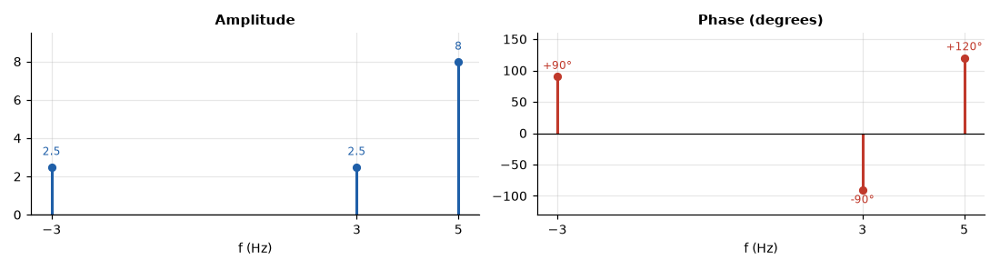
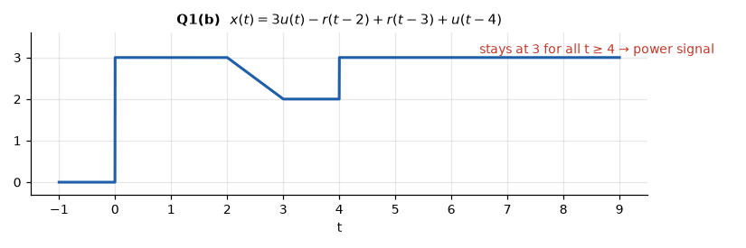
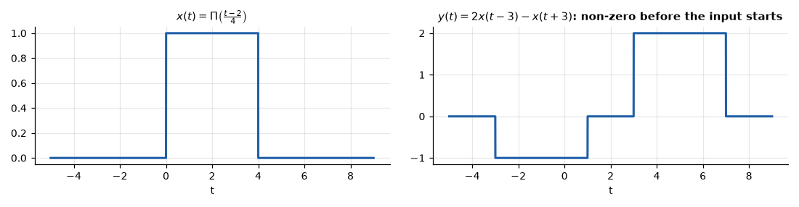
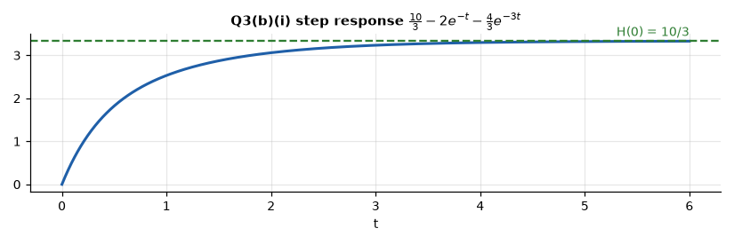
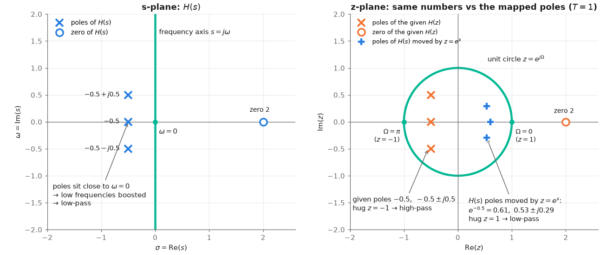

# SC3102 Past Paper Solutions: Semester 1, AY2024/25 (Nov/Dec 2024)

Paper: `../CE3102-24S1.pdf` · 4 questions × 25 marks · 2 hours · all questions compulsory

These are my own worked solutions; there is no official answer key. All numbers were re-checked by computer.
Most figures come from `make_figures.py`; `24S1_Q4a_map.png` was drawn separately for this write-up.
Slide references use PDF page numbers in `SC3102/Slides/`.
The whole-course map is in [00_Exam_Guide.md](00_Exam_Guide.md).

**How each part is laid out.** Every part has two blocks, in this order:
1. **Exam answer:** what to write on the paper. The question, what's given and asked, each step with the rule it uses, the boxed answer, and a one-line check.
2. **Explanation:** why each step works, what the ideas mean, common traps, and links to other parts. Read it after the exam answer.

<b>Answer key: final answers only (open after attempting)</b>

| Part | Final answer |
|---|---|
| 1(a)(i) | Periodic: $T_1=\frac13$ s, $T_2=\frac15$ s, ratio $\frac53$ is rational, so $T_0=1$ s |
| 1(a)(ii) | Lines: $f=-3$: $2.5\angle{+90^\circ}$; $f=+3$: $2.5\angle{-90^\circ}$; $f=+5$: $8\angle{+120^\circ}$ (no line at −5 Hz) |
| 1(b) | $x=0,\ 3,\ 5-t,\ 2,\ 3$ on $t<0,\ [0,2),\ [2,3),\ [3,4),\ t\ge4$. $E=\infty$ and $P=\frac92$, so a **power signal** |
| 1(c) | $y(t)=e^{-(t-2)}u(t-2)-e^{-(t-4)}u(t-4)$ |
| 2(a)(i) | Linear and time-invariant. Equivalently, $h(t)=\sum C_k\delta(t-t_k)$ |
| 2(a)(ii) | $y=2\Pi\left(\frac{t-5}{4}\right)-\Pi\left(\frac{t+1}{4}\right)$. **Non-causal**, because $t_2=-3$ uses the future input |
| 2(b)(i) | FT both, multiply, inverse FT |
| 2(b)(ii) | $\pi\,\dfrac{\sin t}{t}$ |
| 3(a) | $s=\sigma+j\omega$; ROC is the right half-plane $\mathrm{Re}(s)>\sigma_{\max}$; CTFT $=X(s)\vert_{s=j\omega}$ if the axis is in the ROC |
| 3(b)(i) | $y(t)=\left[\frac{10}{3}-2e^{-t}-\frac43e^{-3t}\right]u(t)$ |
| 3(b)(ii) | $y_{ss}=1.225\sin(3\pi t-16.3^\circ)$, from $\lvert H\rvert=0.6126$, $\angle H=-76.3^\circ$ |
| 3(c) | $X(s)=\dfrac{\sqrt2\,(s-3)}{s^2+9}$, $\mathrm{Re}(s)>0$ |
| 4(a) | Both **stable** with a valid Fourier transform. $H(s)$ is **low-pass** ($\lvert H(0)\rvert=8$, falls like $1/\omega^2$); $H(z)$ is **high-pass** ($\lvert H(1)\rvert=0.27$, $\lvert H(-1)\rvert=12$) |
| 4(b) | $y[n]=[8-6(\frac12)^n]u[n]$, so $y[0..5]=2,\ 5,\ 6.5,\ 7.25,\ 7.625,\ 7.8125$ |
| 4(c) | $x[n]=\{7,\ 1,\ -1,\ 5\}$ |

---

## Question 1 (Signals)

> *"Consider the signal $x(t)=5\sin(6\pi t)+8j\,e^{j\left(10\pi t+\frac{\pi}{6}\right)}$ which represents a modulated communication signal ... Note: $j=\sqrt{-1}$ and $je^{j\theta}=e^{j\left(\theta+\frac{\pi}{2}\right)}$"*

**Use the hint first.** Put $\theta=10\pi t+\frac{\pi}{6}$:
$$8j\,e^{j(10\pi t+\frac{\pi}{6})}=8e^{j(10\pi t+\frac{\pi}{6}+\frac{\pi}{2})}.$$
Add the angles: $\frac{\pi}{6}+\frac{\pi}{2}=\frac{\pi}{6}+\frac{3\pi}{6}=\frac{4\pi}{6}=\frac{2\pi}{3}$. So
$$x(t)=5\sin(6\pi t)+8e^{j(10\pi t+\frac{2\pi}{3})}.$$
(Why the hint holds: Euler's formula gives $e^{j\pi/2}=\cos\frac{\pi}{2}+j\sin\frac{\pi}{2}=0+j\cdot1=j$. So $je^{j\theta}=e^{j\pi/2}e^{j\theta}=e^{j(\theta+\pi/2)}$, by the exponent rule $e^ae^b=e^{a+b}$.)

### 1(a)(i) Periodic? Fundamental period (5 marks)

**Topic:** periodicity of a sum (Signals p.13–15). It's periodic if $T_1/T_2$ is rational.

#### Exam answer

> *"(i) Determine whether the signal $x(t)$ is periodic or not. If it is periodic, find the fundamental period of $x(t)$."*

**Given:** $x(t)=5\sin(6\pi t)+8e^{j(10\pi t+\frac{2\pi}{3})}$. **Asked:** is it periodic? If so, the fundamental period $T_0$.

**Rule used** (Signals p.13): a sum of two periodic terms with periods $T_1$ and $T_2$ is periodic if $\frac{T_1}{T_2}$ is rational, $\frac{T_1}{T_2}=\frac km$ with whole numbers $k,m$. Then $T_0=mT_1=kT_2$ (in lowest terms, this is the smallest common period).

1. **Period of the sine.** A sinusoid with angular frequency $\omega$ has period $T=\frac{2\pi}{\omega}$. Here $\omega_1=6\pi$ rad/s:
   $$T_1=\frac{2\pi}{6\pi}=\frac13\text{ s}\quad(f_1=3\text{ Hz}).$$
2. **Period of the complex exponential.** $e^{j(\omega_2t+\phi)}$ repeats each time $\omega_2t$ grows by $2\pi$, because $e^{j2\pi}=\cos2\pi+j\sin2\pi=1$. Here $\omega_2=10\pi$ rad/s:
   $$T_2=\frac{2\pi}{10\pi}=\frac15\text{ s}\quad(f_2=5\text{ Hz}).$$
3. **Ratio:**
   $$\frac{T_1}{T_2}=\frac{1/3}{1/5}=\frac13\times\frac51=\frac53.$$
   5 and 3 are whole numbers, so the ratio is rational and $x(t)$ **is periodic**.
4. **Fundamental period.** $\frac km=\frac53$ gives $k=5$, $m=3$:
   $$T_0=mT_1=3\times\frac13=1\text{ s},\qquad kT_2=5\times\frac15=1\text{ s}\ ✓$$
5. **Nothing smaller works.** A common period must be a whole number of each period: $T=\frac a3=\frac b5$ with whole $a,b$, so $5a=3b$. Then $5a$ is a multiple of 3, and since 5 isn't, $a$ must be: $a=3,6,\dots$ The smallest is $a=3$, giving $T=\frac33=1$ s.

$$\boxed{x(t)\text{ is periodic, with fundamental period }T_0=1\text{ s}}$$

**Check:** numerically $x(0.1)=x(1.1)=8.755-6.928j$ ✓, while $x(0.6)=-8.755+6.928j\ne x(0.1)$, so $T=0.5$ s is not a period.

#### Explanation

- **Why the ratio must be rational.** Each term repeats on its own clock. The sum repeats only when both clocks are back at their start *at the same moment*. In 1 s the sine does 3 full cycles (3 Hz) and the arrow does 5 full turns (5 Hz), so both are back. Earlier, at $\frac13$ s, the sine is back but the arrow has done $\frac53=1.67$ turns, not a whole number. "Rational ratio" just means such a common moment exists.
- **An example that fails** (Signals p.15): $\sin(10\pi t)+\cos(23t)$. $T_1=\frac{2\pi}{10\pi}=0.2$ s and $T_2=\frac{2\pi}{23}=0.273$ s, so $\frac{T_1}{T_2}=\frac{0.2\times23}{2\pi}=\frac{23}{10\pi}$. It contains $\pi$, so it's irrational: the clocks never line up again, and that sum is not periodic.
- **Shortcut with frequencies:** $f_0=\gcd(3,5)=1$ Hz (the largest frequency that goes into both 3 and 5 a whole number of times), so $T_0=\frac1{f_0}=1$ s. Same answer.
- **A complex exponential is periodic too.** Replace $t$ by $t+\frac15$: $e^{j(10\pi(t+\frac15)+\frac{2\pi}{3})}=e^{j(10\pi t+\frac{2\pi}{3})}\cdot e^{j2\pi}$ (exponent rule), and $e^{j2\pi}=1$. Being complex doesn't matter; only the frequency does. The amplitudes 5 and 8 and the phase $\frac{2\pi}{3}$ don't affect the period at all.
- **Traps:**
  - $T_0=T_1T_2=\frac1{15}$ s (wrong: in $\frac1{15}$ s the sine has done only $\frac{3}{15}=0.2$ of a cycle);
  - $T_0=T_1+T_2$ (wrong for the same reason). $T_0$ is the *least common multiple* of $\frac13$ and $\frac15$, which is 1.
- **Link:** (ii) uses the same frequencies. Every spectral line sits at a whole multiple of $f_0=1$ Hz ($-3$, $+3$, $+5$).

### 1(a)(ii) Double-sided amplitude and phase spectra (6 marks)

**Topic:** spectra (Signals p.37–42). Write every term as $c\,e^{j2\pi ft}$.

#### Exam answer

> *"(ii) Plot the double-sided amplitude and phase spectra for the signal $x(t)$."*

**Given:** $x(t)=5\sin(6\pi t)+8e^{j(10\pi t+\frac{2\pi}{3})}$. **Asked:** for every line $c\,e^{j2\pi ft}$, its amplitude $|c|$ and phase $\angle c$, plotted against $f$ (negative and positive).

**Method** (Signals p.38): rewrite $x$ as a sum of terms $c\,e^{j2\pi ft}$. Each term is one line at frequency $f$, with height $|c|$ and phase $\angle c$.

1. **Sine to cosine** (identity $\sin\theta=\cos(\theta-\frac{\pi}{2})$):
   $$5\sin(6\pi t)=5\cos\!\left(6\pi t-\tfrac{\pi}{2}\right).$$
2. **Euler's formula** $\cos\theta=\frac{e^{j\theta}+e^{-j\theta}}{2}$, with $\theta=6\pi t-\frac{\pi}{2}$:
   $$5\cos\!\left(6\pi t-\tfrac{\pi}{2}\right)=\tfrac52e^{j(6\pi t-\frac{\pi}{2})}+\tfrac52e^{-j(6\pi t-\frac{\pi}{2})}.$$
3. **Split each exponent** ($e^{a+b}=e^ae^b$), and write $6\pi t=2\pi(3)t$:
   $$=\tfrac52e^{-j\frac{\pi}{2}}\,e^{j2\pi(3)t}+\tfrac52e^{+j\frac{\pi}{2}}\,e^{j2\pi(-3)t}.$$
   - Line at $f=+3$ Hz: $c=2.5e^{-j\pi/2}$, so amplitude 2.5, phase $-90^\circ$.
   - Line at $f=-3$ Hz: $c=2.5e^{+j\pi/2}$, so amplitude 2.5, phase $+90^\circ$.
4. **The complex exponential** (after the hint): split the exponent and write $10\pi t=2\pi(5)t$:
   $$8e^{j(10\pi t+\frac{2\pi}{3})}=8e^{j\frac{2\pi}{3}}\,e^{j2\pi(5)t}.$$
   This is **already a single line**: $f=+5$ Hz, $c=8e^{j2\pi/3}$, so amplitude 8, phase $+120^\circ$. There is no partner at $-5$ Hz.

| $f$ (Hz) | −3 | +3 | +5 |
|---|---|---|---|
| amplitude $\lvert c\rvert$ | 2.5 | 2.5 | 8 |
| phase $\angle c$ | $+\frac{\pi}{2}$ (+90°) | $-\frac{\pi}{2}$ (−90°) | $+\frac{2\pi}{3}$ (+120°) |

$$\boxed{-3\text{ Hz: }2.5\angle{+90^\circ};\quad+3\text{ Hz: }2.5\angle{-90^\circ};\quad+5\text{ Hz: }8\angle{+120^\circ};\quad\text{no line at }-5\text{ Hz}}$$

**Check (rebuild $x(0)$ from the lines):** at $t=0$ every $e^{j2\pi ft}=1$, so $x(0)=2.5e^{j\pi/2}+2.5e^{-j\pi/2}+8e^{j2\pi/3}=2.5j-2.5j+8(-0.5+0.866j)=-4+6.93j$. Directly: $x(0)=5\sin0+8e^{j2\pi/3}=-4+6.93j$ ✓. (Computing $c=\int_0^1x(t)e^{-j2\pi ft}dt$ numerically also gives $0$ at $-5$ Hz and the three lines above.)

#### Explanation

- **What a double-sided spectrum shows.** The signal is rewritten as a sum of rotating arrows $c\,e^{j2\pi ft}$. Positive $f$ turns anticlockwise, negative $f$ clockwise. The amplitude spectrum is each arrow's length $|c|$; the phase spectrum is its starting angle $\angle c$.
- **Why a real sine needs two lines.** A real signal must stay on the real axis. One spinning arrow can't, but two equal arrows spinning opposite ways with opposite angles cancel each other's imaginary parts: $2.5e^{j\theta}+2.5e^{-j\theta}=2.5(\cos\theta+j\sin\theta)+2.5(\cos\theta-j\sin\theta)=5\cos\theta$. That's why a real signal always has mirror pairs: the same height at $\pm f$ and opposite phases (conjugate symmetry).
- **Why $8e^{j(\cdots)}$ has only one line.** It is a single arrow turning at $+5$ Hz, so $x(t)$ is complex-valued: $x(0)=-4+6.93j$. A complex signal has no reason to be mirror-symmetric, and this one isn't.
- **Same lines from $\sin\theta=\frac{e^{j\theta}-e^{-j\theta}}{2j}$:** $5\sin(6\pi t)=\frac{5}{2j}e^{j6\pi t}-\frac{5}{2j}e^{-j6\pi t}$. To simplify $\frac1j$, multiply top and bottom by $j$: $\frac{j}{j\cdot j}=\frac{j}{-1}=-j$ (using $j^2=-1$). So $\frac{5}{2j}=-2.5j=2.5e^{-j\pi/2}$ at $+3$ Hz, and $-\frac{5}{2j}=+2.5j=2.5e^{+j\pi/2}$ at $-3$ Hz ✓.
- **Amplitudes are never negative.** A minus sign goes into the phase: $-2.5=2.5e^{j\pi}$ (180°). The $j$ in $8j$ works the same way: $j=e^{j\pi/2}$ adds 90° to the phase. The amplitude stays 8.
- **Traps:**
  - adding a line at −5 Hz (only real signals come in mirror pairs);
  - halving the 8 to 4 as if it were a cosine. A cosine is two arrows; $8e^{j(\cdots)}$ is one arrow of length 8;
  - forgetting the hint's $+\frac{\pi}{2}$, which gives 30° instead of 120°;
  - labelling the axis in rad/s while plotting 3 and 5. Use $f$ in Hz (or $6\pi$ and $10\pi$ for $\omega$).

### 1(b) Evaluate $x(t)=3u(t)-r(t-2)+r(t-3)+u(t-4)$; energy or power? (8 marks)

**Topic:** singularity functions (Signals p.43–52), energy and power (Signals p.17–21).

#### Exam answer

> *"(b) Evaluate the signal $x(t)=3u(t)-r(t-2)+r(t-3)+u(t-4)$ where $u(t)$ is the unit step function and $r(t)$ is the ramp function. Determine whether $x(t)$ is an energy signal or a power signal, and show your calculations to justify it."*

**Given:** $x(t)$, with $u(t)=1$ for $t\ge0$ (0 before) and $r(t)=t\,u(t)$. **Asked:** $x(t)$ piece by piece; then energy or power, with calculations.

**Definitions** (Signals p.17):
$$E=\int_{-\infty}^{\infty}|x(t)|^2dt,\qquad P=\lim_{T\to\infty}\frac1T\int_{-T/2}^{T/2}|x(t)|^2dt.$$
Energy signal: $0<E<\infty$ (then $P=0$). Power signal: $0<P<\infty$ (then $E=\infty$).

1. **Each building block** (time shift: $g(t-a)$ is $g$ switched on at $t=a$):
   - $3u(t)$: 3 for $t\ge0$;
   - $-r(t-2)=-(t-2)u(t-2)$: 0 before $t=2$, then $-(t-2)$, a ramp going down with slope $-1$;
   - $+r(t-3)=(t-3)u(t-3)$: 0 before $t=3$, then $+(t-3)$, slope $+1$;
   - $+u(t-4)$: 1 for $t\ge4$.
2. **Add the active terms on each interval:**

   | interval | active terms | algebra | $x(t)$ |
   |---|---|---|---|
   | $t<0$ | none | $0$ | 0 |
   | $0\le t<2$ | $3$ | $3$ | 3 |
   | $2\le t<3$ | $3-(t-2)$ | $3-t+2$ | $5-t$ (falls from 3 to 2) |
   | $3\le t<4$ | $3-(t-2)+(t-3)$ | $3-t+2+t-3$ | 2 |
   | $t\ge4$ | $3-(t-2)+(t-3)+1$ | $2+1$ | 3 (forever) |

   
3. **Energy.** For $t\ge4$, $|x|^2=3^2=9$. That part alone gives $\int_4^L9\,dt=9(L-4)$, which grows without limit as $L\to\infty$. So $E=\infty$: **not** an energy signal.
4. **Power.** Use the window $[-T/2,T/2]$ with $T/2>4$ (fine, since $T\to\infty$). $x=0$ for $t<0$, so split the integral at 0, 2, 3, 4:
   - $\displaystyle\int_0^2 3^2\,dt=9\times2=18$
   - $\displaystyle\int_2^3(5-t)^2dt$: expand $(5-t)^2=25-10t+t^2$; antiderivative $25t-5t^2+\frac{t^3}{3}$.
     Upper limit $t=3$: $75-45+9=39$. Lower limit $t=2$: $50-20+\frac83=30+\frac83=\frac{98}{3}$.
     Difference: $39-\frac{98}{3}=\frac{117}{3}-\frac{98}{3}=\frac{19}{3}$.
   - $\displaystyle\int_3^4 2^2\,dt=4\times1=4$
   - $\displaystyle\int_4^{T/2}3^2\,dt=9\left(\frac T2-4\right)=4.5T-36$

   Add them, collecting the plain numbers: $18+\frac{19}{3}+4+4.5T-36=4.5T+(18+4-36)+\frac{19}{3}=4.5T-14+\frac{19}{3}=4.5T-\frac{42}{3}+\frac{19}{3}=4.5T-\frac{23}{3}$.
5. **Divide by $T$ and let $T\to\infty$:**
   $$P=\lim_{T\to\infty}\frac1T\left(4.5T-\frac{23}{3}\right)=\lim_{T\to\infty}\left(4.5-\frac{23}{3T}\right)=4.5-0=\frac92.$$

$$\boxed{E=\infty,\quad P=\tfrac92=4.5\quad\Rightarrow\quad x(t)\text{ is a power signal}}$$

**Check:** numerically $\frac1T\int_{-T/2}^{T/2}|x|^2dt=4.117,\ 4.423,\ 4.492$ for $T=20,\ 100,\ 1000$, creeping up to 4.5 ✓. The $\frac{19}{3}$ by substitution $v=5-t$ ($dv=-dt$; $t=2\to v=3$, $t=3\to v=2$): $\int_3^2v^2(-dv)=\int_2^3v^2dv=\left[\frac{v^3}{3}\right]_2^3=\frac{27}{3}-\frac83=\frac{19}{3}$ ✓.

#### Explanation

- **Reading ramps as slope changes.** $r(t-a)$ has slope 0 before $a$ and slope 1 after. So $-r(t-2)$ bends the signal down (slope $-1$) at $t=2$, and $+r(t-3)$ adds slope $+1$ at $t=3$, cancelling it: from $t=3$ the slope is $-1+1=0$, a flat line at 2. Steps make jumps: $3u(t)$ jumps up by 3 at $t=0$, and $u(t-4)$ jumps up by 1 at $t=4$ (from 2 to 3).
- **Why $E=\infty$ but $P$ is finite.** Energy is the total area under $|x|^2$. A constant 9 that never stops keeps adding area: 90 more after 10 s, 900 after 100 s. Power is the *average* of $|x|^2$ per second. It settles because the time grows too: the area is about $4.5T$, and $\frac{4.5T}{T}=4.5$.
- **Why 4.5 and not 9.** Half of the window $[-T/2,T/2]$ is negative time, where $x=0$. Only the right half (length $\frac T2$) carries $|x|^2=9$: $\frac1T\cdot9\cdot\frac T2=4.5$. It's the same reason $u(t)$ has $P=\frac12$, not 1.
- **Why the dip on $[2,4)$ doesn't matter.** It changes the area by a fixed amount (the $-\frac{23}{3}$), and a fixed amount divided by $T$ goes to 0: at $T=1000$ it's $\frac{23}{3000}=0.0077$.
- **The slide's rule of thumb fails here.** Signals p.17 says "signals that are both deterministic and non-periodic are energy signals". This $x(t)$ is deterministic and non-periodic, yet it's a power signal (so is $u(t)$). That sentence is about signals that die out; the definitions ($E$ and $P$ computed) always decide.
- **The three classes:**
  - energy signal: $E$ finite, so $P=0$ (e.g. one pulse);
  - power signal: $P$ finite and non-zero, so $E=\infty$ (this $x$, $u(t)$, every periodic signal);
  - neither: $P=\infty$ (e.g. $r(t)$, which keeps growing).
- **Traps:**
  - $P=9$ (forgetting the empty half of the window);
  - integrating $(5-t)$ instead of $(5-t)^2$: power uses the square;
  - losing the $+1$ from $u(t-4)$: the tail would be 2 and $P=\frac42=2$.

### 1(c) $h(t)=e^{-t}u(t)$, $x(t)=\delta(t-2)-\delta(t-4)$ (6 marks)

**Topic:** convolution with shifted impulses (Signals p.56–57, Systems p.31–32). By the sifting property, $h(t)\ast\delta(t-t_0)=h(t-t_0)$.

#### Exam answer

> *"(c) The impulse response of a linear time-invariant system is given by: $h(t)=e^{-t}$ for $t\ge0$, $0$ for $t<0$. Given the input signal: $x(t)=\delta(t-2)-\delta(t-4)$ where $\delta(t)$ is the Dirac delta function, find the output $y(t)$ of the system."*

**Given:** $h(t)=e^{-t}u(t)$ (the piecewise definition in one line) and $x(t)=\delta(t-2)-\delta(t-4)$. **Asked:** $y(t)$.

1. **Output of a linear time-invariant (LTI) system = convolution** (Systems p.31–32):
   $$y(t)=x(t)\ast h(t)=\int_{-\infty}^{\infty}x(\tau)\,h(t-\tau)\,d\tau.$$
2. **Substitute $x$ and split the integral** (linearity of the integral):
   $$y(t)=\int_{-\infty}^{\infty}\delta(\tau-2)\,h(t-\tau)\,d\tau-\int_{-\infty}^{\infty}\delta(\tau-4)\,h(t-\tau)\,d\tau.$$
3. **Sifting property** $\int\delta(\tau-a)g(\tau)\,d\tau=g(a)$ (Signals p.56). The first integral picks $\tau=2$, the second $\tau=4$:
   $$y(t)=h(t-2)-h(t-4).$$
4. **Write out the shifted copies:** replace every $t$ in $e^{-t}u(t)$ by $t-2$ (then by $t-4$), including inside the step:

$$\boxed{y(t)=e^{-(t-2)}u(t-2)-e^{-(t-4)}u(t-4)}$$

5. **Piecewise:**
   - $t<2$: both steps are off, so $y=0$.
   - $2\le t<4$: only the first term, $y=e^{-(t-2)}$ ($1$ at $t=2$, $e^{-1}=0.368$ at $t=3$, $e^{-2}=0.135$ just before 4).
   - $t\ge4$: both terms. Write $t-2=(t-4)+2$, so $e^{-(t-2)}=e^{-(t-4)-2}=e^{-(t-4)}e^{-2}$ (exponent rule). Factor out $e^{-(t-4)}$:
     $$y=e^{-(t-4)}e^{-2}-e^{-(t-4)}=(e^{-2}-1)\,e^{-(t-4)}=(0.1353-1)\,e^{-(t-4)}=-0.865\,e^{-(t-4)}.$$

**Check (area):** a transform at zero frequency is the area, and the transform of a convolution is a product, so area of $y$ = (area of $x$) × (area of $h$) $=(1-1)\times1=0$. Directly: $\int_2^4e^{-(t-2)}dt+\int_4^\infty(-0.865)e^{-(t-4)}dt=(1-e^{-2})-0.865=0.865-0.865=0$ ✓.

#### Explanation

- **Convolving with $\delta(t-a)$ delays by $a$.** An impulse at $t=2$ is a kick at $t=2$, and an LTI system answers every kick with its impulse response, started at the kick: $h(t-2)$. The $-\delta(t-4)$ is an opposite kick 2 s later, so it gives $-h(t-4)$. Linearity adds the two answers.
- **Why sifting works.** $\delta(\tau-2)$ is zero everywhere except $\tau=2$, and its area is 1. Under the integral only the rest of the integrand's value at $\tau=2$ survives, which is $h(t-2)$.
- **Multiplying is different.** $x(t)\cdot h(t)=h(2)\delta(t-2)-h(4)\delta(t-4)=0.135\,\delta(t-2)-0.018\,\delta(t-4)$: two impulses (that's sampling), not the system's output.
- **Reading the plot.** At $t=4$ the output drops by exactly 1, from $0.135$ to $-0.865$: the second kick's response starts at its peak $h(0)=1$, with a minus sign. After that both pieces decay at the same rate $e^{-t}$, so they merge into one exponential: $-0.865$ at $t=4$, $-0.318$ at $t=5$.
- **Traps:**
  - writing $e^{-t}u(t-2)$: *every* $t$ becomes $t-2$, the exponent included;
  - dropping $u(t-2)$ and $u(t-4)$: without them the output exists before the kicks arrive;
  - losing the minus sign on the second term.
- **Link:** 2(a) is the same idea from the other side: a system whose impulse response is a sum of shifted impulses.

---

## Question 2 (Systems and Fourier transforms)

### 2(a)(i) Prove $y(t)=\sum_{k=1}^{N}C_kx(t-t_k)$ is linear and time-invariant (6 marks)

**Topic:** Systems p.11–13, 20–22 (the slide on p.22 is this same "sum of delayed copies" system).

#### Exam answer

> *"(a) Consider a system characterized by the following output expression: $y(t)=\sum_{k=1}^{N}C_kx(t-t_k)$ where $C_k$ are constants and $t_k$ are specific time shifts. (i) Prove that the system is linear and time-invariant."*

**Given:** $y(t)=\sum_{k=1}^{N}C_kx(t-t_k)$ with constants $C_k$ and $t_k$. **Asked:** prove linearity and time invariance.

**Definitions** (Systems p.11, p.13):
- **Linear:** if $x_1\mapsto y_1$ and $x_2\mapsto y_2$, then $a\,x_1+b\,x_2\mapsto a\,y_1+b\,y_2$ for any constants $a,b$ (superposition).
- **Time-invariant:** if $x(t)\mapsto y(t)$, then $x(t-t_0)\mapsto y(t-t_0)$ for any delay $t_0$.

**Linearity:**
1. Input $x_3(t)=a\,x_1(t)+b\,x_2(t)$. At time $t-t_k$ it is $x_3(t-t_k)=a\,x_1(t-t_k)+b\,x_2(t-t_k)$.
2. Its output:
   $$y_3(t)=\sum_{k=1}^{N}C_k\big[a\,x_1(t-t_k)+b\,x_2(t-t_k)\big].$$
3. Multiply $C_k$ into the bracket and split the sum into two sums:
   $$y_3(t)=\sum_{k=1}^{N}a\,C_kx_1(t-t_k)+\sum_{k=1}^{N}b\,C_kx_2(t-t_k).$$
4. $a$ and $b$ don't depend on $k$, so take them out of the sums:
   $$y_3(t)=a\sum_{k=1}^{N}C_kx_1(t-t_k)+b\sum_{k=1}^{N}C_kx_2(t-t_k)=a\,y_1(t)+b\,y_2(t)\ ✓$$

**Time invariance:**

5. **Response to the delayed input** $x_d(t)=x(t-t_0)$. The system evaluates its input at $t-t_k$, and $x_d(t-t_k)=x\big((t-t_k)-t_0\big)$:
   $$y_d(t)=\sum_{k=1}^{N}C_kx_d(t-t_k)=\sum_{k=1}^{N}C_kx(t-t_k-t_0).$$
6. **Delayed output:** replace $t$ by $t-t_0$ in $y(t)$:
   $$y(t-t_0)=\sum_{k=1}^{N}C_kx\big((t-t_0)-t_k\big)=\sum_{k=1}^{N}C_kx(t-t_0-t_k).$$
7. Steps 5 and 6 agree, because $t-t_k-t_0=t-t_0-t_k$ ✓.

$$\boxed{\text{The system is linear and time-invariant (LTI)}}$$

**Check with numbers** (using the values of (ii): $C=\{2,-1\}$, $t_k=\{3,-3\}$, so $y=2x(t-3)-x(t+3)$):
- Linearity at $t=4$ with $x_1=u$, $x_2=r$, $a=3$, $b=-1$: $y_1(4)=2u(1)-u(7)=2-1=1$ and $y_2(4)=2r(1)-r(7)=2-7=-5$, so $3y_1-y_2=3+5=8$. Directly, $x_3=3u-r$ has $x_3(1)=3-1=2$ and $x_3(7)=3-7=-4$, so $y_3(4)=2(2)-(-4)=8$ ✓.
- Time invariance at $t=4$ with $x=u$, $t_0=2$: $y_d(4)=2u(4-3-2)-u(4+3-2)=2u(-1)-u(5)=-1$, and $y(4-2)=y(2)=2u(-1)-u(5)=-1$ ✓.

#### Explanation

- **What the system does.** It adds $N$ echoes of the input: copy $k$ is delayed by $t_k$ (or advanced, if $t_k<0$) and scaled by $C_k$. Example: $C=\{1,0.5\}$, $t_k=\{0,1\}$ is the input plus a half-strength echo 1 s later.
- **Why it's linear: it only scales and adds values of $x$.** Nothing squares $x$, multiplies $x$ by itself, or adds a constant. Compare $y=x(t-1)^2$: input 1 gives 1, but input 2 gives 4, not 2. Not linear.
- **Why it's time-invariant: the $C_k$ and $t_k$ don't depend on $t$.** The rule is the same at every moment. Compare $y(t)=t\,x(t-1)$, whose coefficient $t$ changes with time. With $x=u(t)$, $t_0=1$, at $t=3$: the delayed input $u(t-1)$ gives $3\,u(3-1-1)=3$, but the delayed output is $(3-1)\,u(3-1-1)=2$. $3\ne2$, so that system is time-varying.
- **How to keep the time-invariance proof straight.** Do two separate computations and compare them: (1) feed in the delayed input and compute the output; (2) take the original output and replace $t$ by $t-t_0$. The usual slip is doing (2) twice.
- **Impulse response:** put $x=\delta$: $h(t)=\sum_kC_k\delta(t-t_k)$, weighted, shifted impulses. Systems p.21 notes that every LTI system is a sum like this (in the limit, a convolution integral).
- **Link:** (ii) plugs in numbers. 1(c) is the same idea from the other side.

### 2(a)(ii) $x(t)=\Pi\left(\frac{t-2}{4}\right)$, $C_k=\{2,-1\}$, $t_k=\{3,-3\}$: output and causality (6 marks)

**Topic:** time shifts of a rectangle (Signals p.44), causality (Systems p.10).

#### Exam answer

> *"(ii) Suppose the input to the above system is $x(t)=\Pi\left(\frac{t-2}{4}\right)$, where $\Pi(\cdot)$ is the rectangular function. Given that the constants are $C_k=\{2,-1\}$ and the time shifts are $t_k=\{3,-3\}$, compute the output of the system and determine whether the system is causal."*

**Given:** $x(t)=\Pi\left(\frac{t-2}{4}\right)$; $N=2$ with $C_1=2$, $t_1=3$, $C_2=-1$, $t_2=-3$. **Asked:** $y(t)$, and whether the system is causal.

1. **The system with these numbers:**
   $$y(t)=C_1x(t-t_1)+C_2x(t-t_2)=2x(t-3)-x\big(t-(-3)\big)=2x(t-3)-x(t+3).$$
2. **Read the box.** $\Pi(v)=1$ for $|v|\le\frac12$, so $\Pi\left(\frac{t-c}{w}\right)$ is 1 for $c-\frac w2\le t\le c+\frac w2$ (centre $c$, width $w$). For $x$: $c=2$, $w=4$, so $x$ is 1 on $[0,4]$.
3. **First copy** (replace $t$ by $t-3$):
   $$x(t-3)=\Pi\left(\frac{(t-3)-2}{4}\right)=\Pi\left(\frac{t-5}{4}\right):\ \text{centre 5, on }[3,7].$$
   Times 2: height 2 on $[3,7]$.
4. **Second copy** (replace $t$ by $t+3$):
   $$x(t+3)=\Pi\left(\frac{(t+3)-2}{4}\right)=\Pi\left(\frac{t+1}{4}\right):\ \text{centre }-1,\text{ on }[-3,1].$$
   Times $-1$: height $-1$ on $[-3,1]$.
5. **Add.** $[-3,1]$ and $[3,7]$ don't overlap, so $y=-1$ on $[-3,1]$, $0$ on $(1,3)$, $2$ on $[3,7]$, and $0$ elsewhere:

$$\boxed{y(t)=2\Pi\!\left(\frac{t-5}{4}\right)-\Pi\!\left(\frac{t+1}{4}\right)}$$

6. **Causality** (Systems p.10: the output at time $t$ may depend only on inputs at times $\le t$). The second term uses $x(t+3)$, the input 3 s **in the future**. With numbers: at $t=-3$,
   $$y(-3)=2x(-6)-x(0)=2(0)-1=-1.$$
   The output is already non-zero at $t=-3$, but the input only starts at $t=0$.

$$\boxed{\text{Non-causal, because }t_2=-3<0}$$

**Check:** $y(5)=2x(2)-x(8)=2(1)-0=2$, and the boxed formula gives $2\Pi(0)-\Pi(1.5)=2-0=2$ ✓. $y(0)=2x(-3)-x(3)=0-1=-1$ ✓.

#### Explanation

- **Echo picture.** The output is a double-height copy of the box delayed by 3 s, plus an upside-down copy advanced by 3 s (it arrives 3 s *early*).
- **Why an advance means non-causal.** A real-time system at time $t$ has only seen the input up to $t$. To output $-x(t+3)$ at $t=-3$ it would need $x(0)$, which hasn't happened yet. It can be done offline, on a recording, but not live.
- **Impulse-response test.** $h(t)=2\delta(t-3)-\delta(t+3)$. Causal means $h(t)=0$ for every $t<0$. The impulse at $t=-3$ breaks that. In general this system is causal exactly when every $t_k\ge0$.
- **Shift direction trap.** $x(t+3)$ moves the box **left** by 3, from $[0,4]$ to $[-3,1]$. Check one edge: the box starts where its argument equals $-\frac12$: $\frac{t+1}{4}=-\frac12$ gives $t+1=-2$, so $t=-3$ ✓.
- **"Causal" isn't "the output starts after 0".** It means "never needs the future". $y=x(t-3)$ is causal: its output starts at 3, after the input.
- **Link:** (i) proved the system is linear time-invariant (LTI) for any $C_k$ and $t_k$. LTI and causal are separate properties: this one is LTI but not causal.

### 2(b)(i) Steps of the convolution theorem, and why it simplifies things (5 marks)

**Topic:** Transforms p.33, 62; Systems p.53.

#### Exam answer

> *"(b)(i) Given a system with impulse response $h(t)$ and input signal $x(t)$, outline the steps to determine the output $y(t)$ using the convolution theorem. Additionally, explain how the Fourier transform simplifies the convolution process?"*

**Given:** a linear time-invariant (LTI) system with impulse response $h(t)$ and input $x(t)$. **Asked:** the steps of the convolution-theorem method, and why it is simpler.

**Convolution theorem** (Transforms p.33): $y(t)=x(t)\ast h(t)\ \longleftrightarrow\ Y(f)=X(f)\,H(f)$.

**Steps:**
1. **Transform the input:** $X(f)=\mathcal F\{x(t)\}=\int x(t)e^{-j2\pi ft}dt$ (in practice, from the tables and properties).
2. **Transform the impulse response:** $H(f)=\mathcal F\{h(t)\}$, the system's frequency response (transfer function, Transforms p.62).
3. **Multiply:** $Y(f)=X(f)\,H(f)$, one product at each frequency $f$.
4. **Inverse transform:** $y(t)=\mathcal F^{-1}\{Y(f)\}=\int Y(f)e^{j2\pi ft}df$, usually by splitting $Y(f)$ into table pairs (partial fractions).

**Why it's simpler:**
- **No convolution integral.** In time, $y(t)=\int x(\tau)h(t-\tau)d\tau$ needs flip, shift, multiply and integrate for every $t$, with limits that change from case to case. In frequency it is a single multiplication.
- **Each frequency is handled on its own.** $e^{j2\pi ft}$ is an eigenfunction of an LTI system: it comes out as $H(f)e^{j2\pi ft}$, the same wave scaled by $H(f)$. So the system is just a list of gains $H(f)$, which also shows what it does (low-pass, band-pass, …).
- **Cascades become products:** two systems in series give $H_1(f)H_2(f)$ instead of $h_1\ast h_2$.
- **Faster on a computer:** with the fast Fourier transform (FFT), an $N$-point convolution costs about $N\log_2N$ operations instead of $N^2$.

**Check on a small example:** $x=h=e^{-t}u(t)$. Frequency route: $Y(f)=\frac{1}{(1+j2\pi f)^2}\leftrightarrow te^{-t}u(t)$. Time route: $\int_0^te^{-\tau}e^{-(t-\tau)}d\tau=te^{-t}$. Both give $y(1)=e^{-1}=0.368$ ✓ (worked in full below).

#### Explanation

- **The four steps on the example** $x=h=e^{-t}u(t)$:
  - Steps 1–2: the pair $e^{-at}u(t)\leftrightarrow\frac{1}{a+j2\pi f}$ with $a=1$ gives $X(f)=H(f)=\frac{1}{1+j2\pi f}$.
  - Step 3: $Y(f)=\frac{1}{1+j2\pi f}\cdot\frac{1}{1+j2\pi f}=\frac{1}{(1+j2\pi f)^2}$.
  - Step 4: the pair $te^{-at}u(t)\leftrightarrow\frac{1}{(a+j2\pi f)^2}$ gives $y(t)=te^{-t}u(t)$.
  - The direct convolution for comparison. Limits: $u(\tau)$ needs $\tau\ge0$ and $u(t-\tau)$ needs $\tau\le t$, so for $t\ge0$ integrate from 0 to $t$. Combine the exponents: $-\tau-(t-\tau)=-\tau-t+\tau=-t$. The integrand is $e^{-t}$, a constant in $\tau$, so $\int_0^te^{-t}d\tau=e^{-t}\cdot t$ ✓. Even this easy case needed the limits worked out; the frequency route didn't.
- **Why $e^{j2\pi f_0t}$ is an eigenfunction (shown, not just claimed).** Put $x(t)=e^{j2\pi f_0t}$ into the convolution:
  $$y(t)=\int h(\tau)e^{j2\pi f_0(t-\tau)}d\tau.$$
  Split the exponent ($e^{a+b}=e^ae^b$): $e^{j2\pi f_0(t-\tau)}=e^{j2\pi f_0t}e^{-j2\pi f_0\tau}$. The first factor has no $\tau$, so it comes out of the integral:
  $$y(t)=e^{j2\pi f_0t}\int h(\tau)e^{-j2\pi f_0\tau}d\tau=H(f_0)\,e^{j2\pi f_0t}.$$
  The leftover integral is exactly $H(f)$ at $f=f_0$.
- **Why convolution becomes multiplication.** The inverse transform writes $x$ as a sum of such waves, with weights $X(f)$. Each wave is just scaled by $H(f)$, so the output's weights are $X(f)H(f)$.
- **The FFT with numbers.** $N=1024$ samples: direct convolution takes about $N^2=1{,}048{,}576$ multiplications; one FFT takes about $N\log_2N=1024\times10=10{,}240$. Even with three transforms, that's roughly 30 times less work.
- **The catch.** You need $X(f)$ and $H(f)$ to exist, and $Y(f)$ to be invertible from the tables. Signals without a Fourier transform (like $e^{2t}u(t)$) need the Laplace transform (Q3), where the same theorem holds: $Y(s)=X(s)H(s)$.
- **Link:** (ii) uses exactly this method to evaluate an integral.

### 2(b)(ii) Evaluate $\displaystyle\int_{-\infty}^{\infty}\frac{\sin2\tau}{\tau}\,\frac{\sin(t-\tau)}{t-\tau}\,d\tau$ (8 marks)

**Topic:** convolution theorem, sinc ↔ rect duality (Transforms p.31–33).

#### Exam answer

> *"(ii) Use the convolution theorem to evaluate the following integral: $\int_{-\infty}^{\infty}\frac{\sin(2\tau)}{\tau}\frac{\sin(t-\tau)}{t-\tau}d\tau$. Note: $AT\frac{\sin(\pi tT)}{\pi tT}\overset{FT}{\longleftrightarrow}A\Pi\left(\frac fT\right)$, where $\Pi(\cdot)$ is the rectangular function."*

**Given:** the integral and the pair. **Asked:** its value, as a function of $t$.

1. **Recognise a convolution.** Let $g_1(t)=\dfrac{\sin2t}{t}$ and $g_2(t)=\dfrac{\sin t}{t}$. The second factor is $\dfrac{\sin(t-\tau)}{t-\tau}=g_2(t-\tau)$, so the integral is
   $$\int_{-\infty}^{\infty}g_1(\tau)\,g_2(t-\tau)\,d\tau=(g_1\ast g_2)(t).$$
2. **Convolution theorem:** $g_1\ast g_2\leftrightarrow G_1(f)\,G_2(f)$. So find $G_1$ and $G_2$, multiply, and invert.
3. **Tidy the given pair.** In $AT\dfrac{\sin(\pi Tt)}{\pi Tt}$ the $T$ on top cancels the $T$ underneath: $AT\dfrac{\sin(\pi Tt)}{\pi Tt}=A\dfrac{\sin(\pi Tt)}{\pi t}$. With $A=1$:
   $$\frac{\sin(\pi Tt)}{\pi t}\ \leftrightarrow\ \Pi\!\left(\frac fT\right),$$
   a box of height 1 for $\left|\frac fT\right|\le\frac12$, i.e. for $|f|\le\frac T2$.
4. **$G_1$.** Multiply top and bottom by $\pi$ to get the form of step 3: $\dfrac{\sin2t}{t}=\pi\cdot\dfrac{\sin2t}{\pi t}$. Match $\pi T=2$, so $T=\frac2\pi$:
   $$G_1(f)=\pi\,\Pi\!\left(\frac{f}{2/\pi}\right)=\pi\,\Pi\!\left(\frac{\pi f}{2}\right):\quad\text{height }\pi\text{ for }|f|\le\tfrac T2=\tfrac1\pi\approx0.318.$$
5. **$G_2$.** $\dfrac{\sin t}{t}=\pi\cdot\dfrac{\sin t}{\pi t}$, so $\pi T=1$ and $T=\frac1\pi$:
   $$G_2(f)=\pi\,\Pi\!\left(\frac{f}{1/\pi}\right)=\pi\,\Pi(\pi f):\quad\text{height }\pi\text{ for }|f|\le\tfrac{1}{2\pi}\approx0.159.$$
6. **Multiply.** The product is non-zero only where *both* boxes are on, i.e. $|f|\le\frac{1}{2\pi}$ (the narrow box sits inside the wide one). There it equals $\pi\times\pi=\pi^2$:
   $$G_1(f)\,G_2(f)=\pi^2\,\Pi(\pi f).$$
7. **Invert** with step 3 and $T=\frac1\pi$: $\Pi(\pi f)\leftrightarrow\dfrac{\sin t}{\pi t}$. Then by linearity (×$\pi^2$):
   $$g_1\ast g_2=\pi^2\cdot\frac{\sin t}{\pi t}=\pi\,\frac{\sin t}{t}.$$

$$\boxed{\int_{-\infty}^{\infty}\frac{\sin2\tau}{\tau}\,\frac{\sin(t-\tau)}{t-\tau}\,d\tau=\pi\,\frac{\sin t}{t}}$$

**Check at $t=0$:** the formula gives $\pi\cdot1=\pi$ (since $\frac{\sin t}{t}\to1$). Numerically, $\int\frac{\sin2\tau\,\sin\tau}{\tau^2}d\tau=3.1416$ ✓. At $t=0.7$: numerical integral $2.8912$; formula $\pi\cdot\frac{\sin0.7}{0.7}=\pi\cdot\frac{0.6442}{0.7}=2.8912$ ✓.

#### Explanation

- **Where the pair comes from** (inverse transform of a box of height 1 on $|f|\le\frac T2$):
  $$\int_{-T/2}^{T/2}e^{j2\pi ft}df=\left[\frac{e^{j2\pi ft}}{j2\pi t}\right]_{-T/2}^{T/2}=\frac{e^{j\pi Tt}-e^{-j\pi Tt}}{j2\pi t}.$$
  Using $e^{j\theta}-e^{-j\theta}=2j\sin\theta$: $=\dfrac{2j\sin(\pi Tt)}{j2\pi t}=\dfrac{\sin(\pi Tt)}{\pi t}$ ✓. A box in frequency is a sinc in time, and (duality) a sinc in time is a box in frequency.
- **How to spot the convolution.** Look for "a function of $\tau$" times "a function of $t-\tau$", integrated over $\tau$. Here $t-\tau$ appears in both the sine and the denominator of the second factor, which is exactly $g_2(t-\tau)$.
- **Why the narrower box wins.** Anything times 0 is 0, so wherever either box is off, the product is off. With numbers: at $f=0.25$, $G_1=\pi$ (since $0.25<0.318$) but $G_2=0$ (since $0.25>0.159$), so the product is 0.
- **Intuition.** $\frac{\sin t}{t}$ only contains frequencies up to $\frac{1}{2\pi}$ Hz. Convolving it with $\frac{\sin2t}{t}$ is passing it through an ideal low-pass filter that lets through everything up to $\frac1\pi$ Hz, which is wider. Nothing gets cut; only the filter's gain $\pi$ multiplies it.
- **The $t=0$ check in general:** $\int_{-\infty}^{\infty}\frac{\sin(a\tau)\sin(b\tau)}{\tau^2}d\tau=\pi\min(a,b)$ for $a,b>0$. Here $\min(2,1)=1$: the narrower one wins again.
- **Traps:**
  - forgetting the factor $\pi$ when rewriting $\frac{\sin2t}{t}$ as $\pi\cdot\frac{\sin2t}{\pi t}$ (the answer comes out $\frac{\sin t}{\pi t}$, off by $\pi^2$);
  - box width: $\Pi\left(\frac fT\right)$ has total width $T$, so its edges are at $\pm\frac T2$, not $\pm T$;
  - adding the boxes instead of multiplying them.
- **Link:** (i) is the method. 1(c) and 2(a) are convolutions done directly in time.

---

## Question 3 (Laplace transform)

### 3(a) The unilateral Laplace transform of a causal $x(t)u(t)$: role of $s$, ROC shape, link to the CTFT (6 marks)

**Topic:** L5 `lecture(4)` p.5–19, 27–31, 39; L6 `lecture(5)` p.42.

#### Exam answer

> *"(a) Discuss the unilateral Laplace Transform of a causal signal $x(t)u(t)$. Specifically comment about the role of $s$ in $X(s)$, the shape of the region of convergence (ROC), and lastly its relationship to continuous time Fourier Transform."*

**Given:** a causal signal $x(t)u(t)$. **Asked:** (1) the role of $s$; (2) the shape of the region of convergence (ROC); (3) the link to the continuous-time Fourier transform (CTFT).

**Definition** (L6 p.42):
$$X(s)=\int_{0^-}^{\infty}x(t)\,e^{-st}\,dt,\qquad s=\sigma+j\omega.$$
For a causal signal (zero for $t<0$) this equals the bilateral integral $\int_{-\infty}^{\infty}$.

1. **Role of $s$.** Split the exponent ($e^{a+b}=e^ae^b$, with $-st=-\sigma t-j\omega t$):
   $$e^{-st}=e^{-\sigma t}\,e^{-j\omega t}.$$
   - $\omega$ (the imaginary part) is the ordinary angular frequency, as in the CTFT.
   - $\sigma$ (the real part) is an exponential weighting (L5 p.5–10). For $t\ge0$ and $\sigma>0$, $e^{-\sigma t}$ fades the signal, so $\int|x(t)|e^{-\sigma t}dt$ can be finite even when $\int|x(t)|dt$ isn't.
   - So $X(\sigma+j\omega)$ is the CTFT of the faded signal $x(t)e^{-\sigma t}$. Signals with no CTFT, such as $u(t)$ or $e^{2t}u(t)$, still have a Laplace transform.
2. **Shape of the ROC.** The ROC is the set of $s$ where the integral converges. It depends only on $\sigma$, so its edges are vertical lines.
   - For a causal (right-sided) signal: if the integral converges at $\sigma_0$, then for any $\sigma>\sigma_0$ the extra fade $e^{-(\sigma-\sigma_0)t}\le1$ (for $t\ge0$) only helps. So the ROC is a **right half-plane**, $\mathrm{Re}(s)>\sigma_0$ (L5 p.27–31, 39).
   - For a rational $X(s)$, $\sigma_0$ is the real part of the **rightmost pole**. The ROC never contains a pole.
   - Example: $e^{-t}u(t)\leftrightarrow\frac{1}{s+1}$ with ROC $\mathrm{Re}(s)>-1$.
3. **Link to the CTFT** (L5 p.17–19). Put $\sigma=0$, i.e. $s=j\omega$: $X(j\omega)=\int x(t)e^{-j\omega t}dt$, the CTFT. This is valid only if the $j\omega$-axis lies inside the ROC; for a causal signal, that means every pole has negative real part.
   - $e^{-t}u(t)$: ROC $\mathrm{Re}(s)>-1$ contains the axis, so the CTFT is $\frac{1}{1+j\omega}$.
   - $u(t)$: $\frac1s$ with ROC $\mathrm{Re}(s)>0$ excludes the axis, so there is no CTFT this way (L5 p.19).
4. **Extra feature of the unilateral form:** the derivative rule $\mathcal L\{x'\}=sX(s)-x(0^-)$ brings in initial conditions, which is why it's the tool for differential equations (L6 p.42–43).

$$\boxed{\begin{aligned}&s=\sigma+j\omega:\ \sigma=\text{fade},\ \omega=\text{frequency};\quad\text{ROC}=\text{right half-plane right of the rightmost pole};\\&X(j\omega)=\text{CTFT, valid when the }j\omega\text{-axis is in the ROC}\end{aligned}}$$

**Check with numbers:** for $x=e^{-t}u(t)$ at $\sigma=0.5$, $\int_0^\infty e^{-t}e^{-0.5t}dt=\int_0^\infty e^{-1.5t}dt=\frac{1}{1.5}=0.667$, and the formula gives $\frac{1}{0.5+1}=0.667$ ✓.

#### Explanation

- **Why $\sigma$ is needed at all.** The CTFT needs $\int|x|\,dt<\infty$, and $u(t)$ fails (its area is infinite). Fade it with $\sigma=0.1$: $\int_0^\infty e^{-0.1t}dt=\frac{1}{0.1}=10$, finite. The Laplace transform is "take the CTFT after fading", for every amount of fading that works.
- **Why a right half-plane, with numbers.** Take $x=e^{2t}u(t)$. Faded, it's $e^{2t}e^{-\sigma t}=e^{(2-\sigma)t}$ (exponent rule).
  - $\sigma=3$: $e^{-t}$, area 1, converges.
  - $\sigma=2$: $e^{0}=1$ forever, area infinite.
  - $\sigma=1$: $e^{t}$, grows, area infinite.

  So it converges exactly when $\sigma>2$: everything right of the pole at $s=2$.
- **Why the ROC stops at a pole.** At $s=p$ the formula $X(s)$ is infinite, so the integral can't converge there.
- **What pole positions mean.** Pole at $-1$: $e^{-t}$, decays. Pole at $+2$: $e^{2t}$, grows. Poles at $\pm j3$: $\cos3t$, constant size. A causal signal has a CTFT exactly when all its poles are in the left half-plane, the same condition as bounded-input bounded-output (BIBO) stability for a system's $h(t)$.
- **Unilateral vs bilateral.** The unilateral transform starts at $0^-$, so it only ever sees $t\ge0$ and can't tell $x(t)u(t)$ from $x(t)$. For causal signals the two transforms agree. The unilateral ROC is always a right half-plane, so it's often not even written.
- **The Z-transform twin** (L3 `lecture(2)` p.15–16): $z=re^{j\Omega}$, with $r$ the fade and $\Omega$ the frequency. A causal ROC is the outside of a circle, and the DTFT (discrete-time Fourier transform) is $X(z)$ on the unit circle. Same ideas, circles instead of vertical lines; 4(a) uses both.
- **What earns the marks:** the definition with $s=\sigma+j\omega$; the split $e^{-\sigma t}e^{-j\omega t}$; "right half-plane to the right of the rightmost pole"; "CTFT $=X(j\omega)$ if the $j\omega$-axis is in the ROC"; one example each way.

### 3(b) $h(t)=2e^{-t}+4e^{-3t}$

> *"(b) Given a continuous time LTI system with impulse response: $h(t)=2e^{-1t}+4e^{-3t}$"*

> The paper omits $u(t)$. Assume a causal system, $h(t)=(2e^{-t}+4e^{-3t})u(t)$. Without the step, $h$ blows up as $t\to-\infty$ ($h(-5)=2e^{5}+4e^{15}\approx1.3\times10^7$) and has no Laplace or Fourier transform. Say so in one line in the exam.

**Transfer function (used in both parts).** Pair $e^{-at}u(t)\leftrightarrow\frac{1}{s+a}$, $\mathrm{Re}(s)>-a$ (L5 p.72), and linearity:
$$H(s)=\frac{2}{s+1}+\frac{4}{s+3}.$$
Common denominator $(s+1)(s+3)$; the top is $2(s+3)+4(s+1)=2s+6+4s+4=6s+10$:
$$H(s)=\frac{6s+10}{(s+1)(s+3)}.$$
*(Extra, not asked:)* the region of convergence (ROC) is $\mathrm{Re}(s)>-1$, which contains the $j\omega$-axis, so the system is stable.

#### (i) Step response (8 marks)

**Topic:** $Y=HX$ and partial fractions (L5 `lecture(4)` p.45–48, 72; L6 `lecture(5)` p.15–20).

##### Exam answer

> *"(i) Determine the step response of the system, i.e, when the input $x(t)=u(t)$, where $u(t)$ is the unit step function"*

**Given:** $H(s)=\frac{6s+10}{(s+1)(s+3)}$; input $u(t)$. **Asked:** the step response $y(t)$. No initial conditions are given and the system is described by its impulse response, so it starts at rest: $Y(s)=H(s)X(s)$.

1. **Input transform:** $\mathcal L\{u(t)\}=\int_0^\infty e^{-st}dt=\left[\frac{e^{-st}}{-s}\right]_0^\infty=0-\frac{1}{-s}=\frac1s$.
2. **Multiply** (convolution theorem: $y=h\ast x\leftrightarrow Y=HX$):
   $$Y(s)=\frac{6s+10}{(s+1)(s+3)}\cdot\frac1s=\frac{6s+10}{s(s+1)(s+3)}.$$
3. **Partial fractions:** $Y=\dfrac As+\dfrac{B}{s+1}+\dfrac{C}{s+3}$. Cover-up method (cover one factor, put its root into everything else):
   - $A$ (cover $s$, set $s=0$): $\dfrac{0+10}{(0+1)(0+3)}=\dfrac{10}{3}$
   - $B$ (cover $s+1$, set $s=-1$): $\dfrac{6(-1)+10}{(-1)(-1+3)}=\dfrac{-6+10}{(-1)(2)}=\dfrac{4}{-2}=-2$
   - $C$ (cover $s+3$, set $s=-3$): $\dfrac{6(-3)+10}{(-3)(-3+1)}=\dfrac{-18+10}{(-3)(-2)}=\dfrac{-8}{6}=-\dfrac43$

   So $Y(s)=\dfrac{10/3}{s}-\dfrac{2}{s+1}-\dfrac{4/3}{s+3}$.
4. **Invert term by term** with $u(t)\leftrightarrow\frac1s$ and $e^{-at}u(t)\leftrightarrow\frac{1}{s+a}$:

$$\boxed{y(t)=\left[\frac{10}{3}-2e^{-t}-\frac43e^{-3t}\right]u(t)}$$

**Checks:**
- $y(0)=\frac{10}{3}-2-\frac43=\frac{10}{3}-\frac63-\frac43=0$ ✓ (it starts from rest, and $h$ has no impulse, so the output can't jump).
- $y(\infty)=\frac{10}{3}=H(0)=\frac{10}{1\cdot3}$ ✓ (the zero-frequency gain).
- Time domain: the step response is the running integral of $h$:
  $$\int_0^t\big(2e^{-\tau}+4e^{-3\tau}\big)d\tau=2\big[-e^{-\tau}\big]_0^t+4\left[\frac{e^{-3\tau}}{-3}\right]_0^t=2(1-e^{-t})+\frac43(1-e^{-3t})=\frac{10}{3}-2e^{-t}-\frac43e^{-3t}\ ✓$$
  (At $t=1$ both give $2.531$.)

##### Explanation

- **Why $Y=H\cdot X$.** The output is $h\ast x$, and the Laplace transform turns convolution into multiplication. "At rest" is the default because no initial values are given, and an impulse response always describes the system from rest.
- **The other route: split first.** Use $\frac{1}{s(s+a)}=\frac1a\left(\frac1s-\frac{1}{s+a}\right)$. (Check it: $\frac1a\cdot\frac{(s+a)-s}{s(s+a)}=\frac1a\cdot\frac{a}{s(s+a)}=\frac{1}{s(s+a)}$ ✓.) Then $\frac{2}{s(s+1)}=2\left(\frac1s-\frac{1}{s+1}\right)$ and $\frac{4}{s(s+3)}=\frac43\left(\frac1s-\frac{1}{s+3}\right)$. Adding: $\left(2+\frac43\right)\frac1s-\frac{2}{s+1}-\frac{4/3}{s+3}$, the same as step 3.
- **Why the cover-up method works.** Multiply $Y=\frac As+\frac{B}{s+1}+\frac{C}{s+3}$ by $s$: $sY=A+\frac{Bs}{s+1}+\frac{Cs}{s+3}$. At $s=0$ the last two terms vanish, so $A=\big[sY\big]_{s=0}$, which is "cover the $s$ and put in 0".
- **Why the step response is the integral of $h$.** $u(t)$ is the running integral of $\delta(t)$, and a linear time-invariant system passes integrals straight through. In the $s$-domain, multiplying by $\frac1s$ *is* integrating.
- **The three splits of $y=\frac{10}{3}-2e^{-t}-\frac43e^{-3t}$:**
  - by cause: zero-input $=0$ (at rest), so all of $y$ is zero-state;
  - by shape: natural $-2e^{-t}-\frac43e^{-3t}$ (from $H$'s poles $-1$ and $-3$) + forced $\frac{10}{3}$ (from the step's pole at 0);
  - by time: transient (what dies out) + steady state $\frac{10}{3}$. The system is stable, so transient = natural and steady state = forced. The transient is $-0.802$, $-0.274$, $-0.0135$ at $t=1,2,5$.
- **Final value theorem** (L6 p.48): $\lim_{t\to\infty}y=\lim_{s\to0}sY(s)=\lim_{s\to0}\frac{6s+10}{(s+1)(s+3)}=\frac{10}{3}$ ✓. It applies because the poles of $sY$ ($-1$, $-3$) are in the left half-plane.
- **Traps:**
  - forgetting the $\frac1s$, which gives back $h(t)$ instead of the step response;
  - the sign of $B$: the denominator is $(-1)(2)=-2$;
  - a non-zero $y(0)$ is a red flag here.

#### (ii) Steady state for $x(t)=2\sin(3\pi t+\frac{\pi}{3})$ using $H(j\omega)$ (5 marks)

**Topic:** sinusoidal steady state (Systems p.50–52; L6 p.24). Valid because the system is stable.

##### Exam answer

> *"(ii) Determine the steady state response of the system for the input $x(t)=2\sin\left(3\pi t+\frac{\pi}{3}\right)$ using Frequency Response $H(j\omega)$."*

**Given:** $H(s)=\frac{6s+10}{(s+1)(s+3)}$, stable; $x(t)=2\sin\left(3\pi t+\frac{\pi}{3}\right)$. **Asked:** the steady-state output, via $H(j\omega)$.

**Rule** (Systems p.50–52): for a stable linear time-invariant system with real $h$, in steady state
$$A\sin(\omega_0t+\theta)\ \mapsto\ A\,\lvert H(j\omega_0)\rvert\,\sin\big(\omega_0t+\theta+\angle H(j\omega_0)\big).$$

1. **Frequency:** $\omega_0=3\pi\approx9.4248$ rad/s. Needed below: $(3\pi)^2=88.83$ and $6\times3\pi=18\pi=56.55$.
2. **Frequency response:** put $s=j\omega_0$:
   $$H(j3\pi)=\frac{10+j56.55}{(1+j9.4248)(3+j9.4248)}.$$
3. **Magnitude** (use $\left|\frac{ab}{cd}\right|=\frac{|a||b|}{|c||d|}$ and $|a+jb|=\sqrt{a^2+b^2}$):
   - $|10+j56.55|=\sqrt{100+3197.75}=\sqrt{3297.75}=57.43$
   - $|1+j9.4248|=\sqrt{1+88.83}=\sqrt{89.83}=9.478$
   - $|3+j9.4248|=\sqrt{9+88.83}=\sqrt{97.83}=9.891$

   $$|H|=\frac{57.43}{9.478\times9.891}=\frac{57.43}{93.74}=0.6126.$$
4. **Phase** (angles of the top add, angles of the bottom subtract; $\angle(a+jb)=\tan^{-1}\frac ba$ when $a>0$):
   - $\angle(10+j56.55)=\tan^{-1}5.655=79.97^\circ$
   - $\angle(1+j9.4248)=\tan^{-1}9.4248=83.94^\circ$
   - $\angle(3+j9.4248)=\tan^{-1}3.1416=72.34^\circ$

   $$\angle H=79.97^\circ-83.94^\circ-72.34^\circ=-76.31^\circ\ (=-1.332\text{ rad}).$$
5. **Apply the rule:** amplitude $2\times0.6126=1.225$. Phase: $\frac{\pi}{3}+\angle H=60^\circ-76.31^\circ=-16.31^\circ$ (in radians, $1.0472-1.3319=-0.2848$).

$$\boxed{y_{ss}(t)=1.225\sin(3\pi t-16.3^\circ)=1.225\sin(3\pi t-0.285)}$$

**Check** (the two-term form of $H$; multiply each fraction by its conjugate over itself):
$$\frac{2}{1+j3\pi}=\frac{2(1-j9.4248)}{1+88.83}=\frac{2-j18.85}{89.83}=0.0223-0.2098j,\qquad\frac{4}{3+j3\pi}=\frac{4(3-j9.4248)}{9+88.83}=\frac{12-j37.70}{97.83}=0.1227-0.3854j.$$
The sum is $0.1449-0.5952j$, with $|H|=\sqrt{0.1449^2+0.5952^2}=\sqrt{0.0210+0.3543}=0.6126$ and $\angle H=\tan^{-1}\frac{-0.5952}{0.1449}=-76.3^\circ$ ✓. A numerical simulation with this input also matches $y_{ss}$ to within $10^{-5}$ after $t=10$ s ✓.

##### Explanation

- **Why a sinusoid comes out as the same sinusoid.** Feed $e^{j\omega_0t}$ into the convolution: $y=\int h(\tau)e^{j\omega_0(t-\tau)}d\tau=e^{j\omega_0t}\int h(\tau)e^{-j\omega_0\tau}d\tau=H(j\omega_0)\,e^{j\omega_0t}$ (exponent rule, then take out the factor without $\tau$). Write $H=|H|e^{j\angle H}$ and combine exponents: $|H|e^{j(\omega_0t+\angle H)}$. A sine is the imaginary part of $e^{j(\omega_0t+\theta)}$, and because $h$ is real, the imaginary part goes through on its own: $\sin(\omega_0t+\theta)\mapsto|H|\sin(\omega_0t+\theta+\angle H)$.
- **Why "steady state", and why stability matters.** The full output is transient + steady state. The transient is built from $H$'s poles ($e^{-t}$ and $e^{-3t}$) and dies out: $e^{-5}=0.0067$ by $t=5$ s. What's left is $y_{ss}$. With an unstable pole the "transient" would grow and there would be no steady state.
- **Initial conditions don't matter** for the steady state of a stable system: anything they add is also built from $e^{-t}$ and $e^{-3t}$, which die out.
- **Reading the numbers.** At $\omega=0$ the gain is $H(0)=\frac{10}{3}=3.33$; at $\omega=3\pi$ it's $0.61$. So the system is low-pass: its poles at $-1$ and $-3$ sit near the low-frequency end of the $j\omega$-axis. The $-76.3^\circ$ is a lag. One cycle lasts $\frac{2\pi}{3\pi}=\frac23$ s, so the output peaks $\frac{76.3}{360}\times\frac23=0.141$ s after the input would have.
- **Units trap.** The input's phase $\frac{\pi}{3}$ is in radians and $\angle H$ came out in degrees. Convert one before adding ($60^\circ-76.3^\circ$, or $1.047-1.332$ rad), and never write "$3\pi t-16.3$" without the degree sign.
- **Quadrant trap.** $\tan^{-1}\frac ba$ gives the right angle here only because every real part (10, 1, 3) is positive. For a point like $-a+jb$, sketch it first and add 180° where needed.
- **Other traps:** using $f=1.5$ Hz instead of $\omega=3\pi$ rad/s ($s=j\omega$ needs rad/s); forgetting the input amplitude 2.
- **Link:** (i) is the response at zero frequency (a step settles to $H(0)=\frac{10}{3}$); (ii) is the response at $\omega=3\pi$. 4(a) uses the same "evaluate $H$ along the frequency axis" idea.

### 3(c) Laplace transform of $x(t)=2\cos(3t+\frac{\pi}{4})u(t)$ (6 marks)

**Topic:** pairs for sines and cosines, and the amplitude–phase form (L5 `lecture(4)` p.74–76).

#### Exam answer

> *"(c) Determine the Laplace Transform of $x(t)=2\cos\left(3t+\frac{\pi}{4}\right)u(t)$."*

**Given:** $x(t)$. **Asked:** $X(s)$ with its region of convergence (ROC). (The lecture defines a Laplace transform as an expression plus its ROC, L5 p.71.)

1. **Angle-sum identity** $\cos(A+B)=\cos A\cos B-\sin A\sin B$, with $A=3t$, $B=\frac{\pi}{4}$:
   $$2\cos\!\left(3t+\tfrac{\pi}{4}\right)=2\cos(3t)\cos\tfrac{\pi}{4}-2\sin(3t)\sin\tfrac{\pi}{4}.$$
2. **Values:** $\cos\frac{\pi}{4}=\sin\frac{\pi}{4}=\frac{\sqrt2}{2}$, so $2\times\frac{\sqrt2}{2}=\sqrt2$:
   $$x(t)=\sqrt2\cos(3t)\,u(t)-\sqrt2\sin(3t)\,u(t).$$
3. **Pairs** (L5 p.74) with $\beta=3$, $\beta^2=9$:
   $$\cos(3t)u(t)\leftrightarrow\frac{s}{s^2+9},\qquad\sin(3t)u(t)\leftrightarrow\frac{3}{s^2+9},\qquad\text{both }\mathrm{Re}(s)>0.$$
4. **Linearity:**
   $$X(s)=\sqrt2\cdot\frac{s}{s^2+9}-\sqrt2\cdot\frac{3}{s^2+9}=\frac{\sqrt2\,s-3\sqrt2}{s^2+9}=\frac{\sqrt2\,(s-3)}{s^2+9}.$$
5. **ROC:** both terms need $\mathrm{Re}(s)>0$, so the overlap is $\mathrm{Re}(s)>0$.

$$\boxed{X(s)=\frac{\sqrt2\,(s-3)}{s^2+9},\qquad\mathrm{Re}(s)>0}$$

**Check 1 (slide formula, L5 p.75):** $r\dfrac{(s-\alpha)\cos\theta-\beta\sin\theta}{(s-\alpha)^2+\beta^2}$ with $r=2$, $\theta=\frac{\pi}{4}$, $\alpha=0$, $\beta=3$ gives $2\cdot\dfrac{s\frac{\sqrt2}{2}-3\frac{\sqrt2}{2}}{s^2+9}=\dfrac{\sqrt2(s-3)}{s^2+9}$ ✓.
**Check 2 (one value):** $X(1)=\frac{\sqrt2(1-3)}{1+9}=\frac{-2\sqrt2}{10}=-0.2828$, and numerically $\int_0^\infty2\cos(3t+\frac{\pi}{4})e^{-t}dt=-0.2828$ ✓.

#### Explanation

- **The trap this question is built around.** $\cos(3t+\frac{\pi}{4})=\cos\big(3(t+\frac{\pi}{12})\big)$, so it looks like $\cos3t$ moved left by $\frac{\pi}{12}$ s. But the time-shift rule needs *everything* shifted, the step included: $\cos\big(3(t+\frac{\pi}{12})\big)u(t+\frac{\pi}{12})$. Here $u(t)$ isn't shifted, so this is a different signal: it starts at $t=0$ with value $2\cos\frac{\pi}{4}=1.414$, not at its peak 2. Using the shift rule anyway gives $e^{s\pi/12}\cdot\frac{2s}{s^2+9}$, which at $s=1$ is $1.299\times0.2=0.260$, not $-0.283$ ✗.
- **The Euler route** (no trig identity needed). $2\cos\theta=e^{j\theta}+e^{-j\theta}$, so (splitting exponents) $2\cos(3t+\frac{\pi}{4})=e^{j\pi/4}e^{j3t}+e^{-j\pi/4}e^{-j3t}$. With $e^{at}u(t)\leftrightarrow\frac{1}{s-a}$ and $a=\pm3j$:
  $$X(s)=\frac{e^{j\pi/4}}{s-3j}+\frac{e^{-j\pi/4}}{s+3j}.$$
  - Common denominator: $(s-3j)(s+3j)=s^2-(3j)^2=s^2-9j^2=s^2+9$ (using $j^2=-1$).
  - Top: $e^{j\pi/4}(s+3j)+e^{-j\pi/4}(s-3j)=s\big(e^{j\pi/4}+e^{-j\pi/4}\big)+3j\big(e^{j\pi/4}-e^{-j\pi/4}\big)$.
  - Euler again: $e^{j\pi/4}+e^{-j\pi/4}=2\cos\frac{\pi}{4}=\sqrt2$ and $e^{j\pi/4}-e^{-j\pi/4}=2j\sin\frac{\pi}{4}=j\sqrt2$. So the top is $\sqrt2\,s+3j\cdot j\sqrt2=\sqrt2\,s+3j^2\sqrt2=\sqrt2\,s-3\sqrt2$.

  So $X=\frac{\sqrt2(s-3)}{s^2+9}$ ✓.
- **Reading the answer.** Poles: $s^2+9=0\Rightarrow s^2=-9\Rightarrow s=\pm3j$, on the $j\omega$-axis: an oscillation at 3 rad/s that neither grows nor decays. That's why the ROC edge is $\mathrm{Re}(s)=0$. The zero at $s=3$ carries the phase: with phase 0 the top would be $2s$ (a zero at 0), and the $\frac{\pi}{4}$ moves it.
- **Why the ROC is $\mathrm{Re}(s)>0$.** $\int_0^\infty\cos(3t)e^{-\sigma t}dt$ needs some fade, $\sigma>0$. At $\sigma=0$ the oscillation never dies, and the integral never settles.
- **Link:** 25S1 Q3(b) has the same trap with $e^{j(t+3)}u(t)$: split the exponent rather than treat the 3 as a shift.

---

## Question 4 (s-domain vs z-domain; Z-transform; DFT)

### 4(a) Pole-zero diagrams and ROCs for $H(s)$ and $H(z)$; frequency behaviour, stability, Fourier transform (8 marks)

$$H(s)=\frac{s-2}{(s+\frac12)(s+0.5+j0.5)(s+0.5-j0.5)},\qquad H(z)=\frac{z-2}{(z+\frac12)(z+0.5+j0.5)(z+0.5-j0.5)}$$

**Topic:** L5 `lecture(4)` p.17–19, 39, 57; L3 `lecture(2)` p.15–16, 37, 55; causality and stability: L6 `lecture(5)` p.36–38, L4 `lecture(3)` p.40–45; how $s$ and $z$ connect ($z=e^s$): L5 p.68–70.

#### Exam answer

> *"(a) Given the following transfer functions $H(s)$ and $H(z)$ of causal systems in 's' and 'z' domains, [as above]. Sketch their pole/zero diagrams and ROCs, hence discuss these transfer functions general frequency behavior, stability, and existence of corresponding Fourier Transform."*

**Given:** the two formulas; both systems causal. **Asked:** pole-zero plots with regions of convergence (ROCs); then frequency behaviour, stability, and whether each Fourier transform exists.

1. **Zeros** (top $=0$): $s-2=0\Rightarrow s=2$; $z-2=0\Rightarrow z=2$.
2. **Poles** (bottom $=0$), one per factor:
   - $s+\frac12=0\Rightarrow s=-0.5$
   - $s+0.5+j0.5=0\Rightarrow s=-0.5-j0.5$
   - $s+0.5-j0.5=0\Rightarrow s=-0.5+j0.5$

   $H(z)$ has the same three numbers as poles: $z=-0.5$ and $z=-0.5\pm j0.5$.
3. **ROCs (causal).**
   - $s$-plane: a causal ROC lies to the right of the rightmost pole (L5 p.39). All three poles have real part $-0.5$, so **ROC: $\mathrm{Re}(s)>-0.5$**.
   - $z$-plane: a causal ROC lies outside the outermost pole (L3 p.37). Distances from the origin: $|-0.5|=0.5$ and $|-0.5\pm j0.5|=\sqrt{0.5^2+0.5^2}=\sqrt{0.5}=0.707$. So **ROC: $|z|>0.707$**.
4. **Stability.**
   - $s$: stable ⇔ the ROC contains the $j\omega$-axis, $\mathrm{Re}(s)=0$ (L6 p.38). $0>-0.5$, so **stable** (equivalently, every pole has negative real part).
   - $z$: stable ⇔ the ROC contains the unit circle $|z|=1$ (L4 p.44). $1>0.707$, so **stable** (equivalently, every pole has $|p|<1$).
5. **Fourier transform.** It is the transform evaluated on the frequency contour, which must lie inside the ROC (L5 p.17–18; L3 p.15–16). Both contours do, so both exist:
   $$H(j\omega)=H(s)\big|_{s=j\omega},\qquad H(e^{j\Omega})=H(z)\big|_{z=e^{j\Omega}}.$$
6. **Simplify the complex pair once** (difference of squares $(a+b)(a-b)=a^2-b^2$, and $j^2=-1$):
   $$(s+0.5+j0.5)(s+0.5-j0.5)=(s+0.5)^2-(j0.5)^2=(s+0.5)^2-j^2(0.25)=(s+0.5)^2+0.25.$$
   The same holds with $z$ in place of $s$.
7. **Frequency behaviour, $s$-domain** (walk up the $j\omega$-axis from $\omega=0$):
   - $\omega=0$ ($s=0$): the pair factor is $0.5^2+0.25=0.5$, so $H(0)=\dfrac{0-2}{(0.5)(0.5)}=\dfrac{-2}{0.25}=-8$, i.e. $|H|=8$.
   - $\omega=1$: $|H(j1)|=1.79$ (worked in the Explanation); $\omega=10$: $|H(j10)|=0.0102$.
   - Large $\omega$: the top behaves like $j\omega$ and the bottom like $(j\omega)^3$, so $|H|\approx\frac{\omega}{\omega^3}=\frac{1}{\omega^2}\to0$.

   So $H(s)$ is **low-pass**.
8. **Frequency behaviour, $z$-domain** (walk round the unit circle: $\Omega=0$ at $z=1$, $\Omega=\pi$ at $z=-1$):
   - $\Omega=0$ ($z=1$): the pair factor is $1.5^2+0.25=2.25+0.25=2.5$, so $H(1)=\dfrac{1-2}{(1.5)(2.5)}=\dfrac{-1}{3.75}=-0.267$, i.e. $|H|=0.267$.
   - $\Omega=\frac{\pi}{2}$ ($z=j$): $|H|=1.79$.
   - $\Omega=\pi$ ($z=-1$): the pair factor is $(-0.5)^2+0.25=0.5$, so $H(-1)=\dfrac{-1-2}{(-0.5)(0.5)}=\dfrac{-3}{-0.25}=12$.

   So $H(z)$ is **high-pass**.

| | $s$-domain (continuous) | $z$-domain (discrete) |
|---|---|---|
| Zero | $2$ | $2$ |
| Poles | $-0.5,\ -0.5\pm j0.5$ | $-0.5,\ -0.5\pm j0.5$ |
| Causal ROC | right of the rightmost pole: $\mathrm{Re}(s)>-0.5$ | outside the outermost pole: $\lvert z\rvert>0.707$ |
| Stable? | **Yes**: ROC contains the $j\omega$-axis | **Yes**: ROC contains $\lvert z\rvert=1$ |
| Fourier transform | exists: $H(j\omega)$ | exists: $H(e^{j\Omega})$ |
| Low-frequency gain | $\lvert H(j0)\rvert=8$ | $\lvert H(e^{j0})\rvert=0.267$ |
| High-frequency gain | $\to0$, like $1/\omega^2$ | $\lvert H(e^{j\pi})\rvert=12$ |
| **Behaviour** | **low-pass** | **high-pass** |

$$\boxed{\text{Both causal systems are stable and have a Fourier transform; }H(s)\text{ is low-pass, }H(z)\text{ is high-pass}}$$

**Sketch** (as in the top row of the figure): × at the three poles, ○ at 2. In the $s$-plane, draw the $j\omega$-axis and shade everything right of the dashed line $\mathrm{Re}(s)=-0.5$. In the $z$-plane, draw the unit circle and shade everything outside the dashed circle $|z|=0.707$.

**Check (geometry, $z=-1$):** $|H(-1)|=\dfrac{\text{distance to the zero}}{\text{product of distances to the poles}}=\dfrac{3}{0.5\times0.707\times0.707}=\dfrac{3}{0.25}=12$ ✓.

#### Explanation

- **How $s$ and $z$ talk to each other.**
  - **$z=e^{sT}$ comes from sampling.** The continuous building block is $e^{st}$. Sample it at $t=nT$: $e^{s\,nT}=(e^{sT})^n=z^n$ with $z=e^{sT}$ (exponent rule $e^{an}=(e^a)^n$). So $z$ is what $e^{st}$ gets multiplied by over one sample step. The lecture takes $T=1$, so $z=e^s$ (L5 p.68–70).
  - **$s$ goes with the derivative, $z^{-1}$ with a one-sample delay.** $\frac{d}{dt}e^{st}=s\,e^{st}$, so differentiating is ×$s$. $z^{n-1}=z^{-1}z^n$, so delaying by one sample is ×$z^{-1}$. In Laplace, a delay of $T$ is ×$e^{-sT}$, so $z^{-1}=e^{-sT}$: the two languages agree on delays.
  - **$(1-z^{-1})/T\approx s$ for small $T$.** The discrete stand-in for the derivative is the difference $\frac{y[n]-y[n-1]}{T}\leftrightarrow\frac{1-z^{-1}}{T}Y$. Since $e^x\approx1+x$ for small $x$, $z^{-1}=e^{-sT}\approx1-sT$, so $\frac{1-z^{-1}}{T}\approx\frac{sT}{T}=s$. Numbers: $s=-2$, $T=0.01$ gives $\frac{1-e^{0.02}}{0.01}=-2.02\approx-2$; with $T=0.5$ it gives $-3.44$, a poor match.
  - **Poles map, half-plane to disc.** $|z|=|e^{(\sigma+j\omega)T}|=e^{\sigma T}\cdot|e^{j\omega T}|=e^{\sigma T}$, because $|e^{j\omega T}|=1$. So the left half-plane ($\sigma<0$) maps inside the unit circle ($|z|<1$), the $j\omega$-axis ($\sigma=0$) onto the unit circle, and the right half-plane outside it. That's why "ROC contains the $j\omega$-axis" and "ROC contains the unit circle" are the same test in two languages.
  - **Only the poles map exactly.** A sampled $e^{pt}$ is exactly $(e^{pT})^n$, so poles move by $p\mapsto e^{pT}$. Zeros and the gain don't follow such a simple rule.
- **The point of this question: the same numbers are not the same system.** $H(z)$ is not a sampled $H(s)$. It is the same formula with $z$ written where $s$ was. If $H(s)$ really were sampled (with $T=1$), its poles would move to $e^{-0.5}=0.607$ and $e^{-0.5\pm j0.5}=0.607(\cos0.5\pm j\sin0.5)=0.532\pm j0.291$, all near $z=1$. That would be low-pass, like $H(s)$. The given $H(z)$ has its poles near $z=-1$ instead. Going backwards with $s=\ln z$: since $-0.5=0.5e^{j\pi}$, $\ln(-0.5)=\ln0.5+j\pi=-0.693+j\pi$, a pole oscillating at $\pi$ rad/sample, the fastest frequency a discrete signal can have.

  
- **Why the same numbers give opposite filters (geometry).** $|H|$ at a frequency point = (product of distances to the zeros) ÷ (product of distances to the poles), times the gain constant (here 1). A pole close to the point makes the gain large there.
  - $s$: the frequency points lie on the vertical $j\omega$-axis. $\omega=0$ (the point $s=0$) is $0.5$ from the pole at $-0.5$ and $0.707$ from each of the other two: close. At $\omega=10$ every pole is about 10 away: far. Low frequencies win, so low-pass.
  - $z$: the frequency points lie on the unit circle. $\Omega=\pi$ ($z=-1$) is $0.5,\ 0.707,\ 0.707$ from the poles; $\Omega=0$ ($z=1$) is $1.5,\ 1.58,\ 1.58$ away. High frequencies win, so high-pass. The zero helps too: it is 1 from $z=1$ (pulling that gain down) but 3 from $z=-1$.
- **Same value where the two paths cross.** $s=j$ (that's $\omega=1$) and $z=j$ (that's $\Omega=\frac{\pi}{2}$) are the same complex number, so both formulas give the same value there:
  - top: $j-2=-2+j$, size $\sqrt{4+1}=\sqrt5=2.236$;
  - first pole factor: $j+0.5=0.5+j$, size $\sqrt{0.25+1}=1.118$;
  - pair factor: $(0.5+j)^2+0.25$. Expand term by term: $0.25+2(0.5)(j)+j^2=0.25+j-1=-0.75+j$; add $0.25$: $-0.5+j$, size $\sqrt{0.25+1}=1.118$;
  - $|H|=\frac{2.236}{1.118\times1.118}=\frac{2.236}{1.25}=1.789$.

  The formula is identical; only the path you walk differs (a straight line versus a circle).
- **Trap: using the wrong stability test.**
  - In $s$, $|p|<1$ means nothing: a pole at $s=+0.5$ has $|p|=0.5<1$ but gives $e^{0.5t}$, which grows.
  - In $z$, a negative real part means nothing: $z=-1.5$ gives $(-1.5)^n=1,\ -1.5,\ 2.25,\ -3.38,\dots$, which grows.
  - Rule: $s$-poles must be left of the axis; $z$-poles must be inside the circle.
- **Why stability and "Fourier transform exists" coincide here.** Both mean "the frequency contour is inside the ROC". For a causal system that's the same as every pole being on the stable side.
- **The zero at 2 (extra, not asked).** It is in the right half-plane, and outside the unit circle, which makes both systems non-minimum phase (they add extra phase lag). Zeros never affect stability or the ROC.

### 4(b) $H(z)=\dfrac{z+1}{z-\frac12}$, $x[n]=2u[n]$: $y[n]$ and $y[0..5]$ (10 marks)

**Topic:** linear constant-coefficient difference equations with Z (L4 `lecture(3).pdf` p.26–34), partial fractions (L3 p.43–54), the three inverse-Z methods (L3 p.59–63).

#### Exam answer

> *"(b) Consider a relaxed causal LTI system described by the transfer function $H(z)=\frac{z+1}{z-1/2}$. Given the input $x[n]=2u[n]$, determine the equation describing the output response $y[n]$ using the z-transform. Then, compute and list the values of $y[n]$ for $n=0,1,..,5$."*

**Given:** $H(z)=\frac{z+1}{z-\frac12}$; the system is relaxed (initially at rest, i.e. zero initial conditions) and causal; $x[n]=2u[n]$. **Asked:** a formula for $y[n]$ via the Z-transform, then $y[0],\dots,y[5]$.

1. **Input transform** (pair $u[n]\leftrightarrow\frac{z}{z-1}$, and linearity):
   $$X(z)=\frac{2z}{z-1}.$$
2. **Output transform** (relaxed, so $Y=HX$):
   $$Y(z)=\frac{z+1}{z-\frac12}\cdot\frac{2z}{z-1}=\frac{2z(z+1)}{(z-\frac12)(z-1)}.$$
3. **Divide by $z$** (top and bottom both have degree 2, so work with $\frac{Y}{z}$):
   $$\frac{Y(z)}{z}=\frac{2(z+1)}{(z-\frac12)(z-1)}=\frac{A}{z-\frac12}+\frac{B}{z-1}.$$
4. **Cover-up method:**
   - $A$ (cover $z-\frac12$, set $z=\frac12$): $\dfrac{2(\frac12+1)}{\frac12-1}=\dfrac{2\cdot\frac32}{-\frac12}=\dfrac{3}{-\frac12}=-6$
   - $B$ (cover $z-1$, set $z=1$): $\dfrac{2(1+1)}{1-\frac12}=\dfrac{4}{\frac12}=8$
5. **Multiply back by $z$:**
   $$Y(z)=-6\cdot\frac{z}{z-\frac12}+8\cdot\frac{z}{z-1}.$$
6. **Invert by inspection** with $\frac{z}{z-p}\leftrightarrow p^nu[n]$. The system is causal and the input starts at $n=0$, so both pieces are right-sided:

$$\boxed{y[n]=\left[8-6\left(\tfrac12\right)^n\right]u[n]}$$

7. **Values:**

| $n$ | 0 | 1 | 2 | 3 | 4 | 5 |
|---|---|---|---|---|---|---|
| $(\frac12)^n$ | 1 | 0.5 | 0.25 | 0.125 | 0.0625 | 0.03125 |
| $6(\frac12)^n$ | 6 | 3 | 1.5 | 0.75 | 0.375 | 0.1875 |
| $y[n]=8-6(\frac12)^n$ | **2** | **5** | **6.5** | **7.25** | **7.625** | **7.8125** |

**Check by running the difference equation.** Divide $H$'s top and bottom by $z$: $H=\frac{1+z^{-1}}{1-\frac12z^{-1}}$. Cross-multiply: $Y\big(1-\tfrac12z^{-1}\big)=X\big(1+z^{-1}\big)$, which is $y[n]-\frac12y[n-1]=x[n]+x[n-1]$, so
$$y[n]=\tfrac12y[n-1]+x[n]+x[n-1],\qquad y[-1]=0,\ x[-1]=0\ \text{(relaxed)}.$$
- $y[0]=\frac12(0)+2+0=2$ ✓
- $y[1]=\frac12(2)+2+2=5$ ✓
- $y[2]=\frac12(5)+2+2=6.5$ ✓
- $y[3]=\frac12(6.5)+4=7.25$ ✓
- $y[4]=\frac12(7.25)+4=7.625$ ✓
- $y[5]=\frac12(7.625)+4=7.8125$ ✓

#### Explanation

- **"Relaxed" = initially at rest = zero initial conditions** ($y[-1]=0$, $x[-1]=0$). That's what allows $Y=H\cdot X$ with nothing extra. If the question gave, say, $y[-1]=4$, you would use the unilateral rule $y[n-1]\to z^{-1}Y+y[-1]$, and the answer would gain a zero-input part.
- **"The equation describing the output"** most naturally means the closed form $y[n]=8-6(\frac12)^n$. The difference equation in the check covers the other reading, so writing both is safe.
- **Why divide by $z$ first.** Every table pair has the form $\frac{z}{z-p}$. Splitting $\frac Yz$ into $\frac{A}{z-p}$ pieces and multiplying back by $z$ produces exactly that form.
  - **The constant-term case.** If $Y$ had no factor $z$ on top, $\frac Yz$ would get a pole at $z=0$, giving a piece $\frac Cz$. Multiplied back by $z$ it becomes the constant $C$, and a constant inverts to $C\,\delta[n]$. Here $Y=\frac{2z(z+1)}{\cdots}$ already has the factor $z$, so no constant appears.
  - **The long-division alternative.** Divide first to split off the constant: $2(z^2+z)=2(z^2-1.5z+0.5)+(5z-1)$ (check: $2z^2+2z-(2z^2-3z+1)=5z-1$). So $Y=2+\frac{5z-1}{(z-\frac12)(z-1)}$. The 2 gives $2\delta[n]$. Cover-up on the rest: $\frac{2.5-1}{0.5-1}=-3$ at $z=\frac12$ and $\frac{5-1}{1-0.5}=8$ at $z=1$. But $\frac{C}{z-p}$ (with no $z$ on top) inverts to the delayed $C\,p^{n-1}u[n-1]$, so $y=2\delta[n]-3(\frac12)^{n-1}u[n-1]+8u[n-1]$. At $n=0$: 2; $n=1$: $-3+8=5$; $n=2$: $-1.5+8=6.5$. Same values, messier formula. That's why dividing by $z$ is the default.
- **The three inverse-Z methods** (L3 p.59):
  - inspection: match a table pair (step 6);
  - partial fractions: split into table pairs (steps 3–5);
  - series expansion: long division in powers of $z^{-1}$ (L3 p.60–63). The region of convergence (ROC) picks the direction; a causal signal uses descending powers of $z$, i.e. $z^{-1},z^{-2},\dots$ Divide top and bottom of $Y$ by $z^2$: $Y=\frac{2+2z^{-1}}{1-1.5z^{-1}+0.5z^{-2}}$.
    - First quotient term 2: $2\times(1-1.5z^{-1}+0.5z^{-2})=2-3z^{-1}+z^{-2}$; remainder $(2+2z^{-1})-(2-3z^{-1}+z^{-2})=5z^{-1}-z^{-2}$.
    - Next term $5z^{-1}$: $5z^{-1}\times(\cdots)=5z^{-1}-7.5z^{-2}+2.5z^{-3}$; remainder $(5z^{-1}-z^{-2})-(5z^{-1}-7.5z^{-2}+2.5z^{-3})=6.5z^{-2}-2.5z^{-3}$.
    - So $Y=2+5z^{-1}+6.5z^{-2}+\dots$, and the coefficient of $z^{-n}$ is $y[n]$ ✓. Good for listing values, but it never gives a closed form.
- **The three splits of $y[n]$:**
  - by cause: zero-input $=0$ (relaxed), so all of $y$ is zero-state;
  - by shape: natural $-6(\frac12)^n$ (from $H$'s pole $\frac12$) + forced $8$ (from the input's pole at 1);
  - by time: transient $-6(\frac12)^n$, which dies ($-6,\ -3,\ -1.5,\ -0.75,\dots$), + steady state $8$. The system is stable, so transient = natural and steady state = forced.
- **Where the 8 comes from.** A constant input 2 is the frequency $\Omega=0$, i.e. $z=1$, so the steady state is $2\times H(1)=2\times\frac{1+1}{1-\frac12}=2\times\frac{2}{0.5}=2\times4=8$ ✓. The final value theorem for Z (L4 p.64) agrees: $(1-z^{-1})Y(z)=\frac{z-1}{z}\cdot\frac{2z(z+1)}{(z-\frac12)(z-1)}=\frac{2(z+1)}{z-\frac12}$, which at $z=1$ is $\frac{4}{0.5}=8$ ✓. It applies because the remaining pole $\frac12$ is inside the unit circle.
- **ROC (extra, not asked).** $Y$'s ROC is the overlap of $H$'s $|z|>\frac12$ and $X$'s $|z|>1$, i.e. $|z|>1$. It lies outside both poles, which is why both pieces are right-sided ($p^nu[n]$).
- **Traps:**
  - splitting $Y$ instead of $\frac Yz$ and then reading the pieces as $\frac{z}{z-p}$ (wrong coefficients);
  - dropping the 2 in $x[n]=2u[n]$ (everything halves; the steady state becomes 4);
  - not checking $y[0]$: the recursion gives 2 at once, so a formula that gives anything else at $n=0$ has a slip in $A$ or $B$.
- **Link:** 25S1 Q4(a)(iv) uses the same method. 4(a) explains why a pole inside the unit circle, like $\frac12$ here, makes the transient die out.

### 4(c) $x[n]$ from the 4-point DFT $X[k]=[12,\ 8+4j,\ 0,\ 8-4j]$ (7 marks)

**Topic:** inverse discrete Fourier transform, the synthesis equation (L1 `lecture.pdf` p.53–56).

#### Exam answer

> *"(c) Given the 4-point DFT $X[k]=[12,\ 8+4j,\ 0,\ 8-4j]$, determine the time-domain sequence $x[n]$."*

**Given:** a 4-point discrete Fourier transform (DFT): $X[0]=12$, $X[1]=8+4j$, $X[2]=0$, $X[3]=8-4j$, so $N=4$. **Asked:** $x[0],\dots,x[3]$.

**Inverse DFT** (synthesis equation, L1 p.55):
$$x[n]=\frac1N\sum_{k=0}^{N-1}X[k]\,e^{j2\pi kn/N}.$$

1. **Simplify the exponential for $N=4$.** $e^{j2\pi kn/4}=e^{j\pi kn/2}=\big(e^{j\pi/2}\big)^{kn}$ (exponent rule $(e^a)^b=e^{ab}$), and $e^{j\pi/2}=\cos\frac{\pi}{2}+j\sin\frac{\pi}{2}=0+j=j$. So $e^{j2\pi kn/4}=j^{kn}$. The powers of $j$ repeat every 4: $j^0=1$, $j^1=j$, $j^2=-1$, $j^3=-j$.
2. **Write out the sum.** With $j^{2n}=(j^2)^n=(-1)^n$ and $j^{3n}=(j^3)^n=(-j)^n$:
   $$x[n]=\frac14\Big[12+(8+4j)\,j^n+0\cdot(-1)^n+(8-4j)(-j)^n\Big].$$
3. **$n=0$** (every power is 1):
   $$x[0]=\tfrac14\big[12+(8+4j)+0+(8-4j)\big]=\tfrac14\big[12+8+8+(4j-4j)\big]=\tfrac14(28)=7.$$
4. **$n=1$** ($j^1=j$, $(-j)^1=-j$):
   - $(8+4j)\cdot j=8j+4j^2=8j+4(-1)=-4+8j$
   - $(8-4j)\cdot(-j)=-8j+4j^2=-8j+4(-1)=-4-8j$

   $$x[1]=\tfrac14\big[12+(-4+8j)+(-4-8j)\big]=\tfrac14\big[12-4-4+(8j-8j)\big]=\tfrac14(4)=1.$$
5. **$n=2$** ($j^2=-1$, $(-j)^2=j^2=-1$):
   $$x[2]=\tfrac14\big[12+(8+4j)(-1)+(8-4j)(-1)\big]=\tfrac14\big[12-8-4j-8+4j\big]=\tfrac14(-4)=-1.$$
6. **$n=3$** ($j^3=j^2\cdot j=-j$; $(-j)^3=-(j^3)=-(-j)=j$):
   - $(8+4j)\cdot(-j)=-8j-4j^2=-8j-4(-1)=4-8j$
   - $(8-4j)\cdot j=8j-4j^2=8j-4(-1)=4+8j$

   $$x[3]=\tfrac14\big[12+(4-8j)+(4+8j)\big]=\tfrac14\big[12+4+4+(-8j+8j)\big]=\tfrac14(20)=5.$$

$$\boxed{x[n]=\{7,\ 1,\ -1,\ 5\}\quad(n=0,1,2,3)}$$

Closed form: $x[n]=3+4\cos\frac{\pi n}{2}-2\sin\frac{\pi n}{2}$.

**Check** with the forward DFT, $X[k]=\sum_nx[n](-j)^{kn}$:
- $X[0]=7+1-1+5=12$ ✓
- $X[1]=7+1(-j)+(-1)(-j)^2+5(-j)^3=7-j+(-1)(-1)+5j=7-j+1+5j=8+4j$ ✓ (using $(-j)^2=-1$ and $(-j)^3=j$)
- $X[2]=7+1(-1)+(-1)(1)+5(-1)=7-1-1-5=0$ ✓

#### Explanation

- **What the DFT pair says.** The four samples $x[0..3]$ and the four frequency weights $X[0..3]$ hold the same information. The inverse rebuilds each sample as a weighted sum of four "spinning arrows" $j^{kn}$:
  - $k=0$ doesn't spin: it's the average level, $\frac{X[0]}{4}=3$. Indeed $\frac{7+1-1+5}{4}=\frac{12}{4}=3$ ✓;
  - $k=1$ turns a quarter-turn per sample;
  - $k=2$ turns a half-turn (the sign flips every sample). $X[2]=0$ means $x$ has no $+,-,+,-$ component;
  - $k=3$ turns three quarter-turns, which lands in the same place as a quarter-turn backwards.
- **Sign conventions.** The forward DFT uses $e^{-j2\pi kn/N}$ (so $(-j)^{kn}$ for $N=4$). The inverse uses $e^{+j2\pi kn/N}$ ($j^{kn}$) **and** the factor $\frac1N$. Using $-j$ in the inverse swaps $x[1]$ and $x[3]$ and gives $\{7,5,-1,1\}$; forgetting the $\frac14$ gives $\{28,4,-4,20\}$.
- **Why $x$ came out real.** $X[3]=8-4j$ is the complex conjugate of $X[1]=8+4j$, and $X[0]$, $X[2]$ are real. That pattern, $X[N-k]=X[k]^\ast$, is what a real signal's DFT always looks like. It's why the imaginary parts cancelled in every row ($8j-8j$). A leftover $j$ in your answer means an arithmetic slip.
- **Shortcut for real signals:** $x[n]=\frac14\big[X[0]+X[2](-1)^n+2\,\mathrm{Re}\{X[1]j^n\}\big]$. For $n=1$: $(8+4j)j=-4+8j$, real part $-4$, so $x[1]=\frac14\big[12+0+2(-4)\big]=\frac14(4)=1$ ✓.
- **Where the closed form comes from.** With $\theta=\frac{\pi n}{2}$, $j^n=e^{j\theta}=\cos\theta+j\sin\theta$. Expand term by term: $(8+4j)(\cos\theta+j\sin\theta)=8\cos\theta+8j\sin\theta+4j\cos\theta+4j^2\sin\theta=(8\cos\theta-4\sin\theta)+j(8\sin\theta+4\cos\theta)$. Twice the real part is $16\cos\theta-8\sin\theta$; divide by 4 and add $\frac{12}{4}=3$: $x[n]=3+4\cos\theta-2\sin\theta$. Check at $n=3$ ($\theta=\frac{3\pi}{2}$, $\cos=0$, $\sin=-1$): $3+0+2=5$ ✓.
- **Parseval check:** $\sum_n|x[n]|^2=\frac1N\sum_k|X[k]|^2$. Left: $49+1+1+25=76$. Right: $|8\pm4j|^2=64+16=80$, so $\frac14(144+80+0+80)=\frac{304}{4}=76$ ✓.
- **Link:** 25S1 Q4(b) is the same calculation with different numbers.
