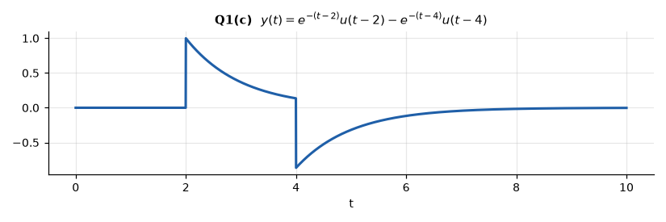
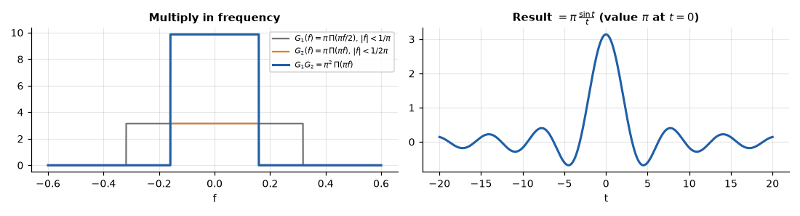
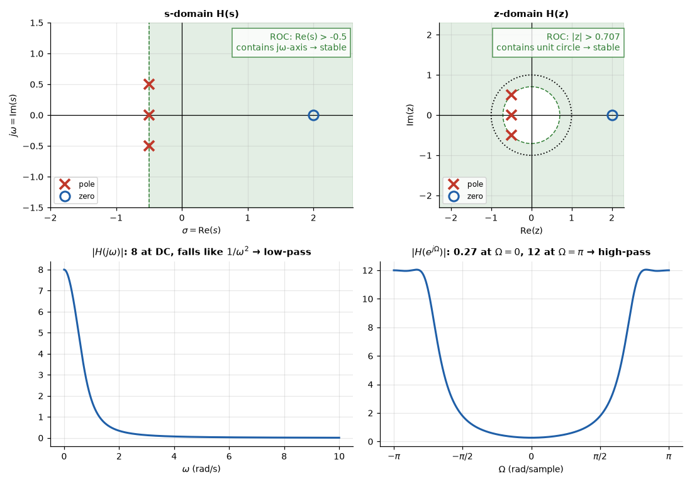
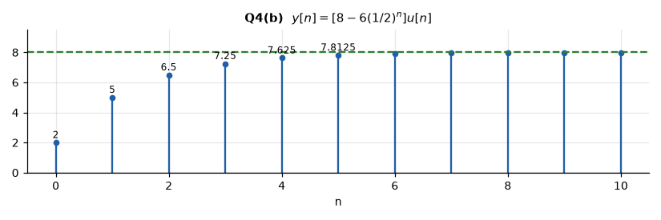

# SC3102 Past Paper Solutions: Semester 1, AY2024/25 (Nov/Dec 2024)

Paper: `../CE3102-24S1.pdf` · 4 questions × 25 marks · 2 hours · all questions compulsory

These are my own worked solutions; there is no official answer key. All numbers were re-checked by computer, and
the figures come from `make_figures.py`. Slide references use PDF page numbers in `SC3102/Slides/`.
The whole-course map is in [00_Exam_Guide.md](00_Exam_Guide.md).

<b>Answer key: final answers only (open after attempting)</b>

| Part | Final answer |
|---|---|
| 1(a)(i) | Periodic: $T_1=\frac13$ s, $T_2=\frac15$ s, ratio $\frac53$ is rational, so $T_0=1$ s |
| 1(a)(ii) | Lines: $f=-3$: $2.5\angle{+90^\circ}$; $f=+3$: $2.5\angle{-90^\circ}$; $f=+5$: $8\angle{+120^\circ}$ (no line at −5 Hz) |
| 1(b) | $x=0,\ 3,\ 5-t,\ 2,\ 3$ on $t<0,\ [0,2),\ [2,3),\ [3,4),\ t\ge4$. $E=\infty$ and $P=\frac92$, so a **power signal** |
| 1(c) | $y(t)=e^{-(t-2)}u(t-2)-e^{-(t-4)}u(t-4)$ |
| 2(a)(i) | Linear and TI. Equivalently, $h(t)=\sum C_k\delta(t-t_k)$ |
| 2(a)(ii) | $y=2\Pi\left(\frac{t-5}{4}\right)-\Pi\left(\frac{t+1}{4}\right)$. **Non-causal**, because $t_2=-3$ uses the future input |
| 2(b)(i) | FT both, multiply, inverse FT |
| 2(b)(ii) | $\pi\,\dfrac{\sin t}{t}$ |
| 3(a) | $s=\sigma+j\omega$; ROC is the right half-plane $\mathrm{Re}(s)>\sigma_{\max}$; CTFT $=X(s)\vert_{s=j\omega}$ if the axis is in the ROC |
| 3(b)(i) | $y(t)=\left[\frac{10}{3}-2e^{-t}-\frac43e^{-3t}\right]u(t)$ |
| 3(b)(ii) | $y_{ss}=1.225\sin(3\pi t-16.3^\circ)$, from $\lvert H\rvert=0.6126$, $\angle H=-76.3^\circ$ |
| 3(c) | $X(s)=\dfrac{\sqrt2\,(s-3)}{s^2+9}$, $\mathrm{Re}(s)>0$ |
| 4(a) | Both **stable** with a valid Fourier transform. $H(s)$ is **low-pass** ($\lvert H(0)\rvert=8$, falls like $1/\omega^2$); $H(z)$ is **high-pass** ($\lvert H(1)\rvert=0.27$, $\lvert H(-1)\rvert=12$) |
| 4(b) | $y[n]=[8-6(\frac12)^n]u[n]$, so $y[0..5]=2,\ 5,\ 6.5,\ 7.25,\ 7.625,\ 7.8125$ |
| 4(c) | $x[n]=\{7,\ 1,\ -1,\ 5\}$ |

---

## Question 1 (Signals)

$$x(t)=5\sin(6\pi t)+8j\,e^{j(10\pi t+\frac{\pi}{6})}$$

First use the hint: $j\,e^{j\theta}=e^{j(\theta+\frac{\pi}{2})}$, so the second term is $8e^{j(10\pi t+\frac{\pi}{6}+\frac{\pi}{2})}=8e^{j(10\pi t+\frac{2\pi}{3})}$.

### 1(a)(i) Periodic? Fundamental period (5 marks)

**Topic:** periodicity of a sum (Signals p.13–15). It's periodic if $T_1/T_2$ is rational.

1. $5\sin(6\pi t)$: $\omega_1=6\pi$, so $f_1=3$ Hz and $T_1=\frac13$ s.
2. $8e^{j(10\pi t+\cdots)}$: $\omega_2=10\pi$, so $f_2=5$ Hz and $T_2=\frac15$ s.
3. $\dfrac{T_1}{T_2}=\dfrac{1/3}{1/5}=\dfrac53$, which is rational, so the sum **is periodic**.
4. Using the slide rule $\frac{T_1}{T_2}=\frac km$ ⇒ $T_0=mT_1=kT_2$ with $k=5$, $m=3$: $T_0=3\cdot\frac13=5\cdot\frac15=1$ s. (Equivalently, $f_0=\gcd(3,5)=1$ Hz.)

**Answer:** periodic, $T_0=1$ s. In one second the sine does 3 cycles and the phasor does 5 turns.

### 1(a)(ii) Double-sided amplitude and phase spectra (6 marks)

**Topic:** spectra (Signals p.37–42). Write every term as $c\,e^{j2\pi ft}$.

1. Sine to cosine: $5\sin(6\pi t)=5\cos(6\pi t-\frac{\pi}{2})=\frac52e^{-j\frac{\pi}{2}}e^{j2\pi(3)t}+\frac52e^{+j\frac{\pi}{2}}e^{-j2\pi(3)t}$.
2. The complex exponential is **already a single line**: $8e^{j\frac{2\pi}{3}}e^{j2\pi(5)t}$. It contributes only at $+5$ Hz.

| $f$ (Hz) | −3 | +3 | +5 |
|---|---|---|---|
| amplitude | 2.5 | 2.5 | 8 |
| phase | $+\frac{\pi}{2}$ (+90°) | $-\frac{\pi}{2}$ (−90°) | $+\frac{2\pi}{3}$ (+120°) |

> **Trap:** don't add a line at −5 Hz. $x(t)$ is **complex-valued**, so its spectrum isn't conjugate-symmetric. Only real signals have matching $\pm f$ pairs.

### 1(b) Evaluate $x(t)=3u(t)-r(t-2)+r(t-3)+u(t-4)$; energy or power? (8 marks)

**Topic:** singularity functions (Signals p.43–52), energy and power (Signals p.17–21).

1. **Piecewise:**

   | interval | active terms | $x(t)$ |
   |---|---|---|
   | $t<0$ | none | 0 |
   | $0\le t<2$ | $3$ | 3 |
   | $2\le t<3$ | $3-(t-2)$ | $5-t$ (falls 3 → 2) |
   | $3\le t<4$ | $3-(t-2)+(t-3)$ | 2 |
   | $t\ge4$ | $2+1$ | 3 (forever) |

   
2. **Energy:** for $t\ge4$ the signal is $|x|^2=9$ forever, so $E=\int|x|^2dt=\infty$. Not an energy signal.
3. **Power** (symmetric window, Signals p.17). For $T/2>4$:
   $$\int_{-T/2}^{T/2}|x|^2dt=\underbrace{\int_0^2 9\,dt}_{18}+\underbrace{\int_2^3(5-t)^2dt}_{19/3}+\underbrace{\int_3^4 4\,dt}_{4}+\underbrace{\int_4^{T/2}9\,dt}_{9(T/2-4)}=\frac92T-\frac{23}{3}.$$
   $$P=\lim_{T\to\infty}\frac1T\left(\frac92T-\frac{23}{3}\right)=\frac92=4.5.$$

**Answer:** $E=\infty$ and $0<P=4.5<\infty$, so it's a **power signal**.

> **Trap:** the answer is $P=9/2$, not 9. The window $[-T/2,T/2]$ is half empty ($x=0$ for $t<0$), exactly like $u(t)$, which has $P=\frac12$. The finite "dip" on $[2,4)$ doesn't matter in the limit.

### 1(c) $h(t)=e^{-t}u(t)$, $x(t)=\delta(t-2)-\delta(t-4)$ (6 marks)

**Topic:** convolution with shifted impulses (Signals p.56–57, Systems p.31–32). By the sifting property, $h(t)*\delta(t-t_0)=h(t-t_0)$.

$$\boxed{y(t)=h(t-2)-h(t-4)=e^{-(t-2)}u(t-2)-e^{-(t-4)}u(t-4)}$$

Piecewise: $0$ for $t<2$; $e^{-(t-2)}$ for $2\le t<4$; and for $t\ge4$, $e^{-(t-2)}-e^{-(t-4)}=(e^{-2}-1)e^{-(t-4)}\approx-0.865\,e^{-(t-4)}$.

---

## Question 2 (Systems and Fourier transforms)

### 2(a)(i) Prove $y(t)=\sum_{k=1}^{N}C_kx(t-t_k)$ is linear and time-invariant (6 marks)

**Topic:** Systems p.11–13, 20–22 (the slide on p.22 is this same "sum of delayed copies" system).

1. **Linear.** The input $a\,x_1+b\,x_2$ gives
   $$\sum_kC_k\big[a\,x_1(t-t_k)+b\,x_2(t-t_k)\big]=a\sum_kC_kx_1(t-t_k)+b\sum_kC_kx_2(t-t_k)=a\,y_1(t)+b\,y_2(t).\ ✓$$
2. **Time-invariant.** The input $x_d(t)=x(t-t_0)$ gives
   $$\sum_kC_kx_d(t-t_k)=\sum_kC_kx(t-t_k-t_0)=y(t-t_0).\ ✓$$
   (The $C_k$ and $t_k$ are constants, with no explicit $t$.)

**Answer:** LTI. Its impulse response is $h(t)=\sum_kC_k\delta(t-t_k)$, a set of weighted echoes.

### 2(a)(ii) $x(t)=\Pi\left(\frac{t-2}{4}\right)$, $C_k=\{2,-1\}$, $t_k=\{3,-3\}$: output and causality (6 marks)

1. $x$ is a box of height 1 on $[0,4]$ (centre 2, width 4).
2. $y(t)=2x(t-3)-x(t+3)$:
   - $2x(t-3)$: height 2 on $[3,7]$, i.e. $2\Pi\left(\frac{t-5}{4}\right)$
   - $-x(t+3)$: height −1 on $[-3,1]$, i.e. $-\Pi\left(\frac{t+1}{4}\right)$
   $$\boxed{y(t)=2\Pi\!\left(\frac{t-5}{4}\right)-\Pi\!\left(\frac{t+1}{4}\right)}$$
3. **Causality:** $t_2=-3$ means $y(t)$ needs $x(t+3)$, the input 3 s **in the future**. Equivalently, $h(t)=2\delta(t-3)-\delta(t+3)$ is non-zero at $t=-3<0$. You can see it in the plot: the output starts at $t=-3$, before the input starts at $t=0$.

**Answer:** **non-causal**. A causal system needs all $t_k\ge0$.

### 2(b)(i) Steps of the convolution theorem, and why it simplifies things (5 marks)

**Topic:** Transforms p.33, 62; Systems p.53.

1. Find the transforms: $X(f)=\mathcal F\{x(t)\}$ and $H(f)=\mathcal F\{h(t)\}$ (from tables and properties).
2. Multiply: $Y(f)=X(f)\,H(f)$, because convolution in time is multiplication in frequency.
3. Invert: $y(t)=\mathcal F^{-1}\{Y(f)\}$, usually by splitting $Y$ into known pairs (partial fractions) and using the tables.

**Why it's simpler:**
- The convolution integral requires flip, shift, multiply and integrate for **every** $t$, with case-by-case limits. In frequency it becomes one algebraic multiplication per frequency.
- Complex exponentials are eigenfunctions of LTI systems, so each frequency is simply scaled by $H(f)$. That also tells you what the system *does* (low-pass, band-pass, …).
- Cascades become products: $H_1H_2$.
- Numerically, the FFT makes it $O(N\log N)$ instead of $O(N^2)$.

### 2(b)(ii) Evaluate $\displaystyle\int_{-\infty}^{\infty}\frac{\sin2\tau}{\tau}\,\frac{\sin(t-\tau)}{t-\tau}\,d\tau$ (8 marks)

**Topic:** convolution theorem, sinc ↔ rect duality (Transforms p.31–33).

1. **Recognise a convolution.** With $g_1(t)=\dfrac{\sin2t}{t}$ and $g_2(t)=\dfrac{\sin t}{t}$, the integral is $\int g_1(\tau)g_2(t-\tau)d\tau=(g_1*g_2)(t)$.
2. **Rewrite the given pair.** $AT\dfrac{\sin(\pi tT)}{\pi tT}=A\dfrac{\sin(\pi Tt)}{\pi t}\leftrightarrow A\,\Pi(f/T)$, so $\dfrac{\sin(\pi Tt)}{\pi t}\leftrightarrow\Pi(f/T)$, a box of height 1 on $|f|<\frac T2$.
3. **$g_1$:** $\dfrac{\sin2t}{t}=\pi\cdot\dfrac{\sin2t}{\pi t}$ with $\pi T=2$, so $T=\frac2\pi$:
   $$G_1(f)=\pi\,\Pi\!\left(\frac{\pi f}{2}\right)\quad(\text{height }\pi\text{ on }|f|<\tfrac1\pi).$$
4. **$g_2$:** $\dfrac{\sin t}{t}=\pi\cdot\dfrac{\sin t}{\pi t}$ with $T=\frac1\pi$:
   $$G_2(f)=\pi\,\Pi(\pi f)\quad(\text{height }\pi\text{ on }|f|<\tfrac{1}{2\pi}).$$
5. **Multiply.** The narrower box wins: $G_1G_2=\pi^2\,\Pi(\pi f)$ (height $\pi^2$ on $|f|<\frac{1}{2\pi}$).
6. **Invert.** Using step 2 with $T=\frac1\pi$: $\Pi(\pi f)\leftrightarrow\dfrac{\sin t}{\pi t}$. So
   $$g_1*g_2=\pi^2\cdot\frac{\sin t}{\pi t}=\boxed{\pi\,\frac{\sin t}{t}}$$

**Check at $t=0$:** $\int\frac{\sin2\tau\sin\tau}{\tau^2}d\tau=\pi\min(2,1)=\pi$ ✓. (It was also checked numerically at $t=0.7$.)
**Intuition:** passing one ideal low-pass signal through a wider ideal low-pass filter leaves the narrower one unchanged, up to the filter's gain $\pi$.

---

## Question 3 (Laplace transform)

### 3(a) The unilateral Laplace transform of a causal $x(t)u(t)$: role of $s$, ROC shape, link to the CTFT (6 marks)

**Topic:** L5 `lecture(4)` p.5–19, 27–31, 39; L6 `lecture(5)` p.42.

$$X(s)=\int_{0^-}^{\infty}x(t)\,e^{-st}\,dt,\qquad s=\sigma+j\omega.$$

- **Role of $s$:** $e^{-st}=e^{-\sigma t}\,e^{-j\omega t}$.
  - $\omega$ is the ordinary frequency, as in the CTFT.
  - $\sigma$ is an exponential weighting (damping) factor. It forces $x(t)e^{-\sigma t}$ to be absolutely integrable, so signals like $u(t)$, $t\,u(t)$ and $e^{2t}u(t)$ (which have no CTFT) still have a Laplace transform.
  - So $X(s)$ is the CTFT of $x(t)e^{-\sigma t}u(t)$, evaluated at frequency $\omega$.
- **Shape of the ROC:** for a causal (right-sided) signal, if the integral converges for some $\sigma_1$, it converges for every $\sigma>\sigma_1$ (more damping only helps). So the ROC is a **right half-plane**, $\mathrm{Re}(s)>\sigma_0$, bounded on the left by a vertical line through the **rightmost pole**. The ROC never contains a pole.
- **Relation to the CTFT:** on the $j\omega$-axis ($\sigma=0$), $X(s)|_{s=j\omega}=X(\omega)$, the CTFT. This is valid only when the $j\omega$-axis is in the ROC, i.e. (for causal signals) every pole has $\mathrm{Re}(p)<0$. For an LTI system, that is also the BIBO stability condition.
- **Extra feature of the unilateral form:** $\mathcal L\{x'\}=sX(s)-x(0^-)$ brings in initial conditions, which is why it's used to solve ODEs.

### 3(b) $h(t)=2e^{-t}+4e^{-3t}$

> The paper omits $u(t)$. Assume a causal system, $h(t)=(2e^{-t}+4e^{-3t})u(t)$; otherwise $h$ blows up as $t\to-\infty$ and neither part makes sense. Say so in one line in the exam.

$$H(s)=\frac{2}{s+1}+\frac{4}{s+3}=\frac{6s+10}{(s+1)(s+3)},\qquad\text{ROC }\mathrm{Re}(s)>-1\ \ (\text{stable}).$$

#### (i) Step response (8 marks)
1. $Y(s)=H(s)\cdot\dfrac1s=\dfrac{2}{s(s+1)}+\dfrac{4}{s(s+3)}$.
2. Partial fractions: $\dfrac{1}{s(s+a)}=\dfrac1a\left(\dfrac1s-\dfrac{1}{s+a}\right)$, so
   $$Y(s)=2\left(\frac1s-\frac{1}{s+1}\right)+\frac43\left(\frac1s-\frac{1}{s+3}\right)=\frac{10/3}{s}-\frac{2}{s+1}-\frac{4/3}{s+3}.$$
3. Invert:

**Answer:** $\boxed{y(t)=\left[\frac{10}{3}-2e^{-t}-\frac43e^{-3t}\right]u(t)}$

**Checks:** $y(0)=\frac{10}{3}-2-\frac43=0$ ✓ (a step can't jump an output whose $h$ has no impulse). $y(\infty)=H(0)=2+\frac43=\frac{10}{3}$ ✓. The time-domain route also works: $y(t)=\int_0^th(\tau)d\tau=2(1-e^{-t})+\frac43(1-e^{-3t})$, which is the same.

#### (ii) Steady state for $x(t)=2\sin(3\pi t+\frac{\pi}{3})$ using $H(j\omega)$ (5 marks)
**Topic:** sinusoidal steady state (Systems p.50–52; L6 p.24). Valid because the system is stable.

1. $\omega=3\pi\approx9.4248$ rad/s:
   $$H(j3\pi)=\frac{10+j\,6(3\pi)}{(1+j3\pi)(3+j3\pi)}=\frac{10+j56.55}{(1+j9.425)(3+j9.425)}.$$
2. **Magnitude:**
   $$|H|=\frac{\sqrt{10^2+56.55^2}}{\sqrt{1+9.425^2}\,\sqrt{9+9.425^2}}=\frac{57.43}{9.478\times9.891}=0.6126.$$
3. **Phase:**
   $$\angle H=\tan^{-1}\tfrac{56.55}{10}-\tan^{-1}9.425-\tan^{-1}\tfrac{9.425}{3}=79.97^\circ-83.94^\circ-72.34^\circ=-76.32^\circ\ (-1.332\text{ rad}).$$
4. The output is the same sinusoid, scaled and shifted: $y_{ss}=2|H|\sin(3\pi t+\frac{\pi}{3}+\angle H)$, and $60^\circ-76.32^\circ=-16.32^\circ$.

**Answer:** $\boxed{y_{ss}(t)=1.225\sin(3\pi t-16.3^\circ)}$, i.e. $1.225\sin(3\pi t-0.285)$.

### 3(c) Laplace transform of $x(t)=2\cos(3t+\frac{\pi}{4})u(t)$ (6 marks)

**Topic:** pairs for sines and cosines, and the amplitude–phase form (L5 `lecture(4)` p.74–76).

1. Expand: $2\cos(3t+\frac{\pi}{4})=2\cos3t\cos\frac{\pi}{4}-2\sin3t\sin\frac{\pi}{4}=\sqrt2\cos3t-\sqrt2\sin3t$.
2. Use $\cos(\beta t)u\leftrightarrow\frac{s}{s^2+\beta^2}$ and $\sin(\beta t)u\leftrightarrow\frac{\beta}{s^2+\beta^2}$:
   $$X(s)=\sqrt2\,\frac{s}{s^2+9}-\sqrt2\,\frac{3}{s^2+9}=\boxed{\frac{\sqrt2\,(s-3)}{s^2+9},\quad\mathrm{Re}(s)>0}$$
3. **Check against the slide formula** (L5 p.75): $r\frac{(s-\alpha)\cos\theta-\beta\sin\theta}{(s-\alpha)^2+\beta^2}$ with $r=2$, $\theta=\frac{\pi}{4}$, $\alpha=0$, $\beta=3$ gives the same thing ✓.

> **Trap:** don't use the time-shift rule. $\cos(3t+\frac{\pi}{4})u(t)$ is **not** a delayed copy of $\cos(3t)u(t)$, because the $u(t)$ isn't shifted.

---

## Question 4 (s-domain vs z-domain; Z-transform; DFT)

### 4(a) Pole-zero diagrams and ROCs for $H(s)$ and $H(z)$; frequency behaviour, stability, Fourier transform (8 marks)

$$H(s)=\frac{s-2}{(s+\frac12)(s+0.5+j0.5)(s+0.5-j0.5)},\qquad H(z)=\frac{z-2}{(z+\frac12)(z+0.5+j0.5)(z+0.5-j0.5)}$$

**Topic:** L5 `lecture(4)` p.17–19, 39, 57; L3 `lecture(2)` p.15–16, 37, 55; L6/L4 causality and stability.

**Poles and zeros (the same numbers in both planes):** zero at $2$; poles at $-0.5$ and $-0.5\pm j0.5$.

| | s-domain (continuous) | z-domain (discrete) |
|---|---|---|
| Causal ROC | right of the rightmost pole: $\mathrm{Re}(s)>-0.5$ | outside the outermost pole: $\lvert z\rvert>\lvert{-0.5\pm j0.5}\rvert=\frac{1}{\sqrt2}\approx0.707$ |
| Stability test | ROC contains the $j\omega$-axis ⇔ all poles have $\mathrm{Re}<0$ | ROC contains the unit circle ⇔ all poles have $\lvert p\rvert<1$ |
| Stable? | **Yes** (all poles have real part $-0.5$) | **Yes** (largest $\lvert p\rvert=0.707<1$) |
| Fourier transform | exists: $H(j\omega)=H(s)\vert_{s=j\omega}$ | exists: $H(e^{j\Omega})=H(z)\vert_{z=e^{j\Omega}}$ |
| The zero at 2 | in the right half-plane: non-minimum phase, no effect on stability | outside the unit circle: non-minimum phase, no effect on stability |
| Gain at low frequency | $H(0)=\frac{-2}{0.5\times0.5}=-8$, so $\lvert H\rvert=8$ | $H(1)=\frac{-1}{1.5\times2.5}=-0.267$ |
| Gain at high frequency | $\lvert H(j\omega)\rvert\sim\frac{\omega}{\omega^3}=\frac{1}{\omega^2}\to0$ (3 poles vs 1 zero, −40 dB/dec) | at $\Omega=\pi$ ($z=-1$): $H(-1)=\frac{-3}{(-0.5)(0.5)}=12$ |
| **Behaviour** | **low-pass** | **high-pass** |

**Why the same numbers behave oppositely.** In the s-plane the frequency axis is the vertical $j\omega$-axis. The poles sit near its low-frequency end ($s=0$, distance about 0.5–0.7), so low frequencies are boosted and high frequencies, far from every pole, are attenuated.
In the z-plane, frequency runs around the unit circle: $\Omega=0$ at $z=1$ and $\Omega=\pi$ at $z=-1$. All the poles lie in the left half of the circle, close to $z=-1$ (distance 0.5–0.7), and far from $z=+1$ (distance 1.5–1.6). The zero at $z=2$ is also closer to $z=1$. So the gain is largest near $\Omega=\pi$, which makes it **high-pass**.

### 4(b) $H(z)=\dfrac{z+1}{z-\frac12}$, $x[n]=2u[n]$: $y[n]$ and $y[0..5]$ (10 marks)

**Topic:** LCCDEs with Z (L4 `lecture(3).pdf` p.26–34), partial fractions (L3 p.43–54).

1. $X(z)=\dfrac{2z}{z-1}$, so $Y(z)=\dfrac{2z(z+1)}{(z-\frac12)(z-1)}$, with ROC $|z|>1$.
2. Partial fractions on $Y/z$:
   $$\frac{Y}{z}=\frac{2(z+1)}{(z-\frac12)(z-1)}=\frac{A}{z-1}+\frac{B}{z-\frac12},\qquad A=\frac{2(2)}{\frac12}=8,\quad B=\frac{2(\frac32)}{-\frac12}=-6.$$
3. $Y(z)=8\dfrac{z}{z-1}-6\dfrac{z}{z-\frac12}$, which inverts to

**Answer:** $\boxed{y[n]=\left[8-6\left(\tfrac12\right)^n\right]u[n]}$. The steady state is $8=2H(1)=2\cdot\frac{2}{0.5}$ ✓, and the transient is $-6(\frac12)^n$.

| $n$ | 0 | 1 | 2 | 3 | 4 | 5 |
|---|---|---|---|---|---|---|
| $y[n]$ | 2 | 5 | 6.5 | 7.25 | 7.625 | 7.8125 |

**Check by recursion.** The difference equation is $y[n]=\frac12y[n-1]+x[n]+x[n-1]$, so:
- $y[0]=2$
- $y[1]=1+2+2=5$
- $y[2]=2.5+4=6.5$ ✓

### 4(c) $x[n]$ from the 4-point DFT $X[k]=[12,\ 8+4j,\ 0,\ 8-4j]$ (7 marks)

$x[n]=\frac14\sum_kX[k]\,j^{kn}$ (L1 `lecture.pdf` p.53–56):

| $n$ | $\frac14\big[12+(8+4j)j^n+0+(8-4j)(-j)^n\big]$ | $x[n]$ |
|---|---|---|
| 0 | $\frac14[12+16]$ | **7** |
| 1 | $\frac14[12+(-4+8j)+(-4-8j)]$ | **1** |
| 2 | $\frac14[12-(8+4j)-(8-4j)]$ | **−1** |
| 3 | $\frac14[12+(4-8j)+(4+8j)]$ | **5** |

A faster way: the pair $X[1],X[3]$ is conjugate, so $x[n]=\frac14\big[12+2\,\mathrm{Re}\{(8+4j)j^n\}\big]=3+4\cos\frac{\pi n}{2}-2\sin\frac{\pi n}{2}$.

**Answer:** $\boxed{x[n]=\{7,\ 1,\ -1,\ 5\}}$

**Checks:**
- $\sum x=12=X[0]$ ✓
- $X[2]=7-1-1-5=0$ ✓
- $X[1]=7+1(-j)+(-1)(-1)+5(j)=8+4j$ ✓
