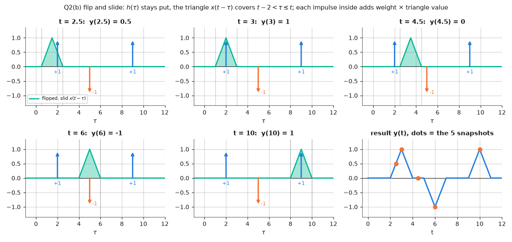
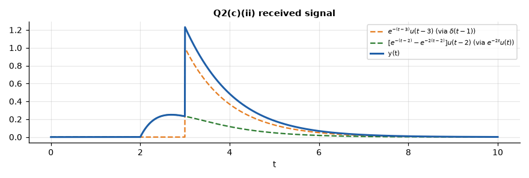
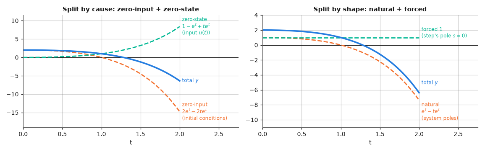

# SC3102 Past Paper Solutions: Semester 1, AY2025/26 (Nov/Dec 2025)

Paper: `../CE3102-25S1.pdf` · 4 questions × 25 marks · 2 hours · all questions compulsory

These are my own worked solutions; there is no official answer key. All numbers were re-checked by computer.
Most figures come from `make_figures.py`; `25S1_Q2b_slide.png` and `25S1_Q3c_split.png` were drawn separately
for this write-up. Slide references use PDF page numbers in `SC3102/Slides/`.
The whole-course map is in [00_Exam_Guide.md](00_Exam_Guide.md).
**This is the most recent Semester 1 paper, so it's the closest in style to the final.**

**How each part is laid out.** Every part has two blocks, in this order:
1. **Exam answer:** what to write on the paper. The question, what's given and asked, each step with the rule it uses, the boxed answer, and a one-line check.
2. **Explanation:** why each step works, what the ideas mean, common traps, and links to other parts. Read it after the exam answer.

<b>Answer key: final answers only (open after attempting)</b>

| Part | Final answer |
|---|---|
| 1(a)(i) | $x(t+4)=x(t)$ (re-index). The value 1 occurs only at $t=4n$, so $T_0=4$ s |
| 1(a)(ii) | Non-overlapping pulses centred at $-4,0,4,8$: peak 1, edges $e^{-1}=0.368$, zero gaps in between |
| 1(a)(iii) | $P=\frac14\int_{-1}^{1}e^{-2\lvert t\rvert}dt=\frac{1-e^{-2}}{4}\approx0.216$, so a **power signal** |
| 1(b) | **Valid**: even, max at 0, and $S(f)=\frac{2A\alpha}{\alpha^2+4\pi^2f^2}+\frac{B}{f_0}\Pi(\frac{f}{f_0})+\frac C2[\delta(f-f_1)+\delta(f+f_1)]\ge0$ |
| 2(a) | $y=6\delta(t-5)+3\Pi(\frac{t-7}{2})-6\delta(t-9)-3\Pi(\frac{t-11}{2})$ |
| 2(b) | $y=x(t-2)-x(t-5)+x(t-9)$: a $+$triangle on $[2,4]$, a $-$triangle on $[5,7]$, a $+$triangle on $[9,11]$ |
| 2(c)(i) | $Y(f)=\dfrac{e^{-j6\pi f}}{1+j2\pi f}+\dfrac{e^{-j4\pi f}}{(1+j2\pi f)(2+j2\pi f)}$ |
| 2(c)(ii) | $y(t)=e^{-(t-3)}u(t-3)+\big[e^{-(t-2)}-e^{-2(t-2)}\big]u(t-2)$ |
| 3(a) | $F(s)=\dfrac{s+2}{(s+2)^2+9}+\dfrac{2}{(s+5)^2+4}$, $\mathrm{Re}(s)>-2$ |
| 3(b) | $F(s)=\dfrac{e^{j3}}{s-j}+\dfrac{5}{s^2+25}$, $\mathrm{Re}(s)>0$ |
| 3(c)(i) | $y(t)=1+(1-t)e^{t}$, $t\ge0$ (unstable) |
| 3(c)(ii) | $h(t)=t\,e^{t}u(t)$ |
| 4(a)(i) | $H(z)=\dfrac{1+0.5z^{-1}}{1-0.1z^{-1}}=\dfrac{z+0.5}{z-0.1}$ |
| 4(a)(ii) | Zero $-0.5$, pole $0.1$, ROC $\lvert z\rvert>0.1$ |
| 4(a)(iii) | Stable: the pole is inside the unit circle (the ROC contains $\lvert z\rvert=1$) |
| 4(a)(iv) | $y_{ss}[n]=\frac{5}{11}\cos(\pi n)=\frac{5}{11}(-1)^n$; full response $\left[\frac{6}{11}(0.1)^n+\frac{5}{11}(-1)^n\right]u[n]$ |
| 4(a)(v) | $h[n]=-5\delta[n]+6(0.1)^nu[n]$ ($=1,\ 0.6,\ 0.06,\ \dots$) |
| 4(b) | $x[n]=\{2.25,\ -0.75,\ -0.75,\ 0.25\}$ |

---

## Question 1 (Signals)

> *"A train of decaying pulses, modeling a radar signal, is defined as"*
>
> $$x(t)=\sum_{n=-\infty}^{\infty}f(t-4n)\,e^{-\alpha|t-4n|},\qquad\alpha>0,$$
>
> *"where $f(t)=u(t+1)-u(t-1)$, and $u(t)$ is the unit step function."*

Call one term $p(t)=f(t)e^{-\alpha|t|}$. The gate $f$ is 1 on $[-1,1)$ and 0 elsewhere, so $p$ is a single pulse on $[-1,1)$, equal to 1 at $t=0$ and $e^{-\alpha}$ at the edges. Term $n$ is the same pulse moved to $t=4n$, so $x(t)=\sum_np(t-4n)$.

### 1(a)(i) Periodic? Fundamental period (6 marks)

**Topic:** definition of periodicity (Signals p.9–10). This is the same proof pattern as 23S1 Q1(a)(i).

#### Exam answer

> *"Using the definition of periodicity, determine whether the signal $x(t)$ is periodic. If it is, find its fundamental period. If it is not, provide a clear justification."*

**Given:** $x(t)=\sum_{n=-\infty}^{\infty}f(t-4n)e^{-\alpha|t-4n|}$ with $f(t)=u(t+1)-u(t-1)$ and $\alpha>0$.
**Asked:** is there a $T>0$ with $x(t+T)=x(t)$ for all $t$? If so, the smallest one, $T_0$.

**Definition used** (Signals p.9–10): $x$ is periodic if some $T>0$ gives $x(t+T)=x(t)$ for **all** $t$. The fundamental period $T_0$ is the smallest such $T$.

1. **Name one term.** Let $p(t)=f(t)e^{-\alpha|t|}$. Replacing $t$ by $t-4n$ gives $p(t-4n)=f(t-4n)e^{-\alpha|t-4n|}$, which is exactly term $n$. So
   $$x(t)=\sum_{n=-\infty}^{\infty}p(t-4n).$$
2. **Test $T=4$** (put $t+4$ in place of $t$):
   $$x(t+4)=\sum_{n=-\infty}^{\infty}p(t+4-4n).$$
   Factor the argument: $t+4-4n=t-4n+4=t-4(n-1)$. So
   $$x(t+4)=\sum_{n=-\infty}^{\infty}p\big(t-4(n-1)\big).$$
3. **Re-index** with $m=n-1$. As $n$ runs over all integers, so does $m$:
   $$x(t+4)=\sum_{m=-\infty}^{\infty}p(t-4m)=x(t)\quad\text{for all }t.$$
   So $x$ is periodic, and $4$ is a period.
4. **Rule out a smaller period.**
   - Pulse $n$ is nonzero only on $[4n-1,\,4n+1)$. The next pulse starts at $4(n+1)-1=4n+3$, which is after $4n+1$. So the pulses never overlap, and at any $t$ at most one term is nonzero.
   - Inside pulse $n$, $x(t)=e^{-\alpha|t-4n|}$. Since $\alpha>0$, this equals $1$ only when $|t-4n|=0$ and is less than 1 otherwise. So $x(t)=1$ **only** at $t=4n$, i.e. at $t=\dots,-4,0,4,8,\dots$
   - Suppose some $T$ with $0<T<4$ were a period. Then $x(T)=x(0+T)=x(0)=1$, so $T$ would have to be one of the points $4n$. No multiple of 4 lies strictly between 0 and 4. That's a contradiction.

$$\boxed{x(t)\text{ is periodic, with fundamental period }T_0=4\text{ s}}$$

**Check** ($\alpha=1$): $x(0.5)=e^{-0.5}=0.607$ and $x(4.5)=e^{-|4.5-4|}=e^{-0.5}=0.607$ ✓. And $T=2$ fails: $x(0)=1$ but $x(2)=0$ (no gate is on at $t=2$).

#### Explanation

- **What the definition asks.** "Periodic" means: slide the whole graph left by $T$ and it lands exactly on itself, at *every* $t$. One matching point isn't enough. That's why step 3 shows the equality for all $t$ instead of checking a few values.
- **Reading the sum.** $n$ is only a counter. Write out three terms with $\alpha=1$:
  - $n=0$: $f(t)e^{-|t|}$. The gate is on for $-1\le t<1$, so this is a pulse on $[-1,1)$ peaking at $t=0$.
  - $n=1$: $f(t-4)e^{-|t-4|}$. The gate is on when $-1\le t-4<1$, i.e. on $[3,5)$, peaking at $t=4$.
  - $n=-1$: on $[-5,-3)$, peaking at $t=-4$.

  So term $n$ is the same pulse with its centre at $4n$. (In general $g(t-c)$ is $g$ moved right by $c$, because at $t=c$ it gives $g(0)$.)
- **Why the gate is 1 on $[-1,1)$.** $u(t+1)$ switches on at $t=-1$; $u(t-1)$ switches on at $t=1$:
  - $t<-1$: $0-0=0$;
  - $-1\le t<1$: $1-0=1$;
  - $t\ge1$: $1-1=0$.
- **Why the re-index works, with numbers.** Adding 4 to $t$ moves every pulse 4 to the *left*: the pulse centred at 4 lands on 0, the one at 0 lands on $-4$, and so on. The set of centres $\{\dots,-4,0,4,8,\dots\}$ is the same set afterwards. That is all "$m=n-1$" says. At $t=0.5$, $x(0.5)$ comes from term $n=0$; at $t=4.5$, $x(4.5)$ comes from term $n=1$; both are $e^{-0.5}$.
- **Why it's periodic although it "decays".** The exponent is $|t-4n|$, the distance from *each pulse's own centre*, not from $t=0$. So the decay restarts at every pulse. If the signal were $e^{-\alpha|t|}\sum_nf(t-4n)$ instead (decay measured from $t=0$), the peaks with $\alpha=1$ would be $1,\ e^{-4}=0.018,\ e^{-8}=0.0003$: shrinking, so not periodic.
- **Why $n$ must run over all integers.** With $\sum_{n\ge0}$ only, $x(-4)=0$ but $x(0)=1$. The signal would have a start, and a periodic signal can't have one.
- **Why step 4 is needed.** Step 3 shows 4 is *a* period, but so are 8, 12, … (for example $x(t+8)=x\big((t+4)+4\big)=x(t+4)=x(t)$). The fundamental period is the smallest, so you must rule out everything below 4. The trick is a feature that happens once per period, here the value 1 at each centre. A unique peak is the usual choice.
- **Trap:** writing "$T_0=4$ because the pulses are spaced 4 apart" without steps 2–4. The question says "using the definition", so the marks are for the substitution and the re-index.
- **Links:** (ii) sketches these pulses; (iii) needs $T_0=4$ for the power. 23S1 Q1(a)(i) is the same proof with $\sum_ng(t-3n)$.

### 1(a)(ii) Sketch for $\alpha=1$ on $[-6,10]$ (6 marks)

#### Exam answer

> *"For $\alpha=1$, sketch the signal $x(t)$ over the interval $t\in[-6,10]$. Annotate key features of the waveform such as peak values and regions of overlap (if any). Clearly indicate the contribution from at least two individual terms in the summation."*

**Given:** $\alpha=1$, so term $n$ is $f(t-4n)e^{-|t-4n|}$. **Asked:** a labelled sketch on $[-6,10]$.

1. **Where term $n$ lives (gate + time shift).** $f(t-4n)=1$ when $-1\le t-4n<1$. Add $4n$ to all three parts: $4n-1\le t<4n+1$.
2. **Which $n$ appear in the window.** Pulse $n$ touches $[-6,10]$ when its right end is past $-6$ and its left end is before $10$:
   - $4n+1>-6\ \Rightarrow\ 4n>-7\ \Rightarrow\ n>-1.75$, so $n\ge-1$;
   - $4n-1\le10\ \Rightarrow\ 4n\le11\ \Rightarrow\ n\le2.75$, so $n\le2$.

   So $n=-1,0,1,2$, with centres $-4,0,4,8$ and supports $[-5,-3)$, $[-1,1)$, $[3,5)$, $[7,9)$. (The $n=-2$ pulse ends at $-7$ and the $n=3$ pulse starts at $11$; both are outside.)
3. **Shape of one pulse** ($n=0$: $e^{-|t|}$ on $[-1,1)$):
   - centre $t=0$: $e^{0}=1$ (**peak**);
   - $t=\pm0.5$: $e^{-0.5}=0.607$;
   - edges $t=\pm1$: $e^{-1}=0.368$, then a vertical jump to 0 where the gate switches off.

   It is symmetric because $|-t|=|t|$, and its sides curve (exponential), not straight lines.
4. **Overlap.** Each pulse is 2 wide and the centres are 4 apart. Pulse $n$ ends at $4n+1$ and pulse $n+1$ starts at $4n+3$, leaving a gap of 2. **No overlap.** $x=0$ on $[-6,-5)$, $[-3,-1)$, $[1,3)$, $[5,7)$ and $[9,10]$.
5. **Two terms highlighted:** $n=0$ (blue, $e^{-|t|}$ on $[-1,1)$) and $n=1$ (orange, $e^{-|t-4|}$ on $[3,5)$).

**Check:** $x(4.5)=e^{-|4.5-4|}=e^{-0.5}=0.607=x(0.5)$, as the period 4 from (i) requires ✓.

#### Explanation

- **What the marker looks for:** four pulses in the right places; the peak value 1 and the edge value $0.368$ labelled; the words "no overlap" with the reason (width 2 < spacing 4); and two terms visibly marked as separate contributions.
- **Why the sides curve.** Halfway down a side ($t=0.5$) the value is $e^{-0.5}=0.607$. A straight line from 1 down to $0.368$ would give $(1+0.368)/2=0.684$ there. The exponential sags below the straight line, so draw the sides bowing inwards, as in the figure.
- **Why there are jumps at the edges.** $e^{-|t|}$ never reaches 0 by itself; the gate $f$ is what cuts it off at $\pm1$. So at $t=1$ the value drops straight from $0.368$ to $0$.
- **What "regions of overlap" would mean.** If the pulses were wider than their spacing (say gate width 6 with spacing 4), two terms would be on at the same $t$, and you'd add them point by point. Here that never happens, so you write "no overlap" and give the reason. The question says "(if any)" to see whether you check.
- **Half-open intervals.** $[-1,1)$ includes $-1$ but not $1$, because $u(t-1)$ is already 1 at $t=1$. In a sketch you can't see this; it only matters for exact values at the edges.
- **Traps:**
  - drawing shrinking peaks (that misreads the exponent as $e^{-\alpha|t|}$, see (i));
  - drawing triangles with straight sides;
  - forgetting the zero stretches at the window ends, $[-6,-5)$ and $[9,10]$.

### 1(a)(iii) Average power for $\alpha=1$; power signal? (6 marks)

**Topic:** power of a periodic signal (Signals p.17; Transforms p.57).

#### Exam answer

> *"Compute the average power of the signal $x(t)$ for $\alpha=1$. Based on your result, determine whether the signal is a power signal. Justify your answer with appropriate calculations and definitions."*

**Given:** $\alpha=1$; $x$ is periodic with $T_0=4$ (from (i)). **Asked:** the average power $P$, and whether $x$ is a power signal.

**Definitions** (Signals p.17; Transforms p.57):
- Average power of a periodic signal: $P=\dfrac{1}{T_0}\displaystyle\int_{\text{one period}}|x(t)|^2\,dt$.
- Power signal: $0<P<\infty$ (then the energy $E=\infty$). Energy signal: $0<E<\infty$ (then $P=0$).

1. **Choose the one-period window $[-2,2)$.** Inside it only the $n=0$ term is nonzero, and only on $[-1,1)$ (the $n=\pm1$ pulses live on $[3,5)$ and $[-5,-3)$). $x$ is real and positive, so $|x|^2=x^2$:
   $$P=\frac14\int_{-1}^{1}\big(e^{-|t|}\big)^2dt.$$
2. **Square** using $(e^{a})^2=e^{2a}$: $\big(e^{-|t|}\big)^2=e^{-2|t|}$.
3. **Remove the absolute value by splitting at 0.** For $t<0$, $|t|=-t$, so $-2|t|=2t$. For $t\ge0$, $|t|=t$, so $-2|t|=-2t$:
   $$\int_{-1}^{1}e^{-2|t|}dt=\int_{-1}^{0}e^{2t}dt+\int_{0}^{1}e^{-2t}dt.$$
4. **Integrate each piece** with $\displaystyle\int e^{at}dt=\frac{e^{at}}{a}$, plugging in the upper limit, then the lower:
   $$\int_{0}^{1}e^{-2t}dt=\left[\frac{e^{-2t}}{-2}\right]_0^1=\frac{e^{-2}}{-2}-\frac{e^{0}}{-2}=-\frac{e^{-2}}{2}+\frac12=\frac{1-e^{-2}}{2}$$
   $$\int_{-1}^{0}e^{2t}dt=\left[\frac{e^{2t}}{2}\right]_{-1}^0=\frac{e^{0}}{2}-\frac{e^{-2}}{2}=\frac{1-e^{-2}}{2}$$
   Total: $\dfrac{1-e^{-2}}{2}+\dfrac{1-e^{-2}}{2}=1-e^{-2}$.
5. **Divide by the period:**
   $$P=\frac14\left(1-e^{-2}\right)=\frac{1-0.1353}{4}=\frac{0.8647}{4}=0.2162.$$

$$\boxed{P=\frac{1-e^{-2}}{4}\approx0.216}$$

**Conclusion:** $0<P=0.216<\infty$, so $x$ is a **power signal**. It is not an energy signal: each of the infinitely many periods adds the same energy $1-e^{-2}=0.865$, so $E=\infty$.

**Check:** numerically integrating $x^2$ over $[-2,2)$ and dividing by 4 gives $0.2162$ ✓.

#### Explanation

- **What average power means.** Energy is the total of "signal squared" over time, $\int|x|^2dt$. Power is energy per second, averaged over a long time. For a periodic signal every period is identical, so the average over one period equals the average over all time. That's why the formula integrates over one $T_0$ and divides by $T_0$.
- **Why any window of length 4 works.** Each window of length 4 contains exactly one pulse's worth of signal. $[-2,2)$ is the easiest because the pulse sits whole in the middle. $[0,4)$ would also work, but it cuts the $n=0$ and $n=1$ pulses into halves.
- **Two different sets of bars.** $|t|$ is part of the signal ($e^{-|t|}$). The bars in $|x(t)|^2$ belong to the power formula and only matter for complex signals; here $x$ is real and positive, so $|x|^2=x^2$. The $|t|$ really matters: at $t=-1$, $e^{-t}=e^{1}=2.718$, but the pulse value is $e^{-|-1|}=e^{-1}=0.368$.
- **Checking the integral rule.** $\int e^{-2t}dt=\dfrac{e^{-2t}}{-2}$. Differentiate back with the chain rule: $\dfrac{d}{dt}\left(\dfrac{e^{-2t}}{-2}\right)=\dfrac{-2e^{-2t}}{-2}=e^{-2t}$ ✓. The common slip is multiplying by $-2$ instead of dividing.
- **Why the two halves are equal.** $e^{-2|t|}$ is even (the same at $t$ and $-t$), so the area left of 0 equals the area right of 0: $0.432+0.432=0.865$. That's the shortcut $\int_{-1}^1=2\int_0^1$, which step 4 confirms the long way.
- **Why $E=\infty$, with numbers.** After $N$ periods the energy is about $0.865N$: $8.6$ after 10 periods, $86$ after 100. It grows without limit, while the average $0.865N/(4N)=0.216$ stays fixed.
- **The three classes:**
  - energy signal: $E$ finite, so $P=0$ (e.g. one single pulse $e^{-|t|}$);
  - power signal: $P$ finite and nonzero, so $E=\infty$ (every nonzero periodic signal; also $u(t)$);
  - neither: $P=\infty$ (e.g. $e^{t}$).
- **Traps:**
  - forgetting to square: $\frac14\int_{-1}^1e^{-|t|}dt=\frac{1.264}{4}=0.316$. That is the *average value* of $x$, not its power;
  - dividing by the pulse width 2 instead of the period 4: gives $0.432$;
  - ignoring the $|t|$: $\int_{-1}^1e^{-2t}dt=\frac{e^{2}-e^{-2}}{2}=3.627$, far too big.

### 1(b) Is $x(\tau)=Ae^{-\alpha|\tau|}+B\dfrac{\sin\pi f_0\tau}{\pi f_0\tau}+C\cos(2\pi f_1\tau)$ a valid autocorrelation function? (7 marks)

**Topic:** autocorrelation properties (Signals p.26–28), Wiener–Khinchin and power spectral density $\ge0$ (Transforms p.57–61).

#### Exam answer

> *"... the autocorrelation function of a signal is proposed to be $x(\tau)=Ae^{-\alpha|\tau|}+B\cdot\frac{\sin(\pi f_0\tau)}{\pi f_0\tau}+C\cdot\cos(2\pi f_1\tau)$, where $A,B,C\ge0$ ... Evaluate whether $x(\tau)$ can be considered a valid autocorrelation function. In your answer, discuss the necessary conditions that an autocorrelation function must satisfy, and analyze the given $x(\tau)$ in terms of these conditions."*

**Given:** the three-term $x(\tau)$ with $A,B,C\ge0$ and $\alpha>0$, plus three hint pairs. **Asked:** the conditions, then whether $x(\tau)$ meets them.

Notation: $\mathrm{sinc}(u)=\dfrac{\sin\pi u}{\pi u}$, so the middle term is $B\,\mathrm{sinc}(f_0\tau)$.

**Conditions an autocorrelation $R(\tau)$ of a real signal must satisfy** (Signals p.26–28, Transforms p.57–61):
1. **Even** (conjugate symmetric): $R(-\tau)=R(\tau)$.
2. **Maximum at the origin:** $|R(\tau)|\le R(0)$, where $R(0)$ is the average power (or energy), so $R(0)\ge0$.
3. **Non-negative power spectral density (PSD)** (Wiener–Khinchin theorem): $S(f)=\mathcal F\{R(\tau)\}\ge0$ for every $f$. This is the decisive test; conditions 1 and 2 follow from it.
4. **Periodic part:** if the signal has a periodic component, $R$ has a periodic component with the same period (this is allowed).

**Term by term** (using $A,B,C\ge0$ and $\alpha>0$):

| Term | Even? | Largest at $\tau=0$? | Fourier transform | $\ge0$? |
|---|---|---|---|---|
| $Ae^{-\alpha\lvert\tau\rvert}$ | $\lvert-\tau\rvert=\lvert\tau\rvert$ ✓ | $e^{-\alpha\lvert\tau\rvert}<1=e^0$ for $\tau\ne0$ ✓ | $\dfrac{2A\alpha}{\alpha^2+(2\pi f)^2}$ | top $\ge0$, bottom $>0$ ✓ |
| $B\,\mathrm{sinc}(f_0\tau)$ | $\frac{\sin(-\theta)}{-\theta}=\frac{-\sin\theta}{-\theta}=\frac{\sin\theta}{\theta}$ ✓ | $\lvert\sin\theta\rvert\le\lvert\theta\rvert$, so $\lvert\mathrm{sinc}\rvert\le1=\mathrm{sinc}(0)$ ✓ | $\dfrac{B}{f_0}\Pi\!\left(\dfrac{f}{f_0}\right)$ | $\Pi$ is only 0 or 1 ✓ |
| $C\cos(2\pi f_1\tau)$ | $\cos(-\theta)=\cos\theta$ ✓ | $\lvert\cos\rvert\le1=\cos0$ ✓ | $\dfrac C2\big[\delta(f-f_1)+\delta(f+f_1)\big]$ | impulses of area $\frac C2\ge0$ ✓ |

**Combine** (check each condition for the sum):
- **Condition 1:** a sum of even functions is even: $x(-\tau)=Ae^{-\alpha|\tau|}+B\,\mathrm{sinc}(f_0\tau)+C\cos(2\pi f_1\tau)=x(\tau)$ ✓
- **Condition 2:** $x(0)=A\cdot1+B\cdot1+C\cdot1=A+B+C\ge0$. By the triangle inequality $|a+b+c|\le|a|+|b|+|c|$:
  $$|x(\tau)|\le A\,e^{-\alpha|\tau|}+B\,|\mathrm{sinc}(f_0\tau)|+C\,|\cos(2\pi f_1\tau)|\le A+B+C=x(0)\ ✓$$
- **Condition 3:** by linearity of the Fourier transform, $S(f)$ is the sum of the three transforms, each $\ge0$:
  $$S(f)=\frac{2A\alpha}{\alpha^2+4\pi^2f^2}+\frac{B}{f_0}\Pi\!\left(\frac{f}{f_0}\right)+\frac C2\big[\delta(f-f_1)+\delta(f+f_1)\big]\ge0\ ✓$$
- **Condition 4:** the cosine term is periodic with period $1/f_1$. It means the signal contains a sinusoid at $f_1$, which is allowed ✓

$$\boxed{\text{Valid autocorrelation function (for any }A,B,C\ge0\text{, not all zero); total power }R(0)=A+B+C}$$

**Check** with numbers ($A=B=C=1$, $\alpha=1$, $f_0=1$, $f_1=2$): $x(0)=3$, and $x(0.25)=e^{-0.25}+\mathrm{sinc}(0.25)+\cos\pi=0.779+0.900-1=0.679\le3$ ✓; $S(0)=\frac{2}{1}+1+0=3\ge0$ ✓.

*(Two of the paper's hint pairs have scaling slips; see the Explanation. Only the signs matter here, and they are the same either way, so the conclusion stands.)*

#### Explanation

- **What autocorrelation measures.** $R(\tau)$ compares a signal with a copy of itself shifted by $\tau$: multiply the two and average. A large $R(\tau)$ means "still similar after a shift of $\tau$". For a power signal, $R(\tau)=\displaystyle\lim_{T\to\infty}\frac1T\int_{-T/2}^{T/2}x(t)x(t-\tau)\,dt$.
- **Why each condition holds for *every* real signal** (so they aren't arbitrary rules):
  - *Even:* $R(-\tau)=\int x(t)x(t+\tau)dt$. Substitute $t'=t+\tau$ (so $t=t'-\tau$ and $dt=dt'$): $\int x(t'-\tau)x(t')dt'=R(\tau)$.
  - *Peak at 0:* a signal matches itself best with no shift. Small example: $x=[1,2,3]$ gives $R=[3,8,14,8,3]$ for shifts $-2,-1,0,1,2$. The peak $14=1^2+2^2+3^2$ (the energy) is at shift 0, and the list is symmetric.
  - *PSD $\ge0$:* $R(\tau)=x(\tau)\ast x(-\tau)$, and flipping a real signal conjugates its spectrum ($x(-t)\leftrightarrow X^\ast (f)$). So $R\leftrightarrow X(f)X^\ast (f)=|X(f)|^2\ge0$. A power *density* can't be negative, just as a length can't.
- **Why condition 3 is the decisive one.**
  - Conditions 1 and 2 can hold while 3 fails. The box $\Pi(\tau)$ is even with its peak 1 at $\tau=0$, but its transform is $\mathrm{sinc}(f)$, and $\mathrm{sinc}(1.5)=\frac{\sin(1.5\pi)}{1.5\pi}=\frac{-1}{4.712}=-0.212<0$. So $\Pi(\tau)$ is **not** a valid autocorrelation.
  - Condition 3 forces 2: $R(\tau)=\int S(f)e^{j2\pi f\tau}df$. Since $|e^{j2\pi f\tau}|=1$ and $S\ge0$, $|R(\tau)|\le\int S(f)\cdot1\,df=R(0)$.
- **The $|\sin\theta|\le|\theta|$ step, with numbers:** $\sin0.5=0.479<0.5$; $\sin2=0.909<2$; near 0 they almost agree ($\sin0.1/0.1=0.998$), which is why $\mathrm{sinc}(0)=1$.
- **Why $A,B,C\ge0$ matters.** Take $A=1$, $\alpha=1$, $B=-3$, $f_0=1$, $C=0$. Then $S(0)=2-3=-1<0$, and $x(0)=1-3=-2$, a negative power. Invalid. The question states $A,B,C\ge0$ precisely so the answer is "valid".
- **Physical picture.** Three independent components added together: noise whose memory fades exponentially ($A$, a smooth bell-shaped spectrum), ideal band-limited noise ($B$, a flat spectrum on $|f|<f_0/2$), and a pure sinusoid at $f_1$ ($C$, two spectral lines). The total power $R(0)=A+B+C$ is shared between them.
- **The hint table's two slips** (checked by derivation and numerical integration):
  - **$e^{-\alpha|\tau|}\leftrightarrow\dfrac{2\alpha}{\alpha^2+(2\pi f)^2}$**; the hint drops the $\alpha$ on top. Derivation: split at 0,
    $$\int_0^\infty e^{-(\alpha+j2\pi f)\tau}d\tau+\int_{-\infty}^0e^{(\alpha-j2\pi f)\tau}d\tau=\frac{1}{\alpha+j2\pi f}+\frac{1}{\alpha-j2\pi f}.$$
    Common denominator: $(\alpha+j2\pi f)(\alpha-j2\pi f)=\alpha^2-(j2\pi f)^2=\alpha^2-j^2(2\pi f)^2=\alpha^2+(2\pi f)^2$ (using $j^2=-1$). Numerator: $(\alpha-j2\pi f)+(\alpha+j2\pi f)=2\alpha$. Sanity check: the transform at $f=0$ must equal the area $\int e^{-\alpha|\tau|}d\tau=2/\alpha$; $2\alpha/\alpha^2=2/\alpha$ ✓, but the hint gives $2/\alpha^2$. At $\alpha=2$, $f=0.3$: true value $0.530$, hint $0.265$.
  - **$\mathrm{sinc}(f_0\tau)\leftrightarrow\dfrac1{f_0}\Pi\!\left(\dfrac{f}{f_0}\right)$**; the hint writes $\Pi\!\left(\frac{f}{2f_0}\right)$ with no $\frac1{f_0}$. Sanity checks: the area $\int\mathrm{sinc}(f_0\tau)d\tau=1/f_0$ must equal the value at $f=0$ (the hint gives 1); and $\sin(\pi f_0\tau)$ oscillates at $f_0/2$ Hz, so the spectrum must stop at $|f|=f_0/2$. Numerically, for $f_0=2$: $X(0.5)=0.5$ and $X(1.5)=0$, whereas the hint's $\Pi(f/4)$ would still be on at $1.5$. (The hint's right-hand side is the transform of $\sin(2\pi f_0\tau)/(\pi\tau)$, a different function.)
  - **In the exam:** use the hint as given (it's what the marker expects), with at most a one-line note. Both versions are $\ge0$, so the conclusion is the same.
- **Trap:** checking only "even" and "peak at 0". Those are necessary but not enough (the $\Pi$ example). Always check the spectrum.

---

## Question 2 (Systems and Fourier transforms)

### 2(a) Step response $y_u(t)=2\delta(t-1)+\Pi\left(\frac{t-3}{2}\right)$; find the output for $x(t)=3\Pi\left(\frac{t-6}{4}\right)$ (7 marks)

**Topic:** using linearity and time invariance (Systems p.11–13, 20). This mirrors Tutorial 3 Q3 ([Tutorial3_Solutions.md](../../Tut/Part1/Tutorial3_Solutions.md)).

#### Exam answer

> *"A linear time-invariant system ... When a unit step input $u(t)$ is applied, the system produces the output $y(t)=2\delta(t-1)+\Pi\left(\frac{t-3}{2}\right)$ ... Now the input is modified to a 3V rectangular pulse centered at $t=6$ lasting 4 seconds, $x(t)=3\Pi\left(\frac{t-6}{4}\right)$. Using the properties of linearity and time-invariance, determine the system's output response to this new input. Clearly show how these properties are applied in your derivation."*

**Given:** a linear time-invariant (LTI) system with step response $y_u(t)=2\delta(t-1)+\Pi\left(\frac{t-3}{2}\right)$; new input $x(t)=3\Pi\left(\frac{t-6}{4}\right)$. **Asked:** $y(t)$, using only linearity and time invariance.

1. **Read the boxes.** $A\,\Pi\left(\frac{t-c}{w}\right)$ has height $A$, centre $c$ and width $w$, so it is on for $c-\frac w2\le t\le c+\frac w2$.
   - $3\Pi\left(\frac{t-6}{4}\right)$: height 3 on $[6-2,\ 6+2]=[4,8]$.
   - $\Pi\left(\frac{t-3}{2}\right)$: height 1 on $[3-1,\ 3+1]=[2,4]$.
2. **Write the input with steps** (switch on at 4, switch off at 8):
   $$x(t)=3u(t-4)-3u(t-8).$$
   Check: $t<4$: $0-0=0$; $4\le t<8$: $3-0=3$; $t\ge8$: $3-3=0$ ✓.
3. **Time invariance** (delaying the input delays the output by the same amount):
   $$u(t)\mapsto y_u(t)\quad\Rightarrow\quad u(t-4)\mapsto y_u(t-4),\qquad u(t-8)\mapsto y_u(t-8).$$
4. **Linearity** (homogeneity: $\times3$ in gives $\times3$ out; additivity: a difference in gives the difference out):
   $$3u(t-4)-3u(t-8)\ \mapsto\ y(t)=3y_u(t-4)-3y_u(t-8).$$
5. **Shift the step response:** replace every $t$ by $t-4$ (then by $t-8$):
   $$y_u(t-4)=2\delta\big((t-4)-1\big)+\Pi\!\left(\frac{(t-4)-3}{2}\right)=2\delta(t-5)+\Pi\!\left(\frac{t-7}{2}\right)\quad(\text{box on }[6,8])$$
   $$y_u(t-8)=2\delta\big((t-8)-1\big)+\Pi\!\left(\frac{(t-8)-3}{2}\right)=2\delta(t-9)+\Pi\!\left(\frac{t-11}{2}\right)\quad(\text{box on }[10,12])$$
6. **Scale by 3:**
   $$3y_u(t-4)=6\delta(t-5)+3\Pi\!\left(\frac{t-7}{2}\right),\qquad 3y_u(t-8)=6\delta(t-9)+3\Pi\!\left(\frac{t-11}{2}\right).$$
7. **Subtract** (step 4):

$$\boxed{y(t)=6\delta(t-5)+3\Pi\!\left(\frac{t-7}{2}\right)-6\delta(t-9)-3\Pi\!\left(\frac{t-11}{2}\right)}$$

In words: an impulse of area 6 at $t=5$, height $+3$ on $[6,8]$, an impulse of area $-6$ at $t=9$, height $-3$ on $[10,12]$, and 0 elsewhere.

**Check at one point,** $t=7$: from step 4, $y(7)=3y_u(3)-3y_u(-1)=3(1)-3(0)=3$, and the boxed formula gives $3\Pi(0)=3$ ✓.

#### Explanation

- **Why steps.** The only response we know is the response to $u(t)$. So the method is: build the new input from shifted, scaled copies of $u(t)$, then use time invariance (for the shifts) and linearity (for the scaling and adding) to build the output from shifted, scaled copies of $y_u(t)$. Name each property as you use it; that's where the marks are ("clearly show how these properties are applied").
- **What the two properties say, with numbers.**
  - Linearity is homogeneity plus additivity. If $u(t)$ gives $y_u(t)$, then $3u(t)$ gives $3y_u(t)$ (homogeneity), and $u(t)-u(t-4)$ gives $y_u(t)-y_u(t-4)$ (additivity).
  - Time invariance: the system doesn't care *when* you switch on. Switching on 4 s later gives the same response, 4 s later.
- **A box is "on" minus "off".** $3u(t-4)$ turns the input on at $t=4$ and leaves it on forever; $-3u(t-8)$ cancels it from $t=8$ onwards. The output is likewise "response to switching on" minus "response to switching off".
- **The shift trap.** Shifting means replacing $t$ by $t-4$ *inside* every bracket: $\Pi\left(\frac{t-3}{2}\right)$ becomes $\Pi\left(\frac{(t-4)-3}{2}\right)=\Pi\left(\frac{t-7}{2}\right)$. Writing $\Pi\left(\frac{t-3}{2}-4\right)$ is wrong. That one simplifies to $\frac{t-3}{2}-4=\frac{t-3-8}{2}=\frac{t-11}{2}$, a box on $[10,12]$ instead of $[6,8]$.
- **What happens to the impulse.** $2\delta(t-1)$ is a spike of area 2 at $t=1$. Shifted by 4 it sits at $t=5$; scaled by 3 its area becomes 6. Impulses are drawn as arrows labelled with their *area*, not a height.
- **Independent cross-check through the impulse response.** For an LTI system $h(t)=\frac{d}{dt}y_u(t)$, because $\delta=\frac{du}{dt}$.
  - $\Pi\left(\frac{t-3}{2}\right)=u(t-2)-u(t-4)$ differentiates to $\delta(t-2)-\delta(t-4)$.
  - $2\delta(t-1)$ differentiates to $2\delta'(t-1)$ (a "doublet"). Convolving with $\delta'$ differentiates: $x\ast \delta'=\frac{d}{dt}(x\ast \delta)=\frac{dx}{dt}$.
  - So $y=x\ast h=2x'(t-1)+x(t-2)-x(t-4)$.
  - $x'(t)=3\delta(t-4)-3\delta(t-8)$, so $2x'(t-1)=6\delta(t-5)-6\delta(t-9)$ ✓ (the two impulses).
  - $x(t-2)$ is 3 on $[6,10]$ and $x(t-4)$ is 3 on $[8,12]$. Their difference is $+3$ on $[6,8]$, $3-3=0$ on $[8,10]$, and $-3$ on $[10,12]$ ✓ (the two boxes).

  The step method is shorter, which is why the question steers you to it.
- **Link:** Tutorial 3 Q3 uses the same step decomposition.

### 2(b) $h(t)=\delta(t-2)-\delta(t-5)+\delta(t-9)$ with the triangle $x(t)$ on $[0,2]$ (6 marks)

**Topic:** convolution with impulses, i.e. the sifting/shifting property (Signals p.56–57), plus distributivity (Systems p.45).

#### Exam answer

> *"A communication channel is modeled as a linear time-invariant system with an impulse response $h(t)=\delta(t-2)-\delta(t-5)+\delta(t-9)$ ... A triangular signal $x(t)$ [$=t$ for $0\le t<1$, $2-t$ for $1\le t<2$, 0 otherwise] is transmitted through this channel. Determine the received signal at the output of the channel. Clearly illustrate each step of convolution process and sketch the resulting signal."*

**Given:** $h$ (three impulses with weights $+1,-1,+1$ at $t=2,5,9$) and the triangle $x$ on $[0,2)$. **Asked:** $y=x\ast h$, with the convolution steps shown and a sketch.

1. **Convolution integral** (the output of a linear time-invariant system):
   $$y(t)=x(t)\ast h(t)=\int_{-\infty}^{\infty}h(\tau)\,x(t-\tau)\,d\tau.$$
2. **Distributive property** (Systems p.45): $h$ is a sum of three impulses, so
   $$y=x\ast \delta(t-2)-x\ast \delta(t-5)+x\ast \delta(t-9).$$
3. **Sifting/shifting property** (Signals p.56–57): $x(t)\ast \delta(t-t_0)=\displaystyle\int x(\tau)\,\delta(t-\tau-t_0)\,d\tau$. The impulse is zero except where $t-\tau-t_0=0$, i.e. $\tau=t-t_0$, so the integral picks out $x(t-t_0)$. Therefore
   $$\boxed{y(t)=x(t-2)-x(t-5)+x(t-9)}$$
4. **Piecewise form.** Substitute into $x$'s two pieces. For $x(t-2)$: the rising piece is $t-2$ when $0\le t-2<1$, i.e. $2\le t<3$; the falling piece is $2-(t-2)=4-t$ when $3\le t<4$. The others work the same way. The copies sit on $[2,4)$, $[5,7)$ and $[9,11)$, which don't overlap (each is 2 wide and the starts are at least 3 apart):

| interval | $y(t)$ | comes from |
|---|---|---|
| $2\le t<3$ | $t-2$ | copy at 2, rising |
| $3\le t<4$ | $2-(t-2)=4-t$ | copy at 2, falling (peak $+1$ at $t=3$) |
| $5\le t<6$ | $-(t-5)=5-t$ | inverted copy at 5, going down |
| $6\le t<7$ | $-\big(2-(t-5)\big)=t-7$ | inverted copy at 5, coming back up (trough $-1$ at $t=6$) |
| $9\le t<10$ | $t-9$ | copy at 9, rising |
| $10\le t<11$ | $2-(t-9)=11-t$ | copy at 9, falling (peak $+1$ at $t=10$) |
| otherwise | $0$ | |

5. **Flip and slide** (the "steps of the convolution process"). Keep $h(\tau)$ fixed and flip and slide the triangle. $x(t-\tau)$ is nonzero when $0\le t-\tau<2$, i.e. $t-2<\tau\le t$. Each impulse inside that window adds (its weight) × (the triangle's value at it):
   - $t=2.5$: window $(0.5,2.5]$ holds the impulse at 2, so $y=+x(2.5-2)=x(0.5)=0.5$;
   - $t=3$: window $(1,3]$ holds the impulse at 2, so $y=x(1)=1$;
   - $t=4.5$: window $(2.5,4.5]$ holds no impulse, so $y=0$;
   - $t=6$: window $(4,6]$ holds the impulse at 5 (weight $-1$), so $y=-x(6-5)=-x(1)=-1$;
   - $t=10$: window $(8,10]$ holds the impulse at 9, so $y=x(1)=1$.

   These match the table ✓.

**Check (area):** the transform at $f=0$ is the area, and $Y(0)=X(0)H(0)$, so area of $y$ = (area of $x$) × (area of $h$). The triangle's area is $\frac12\cdot2\cdot1=1$; $h$'s area is the sum of the weights $1-1+1=1$. So $y$ should have area 1. From the table: $+1-1+1=1$ ✓.

#### Explanation

- **Convolving with an impulse shifts; multiplying by one samples.** These look similar but are different:
  - multiplying: $x(t)\cdot\delta(t-1)=x(1)\,\delta(t-1)$, a single impulse (sampling);
  - convolving: $x(t)\ast \delta(t-1)=x(t-1)$, the whole signal moved right by 1.

  So an impulse response $\delta(t-t_0)$ is a pure delay, and a sum of impulses is several delayed copies (echoes). This channel is a multipath channel: a direct path at 2 s, an inverted echo at 5 s, and another echo at 9 s.
- **Why sifting picks $x(t-t_0)$.** $\delta$ is zero everywhere except where its argument is 0, and its area is 1. Under the integral only the single point $\tau=t-t_0$ contributes, and it contributes the value of the rest of the integrand at that point.
- **Where is the flip?** This is a real convolution, so something is flipped: in step 5, $x(t-\tau)$ is the triangle mirrored about the vertical axis ($\tau\to-\tau$) and then slid right by $t$. The output copies still come out the original way round. As the window slides right, its right-hand end, which holds $x(0)$ (the *start* of $x$), reaches each impulse first. So each impulse reads $x$ from start to end: $x(0)$, $x(0.5)$, $x(1)$, … The flip and the slide cancel. (The triangle is symmetric, so here you can't see it, but a ramp would show it: a ramp convolved with $\delta(t-2)$ is a rising ramp on $[2,4)$.)
- **Either function can be flipped.** You can flip $h$ instead: $h(t-\tau)$ has impulses at $\tau=t-2,\ t-5,\ t-9$, a spike train marching right over the fixed triangle. At $t=3$ the spikes sit at $\tau=1,-2,-6$; only the $+$ spike at $\tau=1$ is on the triangle, giving $x(1)=1$. Same answer, because $x\ast h=h\ast x$.
- **What if the copies overlapped?** With $h=\delta(t-2)+\delta(t-3)-\delta(t-4)$ (impulses 1 apart, closer than the width 2), neighbouring copies overlap and you add them point by point on each interval. For example on $[3,4)$: copy 1 falling ($4-t$) plus copy 2 rising ($t-3$) gives $4-t+t-3=1$, a flat top. The test is: impulse spacing < width of $x$ means overlap.
- **What "illustrate each step" wants:** the integral, the split of $h$ (distributive property), the sifting result, the piecewise $y$, the sketch, and ideally a snapshot or two of the sliding window (the first figure above).
- **Trap:** drawing $-x(t-5)$ as a left-right mirror image. The minus sign turns it upside down (mirror about the horizontal axis); it doesn't reverse time.

### 2(c)(i) $Y(f)$ for $y=x(t-2)\ast h(t)$, with $x=e^{-t}u(t)$ and $h=\delta(t-1)+e^{-2t}u(t)$ (6 marks)

**Topic:** time-shift and convolution properties (Transforms p.32–33).

#### Exam answer

> *"A baseband signal is given by $x(t)=e^{-t}\cdot u(t)$ ... transmitted through a linear time-invariant channel with impulse response $h(t)=\delta(t-1)+e^{-2t}\cdot u(t)$ ... The received signal is $y(t)=x(t-2)\ast h(t)$. (i) Using the time-shifting property of the Fourier transform and the convolution theorem, derive an expression for the Fourier transform $Y(f)$ of the received signal $y(t)$."*

**Given:** $x(t)=e^{-t}u(t)$, $h(t)=\delta(t-1)+e^{-2t}u(t)$, $y=x(t-2)\ast h(t)$, and the pairs printed on the paper: $\delta(t-t_0)\leftrightarrow e^{-j2\pi ft_0}$, $x(t-t_0)\leftrightarrow X(f)e^{-j2\pi ft_0}$, $x\ast h\leftrightarrow X(f)H(f)$, $e^{-at}u(t)\leftrightarrow\frac{1}{a+j2\pi f}$. **Asked:** $Y(f)$.

1. **Transform of $x$** (pair $e^{-at}u(t)\leftrightarrow\frac1{a+j2\pi f}$ with $a=1$):
   $$X(f)=\frac{1}{1+j2\pi f}.$$
2. **Time-shifting property** with $t_0=2$:
   $$x(t-2)\ \leftrightarrow\ X(f)\,e^{-j2\pi f(2)}=\frac{e^{-j4\pi f}}{1+j2\pi f}.$$
3. **Transform of $h$** (linearity, one term at a time): $\delta(t-1)\leftrightarrow e^{-j2\pi f(1)}=e^{-j2\pi f}$, and $e^{-2t}u(t)\leftrightarrow\frac{1}{2+j2\pi f}$ (pair with $a=2$). So
   $$H(f)=e^{-j2\pi f}+\frac{1}{2+j2\pi f}.$$
4. **Convolution theorem** (convolution in time is multiplication in frequency):
   $$Y(f)=\mathcal F\{x(t-2)\}\cdot H(f)=\frac{e^{-j4\pi f}}{1+j2\pi f}\left[e^{-j2\pi f}+\frac{1}{2+j2\pi f}\right].$$
5. **Expand the bracket** (multiply the front factor into each term):
   $$Y(f)=\frac{e^{-j4\pi f}\,e^{-j2\pi f}}{1+j2\pi f}+\frac{e^{-j4\pi f}}{(1+j2\pi f)(2+j2\pi f)}.$$
6. **Combine the exponentials** with $e^ae^b=e^{a+b}$: $(-j4\pi f)+(-j2\pi f)=-j6\pi f$.

$$\boxed{Y(f)=\frac{e^{-j6\pi f}}{1+j2\pi f}+\frac{e^{-j4\pi f}}{(1+j2\pi f)(2+j2\pi f)}}$$

**Check at $f=0$:** a transform at $f=0$ is the area under the signal, since $X(0)=\int x(t)e^{0}dt=\int x(t)dt$. The formula gives $Y(0)=\frac11+\frac{1}{1\cdot2}=1.5$. In time: the area of $x(t-2)$ is $\int_0^\infty e^{-t}dt=1$, the area of $h$ is $1+\int_0^\infty e^{-2t}dt=1+\frac12=1.5$, and $Y(0)=X(0)H(0)$ gives $1\times1.5=1.5$ ✓.

#### Explanation

- **Where the pair $e^{-at}u(t)\leftrightarrow\frac1{a+j2\pi f}$ comes from.** Merge the exponents ($e^ae^b=e^{a+b}$) and integrate:
  $$\int_0^\infty e^{-at}e^{-j2\pi ft}dt=\int_0^\infty e^{-(a+j2\pi f)t}dt=\left[\frac{e^{-(a+j2\pi f)t}}{-(a+j2\pi f)}\right]_0^\infty=0-\frac{1}{-(a+j2\pi f)}=\frac{1}{a+j2\pi f}.$$
  The upper limit gives 0 because $a>0$ makes $e^{-at}\to0$ (the $e^{-j2\pi ft}$ part always has size 1).
- **Where $\delta(t-1)\leftrightarrow e^{-j2\pi f}$ comes from:** sifting. $\int\delta(t-1)e^{-j2\pi ft}dt$ is the value of $e^{-j2\pi ft}$ at $t=1$.
- **What the time shift does to the spectrum.** $|e^{-j2\pi ft_0}|=1$, so a delay doesn't change how much of each frequency is present; it only adds a phase of $-2\pi ft_0$ (a delay of $t_0$ is $ft_0$ cycles of a wave at frequency $f$). At $f=0.25$: $|X|=0.537$ before and after the delay, and the phase goes from $-57.5°$ to $-57.5°-180°=-237.5°$, which is the same angle as $122.5°$.
- **Why the convolution theorem helps.** It replaces a convolution integral with one multiplication. Here "delay, then pass through two paths" becomes "multiply by two factors".
- **Reading the answer physically.** The first term has $e^{-j6\pi f}=e^{-j2\pi f(3)}$, a delay of 3: 2 s at the transmitter plus 1 s on the direct path $\delta(t-1)$. The second term is the delayed signal passed through the $e^{-2t}u(t)$ path.
- **Traps:**
  - multiplying the exponents instead of adding them: $e^{-j4\pi f}\cdot e^{-j2\pi f}$ is $e^{-j6\pi f}$, not anything with $f^2$ in it;
  - multiplying the delay factor into only one of the two terms of $H$;
  - the sign of the shift: a delay ($t-t_0$) gives $e^{-j2\pi ft_0}$ (minus); an advance ($t+t_0$) would give a plus.

### 2(c)(ii) Inverse transform to get $y(t)$ (6 marks)

#### Exam answer

> *"(ii) Using the Fourier transform relations provided above and the definition of time-domain convolution, compute the inverse Fourier transform of $Y(f)$ to determine $y(t)$."*

**Given:** $Y(f)$ from (i). **Asked:** $y(t)$, using the given pairs and the convolution integral.

1. **First term.** $\frac{1}{1+j2\pi f}\leftrightarrow e^{-t}u(t)$, and the factor $e^{-j6\pi f}=e^{-j2\pi f(3)}$ is a delay of 3 (time-shifting property):
   $$\frac{e^{-j6\pi f}}{1+j2\pi f}\ \leftrightarrow\ e^{-(t-3)}u(t-3).$$
2. **Second term, without its delay factor.** $\frac{1}{1+j2\pi f}\cdot\frac{1}{2+j2\pi f}$ is a product of two transforms, so (convolution theorem, read backwards) it is the transform of $g(t)=e^{-t}u(t)\ast e^{-2t}u(t)$. By the **definition of convolution**:
   $$g(t)=\int_{-\infty}^{\infty}e^{-\tau}u(\tau)\,e^{-2(t-\tau)}u(t-\tau)\,d\tau.$$
   - **Limits:** $u(\tau)=1$ needs $\tau\ge0$; $u(t-\tau)=1$ needs $\tau\le t$. So for $t\ge0$ integrate from 0 to $t$. For $t<0$ there's no overlap, so $g=0$.
   - **Combine the exponents** ($e^ae^b=e^{a+b}$): $-\tau-2(t-\tau)=-\tau-2t+2\tau=-2t+\tau$, so the integrand is $e^{-2t}e^{\tau}$.
   - **Take out the constant** ($e^{-2t}$ doesn't depend on $\tau$) and integrate:
   $$g(t)=e^{-2t}\int_0^te^{\tau}d\tau=e^{-2t}\big[e^{\tau}\big]_0^t=e^{-2t}\big(e^{t}-e^{0}\big)=e^{-2t}e^{t}-e^{-2t}=e^{-t}-e^{-2t},\quad t\ge0.$$
   So $g(t)=\big(e^{-t}-e^{-2t}\big)u(t)$.
3. **Apply the delay** $e^{-j4\pi f}=e^{-j2\pi f(2)}$: replace every $t$ by $t-2$:
   $$\frac{e^{-j4\pi f}}{(1+j2\pi f)(2+j2\pi f)}\ \leftrightarrow\ \big[e^{-(t-2)}-e^{-2(t-2)}\big]u(t-2).$$
4. **Add the two pieces** (linearity):

$$\boxed{y(t)=e^{-(t-3)}u(t-3)+\big[e^{-(t-2)}-e^{-2(t-2)}\big]u(t-2)}$$

Piece by piece: $y=0$ for $t<2$; $y=e^{-(t-2)}-e^{-2(t-2)}$ for $2\le t<3$; $y=e^{-(t-3)}+e^{-(t-2)}-e^{-2(t-2)}$ for $t\ge3$.

**Check by partial fractions** (an independent route for step 2): with $p=j2\pi f$, write $\frac{1}{(1+p)(2+p)}=\frac{A}{1+p}+\frac{B}{2+p}$. Cover-up method: $A=\frac{1}{2+(-1)}=1$ (cover $1+p$, set $p=-1$) and $B=\frac{1}{1+(-2)}=-1$ (cover $2+p$, set $p=-2$). So $\frac{1}{1+p}-\frac{1}{2+p}\leftrightarrow e^{-t}u(t)-e^{-2t}u(t)$ ✓, the same $g$. Also, the area of $y$ is $1+\left(1-\frac12\right)=1.5=Y(0)$ ✓.

#### Explanation

- **Two signal paths, two pieces.** $h=\delta(t-1)+e^{-2t}u(t)$ is a direct path with a 1 s delay plus a smoothing path, and the input arrives 2 s late. So:
  - the direct path gives an exact copy of $e^{-t}u(t)$ starting at $t=2+1=3$. That's why $y$ jumps up by 1 at $t=3$: $x$ itself jumps from 0 to 1 at its start;
  - the smoothing path gives $e^{-(t-2)}-e^{-2(t-2)}$ from $t=2$: it starts at 0, rises to a peak, then decays. Peak: with $v=t-2$, set the derivative $-e^{-v}+2e^{-2v}$ to 0, so $e^{-v}=\frac12$, $v=\ln2=0.693$, and the value is $\frac12-\frac14=0.25$ (visible in the figure near $t=2.69$).
- **Shortcut for the first term, by sifting:** $x(t-2)\ast \delta(t-1)=x(t-2-1)=x(t-3)=e^{-(t-3)}u(t-3)$. No transform needed.
- **Why the limits are 0 to $t$.** Picture the two factors on the $\tau$ axis. $e^{-\tau}u(\tau)$ lives on $\tau\ge0$. The flipped, slid $e^{-2(t-\tau)}u(t-\tau)$ lives on $\tau\le t$. They overlap only on $[0,t]$, and only when $t\ge0$. Reading the limits off the step functions works for every "one-sided exponential convolved with one-sided exponential".
- **Values at the jump:** just before $t=3$, $y=e^{-1}-e^{-2}=0.368-0.135=0.233$; just after, $1+0.233=1.233$.
- **Traps:**
  - delaying only part of an expression: $e^{-(t-2)}-e^{-2t}$ is wrong. *Every* $t$ becomes $t-2$, including inside the $u$;
  - dropping $u(t-2)$ and $u(t-3)$: without them the formula claims an output before the signal arrives;
  - integrating from $-\infty$ to $\infty$ without using the steps, which diverges.

---

## Question 3 (Laplace transform)

> *"Determine the Laplace Transform of the following functions:"*

**Pairs used** (L5 `lecture(4)` p.72–74): $e^{at}u(t)\leftrightarrow\frac{1}{s-a}$ ($a$ may be complex); $e^{\alpha t}\cos(\beta t)u\leftrightarrow\frac{s-\alpha}{(s-\alpha)^2+\beta^2}$; $e^{\alpha t}\sin(\beta t)u\leftrightarrow\frac{\beta}{(s-\alpha)^2+\beta^2}$.
(The pairs table in `notes/Transform_Pairs.html` writes the same pairs with $e^{-at}$, e.g. $e^{-at}\cos(\beta t)u(t)\leftrightarrow\frac{s+a}{(s+a)^2+\beta^2}$, $\sigma>-a$. Same pairs, $a\to-a$.)

### 3(a) $f(t)=e^{-2t}\cos(3t)u(t)+e^{-5t}\sin(2t)u(t)$ (6 marks)

#### Exam answer

> *"(a) $f(t)=e^{-2t}\cos(3t)u(t)+e^{-5t}\sin(2t)u(t)$"*

**Given:** $f(t)$. **Asked:** $F(s)$ and its region of convergence (ROC).

**Pairs** (L5 p.74), with $\alpha$ real and $\beta>0$:
$$e^{\alpha t}\cos(\beta t)u(t)\leftrightarrow\frac{s-\alpha}{(s-\alpha)^2+\beta^2},\qquad e^{\alpha t}\sin(\beta t)u(t)\leftrightarrow\frac{\beta}{(s-\alpha)^2+\beta^2},\qquad\mathrm{Re}(s)>\alpha.$$

1. **First term:** $\alpha=-2$, $\beta=3$, so $s-\alpha=s-(-2)=s+2$ and $\beta^2=9$:
   $$e^{-2t}\cos(3t)u(t)\leftrightarrow\frac{s+2}{(s+2)^2+9},\qquad\mathrm{Re}(s)>-2.$$
2. **Second term:** $\alpha=-5$, $\beta=2$, so $s-\alpha=s+5$ and $\beta^2=4$:
   $$e^{-5t}\sin(2t)u(t)\leftrightarrow\frac{2}{(s+5)^2+4},\qquad\mathrm{Re}(s)>-5.$$
3. **Linearity:** add the transforms. The sum converges only where both terms converge, so the ROC is the overlap of $\mathrm{Re}(s)>-2$ and $\mathrm{Re}(s)>-5$, which is $\mathrm{Re}(s)>-2$.
4. **Expanded denominators** (optional form): $(s+2)^2+9=s^2+2\cdot2\cdot s+4+9=s^2+4s+13$; $(s+5)^2+4=s^2+2\cdot5\cdot s+25+4=s^2+10s+29$.

$$\boxed{F(s)=\frac{s+2}{(s+2)^2+9}+\frac{2}{(s+5)^2+4}=\frac{s+2}{s^2+4s+13}+\frac{2}{s^2+10s+29},\qquad\mathrm{Re}(s)>-2}$$

**Check at $s=1$:** $F(1)=\frac{3}{3^2+9}+\frac{2}{6^2+4}=\frac{3}{18}+\frac{2}{40}=0.1667+0.05=0.2167$. Numerically integrating $\int_0^\infty f(t)e^{-t}dt$ also gives $0.2167$ ✓.

#### Explanation

- **Where the damped pairs come from (the $s$-shift property).** Multiplying a signal by $e^{\alpha t}$ shifts $s$:
  $$\int_0^\infty e^{\alpha t}g(t)\,e^{-st}dt=\int_0^\infty g(t)\,e^{-(s-\alpha)t}dt=G(s-\alpha),$$
  using $e^{\alpha t}e^{-st}=e^{(\alpha-s)t}=e^{-(s-\alpha)t}$. So start from $\cos(3t)u(t)\leftrightarrow\frac{s}{s^2+9}$ and replace every $s$ by $s+2$: $\frac{s+2}{(s+2)^2+9}$ ✓.
- **Where the ROC comes from.** $\int_0^\infty f(t)e^{-st}dt$ only converges if the fade $e^{-\sigma t}$ (with $\sigma=\mathrm{Re}(s)$) is strong enough. The first term behaves like $e^{-2t}$, so it needs $\sigma>-2$. Try $s=-3$, just outside: $e^{-2t}\cdot e^{3t}=e^{t}$, which grows, so the integral is infinite. The second term behaves like $e^{-5t}$ and only needs $\sigma>-5$. Both must converge, so take the overlap (the stricter condition).
- **Same ROC from the poles.** Poles: $(s+2)^2+9=0\Rightarrow(s+2)^2=-9\Rightarrow s+2=\pm j3\Rightarrow s=-2\pm j3$; and $(s+5)^2+4=0\Rightarrow s=-5\pm j2$. The signal is right-sided (it has $u(t)$), so the ROC is to the right of the rightmost pole, whose real part is $-2$.
- **What the pole numbers mean.** In $s=-2\pm j3$, the $-2$ is the decay rate (the $e^{-2t}$) and the $3$ is the oscillation frequency in rad/s (the $\cos3t$).
- **Traps:**
  - the sign: $e^{-2t}$ means $\alpha=-2$, so $s+2$ appears, not $s-2$;
  - the numerators: cosine gives $s-\alpha$ (here $s+2$); sine gives $\beta$ (here 2), not $s$;
  - taking the wider ROC ($\mathrm{Re}(s)>-5$) instead of the overlap.

### 3(b) $f(t)=e^{j(t+3)}u(t)+\sin(5t)u(t)$ (5 marks)

#### Exam answer

> *"(b) $f(t)=e^{j(t+3)}u(t)+\sin(5t)u(t)$"*

**Given:** $f(t)$. **Asked:** $F(s)$ and its region of convergence (ROC).

1. **Split the exponent** ($e^{a+b}=e^ae^b$): $e^{j(t+3)}=e^{jt+j3}=e^{j3}\,e^{jt}$. The factor $e^{j3}$ contains no $t$, so it is a constant. By Euler's formula, $e^{j3}=\cos3+j\sin3\approx-0.990+0.141j$. (It is **not** a time shift, because $u(t)$ is not shifted.)
2. **Linearity** takes the constant outside: $\mathcal L\{e^{j3}e^{jt}u(t)\}=e^{j3}\,\mathcal L\{e^{jt}u(t)\}$.
3. **Pair** $e^{at}u(t)\leftrightarrow\frac{1}{s-a}$, $\mathrm{Re}(s)>\mathrm{Re}(a)$ (L5 p.72), with the complex rate $a=j$:
   $$e^{jt}u(t)\leftrightarrow\frac{1}{s-j},\qquad\mathrm{Re}(s)>\mathrm{Re}(j)=0.$$
4. **Pair** $\sin(\beta t)u(t)\leftrightarrow\frac{\beta}{s^2+\beta^2}$, $\mathrm{Re}(s)>0$ (L5 p.74), with $\beta=5$:
   $$\sin(5t)u(t)\leftrightarrow\frac{5}{s^2+25},\qquad\mathrm{Re}(s)>0.$$
5. **ROC of the sum:** the overlap of $\mathrm{Re}(s)>0$ and $\mathrm{Re}(s)>0$, i.e. $\mathrm{Re}(s)>0$.

$$\boxed{F(s)=\frac{e^{j3}}{s-j}+\frac{5}{s^2+25},\qquad\mathrm{Re}(s)>0}$$

(Equivalent form: multiply top and bottom of the first term by $s+j$. The bottom becomes $(s-j)(s+j)=s^2+js-js-j^2=s^2-(-1)=s^2+1$, so $\frac{e^{j3}}{s-j}=\frac{e^{j3}(s+j)}{s^2+1}$.)

**Check by the definition** (first term):
$$\int_0^\infty e^{j3}e^{jt}e^{-st}dt=e^{j3}\int_0^\infty e^{-(s-j)t}dt=e^{j3}\left[\frac{e^{-(s-j)t}}{-(s-j)}\right]_0^\infty=e^{j3}\left(0-\frac{1}{-(s-j)}\right)=\frac{e^{j3}}{s-j},$$
where the upper limit gives 0 only if $\mathrm{Re}(s-j)=\mathrm{Re}(s)>0$ ✓. Numerically at $s=1$, the whole $F(1)=-0.373-0.424j$ matches direct integration ✓.

#### Explanation

- **The trap this question is built around.** $e^{j(t+3)}u(t)$ looks like "something shifted by 3", but a time shift has to shift *everything*, including the step. The real left-shift of $e^{jt}u(t)$ by 3 is $e^{j(t+3)}u(t+3)$, a different signal. At $t=-1$: $e^{j(t+3)}u(t)=0$ (the step is off), but $e^{j(t+3)}u(t+3)=e^{j2}\ne0$. So don't use the time-shift rule (an $e^{3s}$ factor); split the exponent instead.
- **What $e^{j3}$ is.** A complex number of size 1 at angle 3 rad ($171.9°$). Multiplying by it rotates every value of the signal by 3 rad. It rides through the transform like any constant $A$ in $Ae^{at}$.
- **Why a complex $a$ is allowed in $e^{at}u(t)\leftrightarrow\frac{1}{s-a}$.** The derivation in the check never needed $a$ to be real. Only the real part matters for convergence: $|e^{jt}|=\sqrt{\cos^2t+\sin^2t}=1$, so $e^{jt}$ neither grows nor decays, and any fade with $\sigma>0$ is enough.
- **Where the sine pair comes from (Euler's formula):** $\sin(5t)=\dfrac{e^{j5t}-e^{-j5t}}{2j}$. Transform each piece with $a=\pm j5$:
  $$\frac{1}{2j}\left[\frac{1}{s-j5}-\frac{1}{s+j5}\right]=\frac{1}{2j}\cdot\frac{(s+j5)-(s-j5)}{(s-j5)(s+j5)}=\frac{1}{2j}\cdot\frac{j10}{s^2-(j5)^2}.$$
  Since $(j5)^2=25j^2=-25$, the bottom is $s^2+25$; and $\frac{j10}{2j}=5$. So the result is $\frac{5}{s^2+25}$ ✓.
- **Poles:** $s=j$ (from $e^{jt}$) and $s=\pm j5$ (from $\sin5t$), all on the imaginary axis. That's why the ROC boundary is $\mathrm{Re}(s)=0$. Poles on the axis mean oscillations that neither grow nor decay.
- **Link:** 24S1 Q3(c) has the same trap with $\cos(3t+\pi/4)u(t)$: expand with the angle-sum formula instead of treating $\pi/4$ as a shift.

### 3(c) $y''-2y'+y=x$, $y(0)=2$, $y'(0)=0$, $x=u(t)$

> *"Consider the second-order ordinary differential equation $\frac{d^2y(t)}{dt^2}-2\frac{dy(t)}{dt}+y(t)=x(t)$ with initial conditions $y(0)=2$ and $\frac{dy(t)}{dt}\big|_{t=0}=0$, input $x(t)=u(t)$."*

**Topic:** unilateral Laplace with initial conditions (L6 `lecture(5)` p.42–43):
$\mathcal L\{y'\}=sY-y(0)$ and $\mathcal L\{y''\}=s^2Y-sy(0)-y'(0)$. (The slide states the first rule; the second is used in the lecture's RLC example, p.66–68.)

#### (i) Complete response (8 marks)

##### Exam answer

> *"(i) Find the complete response $y(t)$."*

**Given:** the ordinary differential equation (ODE) $y''-2y'+y=x$, initial conditions $y(0)=2$ and $y'(0)=0$, input $x(t)=u(t)$. **Asked:** the complete response (initial conditions and input together) for $t\ge0$.

**Method:** the unilateral Laplace transform, whose derivative rules carry the initial conditions (L6 p.42–43):
$$\mathcal L\{y'\}=sY(s)-y(0),\qquad\mathcal L\{y''\}=s^2Y(s)-s\,y(0)-y'(0),\qquad\mathcal L\{u(t)\}=\frac1s.$$

1. **Transform term by term:**
   - $\mathcal L\{y''\}=s^2Y-s(2)-0=s^2Y-2s$
   - $\mathcal L\{-2y'\}=-2\big[sY-2\big]=-2sY+4$
   - $\mathcal L\{y\}=Y$
   - $\mathcal L\{u(t)\}=\frac1s$
2. **Substitute into the ODE:**
   $$s^2Y-2s-2sY+4+Y=\frac1s.$$
3. **Collect the $Y$ terms on the left**, and move $-2s+4$ to the right (it changes sign):
   $$s^2Y-2sY+Y=\frac1s+2s-4\quad\Longrightarrow\quad Y\,(s^2-2s+1)=\frac1s+2s-4.$$
4. **Factor:** $s^2-2s+1=(s-1)^2$. (Check: $(s-1)(s-1)=s^2-s-s+1=s^2-2s+1$ ✓.)
5. **Divide by $(s-1)^2$**, and label where each part came from:
   $$Y=\underbrace{\frac{1}{s(s-1)^2}}_{\text{from the input: zero-state}}+\underbrace{\frac{2s-4}{(s-1)^2}}_{\text{from the initial conditions: zero-input}}.$$
6. **Zero-input part.** Rewrite the top in terms of $(s-1)$: $2s-4=2(s-1)+2-4=2(s-1)-2$. So
   $$\frac{2s-4}{(s-1)^2}=\frac{2(s-1)}{(s-1)^2}-\frac{2}{(s-1)^2}=\frac{2}{s-1}-\frac{2}{(s-1)^2}.$$
   With the pairs $e^{at}u(t)\leftrightarrow\frac{1}{s-a}$ and $te^{at}u(t)\leftrightarrow\frac{1}{(s-a)^2}$ (L5 p.72–73), $a=1$:
   $$y_{zi}(t)=2e^{t}-2te^{t},\quad t\ge0.$$
7. **Zero-state part: partial fractions with a repeated pole.**
   $$\frac{1}{s(s-1)^2}=\frac As+\frac{B}{s-1}+\frac{C}{(s-1)^2}.$$
   Multiply both sides by $s(s-1)^2$:
   $$1=A(s-1)^2+Bs(s-1)+Cs.$$
   - Set $s=0$: $1=A(-1)^2+0+0$, so $A=1$.
   - Set $s=1$: $1=0+0+C(1)$, so $C=1$.
   - Compare $s^2$ coefficients. Expand the right side: $A(s^2-2s+1)+B(s^2-s)+Cs=(A+B)s^2+(-2A-B+C)s+A$. The left side (just 1) has no $s^2$ term, so $A+B=0$, giving $B=-1$.
   - Check the $s$ coefficient: $-2A-B+C=-2+1+1=0$ ✓, matching the left side.

   So $\frac{1}{s(s-1)^2}=\frac1s-\frac{1}{s-1}+\frac{1}{(s-1)^2}$, and with $u(t)\leftrightarrow\frac1s$:
   $$y_{zs}(t)=1-e^{t}+te^{t},\quad t\ge0.$$
8. **Add the two parts** and group like terms:
   $$y=(2e^t-2te^t)+(1-e^t+te^t)=1+(2-1)e^t+(-2+1)te^t=1+e^t-te^t.$$

$$\boxed{y(t)=1+(1-t)\,e^{t},\quad t\ge0}$$

**Checks** (substitute back):
- $y(0)=1+(1-0)e^0=1+1=2$ ✓
- Product rule on $(1-t)e^t$ (the derivative of $1-t$ is $-1$; of $e^t$ is $e^t$): $y'=-e^t+(1-t)e^t=(-1+1-t)e^t=-te^t$, so $y'(0)=0$ ✓
- Product rule on $-te^t$: $y''=-\big[1\cdot e^t+t\cdot e^t\big]=-(1+t)e^t$
- $y''-2y'+y=-(1+t)e^t-2(-te^t)+1+(1-t)e^t=-e^t-te^t+2te^t+1+e^t-te^t=1$ ✓. (The $e^t$ terms: $-1+1=0$. The $te^t$ terms: $-1+2-1=0$.) That equals $u(t)=1$ for $t>0$.

*(Extra, not asked:)* the characteristic polynomial $s^2-2s+1=(s-1)^2$ has a double root at $s=+1$, in the right half-plane. So the terms $e^t$ and $te^t$ grow, $y\to-\infty$ (see the plot), the system is unstable, and there is no steady state. The constant 1 is the forced part.

##### Explanation

- **What initial conditions are.** The state the output is already in at $t=0$, before the input acts. For a second-order ODE that's the position $y(0)$ and the slope $y'(0)$. Here $y(0)=2$, $y'(0)=0$ means "sitting at 2, not moving".
- **Why the equation needs them.** Rearranged, the ODE says $y''=x+2y'-y$: it only gives the *acceleration* from the current $y$ and $y'$. At $t=0$: $y''(0)=1+2(0)-2=-1$, which you can only work out because $y(0)$ and $y'(0)$ are known. Order 2 means 2 initial conditions, and they fix the 2 constants in front of $e^t$ and $te^t$. Same equation and input, different initial conditions, different outputs:
  - $(y(0),y'(0))=(2,0)$: $1+(1-t)e^t$;
  - $(1,1)$: $1+te^t$;
  - $(1,0)$: exactly $1$.
- **Why the derivative rule has $-y(0)$ (integration by parts).** By definition $\mathcal L\{y'\}=\int_0^\infty y'(t)e^{-st}dt$. Integration by parts, $\int fg'=\big[fg\big]-\int f'g$, with $f=e^{-st}$ and $g'=y'$, so $f'=-se^{-st}$ and $g=y$:
  $$\int_0^\infty e^{-st}y'(t)\,dt=\Big[e^{-st}y(t)\Big]_0^\infty-\int_0^\infty(-s)e^{-st}y(t)\,dt.$$
  - Upper limit: $e^{-st}y(t)\to0$ (the fade wins when $\mathrm{Re}(s)$ is large enough).
  - Lower limit: $e^{0}y(0)=y(0)$, which is subtracted.
  - The last integral: the two minus signs make a plus, giving $s\int_0^\infty y\,e^{-st}dt=sY$.

  So $\mathcal L\{y'\}=0-y(0)+sY=sY-y(0)$. Apply the same rule to $y'$ for the second derivative: $\mathcal L\{y''\}=s\,\mathcal L\{y'\}-y'(0)=s\big(sY-y(0)\big)-y'(0)=s^2Y-s\,y(0)-y'(0)$.
  Numeric check: $y=2e^{-0.5t}$ has $Y=\frac{2}{s+0.5}$. Then $sY-2=\frac{2s-2(s+0.5)}{s+0.5}=\frac{-1}{s+0.5}$, which is the transform of $-e^{-0.5t}$, and that is $y'$ ✓.
  In words: the unilateral transform only sees $t\ge0$, so it treats $y$ as jumping from 0 up to $y(0)$ at $t=0$. The $-y(0)$ removes the spike that this jump would add to the slope.
- **Three ways to split the same $y=1+e^t-te^t$** (figure below):
  - **by cause:** zero-input $2e^t-2te^t$ (initial conditions only, input off) + zero-state $1-e^t+te^t$ (input only, starting from rest);
  - **by shape:** natural $e^t-te^t$ (the system's own modes, from its poles) + forced $1$ (copies the input's shape: a step gives a constant. Try $y_p=K$: $y''=y'=0$, so $0-0+K=1$ and $K=1$);
  - **by time:** transient (the part that dies out) + steady state (what's left). This split **doesn't exist here**: the natural part grows instead of dying.
- **The characteristic polynomial** is the $y$-side coefficients $1,-2,1$ written as $s^2-2s+1$. It's what multiplies $Y$ after transforming, and the denominator of $H(s)$. You get the same polynomial by trying $y=e^{st}$ in $y''-2y'+y=0$: $s^2e^{st}-2se^{st}+e^{st}=(s^2-2s+1)e^{st}=0$, and $e^{st}\ne0$, so $s^2-2s+1=0$.
- **"Why isn't $s=0$ a system pole too?"** It *is* a pole of $Y$ (the denominator $s(s-1)^2$ is 0 at $s=0$), but trace where each factor came from:
  - the left side of the ODE (the system's rule $y''-2y'+y$) gave $Y\cdot(s-1)^2$;
  - the right side (the input $u(t)$) gave $\frac1s$;
  - the initial conditions gave $2s-4$.

  So $(s-1)^2$ belongs to the system and $s$ belongs to the step. Changing the input moves only the input's pole: the zero-state poles are $\{1,1\}$ for $x=\delta$, $\{0,1,1\}$ for $x=u$, and $\{-3,1,1\}$ for $x=e^{-3t}u$. The pair at 1 never moves. The input's pole at 0 makes the forced constant, not instability. Compare the stable $y'+y=u(t)$ from rest: $Y=\frac{1}{s(s+1)}=\frac1s-\frac{1}{s+1}$, so $y=1-e^{-t}$ ($0,\ 0.632,\ 0.950$ at $t=0,1,3$), which settles at 1 despite the pole at 0.
- **Why a double pole needs both $\frac{B}{s-1}$ and $\frac{C}{(s-1)^2}$.** Try without $B$: $1=A(s-1)^2+Cs$. Setting $s=0$ gives $A=1$, but the $s^2$ coefficient needs $A=0$. Contradiction, so the $B$ term is required. A double pole contributes two shapes, $e^t$ and $te^t$.
- **Behind the extra remark (not asked):**
  - *Why $y\to-\infty$.* $te^t$ outgrows $e^t$ (their ratio is $t$), and its coefficient is $-1$. Values: $y(1)=1$, $y(2)=1-e^2=-6.39$, $y(3)=1-2e^3=-39.2$, $y(5)=1-4e^5=-593$.
  - *Final value theorem trap.* Blindly, $\lim_{s\to0}sY=\lim_{s\to0}\left[\frac{1}{(s-1)^2}+\frac{s(2s-4)}{(s-1)^2}\right]=1+0=1$, which would claim $y\to1$. But the theorem only applies when every pole of $sY$ has negative real part (L6 p.48–50: "an increasing exponential" is its first failure case). The double pole at $+1$ breaks it. Check the poles first.
  - *The lecture's stable twin* (L6 p.66–69): $y''+2y'+y=2\cos(t)u(t)$ with $y(0)=1$, $y'(0)=0$ has its double pole at $-1$ (left half-plane), and $y=e^{-t}+\sin t$ settles into a steady oscillation. Same method, opposite behaviour.
- **Sign traps:** $-2\big(sY-2\big)=-2sY+4$ (minus times minus is plus), and the $-s\,y(0)$ term is $-2s$, not $-2$.

#### (ii) Impulse response (6 marks)

##### Exam answer

> *"(ii) Find the impulse response $h(t)$."*

**Given:** the same ordinary differential equation (ODE). **Asked:** $h(t)$, the output when the input is $x(t)=\delta(t)$ **and the system starts at rest** (all initial conditions zero).

1. **Zero initial conditions,** so the derivative rules lose their extra terms: $\mathcal L\{y''\}=s^2Y$ and $\mathcal L\{y'\}=sY$. The input's transform is $\mathcal L\{\delta(t)\}=1$ (sifting: $\int\delta(t)e^{-st}dt=e^0=1$).
2. **Transform the ODE:**
   $$s^2Y-2sY+Y=1\quad\Longrightarrow\quad Y(s^2-2s+1)=1\quad\Longrightarrow\quad Y(s-1)^2=1.$$
3. **Transfer function:**
   $$H(s)=\frac{Y(s)}{X(s)}=\frac{1}{s^2-2s+1}=\frac{1}{(s-1)^2}.$$
4. **Invert** with the repeated-pole pair $te^{at}u(t)\leftrightarrow\frac{1}{(s-a)^2}$ (L5 p.73), $a=1$. The ODE is solved forward in time from $t=0$, so the system is causal and the right-sided pair (with $u(t)$) applies.

$$\boxed{h(t)=t\,e^{t}\,u(t)}$$

**Check (reusing (i)):** the impulse response is the derivative of the zero-state step response $y_{zs}(t)=1-e^t+te^t$ from (i), step 7. Product rule: $\frac{d}{dt}(te^t)=1\cdot e^t+t\cdot e^t$. So $y_{zs}'(t)=0-e^t+(e^t+te^t)=te^t$ ✓. Equivalently, dividing (i)'s zero-state part by the step's transform $X_1=\frac1s$: $H=\dfrac{Y_{zs}}{X_1}=\dfrac{1/\big(s(s-1)^2\big)}{1/s}=\dfrac{1}{(s-1)^2}$ ✓.

*(Extra, not asked:)* the causal region of convergence (ROC) is $\mathrm{Re}(s)>1$, which doesn't contain the imaginary axis, so the system is unstable. Indeed $h$ grows without bound: $h(1)=2.72$, $h(2)=14.8$, $h(3)=60.3$.

##### Explanation

- **Why $h$ is defined from rest.** $h$ is the system's fingerprint: its job is to give the output for *any* input through $y=h\ast x$. That needs linearity, which only holds when the system starts at rest. Numbers at $t=0.5$:
  - from rest: input $\delta$ gives $h(0.5)=0.5e^{0.5}=0.824$; input $2\delta$ gives $1.649$, double ✓;
  - starting from $(y(0),y'(0))=(2,0)$, the stored part $2(1-t)e^t$ adds $1.649$ to both. Input $\delta$ gives $1.649+0.824=2.473$; input $2\delta$ gives $1.649+1.649=3.297$; but $2\times2.473=4.946$ ✗. The stored part doesn't scale with the input.

  So the full output = zero-input (handles the stored state) + $h\ast x$ (handles the input).
- **"Why is $X=\frac1s$ in (i) but $X=1$ here?"** $X$ means the transform of *whichever input is in use*. (i)'s input is the step: $\int_0^\infty e^{-st}dt=\left[\frac{e^{-st}}{-s}\right]_0^\infty=0-\frac{1}{-s}=\frac1s$. (ii)'s input is the impulse, with transform 1. $H$ is the same in both because it's the same system. Check at $s=2$: $Y_{zs}=\frac{1}{2\cdot1^2}=0.5$ and $X_1=\frac12=0.5$, so $H=\frac{0.5}{0.5}=1=\frac{1}{(2-1)^2}$ ✓.
- **Why $h$ is the derivative of the zero-state step response.** $\delta=\frac{du}{dt}$, and a linear time-invariant (LTI) system passes a derivative straight through:
  - $u(t)\mapsto y_{zs}(t)$, so $u(t-\varepsilon)\mapsto y_{zs}(t-\varepsilon)$ (time invariance);
  - so $\frac{u(t)-u(t-\varepsilon)}{\varepsilon}\mapsto\frac{y_{zs}(t)-y_{zs}(t-\varepsilon)}{\varepsilon}$ (linearity);
  - as $\varepsilon\to0$ the left side becomes $\delta$ and the right side becomes $y_{zs}'$.

  In the $s$-domain this is $H=s\cdot Y_{zs}$.
- **Trap:** differentiate only the **zero-state** part. The complete response gives $\frac{d}{dt}\big[1+(1-t)e^t\big]=-te^t$, the wrong sign, because the initial-condition part has nothing to do with the input.
- **The kick as a special initial condition.** $\delta$ is an infinitely short push of area 1 in the acceleration $y''$. The area under the acceleration is the change in speed, so $y'$ jumps from 0 to 1 while $y$ has no time to move. So $h$ equals the zero-input response with $y(0)=0$, $y'(0)=1$. This system's zero-input response is $y(0)e^t+\big(y'(0)-y(0)\big)te^t$: with $(2,0)$ it gives $2e^t-2te^t$, matching (i) step 6; with $(0,1)$ it gives $te^t$ ✓.
- **Check that $te^t$ solves the equation with zero input:** $y=te^t$, $y'=e^t+te^t$, $y''=2e^t+te^t$. Then $y''-2y'+y=2e^t+te^t-2e^t-2te^t+te^t=0$ ✓. A double root always brings the extra factor $t$.
- **Link (i) ↔ (ii):** the zero-state part of (i) is $h\ast u$, the running area under $h$: $\int_0^t\tau e^\tau d\tau$. Integration by parts with $f=\tau$, $g'=e^\tau$, so $f'=1$, $g=e^\tau$: $\big[\tau e^\tau\big]_0^t-\int_0^te^\tau d\tau=(te^t-0)-(e^t-1)=te^t-e^t+1$ ✓.
- **Where the ROC would come from (extra, not asked).** The formula $\frac{1}{(s-1)^2}$ alone doesn't say which signal it is: $te^tu(t)$ (ROC $\mathrm{Re}(s)>1$) and $-te^tu(-t)$ (ROC $\mathrm{Re}(s)<1$) share it. The ROC is the set of $s$ where $\int_0^\infty te^te^{-st}dt=\int_0^\infty te^{-(s-1)t}dt$ is finite: at $\sigma=2$ the area is $1=\frac{1}{(2-1)^2}$; at $\sigma=1.5$ it's $4=\frac{1}{0.5^2}$; at $\sigma=1$ it's $\int_0^\infty t\,dt=\infty$. So $\mathrm{Re}(s)>1$. The procedure is the same as for Z-transforms: find the poles, then let the description ("causal", "stable") pick the side. An ODE solved forward from initial conditions is causal.
- **Write-up tip:** show $H(s)$ explicitly; don't just write "from (i)".

---

## Question 4 (Discrete time)

### 4(a) $y[n]=x[n]+0.5x[n-1]+0.1y[n-1]$

> *"A discrete control system is represented by the following difference equation: $y[n]=x[n]+0.5x[n-1]+0.1y[n-1]$"*

**Topic:** L4 `lecture(3).pdf` (linear constant-coefficient difference equations with the Z-transform), L3 `lecture(2).pdf` (region of convergence and poles).

#### (i) Transfer function (4 marks)

##### Exam answer

> *"(i) Determine the system's transfer function $H(z)$."*

**Given:** the difference equation. **Asked:** $H(z)=Y(z)/X(z)$.

1. **Transform both sides** with zero initial conditions (a transfer function describes the system at rest), using linearity and the delay (time-shift) property $x[n-1]\leftrightarrow z^{-1}X(z)$, $y[n-1]\leftrightarrow z^{-1}Y(z)$:
   $$Y(z)=X(z)+0.5z^{-1}X(z)+0.1z^{-1}Y(z).$$
2. **Move the $Y$ term to the left** (subtract $0.1z^{-1}Y(z)$ from both sides):
   $$Y(z)-0.1z^{-1}Y(z)=X(z)+0.5z^{-1}X(z).$$
3. **Factor:**
   $$Y(z)\big(1-0.1z^{-1}\big)=X(z)\big(1+0.5z^{-1}\big).$$
4. **Divide:**
   $$H(z)=\frac{Y(z)}{X(z)}=\frac{1+0.5z^{-1}}{1-0.1z^{-1}}.$$
5. **Multiply top and bottom by $z$** (to read poles and zeros): $z\big(1+0.5z^{-1}\big)=z+0.5$ and $z\big(1-0.1z^{-1}\big)=z-0.1$.

$$\boxed{H(z)=\frac{1+0.5z^{-1}}{1-0.1z^{-1}}=\frac{z+0.5}{z-0.1}}$$

**Check (constant input):** feed $x[n]=1$ for all $n$. The output settles to a constant $c$ with $c=1+0.5(1)+0.1c$, so $0.9c=1.5$ and $c=1.667$. The transfer function at $z=1$ (zero frequency) gives $H(1)=\frac{1+0.5}{1-0.1}=\frac{1.5}{0.9}=1.667$ ✓.

##### Explanation

- **Why a delay becomes $\times z^{-1}$.** $\mathcal Z\{x[n-1]\}=\sum_nx[n-1]z^{-n}$. Substitute $m=n-1$ (so $n=m+1$): $\sum_mx[m]z^{-(m+1)}=\sum_mx[m]z^{-m}z^{-1}=z^{-1}X(z)$, using $z^{-(m+1)}=z^{-m}\cdot z^{-1}$. In words: $z^{-n}$ tags each sample with its position, and multiplying by $z^{-1}$ moves every tag one step later.
- **Why zero initial conditions.** A transfer function is "output ÷ input" for a linear time-invariant (LTI) system. With a stored $y[-1]\ne0$, a zero input would still give a nonzero output, which a linear system can't do, so there'd be no single $H$.
- **Which side gives what.** The $y$-terms (the feedback $0.1y[n-1]$) end up in the denominator and give the **poles**. The $x$-terms end up in the numerator and give the **zeros**.
- **Why multiply by $z$.** Both forms are the same function. The $z^{-1}$ form comes straight from the difference equation; the positive-power form makes the poles and zeros easy to read for (ii).
- **Traps:**
  - moving $0.1z^{-1}Y$ to the left without changing its sign (you'd get $1+0.1z^{-1}$ and a pole at $-0.1$);
  - leaving $Y$ on both sides: $H$ must not contain $Y$ or $X$.

#### (ii) Pole-zero diagram and ROC (3 marks)

##### Exam answer

> *"(ii) Sketch the pole, zero diagram and its region of convergence (ROC)."*

**Given:** $H(z)=\dfrac{z+0.5}{z-0.1}$. **Asked:** the pole-zero plot with the region of convergence (ROC) shaded.

1. **Zero** (numerator $=0$): $z+0.5=0\Rightarrow z=-0.5$. Mark it with ○.
2. **Pole** (denominator $=0$): $z-0.1=0\Rightarrow z=0.1$. Mark it with ×.
3. **ROC.** The equation computes $y[n]$ from present and *past* values, running forward in time, so the system is causal. A causal system's ROC is everything outside the outermost pole:

$$\boxed{\text{zero at }z=-0.5,\quad\text{pole at }z=0.1,\quad\text{ROC: }|z|>0.1}$$

4. **Sketch:** the $z$-plane with axes $\mathrm{Re}(z)$ and $\mathrm{Im}(z)$, the unit circle dashed, × at $0.1$, ○ at $-0.5$, and everything outside the small circle of radius 0.1 shaded and labelled $|z|>0.1$.

**Check:** $H(-0.5)=\frac{-0.5+0.5}{-0.5-0.1}=\frac{0}{-0.6}=0$ ✓ (a zero); at $z=0.1$ the denominator is $0.1-0.1=0$ ✓ (a pole).

##### Explanation

- **What poles and zeros are.** A zero is a $z$ where $H=0$. A pole is a $z$ where $H$ blows up. Reading them from the $z^{-1}$ form is a trap: $1-0.1z^{-1}=0$ gives $z^{-1}=10$, so $z=\frac{1}{10}=0.1$, not 10.
- **Where the ROC comes from.** The causal impulse response contains $(0.1)^nu[n]$ (see (v)). Its Z-transform is a geometric series:
  $$\sum_{n=0}^{\infty}(0.1)^nz^{-n}=\sum_{n=0}^{\infty}\big(0.1z^{-1}\big)^n=\frac{1}{1-0.1z^{-1}},$$
  using $\sum_{n\ge0}q^n=\frac{1}{1-q}$, which is valid **only if $|q|<1$**. Here $|0.1z^{-1}|<1\iff|z|>0.1$. So the ROC records where the sum actually converges.
- **Why "causal" picks the outside.** One pole allows two ROCs: $|z|>0.1$ (the rule run forward in time, $h$ right-sided) or $|z|<0.1$ (run backward, $h$ left-sided). The formula is the same; the description chooses. A control system computing outputs in real time is causal. (The ROC never contains a pole: at $z=0.1$ the formula is infinite, so the sum can't converge there.)
- **What the marker wants in the sketch:** labelled axes, the unit circle, × and ○ in the right places, and the shaded region with "$|z|>0.1$" written on it.

#### (iii) Stable? (2 marks)

##### Exam answer

> *"(iii) Determine if the system is stable and state the reason."*

**Criterion:** a linear time-invariant system is bounded-input bounded-output (BIBO) stable exactly when the region of convergence (ROC) of $H(z)$ contains the unit circle $|z|=1$. For a causal system this is the same as every pole having $|p|<1$.

- The only pole is $z=0.1$, with $|0.1|=0.1<1$: inside the unit circle.
- So the causal ROC $|z|>0.1$ contains $|z|=1$.

$$\boxed{\text{Stable: the pole }0.1\text{ is inside the unit circle, so the ROC }|z|>0.1\text{ contains }|z|=1}$$

**Check:** using $h$ from (v) and the geometric series with ratio $0.1$: $\sum_n|h[n]|=1+0.6+0.06+\dots=1+\frac{0.6}{1-0.1}=1+0.667=1.667<\infty$ ✓ (absolutely summable).

##### Explanation

- **What BIBO stability means.** Every bounded input gives a bounded output: no sensible input can make the system blow up. The time-domain test is $\sum_n|h[n]|<\infty$.
- **Why the unit circle.** On $|z|=1$, $|z^{-n}|=1$, so $\sum_n|h[n]z^{-n}|=\sum_n|h[n]|$. The transform converges absolutely on the unit circle exactly when that sum is finite.
- **With numbers.** The pole $0.1$ means the natural response behaves like $(0.1)^n$: $1,\ 0.1,\ 0.01,\ 0.001$, dying fast. A pole at $2$ would give $1,2,4,8,\dots$, unbounded. The closer a pole is to the unit circle, the slower its transient dies.
- **Trap:** the zero at $-0.5$ is irrelevant to stability; only poles matter.
- **Link:** stability is what makes (iv)'s steady state exist.

#### (iv) (Steady-)state response for $x[n]=\cos(\pi n)u[n]$ (4 marks)

##### Exam answer

> *"(iv) Determine the state response of the system when the input is $x[n]=\cos(\pi n)u[n]$."*

**Reading the question.** "State response" is ambiguous. It most likely means the **steady-state response** (what the output settles into), but it could also be read as the **zero-state response** (the full response from rest). Both are given: the steady state first, then the full response, which contains it.

**Given:** $H(z)=\frac{z+0.5}{z-0.1}$, stable (iii); input $\cos(\pi n)u[n]$. **Asked:** the steady-state (and full) response.

**Steady state, by the frequency response:**
1. $\cos(\pi n)=(-1)^n$ ($\cos0=1$, $\cos\pi=-1$, $\cos2\pi=1$, …). Its frequency is $\Omega_0=\pi$, which is the point $z=e^{j\pi}=\cos\pi+j\sin\pi=-1$ on the unit circle.
2. For a stable system, a sinusoid in gives the same sinusoid out, scaled and phase-shifted by $H(e^{j\Omega_0})$:
   $$y_{ss}[n]=\big|H(e^{j\Omega_0})\big|\cos\!\big(\Omega_0n+\angle H(e^{j\Omega_0})\big).$$
3. **Evaluate:**
   $$H(e^{j\pi})=H(-1)=\frac{-1+0.5}{-1-0.1}=\frac{-0.5}{-1.1}=\frac{5}{11}\approx0.455.$$
   This is real and positive, so $|H|=\frac5{11}$ and $\angle H=0$.

$$\boxed{y_{ss}[n]=\tfrac{5}{11}\cos(\pi n)=\tfrac{5}{11}(-1)^n}$$

**Full (zero-state) response,** with zero initial conditions:
1. Input transform (pair $p^nu[n]\leftrightarrow\frac{z}{z-p}$ with $p=-1$): $X(z)=\dfrac{z}{z+1}$, $|z|>1$.
2. Output: $Y(z)=H(z)X(z)=\dfrac{z+0.5}{z-0.1}\cdot\dfrac{z}{z+1}$.
3. Partial fractions on $\frac{Y(z)}{z}$:
   $$\frac{Y(z)}{z}=\frac{z+0.5}{(z-0.1)(z+1)}=\frac{A}{z-0.1}+\frac{B}{z+1}.$$
   Cover-up method: $A=\dfrac{0.1+0.5}{0.1+1}=\dfrac{0.6}{1.1}=\dfrac{6}{11}$ (cover $z-0.1$, set $z=0.1$); $B=\dfrac{-1+0.5}{-1-0.1}=\dfrac{-0.5}{-1.1}=\dfrac{5}{11}$ (cover $z+1$, set $z=-1$).
4. Multiply back by $z$ and invert (both pieces right-sided):
   $$Y(z)=\frac{6}{11}\cdot\frac{z}{z-0.1}+\frac{5}{11}\cdot\frac{z}{z+1}$$

$$\boxed{y[n]=\Big[\underbrace{\tfrac{6}{11}(0.1)^n}_{\text{transient}}+\underbrace{\tfrac{5}{11}(-1)^n}_{\text{steady state}}\Big]u[n]}$$

**Check** by running the recursion from rest ($x[-1]=y[-1]=0$):
- $y[0]=x[0]+0.5(0)+0.1(0)=1$; formula: $\frac{6}{11}+\frac{5}{11}=1$ ✓
- $y[1]=x[1]+0.5x[0]+0.1y[0]=-1+0.5+0.1=-0.4$; formula: $\frac{6}{11}(0.1)+\frac{5}{11}(-1)=\frac{0.6-5}{11}=\frac{-4.4}{11}=-0.4$ ✓

##### Explanation

- **Why "sinusoid in, scaled sinusoid out".** Try the input $x[n]=(-1)^n$ for all $n$ and guess $y[n]=K(-1)^n$. Substitute into the difference equation:
  $$K(-1)^n=(-1)^n+0.5(-1)^{n-1}+0.1K(-1)^{n-1}.$$
  Divide by $(-1)^n$, using $\frac{(-1)^{n-1}}{(-1)^n}=(-1)^{-1}=-1$: $K=1-0.5-0.1K$, so $1.1K=0.5$ and $K=\frac{5}{11}$. That's $H(-1)$. In general an input $z_0^n$ gives the output $H(z_0)z_0^n$, and $H(e^{j\Omega})$ on the unit circle is the frequency response.
- **Why the steady state needs stability.** The full response is transient + steady state. The transient $\frac{6}{11}(0.1)^n$ comes from the system's pole and dies: $0.545,\ 0.055,\ 0.0055,\ 0.00055$ for $n=0,1,2,3$. By $n=3$ it is below $0.001$, and $y$ is just $\pm\frac{5}{11}$ (see the figure in (ii)). With an unstable pole the "transient" would grow and there'd be no steady state, as in Q3(c).
- **Where each part comes from (the poles of $Y$):** $0.1$ is the system's pole and gives the transient; $-1$ is the input's pole and gives the steady state, which copies the input's shape. The coefficient $B=\frac{5}{11}$ is exactly $H(-1)$: the cover-up for $B$ *is* evaluating $H$ at $z=-1$. So the two methods agree by construction.
- **Why divide by $z$ before partial fractions.** The table pairs have the form $\frac{z}{z-p}$. Splitting $\frac{Y}{z}$ into $\frac{A}{z-p}$ pieces and then multiplying by $z$ gives exactly that form.
- **Why the output is small.** $\cos(\pi n)$ is the fastest possible discrete-time oscillation (the sign flips every sample). The zero at $-0.5$ sits near $z=-1$, and $|H(-1)|=\dfrac{\text{distance from }-1\text{ to the zero}}{\text{distance from }-1\text{ to the pole}}=\dfrac{0.5}{1.1}=0.455$. At zero frequency ($z=1$) the gain is $\frac{1.5}{0.9}=1.667$. So the system passes slow signals and weakens fast ones: a low-pass filter.
- **Why give both answers.** Read as "steady state", the answer is $\frac{5}{11}(-1)^n$. Read as "zero-state response", it's the full $y[n]$ (the system starts at rest, so the full response *is* the zero-state response). Writing the full response and labelling its steady-state part covers both readings.

#### (v) Impulse response (4 marks)

##### Exam answer

> *"(v) Find the impulse response $h[n]$ of the system."*

**Given:** $H(z)=\frac{z+0.5}{z-0.1}$, causal, region of convergence $|z|>0.1$. **Asked:** $h[n]=\mathcal Z^{-1}\{H(z)\}$.

1. **Partial fractions on $\frac{H(z)}{z}$:**
   $$\frac{H(z)}{z}=\frac{z+0.5}{z(z-0.1)}=\frac{A}{z}+\frac{B}{z-0.1}.$$
   Cover-up method: $A=\dfrac{0+0.5}{0-0.1}=\dfrac{0.5}{-0.1}=-5$ (cover $z$, set $z=0$); $B=\dfrac{0.1+0.5}{0.1}=\dfrac{0.6}{0.1}=6$ (cover $z-0.1$, set $z=0.1$).
2. **Multiply by $z$:**
   $$H(z)=-5+6\cdot\frac{z}{z-0.1},\qquad|z|>0.1.$$
3. **Invert term by term:** $1\leftrightarrow\delta[n]$, and $\frac{z}{z-p}\leftrightarrow p^nu[n]$ for $|z|>|p|$, with $p=0.1$:

$$\boxed{h[n]=-5\delta[n]+6(0.1)^nu[n]}$$

Values: $h[0]=-5+6=1$, $h[1]=6(0.1)=0.6$, $h[2]=0.06$, $h[3]=0.006$, …

**Check** by running the recursion with $x=\delta$ from rest:
- $h[0]=\delta[0]+0.5\delta[-1]+0.1h[-1]=1+0+0=1$ ✓
- $h[1]=\delta[1]+0.5\delta[0]+0.1h[0]=0+0.5+0.1=0.6$ ✓
- $h[2]=\delta[2]+0.5\delta[1]+0.1h[1]=0+0+0.06=0.06$ ✓

Equivalent form: $h[n]=(0.1)^nu[n]+0.5(0.1)^{n-1}u[n-1]$, from $H=\frac{1}{1-0.1z^{-1}}+0.5z^{-1}\cdot\frac{1}{1-0.1z^{-1}}$ and the delay property. At $n=1$: $0.1+0.5=0.6$ ✓.

##### Explanation

- **Why there's a $\delta[n]$ term.** The top and bottom of $H$ have the same degree (both $z^1$), so $H$ contains a constant part. Long division: $z+0.5=(z-0.1)+0.6$, so $\frac{z+0.5}{z-0.1}=1+\frac{0.6}{z-0.1}$. A constant in $H(z)$ is an impulse in $h[n]$. Dividing by $z$ first handles this automatically: the $\frac{A}{z}$ term becomes the constant $-5$.
- **The two forms agree.** $-5+6\frac{z}{z-0.1}$ and $1+\frac{0.6}{z-0.1}$ are the same function. Check at $z=1$: $-5+\frac{6}{0.9}=-5+6.667=1.667$ and $1+\frac{0.6}{0.9}=1+0.667=1.667$ ✓.
- **Where $\frac{z}{z-p}\leftrightarrow p^nu[n]$ comes from:** the geometric series in (ii), $\sum_{n\ge0}(pz^{-1})^n=\frac{1}{1-pz^{-1}}$ when $|pz^{-1}|<1$, i.e. $|z|>|p|$. Multiply top and bottom by $z$ to get $\frac{z}{z-p}$.
- **Trap:** dropping the $-5\delta[n]$ gives $h[0]=6$, but running the equation clearly gives $h[0]=1$. The recursion check catches this in one line, so always do it.
- **What $h$ says about the system:** at $n=0$ the input passes straight through ($h[0]=1$); at $n=1$ you get the feedforward $0.5$ plus the feedback $0.1\times1$; after that only the feedback remains, shrinking by $\times0.1$ each step.
- **Links:** $\sum_nh[n]=1.667=H(1)$, the zero-frequency gain from (i)'s check; and $h$ is absolutely summable, which is (iii).

### 4(b) $x[n]$ from $X[k]=[1,\ 3+j,\ 2,\ 3-j]$ (8 marks)

**Topic:** inverse discrete Fourier transform, the synthesis equation (L1 `lecture.pdf` p.53–56).

#### Exam answer

> *"(b) Find $x[n]$ given the following DFT representation of the signal: $X[k]=[1,\ 3+j,\ 2,\ 3-j]$"*

**Given:** a 4-point discrete Fourier transform (DFT): $X[0]=1$, $X[1]=3+j$, $X[2]=2$, $X[3]=3-j$, so $N=4$. **Asked:** $x[0],\dots,x[3]$.

**Inverse DFT** (synthesis equation, L1 p.55):
$$x[n]=\frac1N\sum_{k=0}^{N-1}X[k]\,e^{j2\pi kn/N}.$$

1. **Simplify the exponential for $N=4$.** $e^{j2\pi kn/4}=e^{j\pi kn/2}=\big(e^{j\pi/2}\big)^{kn}$ (exponent rule $(e^a)^b=e^{ab}$), and $e^{j\pi/2}=\cos\frac\pi2+j\sin\frac\pi2=0+j=j$. So $e^{j2\pi kn/4}=j^{kn}$. The powers of $j$ repeat every 4: $j^0=1$, $j^1=j$, $j^2=-1$, $j^3=-j$.
2. **Write out the sum.** With $j^{2n}=(j^2)^n=(-1)^n$ and $j^{3n}=(j^3)^n=(-j)^n$:
   $$x[n]=\frac14\Big[1+(3+j)\,j^n+2(-1)^n+(3-j)(-j)^n\Big].$$
3. **$n=0$** (every power is 1):
   $$x[0]=\tfrac14\big[1+(3+j)+2+(3-j)\big]=\tfrac14\big[1+3+2+3+(j-j)\big]=\tfrac14(9)=2.25.$$
4. **$n=1$** ($j^1=j$, $(-1)^1=-1$, $(-j)^1=-j$):
   - $(3+j)\cdot j=3j+j^2=3j+(-1)=-1+3j$
   - $(3-j)\cdot(-j)=-3j+j^2=-3j+(-1)=-1-3j$

   $$x[1]=\tfrac14\big[1+(-1+3j)-2+(-1-3j)\big]=\tfrac14\big[1-1-2-1+(3j-3j)\big]=\tfrac14(-3)=-0.75.$$
5. **$n=2$** ($j^2=-1$, $(-1)^2=1$, $(-j)^2=j^2=-1$):
   $$x[2]=\tfrac14\big[1+(3+j)(-1)+2(1)+(3-j)(-1)\big]=\tfrac14\big[1-3-j+2-3+j\big]=\tfrac14(-3)=-0.75.$$
6. **$n=3$** ($j^3=-j$, $(-1)^3=-1$, $(-j)^3=-j^3=-(-j)=j$):
   - $(3+j)\cdot(-j)=-3j-j^2=-3j-(-1)=1-3j$
   - $(3-j)\cdot j=3j-j^2=3j-(-1)=1+3j$

   $$x[3]=\tfrac14\big[1+(1-3j)-2+(1+3j)\big]=\tfrac14\big[1+1-2+1+(-3j+3j)\big]=\tfrac14(1)=0.25.$$

$$\boxed{x[n]=\{2.25,\ -0.75,\ -0.75,\ 0.25\}\quad(n=0,1,2,3)}$$

Closed form: $x[n]=\frac14\big[1+2(-1)^n+6\cos\frac{\pi n}{2}-2\sin\frac{\pi n}{2}\big]$.

**Check** with the forward DFT, $X[k]=\sum_nx[n](-j)^{kn}$:
- $X[0]=2.25-0.75-0.75+0.25=1$ ✓
- $X[1]=2.25+(-0.75)(-j)+(-0.75)(-j)^2+0.25(-j)^3=2.25+0.75j+0.75+0.25j=3+j$ ✓ (using $(-j)^2=-1$ and $(-j)^3=j$)
- $X[2]=2.25-(-0.75)+(-0.75)-0.25=2.25+0.75-0.75-0.25=2$ ✓

#### Explanation

- **What the DFT pair says.** Four samples $x[0..3]$ and four frequency weights $X[0..3]$ carry the same information. The inverse rebuilds each sample as a weighted sum of four "spinning arrows" $j^{kn}$: $k=0$ doesn't spin (it's the average level); $k=1$ turns a quarter-turn per sample; $k=2$ a half-turn (the sign flips every sample); $k=3$ three quarter-turns, which lands in the same place as a quarter-turn backwards.
- **Sign conventions.** The forward DFT uses $e^{-j2\pi kn/N}$ (so $(-j)^{kn}$ when $N=4$). The inverse uses $e^{+j2\pi kn/N}$ ($j^{kn}$) **and** the factor $\frac1N$. Using the wrong sign or forgetting the $\frac14$ are the two common slips.
- **Why $x$ came out real.** $X[3]=3-j$ is the complex conjugate of $X[1]=3+j$, and $X[0]$, $X[2]$ are real. That pattern ($X[N-k]=X[k]^\ast $) is exactly what a real signal's DFT looks like, and it's why the imaginary parts cancelled in every row ($3j-3j$). A leftover $j$ in your answer means an arithmetic slip.
- **Shortcut for real signals:** $x[n]=\frac14\big[X[0]+X[2](-1)^n+2\,\mathrm{Re}\{X[1]j^n\}\big]$. For $n=1$: $X[1]j=(3+j)j=-1+3j$, whose real part is $-1$, so $x[1]=\frac14\big[1+2(-1)+2(-1)\big]=\frac14(-3)=-0.75$ ✓. The closed form above comes from the same idea: with $\theta=\frac{\pi n}{2}$, $(3+j)(\cos\theta+j\sin\theta)=3\cos\theta+3j\sin\theta+j\cos\theta+j^2\sin\theta=(3\cos\theta-\sin\theta)+j(3\sin\theta+\cos\theta)$, and twice the real part is $6\cos\theta-2\sin\theta$.
- **Quick checks you can do in seconds:**
  - $x[0]=\frac14\sum_kX[k]=\frac14(1+3+j+2+3-j)=\frac94$ ✓
  - $X[0]=\sum_nx[n]=1$ ✓
  - Parseval: $\sum_n|x[n]|^2=\frac1N\sum_k|X[k]|^2$. Left: $5.0625+0.5625+0.5625+0.0625=6.25$. Right: $|3\pm j|^2=9+1=10$, so $\frac14(1+10+4+10)=\frac{25}{4}=6.25$ ✓
- **Tip:** for large powers, reduce $kn$ by multiples of 4 first: for $k=3$, $n=3$, $j^9=j^8\cdot j=(j^4)^2\cdot j=1\cdot j=j$. Writing it as $(-j)^3$, as in step 6, gives the same $j$ without the big power.
