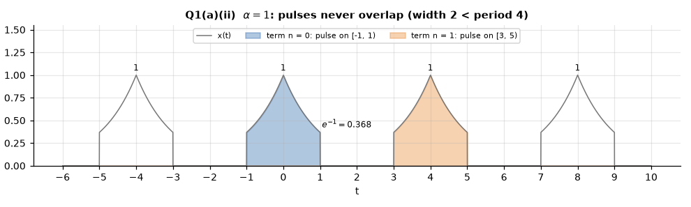
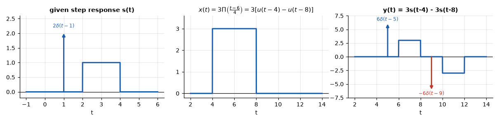
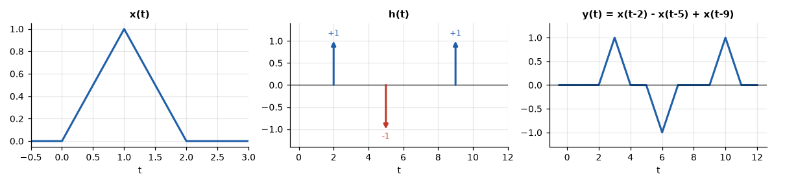
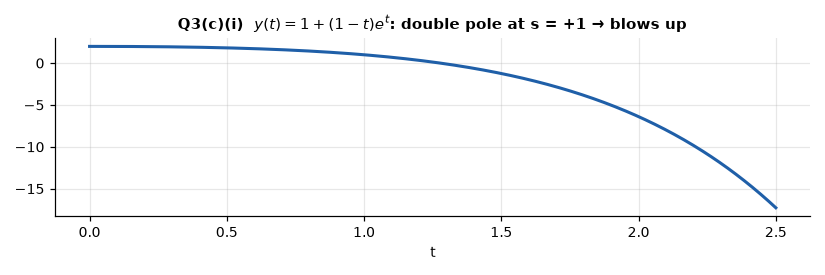
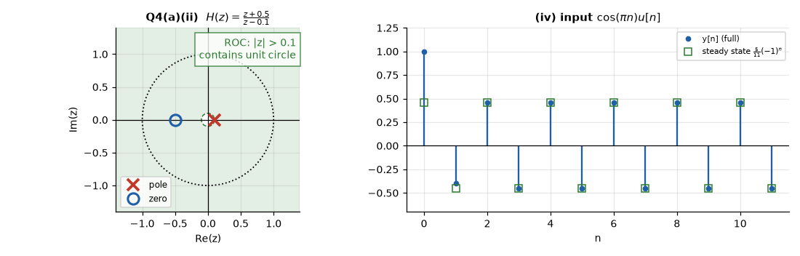

# SC3102 Past Paper Solutions: Semester 1, AY2025/26 (Nov/Dec 2025)

Paper: `../CE3102-25S1.pdf` · 4 questions × 25 marks · 2 hours · all questions compulsory

These are my own worked solutions; there is no official answer key. All numbers were re-checked by computer, and
the figures come from `make_figures.py`. Slide references use PDF page numbers in `SC3102/Slides/`.
The whole-course map is in [00_Exam_Guide.md](00_Exam_Guide.md).
**This is the most recent Semester 1 paper, so it's the closest in style to what you'll sit on 30 Nov.**

<b>Answer key: final answers only (open after attempting)</b>

| Part | Final answer |
|---|---|
| 1(a)(i) | $x(t+4)=x(t)$ (re-index). The value 1 occurs only at $t=4n$, so $T_0=4$ s |
| 1(a)(ii) | Non-overlapping pulses centred at $-4,0,4,8$: peak 1, edges $e^{-1}=0.368$, zero gaps in between |
| 1(a)(iii) | $P=\frac14\int_{-1}^{1}e^{-2\lvert t\rvert}dt=\frac{1-e^{-2}}{4}\approx0.216$, so a **power signal** |
| 1(b) | **Valid**: even, max at 0, and $S(f)=\frac{2A\alpha}{\alpha^2+4\pi^2f^2}+\frac{B}{f_0}\Pi(\frac{f}{f_0})+\frac C2[\delta(f-f_1)+\delta(f+f_1)]\ge0$ |
| 2(a) | $y=6\delta(t-5)+3\Pi(\frac{t-7}{2})-6\delta(t-9)-3\Pi(\frac{t-11}{2})$ |
| 2(b) | $y=x(t-2)-x(t-5)+x(t-9)$: a $+$triangle on $[2,4]$, a $-$triangle on $[5,7]$, a $+$triangle on $[9,11]$ |
| 2(c)(i) | $Y(f)=\dfrac{e^{-j6\pi f}}{1+j2\pi f}+\dfrac{e^{-j4\pi f}}{(1+j2\pi f)(2+j2\pi f)}$ |
| 2(c)(ii) | $y(t)=e^{-(t-3)}u(t-3)+\big[e^{-(t-2)}-e^{-2(t-2)}\big]u(t-2)$ |
| 3(a) | $F(s)=\dfrac{s+2}{(s+2)^2+9}+\dfrac{2}{(s+5)^2+4}$, $\mathrm{Re}(s)>-2$ |
| 3(b) | $F(s)=\dfrac{e^{j3}}{s-j}+\dfrac{5}{s^2+25}$, $\mathrm{Re}(s)>0$ |
| 3(c)(i) | $y(t)=1+(1-t)e^{t}$, $t\ge0$ (unstable) |
| 3(c)(ii) | $h(t)=t\,e^{t}u(t)$ |
| 4(a)(i) | $H(z)=\dfrac{1+0.5z^{-1}}{1-0.1z^{-1}}=\dfrac{z+0.5}{z-0.1}$ |
| 4(a)(ii) | Zero $-0.5$, pole $0.1$, ROC $\lvert z\rvert>0.1$ |
| 4(a)(iii) | Stable: the pole is inside the unit circle (the ROC contains $\lvert z\rvert=1$) |
| 4(a)(iv) | $y_{ss}[n]=\frac{5}{11}\cos(\pi n)=\frac{5}{11}(-1)^n$; full response $\left[\frac{6}{11}(0.1)^n+\frac{5}{11}(-1)^n\right]u[n]$ |
| 4(a)(v) | $h[n]=-5\delta[n]+6(0.1)^nu[n]$ ($=1,\ 0.6,\ 0.06,\ \dots$) |
| 4(b) | $x[n]=\{2.25,\ -0.75,\ -0.75,\ 0.25\}$ |

---

## Question 1 (Signals)

$$x(t)=\sum_{n=-\infty}^{\infty}f(t-4n)\,e^{-\alpha|t-4n|},\qquad f(t)=u(t+1)-u(t-1),\ \alpha>0.$$

Call one term $p(t)=f(t)e^{-\alpha|t|}$. That's a pulse living on $[-1,1)$, equal to 1 at $t=0$ and decaying to $e^{-\alpha}$ at the edges. Then $x(t)=\sum_np(t-4n)$.

### 1(a)(i) Periodic? Fundamental period (6 marks)

**Topic:** definition of periodicity (Signals p.9–10). This is the same proof pattern as 23S1 Q1(a)(i).

1. **4 is a period:**
   $$x(t+4)=\sum_np(t+4-4n)=\sum_np\big(t-4(n-1)\big)\overset{m=n-1}{=}\sum_mp(t-4m)=x(t)\quad\forall t.$$
2. **No smaller period works.** Within one period the pulses don't overlap (width 2 < spacing 4), so $x(t)=1$ only where $|t-4n|=0$, i.e. at $t=4n$. If some $0<T<4$ were a period, then $x(T)=x(0)=1$, which would force $T$ to be a multiple of 4. That's a contradiction.

**Answer:** periodic with $T_0=4$ s.

### 1(a)(ii) Sketch for $\alpha=1$ on $[-6,10]$ (6 marks)

- The pulse centres $4n$ that land in the window are $t=-4,0,4,8$. Their supports are $[-5,-3)$, $[-1,1)$, $[3,5)$ and $[7,9)$. (The $n=-2$ pulse ends at $-7$ and the $n=3$ pulse starts at 11, so both are outside.)
- **Peak value:** 1 at each centre. **Edge value:** $e^{-1}\approx0.368$ at $4n\pm1$, then a jump to 0.
- **Overlap:** none. Each pulse is 2 wide and they are spaced 4 apart, so there are zero gaps of length 2: $(-3,-1)$, $(1,3)$, $(5,7)$, and also $[-6,-5)$ and $[9,10]$.
- The highlighted terms are $n=0$ (blue, $e^{-|t|}$ on $[-1,1)$) and $n=1$ (orange, $e^{-|t-4|}$ on $[3,5)$).

### 1(a)(iii) Average power for $\alpha=1$; power signal? (6 marks)

**Topic:** power of a periodic signal (Signals p.17; Transforms p.57).

$$P=\frac{1}{T_0}\int_{T_0}|x(t)|^2dt=\frac14\int_{-1}^{1}e^{-2|t|}dt=\frac14\cdot2\int_0^1e^{-2t}dt=\frac12\left[\frac{1-e^{-2}}{2}\right]=\frac{1-e^{-2}}{4}.$$

**Answer:** $P=\dfrac{1-e^{-2}}{4}\approx\mathbf{0.216}$. It's finite and non-zero, so it's a **power signal**. (The energy is $E=\infty$, because each of infinitely many periods adds the same energy $\int_{-1}^1e^{-2|t|}dt=1-e^{-2}\approx0.865$.)

### 1(b) Is $x(\tau)=Ae^{-\alpha|\tau|}+B\dfrac{\sin\pi f_0\tau}{\pi f_0\tau}+C\cos(2\pi f_1\tau)$ a valid autocorrelation function? (7 marks)

**Topic:** autocorrelation properties (Signals p.26–28), Wiener–Khinchin and PSD $\ge0$ (Transforms p.57–61).

**Conditions an autocorrelation $R(\tau)$ must satisfy:**
1. **Even** (conjugate symmetric): $R(-\tau)=R(\tau)$ (for a real signal).
2. **Peak at the origin:** $|R(\tau)|\le R(0)$, where $R(0)$ is the average power (or energy) and is $\ge0$.
3. **Non-negative spectrum:** $S(f)=\mathcal F\{R(\tau)\}\ge0$ for all $f$. The PSD is a power density, so it can't be negative. This is the decisive test, because (1) and (2) follow from it.
4. (If the signal has a periodic part, $R$ has a periodic part with the same period. That's allowed.)

**Check each term ($A,B,C\ge0$, $\alpha>0$):**

| Term | Even? | $\lvert\cdot\rvert\le$ value at 0? | Fourier transform | $\ge0$? |
|---|---|---|---|---|
| $Ae^{-\alpha\lvert\tau\rvert}$ | ✓ | ✓ ($e^{-\alpha\lvert\tau\rvert}\le1$) | $\dfrac{2A\alpha}{\alpha^2+(2\pi f)^2}$ | ✓ |
| $B\,\mathrm{sinc}(f_0\tau)$ | ✓ | ✓ ($\lvert\mathrm{sinc}\rvert\le1$) | $\dfrac{B}{f_0}\Pi\!\left(\dfrac{f}{f_0}\right)$ | ✓ |
| $C\cos(2\pi f_1\tau)$ | ✓ | ✓ ($\lvert\cos\rvert\le1$) | $\dfrac C2[\delta(f-f_1)+\delta(f+f_1)]$ | ✓ |

**Combine:**
- **Even:** a sum of even functions is even ✓
- **Peak:** by the triangle inequality, $|x(\tau)|\le A+B+C=x(0)$ ✓
- **PSD:** a sum of non-negative terms,
  $$S(f)=\frac{2A\alpha}{\alpha^2+4\pi^2f^2}+\frac{B}{f_0}\Pi\!\left(\frac{f}{f_0}\right)+\frac C2\big[\delta(f-f_1)+\delta(f+f_1)\big]\ge0\ ✓$$

**Answer:** **valid** (for any $A,B,C\ge0$, not all zero). Physically it's the sum of three uncorrelated components: noise whose correlation decays exponentially (a Lorentzian spectrum), ideal band-limited noise (a flat spectrum on $|f|<f_0/2$), and a sinusoid at $f_1$ (spectral lines). The non-negativity of $A$, $B$ and $C$ is what makes it work. With, say, $B<0$, $S(f)$ could go negative near $f=0$ and the function would be invalid.

> **Note on the paper's hint table:** two pairs have scaling slips. The correct pairs are $e^{-\alpha|\tau|}\leftrightarrow\frac{2\alpha}{\alpha^2+(2\pi f)^2}$ (the hint drops the $\alpha$ on top) and $\frac{\sin\pi f_0\tau}{\pi f_0\tau}\leftrightarrow\frac{1}{f_0}\Pi(\frac{f}{f_0})$ (the hint writes $\Pi(\frac{f}{2f_0})$). The sign is what matters here, and it's the same either way, so using the hint as printed still earns the marks.

---

## Question 2 (Systems and Fourier transforms)

### 2(a) Step response $y_u(t)=2\delta(t-1)+\Pi\left(\frac{t-3}{2}\right)$; find the output for $x(t)=3\Pi\left(\frac{t-6}{4}\right)$ (7 marks)

**Topic:** using linearity and time invariance (Systems p.11–13, 20). This mirrors Tutorial 3 Q3 ([Tutorial3_Solutions.md](../../Tut/Part1/Tutorial3_Solutions.md)).

1. **Write the new input with steps.** $3\Pi\left(\frac{t-6}{4}\right)$ is height 3 on $[4,8]$:
   $$x(t)=3u(t-4)-3u(t-8).$$
2. **Apply each property:**
   - Time invariance: $u(t-t_0)\mapsto y_u(t-t_0)$.
   - Linearity: scaling and adding pass straight through.
   $$y(t)=3y_u(t-4)-3y_u(t-8).$$
3. **Substitute.** Note that $\Pi\left(\frac{(t-4)-3}{2}\right)=\Pi\left(\frac{t-7}{2}\right)$ is the box on $[6,8]$, and $\Pi\left(\frac{t-11}{2}\right)$ is the box on $[10,12]$:
   - $3y_u(t-4)=6\delta(t-5)+3\Pi\left(\frac{t-7}{2}\right)$
   - $3y_u(t-8)=6\delta(t-9)+3\Pi\left(\frac{t-11}{2}\right)$

**Answer:**
$$\boxed{y(t)=6\delta(t-5)+3\Pi\!\left(\frac{t-7}{2}\right)-6\delta(t-9)-3\Pi\!\left(\frac{t-11}{2}\right)}$$
In words: an impulse of area 6 at $t=5$, $+3$ on $[6,8]$, an impulse of area $-6$ at $t=9$, and $-3$ on $[10,12]$.

### 2(b) $h(t)=\delta(t-2)-\delta(t-5)+\delta(t-9)$ with the triangle $x(t)$ on $[0,2]$ (6 marks)

**Topic:** convolution with impulses, i.e. the sifting/shifting property (Signals p.56–57), plus distributivity (Systems p.45).

1. **Split $h$ into three impulses** and convolve each with $x$ (distributive property):
   $$y=x*\delta(t-2)-x*\delta(t-5)+x*\delta(t-9).$$
2. **Each impulse places a copy of $x$ at its location**, scaled by its weight: $x(t)*\delta(t-t_0)=x(t-t_0)$.
   $$\boxed{y(t)=x(t-2)-x(t-5)+x(t-9)}$$
3. **The copies don't overlap.** Each is 2 wide; they start at 2, 5 and 9, which are at least 3 apart. So:

| interval | $y(t)$ | |
|---|---|---|
| $2\le t<3$ | $t-2$ | rising edge of copy 1 |
| $3\le t<4$ | $4-t$ | peak $+1$ at $t=3$ |
| $5\le t<6$ | $-(t-5)$ | |
| $6\le t<7$ | $t-7$ | trough $-1$ at $t=6$ |
| $9\le t<10$ | $t-9$ | |
| $10\le t<11$ | $11-t$ | peak $+1$ at $t=10$ |
| otherwise | 0 | |

(This is a multipath channel: three echoes, the middle one inverted.)

### 2(c)(i) $Y(f)$ for $y=x(t-2)*h(t)$, with $x=e^{-t}u(t)$ and $h=\delta(t-1)+e^{-2t}u(t)$ (6 marks)

**Topic:** time-shift and convolution properties (Transforms p.32–33).

1. $X(f)=\dfrac{1}{1+j2\pi f}$. With the time shift, $x(t-2)\leftrightarrow X(f)e^{-j2\pi f(2)}=\dfrac{e^{-j4\pi f}}{1+j2\pi f}$.
2. $H(f)=e^{-j2\pi f}+\dfrac{1}{2+j2\pi f}$.
3. By the convolution theorem, $Y(f)=\mathcal F\{x(t-2)\}\cdot H(f)$:
   $$\boxed{Y(f)=\frac{e^{-j4\pi f}}{1+j2\pi f}\left[e^{-j2\pi f}+\frac{1}{2+j2\pi f}\right]=\frac{e^{-j6\pi f}}{1+j2\pi f}+\frac{e^{-j4\pi f}}{(1+j2\pi f)(2+j2\pi f)}}$$

### 2(c)(ii) Inverse transform to get $y(t)$ (6 marks)

1. **First term:** $\dfrac{1}{1+j2\pi f}\leftrightarrow e^{-t}u(t)$, and $e^{-j6\pi f}$ is a delay of 3. So it gives $e^{-(t-3)}u(t-3)$. (Physically, the direct path $\delta(t-1)$ adds 1 s to the 2 s offset.)
2. **Second term.** Use partial fractions in $p=j2\pi f$: $\dfrac{1}{(1+p)(2+p)}=\dfrac{1}{1+p}-\dfrac{1}{2+p}$, which inverts to $(e^{-t}-e^{-2t})u(t)$.
   **Same result from the convolution definition:**
   $$e^{-t}u(t)*e^{-2t}u(t)=\int_0^te^{-\tau}e^{-2(t-\tau)}d\tau=e^{-2t}\int_0^te^{\tau}d\tau=e^{-2t}(e^t-1)=e^{-t}-e^{-2t},\quad t\ge0.$$
   Then delay by 2 (the $e^{-j4\pi f}$ factor): $\big[e^{-(t-2)}-e^{-2(t-2)}\big]u(t-2)$.

**Answer:**
$$\boxed{y(t)=e^{-(t-3)}u(t-3)+\big[e^{-(t-2)}-e^{-2(t-2)}\big]u(t-2)}$$
That is: $0$ for $t<2$; $e^{-(t-2)}-e^{-2(t-2)}$ on $[2,3)$; and, adding the jump of 1 at $t=3$, $e^{-(t-3)}+e^{-(t-2)}-e^{-2(t-2)}$ for $t\ge3$.

---

## Question 3 (Laplace transform)

**Pairs used** (L5 `lecture(4)` p.72–74): $e^{at}u(t)\leftrightarrow\frac{1}{s-a}$ ($a$ may be complex); $e^{\alpha t}\cos(\beta t)u\leftrightarrow\frac{s-\alpha}{(s-\alpha)^2+\beta^2}$; $e^{\alpha t}\sin(\beta t)u\leftrightarrow\frac{\beta}{(s-\alpha)^2+\beta^2}$.

### 3(a) $f(t)=e^{-2t}\cos(3t)u(t)+e^{-5t}\sin(2t)u(t)$ (6 marks)

1. First term: $\alpha=-2$, $\beta=3$, giving $\dfrac{s+2}{(s+2)^2+9}$ with ROC $\mathrm{Re}(s)>-2$.
2. Second term: $\alpha=-5$, $\beta=2$, giving $\dfrac{2}{(s+5)^2+4}$ with ROC $\mathrm{Re}(s)>-5$.
3. By linearity, the ROC is the intersection of the two.

**Answer:**
$$\boxed{F(s)=\frac{s+2}{(s+2)^2+9}+\frac{2}{(s+5)^2+4}=\frac{s+2}{s^2+4s+13}+\frac{2}{s^2+10s+29},\qquad\mathrm{Re}(s)>-2}$$

### 3(b) $f(t)=e^{j(t+3)}u(t)+\sin(5t)u(t)$ (5 marks)

1. $e^{j(t+3)}=e^{j3}\,e^{jt}$. The $e^{j3}$ is just a **constant** complex number ($\cos3+j\sin3\approx-0.990+0.141j$); it is *not* a time shift, because $u(t)$ isn't shifted.
2. $e^{jt}u(t)$ uses the pair $e^{at}u(t)\leftrightarrow\frac{1}{s-a}$ with $a=j$: $\dfrac{1}{s-j}$, ROC $\mathrm{Re}(s)>\mathrm{Re}(j)=0$.
3. $\sin(5t)u(t)\leftrightarrow\dfrac{5}{s^2+25}$, ROC $\mathrm{Re}(s)>0$.

**Answer:** $\boxed{F(s)=\dfrac{e^{j3}}{s-j}+\dfrac{5}{s^2+25},\qquad\mathrm{Re}(s)>0}$

### 3(c) $y''-2y'+y=x$, $y(0)=2$, $y'(0)=0$, $x=u(t)$

**Topic:** unilateral Laplace with initial conditions (L6 `lecture(5)` p.42–43):
$\mathcal L\{y'\}=sY-y(0)$ and $\mathcal L\{y''\}=s^2Y-sy(0)-y'(0)$.

#### (i) Complete response (8 marks)
1. Transform:
   $$\big[s^2Y-2s-0\big]-2\big[sY-2\big]+Y=\frac1s.$$
2. Collect terms:
   $$Y(s^2-2s+1)=\frac1s+2s-4\;\Rightarrow\;Y=\underbrace{\frac{1}{s(s-1)^2}}_{\text{zero-state}}+\underbrace{\frac{2s-4}{(s-1)^2}}_{\text{zero-input}}.$$
3. **Zero-input part:** $\dfrac{2s-4}{(s-1)^2}=\dfrac{2(s-1)-2}{(s-1)^2}=\dfrac{2}{s-1}-\dfrac{2}{(s-1)^2}$, which gives $2e^t-2te^t$.
4. **Zero-state part:** $\dfrac{1}{s(s-1)^2}=\dfrac As+\dfrac{B}{s-1}+\dfrac{C}{(s-1)^2}$.
   - $A=\frac{1}{(0-1)^2}=1$
   - $C=\frac{1}{1}=1$
   - Comparing $s^2$ coefficients: $0=A+B$, so $B=-1$.

   This gives $1-e^t+te^t$.
5. Add them:

**Answer:** $\boxed{y(t)=1+(1-t)\,e^{t},\quad t\ge0}$

**Checks:**
- $y(0)=1+1=2$ ✓
- $y'=-te^t$, so $y'(0)=0$ ✓
- $y''=-(1+t)e^t$, so $y''-2y'+y=-(1+t)e^t+2te^t+1+(1-t)e^t=1$ ✓

**Comment:** the characteristic polynomial $(s-1)^2$ has a **double pole at $s=+1$**, in the right half-plane. The system is unstable and $y\to-\infty$ (see the plot), so there is no steady state. The "1" is the forced (particular) part.

#### (ii) Impulse response (6 marks)
1. With zero initial conditions and $x=\delta$, $H(s)=\dfrac{1}{s^2-2s+1}=\dfrac{1}{(s-1)^2}$.
2. The ODE is solved forward in time, so take the causal ROC $\mathrm{Re}(s)>1$. The repeated-pole pair $te^{at}u(t)\leftrightarrow\frac{1}{(s-a)^2}$ (L5 p.73) gives the answer.

**Answer:** $\boxed{h(t)=t\,e^{t}\,u(t)}$. It grows without bound, so the system is causal but **unstable** (ROC $\mathrm{Re}(s)>1$ excludes the $j\omega$-axis).

---

## Question 4 (Discrete time)

### 4(a) $y[n]=x[n]+0.5x[n-1]+0.1y[n-1]$

**Topic:** L4 `lecture(3).pdf` (LCCDEs with Z), L3 `lecture(2).pdf` (ROC and poles).

#### (i) Transfer function (4 marks)
1. Transform with zero initial conditions ($x[n-1]\to z^{-1}X$): $Y=X+0.5z^{-1}X+0.1z^{-1}Y$.
2. Rearrange:

**Answer:** $\boxed{H(z)=\dfrac{Y}{X}=\dfrac{1+0.5z^{-1}}{1-0.1z^{-1}}=\dfrac{z+0.5}{z-0.1}}$

#### (ii) Pole-zero diagram and ROC (3 marks)
- Zero at $z=-0.5$; pole at $z=0.1$.
- The system is causal (it's a recursion running forward), so the ROC is outside the outermost pole: $|z|>0.1$.

#### (iii) Stable? (2 marks)
**Yes.** The only pole, $0.1$, is inside the unit circle, so the causal ROC $|z|>0.1$ contains $|z|=1$. Equivalently, $h[n]$ decays like $(0.1)^n$ and is absolutely summable.

#### (iv) (Steady-)state response for $x[n]=\cos(\pi n)u[n]$ (4 marks)
"State response" is presumably "steady-state response".
1. $\cos(\pi n)=(-1)^n$ is the frequency $\Omega=\pi$, i.e. $z=e^{j\pi}=-1$.
2. $H(e^{j\pi})=H(-1)=\dfrac{-1+0.5}{-1-0.1}=\dfrac{-0.5}{-1.1}=\dfrac{5}{11}\approx0.455$. This is real and positive, so the phase shift is 0.
3. So $y_{ss}[n]=\frac{5}{11}\cos(\pi n)$.

**Answer:** $\boxed{y_{ss}[n]=\tfrac{5}{11}\cos(\pi n)=\tfrac{5}{11}(-1)^n}$ (the zero at $-0.5$ sits near $z=-1$ and attenuates the highest frequency).

**Full response** (for completeness): $X=\frac{z}{z+1}$, so $\frac{Y}{z}=\frac{z+0.5}{(z-0.1)(z+1)}=\frac{6/11}{z-0.1}+\frac{5/11}{z+1}$, which gives
$$y[n]=\Big[\underbrace{\tfrac{6}{11}(0.1)^n}_{\text{transient}}+\underbrace{\tfrac{5}{11}(-1)^n}_{\text{steady state}}\Big]u[n].$$
Check: $y[0]=1$ ✓, and $y[1]=-1+0.5+0.1=-0.4$, which matches $\frac{0.6-5}{11}=-0.4$ ✓.

#### (v) Impulse response (4 marks)
1. $\dfrac{H(z)}{z}=\dfrac{z+0.5}{z(z-0.1)}=\dfrac Az+\dfrac{B}{z-0.1}$, with $A=\dfrac{0.5}{-0.1}=-5$ and $B=\dfrac{0.6}{0.1}=6$.
2. $H(z)=-5+6\dfrac{z}{z-0.1}$, with ROC $|z|>0.1$.

**Answer:** $\boxed{h[n]=-5\delta[n]+6(0.1)^nu[n]}$, so $h=1,\ 0.6,\ 0.06,\ 0.006,\dots$
An equivalent form is $h[n]=(0.1)^nu[n]+0.5(0.1)^{n-1}u[n-1]$.
Check by recursion with $x=\delta$: $h[0]=1$, $h[1]=0.5+0.1(1)=0.6$ ✓.

### 4(b) $x[n]$ from $X[k]=[1,\ 3+j,\ 2,\ 3-j]$ (8 marks)

$x[n]=\frac14\sum_{k=0}^{3}X[k]\,j^{kn}$ (L1 `lecture.pdf` p.53–56):

| $n$ | $\frac14\big[1+(3+j)j^n+2(-1)^n+(3-j)(-j)^n\big]$ | $x[n]$ |
|---|---|---|
| 0 | $\frac14[1+3+j+2+3-j]=\frac94$ | **2.25** |
| 1 | $\frac14[1+(-1+3j)-2+(-1-3j)]=\frac{-3}{4}$ | **−0.75** |
| 2 | $\frac14[1-(3+j)+2-(3-j)]=\frac{-3}{4}$ | **−0.75** |
| 3 | $\frac14[1+(1-3j)-2+(1+3j)]=\frac14$ | **0.25** |

Or in closed form: $x[n]=\frac14\big[1+2(-1)^n+6\cos\frac{\pi n}{2}-2\sin\frac{\pi n}{2}\big]$.

**Answer:** $\boxed{x[n]=\{2.25,\ -0.75,\ -0.75,\ 0.25\}}$

**Checks:**
- $\sum x=1=X[0]$ ✓
- $X[2]=2.25+0.75-0.75-0.25=2$ ✓
- $X[1]=2.25-0.75(-j)-0.75(-1)+0.25(j)=3+j$ ✓
