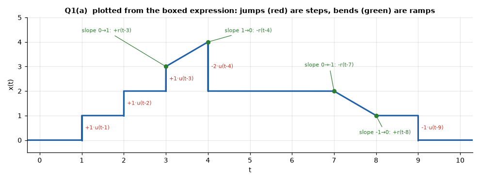
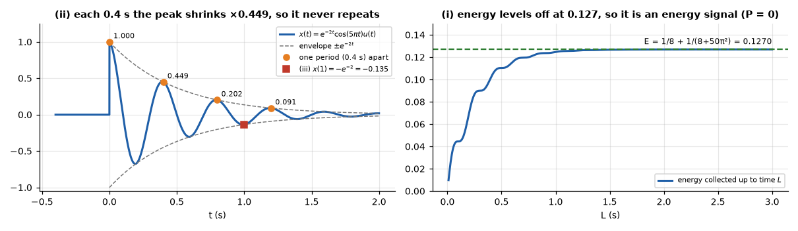
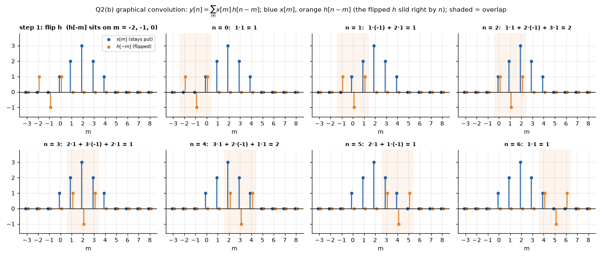
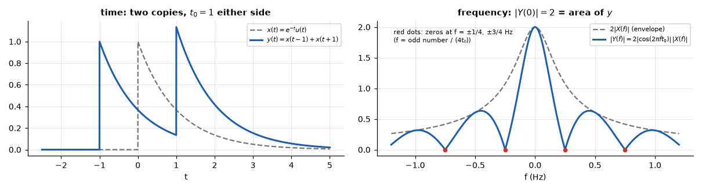
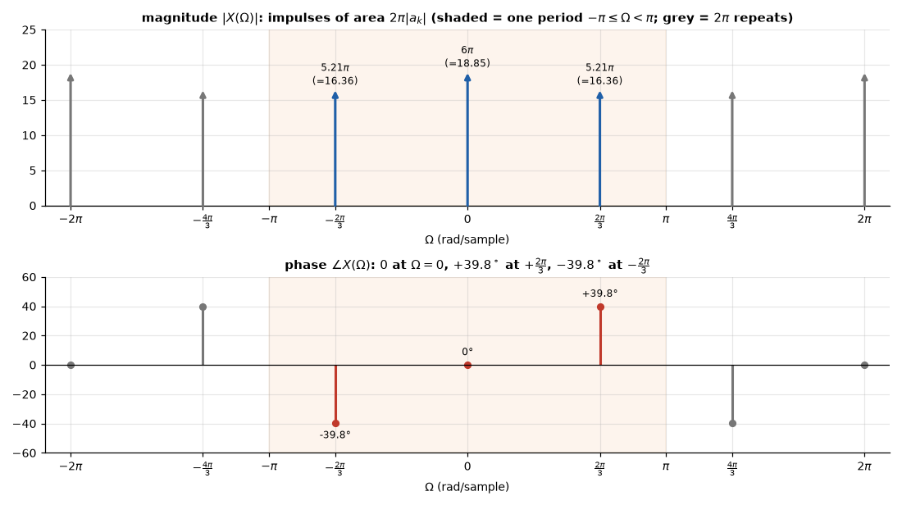
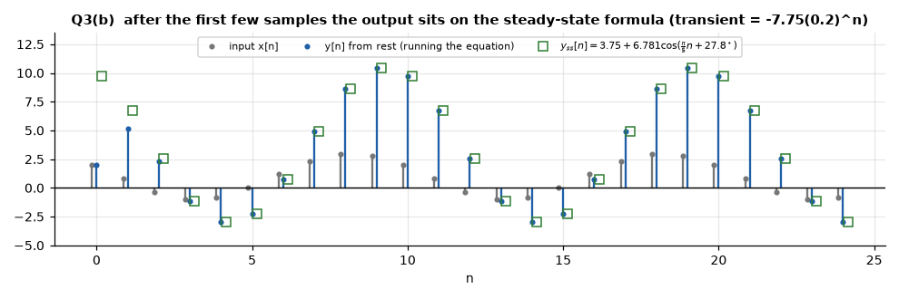
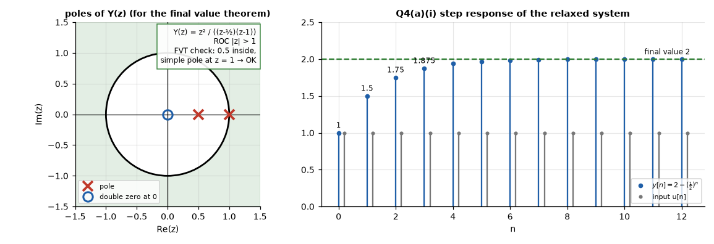
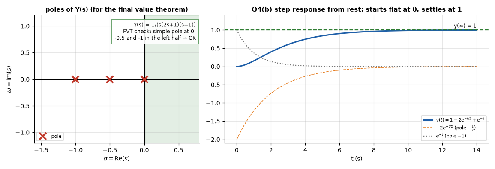
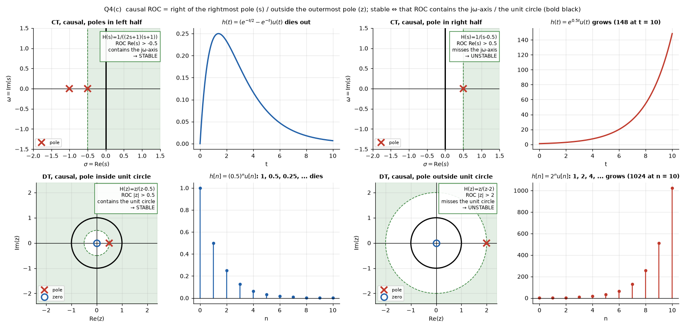

# SC3102 Past Paper Solutions: Semester 2, AY2024/25 (Apr/May 2025)

Paper: `../SC3102-24S2.pdf` · 4 questions × 25 marks · 2 hours · all questions compulsory

These are my own worked solutions; there is no official answer key. All numbers were re-checked by computer.
All figures come from `make_figures_24S2.py`, which also re-runs the numerical checks (it stops if any answer is off).
Slide references use PDF page numbers in `SC3102/Slides/`.
The whole-course map is in [00_Exam_Guide.md](00_Exam_Guide.md).
**Typos on the paper** (none changes a question): "justicfication" in Q1(b)(i), "the time-shifting the property" in Q2(c) (read: "the time-shifting property"), and "step reponse" in Q4(a)(i). Q3(b) has the same wording as 25S1 Q4(a), and Q4(a) is the L4 lecture's own running example (`lecture(3)` p.6–32 and p.75–76), so the slides confirm that answer.

**How each part is laid out.** Every part has two blocks, in this order:
1. **Exam answer:** what to write on the paper. The question, what's given and asked, each step with the rule it uses, the boxed answer, and a one-line check.
2. **Explanation:** why each step works, what the ideas mean, common traps, and links to other parts. Read it after the exam answer.

<b>Answer key: final answers only (open after attempting)</b>

| Part | Final answer |
|---|---|
| 1(a) | $x(t)=u(t-1)+u(t-2)+u(t-3)+r(t-3)-2u(t-4)-r(t-4)-r(t-7)+r(t-8)-u(t-9)$ |
| 1(b)(i) | $E=\frac18+\frac{1}{8+50\pi^2}\approx0.1270$ (finite) and $P=0$, so an **energy signal** |
| 1(b)(ii) | **Non-periodic**: $\cos(5\pi t)$ has $T_0=0.4$ s, but $e^{-2t}$ and $u(t)$ never repeat; $x(t+0.4)=0.449\,x(t)$ for $t\ge0$ |
| 1(b)(iii) | $\frac12x(1)=-\frac{e^{-2}}{2}\approx-0.0677$ |
| 2(a) | **Not linear** (the $+5$); **time-variant** (the gain $3\cos(2t)$) |
| 2(b) | $y[n]=\{1,\ 1,\ 2,\ 1,\ 2,\ 1,\ 1\}$ for $n=0,\dots,6$, zero elsewhere |
| 2(c) | $Y(f)=2\cos(2\pi ft_0)\,X(f)=\dfrac{2\cos(2\pi ft_0)}{1+j2\pi f}$ |
| 3(a)(i) | $x[n]=3+4\cos\frac{2\pi n}{3}-\frac{10}{3}\sin\frac{2\pi n}{3}=3+5.207\cos(\frac{2\pi n}{3}+39.8^\circ)$; values $\{7,\ -1.887,\ 3.887,\ 7,\ -1.887,\ 3.887\}$ (fundamental period 3) |
| 3(a)(ii) | Impulses at $\Omega=0,\ \pm\frac{2\pi}{3}$ (repeating every $2\pi$) with areas $6\pi$ and $5.21\pi$ ($=2\pi\times3$ and $2\pi\times2.603$); phases $0$ and $\pm39.8^\circ$ |
| 3(b) | $y_{ss}[n]=3.75+6.781\cos(\frac{\pi}{5}n+27.8^\circ)$ |
| 4(a)(i) | $y[n]=\big[2-(\tfrac12)^n\big]u[n]$ |
| 4(a)(ii) | $y[\infty]=\lim_{z\to1}(1-z^{-1})Y(z)=2$, the same as $\lim_{n\to\infty}[2-(\frac12)^n]=2$ |
| 4(b) | $y(t)=\big(1-2e^{-t/2}+e^{-t}\big)u(t)$; $y(\infty)=1$ |
| 4(c) | Causal ROC: $\mathrm{Re}(s)>$ rightmost pole / $\lvert z\rvert>$ outermost pole. Stable ⇔ ROC contains the $j\omega$-axis / unit circle ⇔ all poles in the left half-plane / inside the unit circle. Zeros affect neither |

---

## Question 1 (Signals)

### 1(a) Express Figure Q1a with singularity functions (6 marks)

**Topic:** building signals from steps and ramps (Signals p.43–52; worked example p.52). Same method as 23S2 Q1(b)(i).

#### Exam answer

> *"Express the signal $x(t)$ in Figure Q1a in terms of singularity functions."*

**Given:** the graph in Figure Q1a. **Asked:** $x(t)$ as a sum of shifted unit steps $u(t-t_0)$ and unit ramps $r(t-t_0)=(t-t_0)\,u(t-t_0)$.

**Reading the figure** (left to right; every corner sits on a whole-number grid point):
- $t<1$: 0.
- at $t=1$: jumps from 0 to 1, then flat at 1 until $t=2$.
- at $t=2$: jumps from 1 to 2, then flat at 2 until $t=3$.
- at $t=3$: jumps from 2 to 3, then a straight line from $(3,3)$ to $(4,4)$, slope $\frac{4-3}{4-3}=1$.
- at $t=4$: drops from 4 to 2, then flat at 2 until $t=7$.
- $7\le t\le8$: a straight line from $(7,2)$ to $(8,1)$, slope $\frac{1-2}{8-7}=-1$.
- $8\le t<9$: flat at 1.
- at $t=9$: drops from 1 to 0, and stays 0.

**Method** (bookkeeping, walking left to right; Signals p.51–52). At each time $t_0$:
- a **jump** from value $v_1$ to $v_2$ adds $(v_2-v_1)\,u(t-t_0)$;
- a **change of slope** from $m_1$ to $m_2$ adds $(m_2-m_1)\,r(t-t_0)$.

| $t_0$ | jump | slope change | terms added |
|---|---|---|---|
| 1 | $0\to1$: $+1$ | none | $+u(t-1)$ |
| 2 | $1\to2$: $+1$ | none | $+u(t-2)$ |
| 3 | $2\to3$: $+1$ | $0\to1$: $+1$ | $+u(t-3)+r(t-3)$ |
| 4 | $4\to2$: $-2$ | $1\to0$: $-1$ | $-2u(t-4)-r(t-4)$ |
| 7 | none | $0\to-1$: $-1$ | $-r(t-7)$ |
| 8 | none | $-1\to0$: $+1$ | $+r(t-8)$ |
| 9 | $1\to0$: $-1$ | none | $-u(t-9)$ |

Add every term:
$$\boxed{x(t)=u(t-1)+u(t-2)+u(t-3)+r(t-3)-2u(t-4)-r(t-4)-r(t-7)+r(t-8)-u(t-9)}$$

**Check** one point in each piece. Once switched on, $u(t-t_0)$ equals 1 and $r(t-t_0)$ equals $t-t_0$:
- $t=1.5$: only $u(t-1)$ is on: $1$ ✓
- $t=3.5$: $1+1+1+r(0.5)=3+0.5=3.5$ ✓ (halfway up the ramp from 3 to 4)
- $t=5$: $1+1+1+r(2)-2-r(1)=3+2-2-1=2$ ✓
- $t=7.5$: $3+r(4.5)-2-r(3.5)-r(0.5)=3+4.5-2-3.5-0.5=1.5$ ✓ (halfway down from 2 to 1)
- $t=8.5$: $3+5.5-2-4.5-1.5+0.5=1$ ✓
- $t=9.5$: $3+6.5-2-5.5-2.5+1.5-1=0$ ✓

The figure below is plotted straight from the boxed expression (the computer also checked that it equals the paper's graph at 22 001 points).

#### Explanation

- **The two building blocks, with numbers.**
  - $u(t-3)$ is 0 before $t=3$ and 1 after. It adds a **jump** of height 1 at $t=3$.
  - $r(t-3)$ is 0 before $t=3$, then $t-3$: $r(3.5-3)=0.5$, $r(4-3)=1$. It adds a **bend** (the slope goes up by 1) at $t=3$, with no jump, because it starts from 0.
  - A number in front scales the jump or the slope change: $-2u(t-4)$ is a drop of 2.
- **Why "change of slope", not "new slope".** A ramp, once on, keeps rising forever. At $t=4$ the signal goes flat, so the slope must go from 1 back to 0: add $-r(t-4)$ to cancel $r(t-3)$. Check for $t\ge4$: $r(t-3)-r(t-4)=(t-3)-(t-4)=1$, a constant ✓. Same idea at 7 and 8: for $t\ge8$, $-r(t-7)+r(t-8)=-(t-7)+(t-8)=-1$, a constant drop of 1 (from 2 down to 1) ✓.
- **Jump size = value just after − value just before.** At $t=4$ the ramp has just reached 4 and the signal carries on at 2: $2-4=-2$. A common slip is $-1$, reading the drop from 3 (where the ramp started) instead of from 4.
- **A jump and a bend at the same time** ($t=3$ and $t=4$): write both terms.
- **Gate form (also acceptable).** A gate $u(t-a)-u(t-b)$ is 1 on $[a,b)$ and 0 elsewhere, so multiply each piece's formula by its gate:
  $$x=[u(t-1)-u(t-2)]+2[u(t-2)-u(t-3)]+t\,[u(t-3)-u(t-4)]+2[u(t-4)-u(t-7)]+(9-t)[u(t-7)-u(t-8)]+[u(t-8)-u(t-9)].$$
  The line on $[3,4)$ goes through $(3,3)$ with slope 1, so it is $3+(t-3)=t$. The line on $[7,8)$ goes through $(7,2)$ with slope $-1$, so it is $2-(t-7)=9-t$ (at $t=8$: $1$ ✓). The boxed form is shorter and is what "singularity functions" usually means.
- **Traps:**
  - writing $3u(t-3)$ (the new **level**) instead of $+1\,u(t-3)$ (the **change**);
  - forgetting $-r(t-4)$: the signal would keep climbing after $t=4$;
  - the sign inside the shift: $r(t-3)$ starts at $t=+3$, where $t-3=0$.
- **What the marker looks for:** one term per event with the right sign, and a quick check of one point per piece.
- **Link:** 23S2 Q1(b)(i) uses the same table. 23S2 Q1(b)(ii) then integrates $x^2$ piece by piece for the energy.

### 1(b) $x(t)=e^{-2t}\cos(5\pi t)\,u(t)$

> *"A damped harmonic oscillation in a physical system is modeled as follows: $x(t)=e^{-2t}\cos(5\pi t)u(t)$ where $u(t)$ is the unit step function. Answer the following questions corresponding to this signal."*

What the signal looks like: a cosine at $f=\frac{5\pi}{2\pi}=2.5$ Hz (period 0.4 s) inside a shrinking envelope $\pm e^{-2t}$, switched on at $t=0$. The figure in (i) shows it.

#### (i) Energy or power signal? (7 marks)

**Topic:** energy and power (Signals p.17–22).

##### Exam answer

> *"(i) Classify the signal $x(t)$ as either an energy signal or a power signal. Provide a clear justi[fi]cation for your classification by briefly explaining the fundamental differences between energy signals and power signals. Note: Use the relation $\int_0^\infty e^{-at}\cos(bt)\,dt=\frac{a}{a^2+b^2}$, for $a>0$."*

**Given:** $x(t)$ and the hint. **Asked:** energy or power, with the reason, and the difference between the two classes.

**Definitions** (Signals p.17):
$$E=\int_{-\infty}^{\infty}|x(t)|^2dt,\qquad P=\lim_{T\to\infty}\frac1T\int_{-T/2}^{T/2}|x(t)|^2dt.$$
- **Energy signal:** $0<E<\infty$. Then $P=0$.
- **Power signal:** $0<P<\infty$. Then $E=\infty$.
- **The difference:** an energy signal is "used up": its total energy is a finite number, so averaged over a longer and longer time it gives zero power (typical: pulses and decaying signals). A power signal keeps going at a steady size, so its total energy is infinite but its average power per second is finite (typical: periodic signals, constants). No signal is both (Signals p.18).

1. **Set up $E$.** $u(t)=0$ for $t<0$, so the integral starts at 0. $x$ is real, so $|x|^2=x^2$. Square each factor: $(e^{-2t})^2=e^{-2t}e^{-2t}=e^{-4t}$ and $u(t)^2=u(t)$:
   $$E=\int_0^\infty e^{-4t}\cos^2(5\pi t)\,dt.$$
2. **Remove the square** with $\cos^2\theta=\frac{1+\cos2\theta}{2}$, where $\theta=5\pi t$, so $2\theta=10\pi t$:
   $$E=\int_0^\infty e^{-4t}\cdot\frac{1+\cos(10\pi t)}{2}\,dt=\frac12\int_0^\infty e^{-4t}dt+\frac12\int_0^\infty e^{-4t}\cos(10\pi t)\,dt.$$
3. **First integral:** $\displaystyle\int_0^\infty e^{-4t}dt=\left[\frac{e^{-4t}}{-4}\right]_0^\infty=0-\frac{1}{-4}=\frac14$. (The hint with $b=0$ gives the same: $\frac{4}{4^2+0^2}=\frac14$.)
4. **Second integral** (the hint with $a=4>0$ and $b=10\pi$):
   $$\int_0^\infty e^{-4t}\cos(10\pi t)\,dt=\frac{4}{4^2+(10\pi)^2}=\frac{4}{16+100\pi^2}=\frac{4}{16+986.96}=\frac{4}{1002.96}=0.003988.$$
5. **Add the halves:**
   $$E=\frac12\cdot\frac14+\frac12\cdot\frac{4}{16+100\pi^2}=\frac18+\frac{2}{16+100\pi^2}=\frac18+\frac{1}{8+50\pi^2}=0.125+0.001994=0.126994.$$
   (For the tidy form, divide the top and bottom of $\frac{2}{16+100\pi^2}$ by 2.)
6. **Power.** A window can't hold more energy than the whole signal: $\int_{-T/2}^{T/2}x^2dt\le E=0.127$. So $0\le P\le\lim_{T\to\infty}\frac{0.127}{T}=0$, i.e. $P=0$.

$$\boxed{E=\tfrac18+\tfrac{1}{8+50\pi^2}\approx0.127\ \ (0<E<\infty)\ \text{ and }\ P=0\ \ \Rightarrow\ \ x(t)\text{ is an energy signal}}$$

**Check:** numerically integrating $x(t)^2$ from 0 to 20 gives $0.1269941$ ✓. The energy collected by $t=1$ is already $0.1103$ (87% of it).

##### Explanation

- **Why the square goes onto the exponential too.** $|x|^2=e^{-4t}\cos^2(5\pi t)$, because $(e^{-2t})^2=e^{-4t}$ (add the exponents). Using $a=2$ in the hint instead of $a=4$ is the most common slip: it gives $E=\frac12\cdot\frac12+\frac12\cdot\frac{2}{4+100\pi^2}=0.2510$, about twice the right answer.
- **Why the hint needs $a>0$.** The integral only settles if $e^{-at}\to0$. With $a=4$, the factor is already $e^{-4}=0.018$ at $t=1$.
- **Where the hint comes from** (optional). $\cos bt$ is the real part of $e^{jbt}$, and $\int_0^\infty e^{-at}e^{jbt}dt=\frac{1}{a-jb}$. Multiply the top and bottom by $a+jb$: $\frac{a+jb}{a^2+b^2}$. Its real part is $\frac{a}{a^2+b^2}$. It is also the Laplace pair $\cos(bt)u(t)\leftrightarrow\frac{s}{s^2+b^2}$ (L5 `lecture(4)` p.74) at $s=a$.
- **Why $P=0$, with numbers.** $P(T)=\frac{E(T)}{T}$: $T=10$ gives $\frac{0.12699}{10}=0.0127$; $T=100$ gives $0.00127$; the limit is 0.
- **Why the cosine term is tiny.** $\cos(10\pi t)$ swings positive and negative 5 times per second, so most of its area cancels: only $0.004$ survives, against $0.25$ for the steady part. The quick estimate $E\approx\frac12\cdot\frac14=\frac18$ is within 2%.
- **Compare with the slide example.** Signals p.22: $A\cos(\omega t+\theta)$ for all $t$ has $E=\infty$ and $P=\frac{A^2}{2}$, a power signal. Multiplying by $e^{-2t}u(t)$ makes it die out, which turns it into an energy signal.
- **What the marker looks for:** both definitions, $E$ computed to a finite number (not just "it decays"), $P=0$, and the one-line difference between the classes.
- **Link:** (ii) uses the same fact from the other side: a non-zero periodic signal always has $P>0$.

#### (ii) Periodic or non-periodic? (6 marks)

**Topic:** periodicity (Signals p.9–15).

##### Exam answer

> *"(ii) Determine whether the signal $x(t)$ is periodic or non-periodic. Justify your answer by analyzing the periodicity of the individual components of the signal."*

**Given:** $x(t)=e^{-2t}\cos(5\pi t)u(t)$. **Asked:** periodic or not, by looking at each factor.

**Definition** (Signals p.9): $x(t)$ is periodic if and only if there is a $T>0$ with $x(t+T)=x(t)$ **for all** $t$.

1. **$\cos(5\pi t)$ is periodic.** A sinusoid with angular frequency $\omega_0$ has period $T_0=\frac{2\pi}{\omega_0}$ (Signals p.11). Here $\omega_0=5\pi$ rad/s, so $T_0=\frac{2\pi}{5\pi}=0.4$ s ($f_0=2.5$ Hz). Check: $\cos\big(5\pi(t+0.4)\big)=\cos(5\pi t+2\pi)=\cos(5\pi t)$ ✓.
2. **$e^{-2t}$ is not periodic.** It strictly decreases: $e^{0}=1$, $e^{-0.8}=0.449$, $e^{-1.6}=0.202$. For any $T>0$, $e^{-2(t+T)}=e^{-2T}e^{-2t}$ and $e^{-2T}<1$, so it never returns to an earlier value.
3. **$u(t)$ is not periodic.** It is 0 for all $t<0$ and 1 for all $t\ge0$. For any $T>0$, take $t=-T$: $u(-T+T)=u(0)=1$, but $u(-T)=0$.
4. **The product.** Try the cosine's period, $T=0.4$ s, for $t\ge0$ (exponent rule $e^{a+b}=e^ae^b$):
   $$x(t+0.4)=e^{-2(t+0.4)}\cos(5\pi t+2\pi)=e^{-0.8}\,e^{-2t}\cos(5\pi t)=0.449\,x(t)\ne x(t).$$
   Each period, the oscillation is 0.449 times smaller, so it never repeats. No other $T$ works either: for any $T>0$, at $t=-T$, $x(-T+T)=x(0)=e^0\cos0\cdot u(0)=1$, but $x(-T)=0$ because $u(-T)=0$.

$$\boxed{x(t)\text{ is non-periodic: only }\cos(5\pi t)\text{ is periodic }(T_0=0.4\text{ s});\ e^{-2t}\text{ and }u(t)\text{ are not}}$$

**Check:** $x(0)=1$, $x(0.4)=0.4493$, $x(0.8)=0.2019$, $x(1.2)=0.0907$ (computed; the orange dots in the figure in (i)). The samples one cosine-period apart keep shrinking ✓. Second method: a non-zero periodic signal repeats the same energy every period, so its power is positive. (i) found $P=0$, so $x$ can't be periodic ✓.

##### Explanation

- **Why one non-periodic factor is enough here.** Multiplying by a factor that never repeats changes each "copy" differently. The cosine is the same every 0.4 s, but its envelope $e^{-2t}$ isn't, so the product isn't.
- **"Damped" vs "periodic".** A damped oscillation still crosses zero regularly (every 0.2 s here: $t=0.1,\ 0.3,\ 0.5,\dots$), which can look periodic. Periodic needs the **values** to repeat, not just the zero crossings.
- **The step alone already breaks it.** Even $\cos(5\pi t)u(t)$, with no decay, is not periodic: it is 0 for all $t<0$ but not for $t\ge0$. A periodic signal must repeat for all $t$, negative time included (Signals p.9: "for all times $t$"). Signals p.16 calls a signal that starts at $t=0$ causal.
- **The rational-ratio rule doesn't apply.** "Periodic if $T_1/T_2$ is rational" (Signals p.13) is for **sums** of periodic signals. Here the parts are multiplied, and two of them aren't periodic at all.
- **What the marker looks for:** the period of the cosine (0.4 s), a reason why each other factor isn't periodic, and a clear conclusion for the product.
- **Trap:** answering "periodic with $T=0.4$ s" because the cosine is.

#### (iii) $\displaystyle\int_{-\infty}^{\infty}e^{-2t}\cos(5\pi t)u(t)\,\delta(2t-2)\,dt$ (6 marks)

**Topic:** the Dirac delta: scaling $\delta(at)=\frac{1}{|a|}\delta(t)$ (Signals p.54) and sifting $\int g(t)\delta(t-t_0)dt=g(t_0)$ (Signals p.56).

##### Exam answer

> *"(iii) Evaluate the following integral, which represents the instantaneous response of the signal $x(t)$ to a unit impulse: $\int_{-\infty}^{\infty}e^{-2t}\cos(5\pi t)u(t)\delta(2t-2)\,dt$"*

(Wording: the integral is the sifting property, which picks out the signal's value where the impulse sits. "Instantaneous response … to a unit impulse" is just the paper's name for that.)

**Given:** the integral. **Asked:** its value.

1. **Where is the impulse?** $\delta(\cdot)$ is non-zero only where its argument is 0: $2t-2=0\Rightarrow t=1$.
2. **Factor the argument:** $2t-2=2(t-1)$, so $\delta(2t-2)=\delta\big(2(t-1)\big)$.
3. **Scaling property** (Signals p.54) $\delta(at)=\frac{1}{|a|}\delta(t)$, with $a=2$ and $t$ replaced by $t-1$:
   $$\delta\big(2(t-1)\big)=\frac{1}{2}\,\delta(t-1).$$
4. **Substitute** (the $\frac12$ is a constant, so it comes outside):
   $$\int_{-\infty}^{\infty}x(t)\,\delta(2t-2)\,dt=\frac12\int_{-\infty}^{\infty}x(t)\,\delta(t-1)\,dt.$$
5. **Sifting property** (Signals p.56) with $t_0=1$: the integral picks out $x(1)$, so the whole thing is $\frac12x(1)$.
6. **Evaluate $x(1)$:**
   - $e^{-2\cdot1}=e^{-2}=0.1353$;
   - $\cos(5\pi\cdot1)=\cos(5\pi)=\cos(\pi+4\pi)=\cos\pi=-1$;
   - $u(1)=1$.

   So $x(1)=0.1353\times(-1)\times1=-e^{-2}$.

$$\boxed{\int_{-\infty}^{\infty}e^{-2t}\cos(5\pi t)u(t)\,\delta(2t-2)\,dt=\tfrac12x(1)=-\tfrac{e^{-2}}{2}\approx-0.0677}$$

**Check (second method, substitution).** Let $v=2t$, so $t=\frac v2$ and $dt=\frac{dv}{2}$; the limits stay $-\infty$ to $\infty$:
$$\int_{-\infty}^{\infty}x\!\left(\tfrac v2\right)\delta(v-2)\,\frac{dv}{2}=\frac12\,x\!\left(\tfrac22\right)=\frac12x(1)\ ✓.$$
Replacing $\delta(2t-2)$ by a very narrow pulse of area 1 and integrating numerically gives $-0.06767$ ✓.

##### Explanation

- **Why the $\frac12$ appears, with a pulse.** Picture $\delta(t)$ as a box of width $\Delta$ and height $\frac1\Delta$, so area 1 (Signals p.54). $\delta(2t)$ is that box squeezed to width $\frac\Delta2$, but its height is still $\frac1\Delta$, so its area is $\frac\Delta2\cdot\frac1\Delta=\frac12$. Squeezing time by 2 halves the area.
- **Trap: answering $x(1)=-0.135$.** That forgets the scaling and is exactly twice too big. Another trap is putting the impulse at $t=2$ (reading $\delta(2t-2)$ as $\delta(t-2)$).
- **Why $u(t)$ doesn't matter here.** The impulse sits at $t=1>0$, where $u=1$. If it sat at $t=-1$ (e.g. $\delta(2t+2)$), the answer would be $\frac12x(-1)=0$, because $u(-1)=0$.
- **$\cos(5\pi)=-1$:** $5\pi$ is two full turns ($4\pi$) plus half a turn ($\pi$), and half a turn round the unit circle lands at $-1$.
- **Sampling vs sifting** (Signals p.56). $x(t)\delta(t-1)=x(1)\delta(t-1)$ is still an impulse (that's sampling). Integrating it gives the number $x(1)$ (that's sifting).
- **Link:** 24S1 Q1(c) and 25S1 Q2(b) use the sifting property inside a convolution, where it shifts a signal instead of sampling it.

---

## Question 2 (Systems, convolution, Fourier transform)

### 2(a) $y(t)=x(t)+3\cos(2t)\,x(t-2)+5$: linear? time-invariant? (8 marks)

**Topic:** Systems p.11–19 (p.18: $y=g(t)x(t)$ is linear but time-variant; p.19: $y=x+K$ is not linear but time-invariant); L0 p.43–44.

#### Exam answer

> *"Consider the system with the following input-output relation. $y(t)=x(t)+3\cos(2t)x(t-2)+5$. Verify whether the system is (i) linear, (ii) time-invariant."*

**Given:** the input–output rule. **Asked:** (i) linear? (ii) time-invariant? With a proof or counterexample for each.

**(i) Linearity** (Systems p.11). Test: does $a\,x_1+b\,x_2$ give $a\,y_1+b\,y_2$ for all constants $a,b$?
1. **Outputs for $x_1$ and $x_2$:**
   $$y_1=x_1(t)+3\cos(2t)\,x_1(t-2)+5,\qquad y_2=x_2(t)+3\cos(2t)\,x_2(t-2)+5.$$
2. **Feed $x_3=ax_1+bx_2$** (replace $x$ by $x_3$ everywhere, including inside $x(t-2)$), then collect the $a$-terms and the $b$-terms:
   $$y_3=ax_1(t)+bx_2(t)+3\cos(2t)\big[ax_1(t-2)+bx_2(t-2)\big]+5=a\big[x_1+3\cos(2t)x_1(t-2)\big]+b\big[x_2+3\cos(2t)x_2(t-2)\big]+5.$$
3. **What linearity needs** (multiply out $ay_1+by_2$):
   $$ay_1+by_2=a\big[x_1+3\cos(2t)x_1(t-2)\big]+b\big[x_2+3\cos(2t)x_2(t-2)\big]+5a+5b.$$
4. **Compare:** $y_3-(ay_1+by_2)=5-5a-5b=5(1-a-b)$. This is 0 only when $a+b=1$, not for all $a,b$. For example $a=2$, $b=0$: $5(1-2)=-5\ne0$.

   **Counterexample:** $x(t)=0$ for all $t$ gives $y(t)=0+0+5=5\ne0$. A linear system must give zero output for zero input (put $a=0$: $0\cdot x_1\mapsto0\cdot y_1=0$). **Not linear ✗.**

**(ii) Time invariance** (Systems p.13). Test: does delaying the input by $t_0$ just delay the output by $t_0$?
1. **Output for the delayed input** $x_d(t)=x(t-t_0)$. Replace each $x(\cdot)$ by $x(\cdot-t_0)$; the $3\cos(2t)$ and the 5 belong to the system, so they stay as they are:
   $$y_d(t)=x(t-t_0)+3\cos(2t)\,x(t-2-t_0)+5.$$
2. **Delayed output.** Replace every $t$ in $y(t)$ by $t-t_0$, including inside the cosine:
   $$y(t-t_0)=x(t-t_0)+3\cos\big(2(t-t_0)\big)\,x(t-t_0-2)+5=x(t-t_0)+3\cos(2t-2t_0)\,x(t-t_0-2)+5.$$
3. **Compare:** the gains differ, $\cos(2t)$ against $\cos(2t-2t_0)$. So $y_d(t)\ne y(t-t_0)$ in general.

   **Counterexample:** $x(t)=1$ for all $t$ gives $y(t)=1+3\cos(2t)\cdot1+5=6+3\cos(2t)$. Delaying a constant input by $t_0=\frac\pi2$ gives the same constant, so the output is still $6+3\cos(2t)$, which is $9$ at $t=0$. Time invariance would need $y(t-\frac\pi2)=6+3\cos(2t-\pi)=6-3\cos(2t)$, which is $3$ at $t=0$. $9\ne3$. **Time-variant ✗.**

$$\boxed{\text{(i) Not linear (the added constant 5)}\qquad\text{(ii) Time-variant (the time-varying gain }3\cos(2t)\text{)}}$$

**Check (numbers for (i)):** $x=1$ gives $y=6+3\cos2t$, which is 9 at $t=0$. $x=2$ gives $y=2+6\cos2t+5=7+6\cos2t$, which is 13 at $t=0$. Doubling the input should double the output to 18, but it gives 13 ✗, confirming non-linear.

#### Explanation

- **Which term causes which failure:**

| term | linear? | time-invariant? |
|---|---|---|
| $x(t)$ | yes | yes |
| $3\cos(2t)\,x(t-2)$ | yes (the gain doesn't depend on $x$) | **no** (the gain reads the clock; Systems p.18) |
| $+5$ | **no** (output with no input; Systems p.19) | yes (a constant doesn't care when) |

  One failing term is enough to fail the whole system.
- **Why $+5$ breaks linearity but not time invariance.** Linear means the output is made only from the input, scaled and added. The 5 is there even with no input. But it is the same 5 at every time, so delaying the input changes nothing about it. (A system like this, linear plus a constant, is sometimes called incrementally linear. It is still "not linear".)
- **Why $\cos(2t)$ breaks time invariance, with a pulse.** Put a narrow pulse in at $t=0$. The second term passes it out at $t=2$ with gain $3\cos(2\cdot2)=3\cos4=-1.96$. Put the same pulse in at $t=\frac\pi2$: it comes out at $t=2+\frac\pi2$ with gain $3\cos(4+\pi)=-3\cos4=+1.96$. Same input, a response of a different size and sign: the system cares about **when** the input arrives.
- **Why the delay $x(t-2)$ is not the problem.** A pure delay is linear and time-invariant (Systems p.21–22: $y=\sum C_kx(t-t_k)$ is LTI). It's the multiplying gain that breaks it.
- **When the comparison accidentally matches.** If $t_0=\pi$, then $\cos(2t-2\pi)=\cos2t$ and that particular delay passes. Time invariance must hold for **every** $t_0$; one failing $t_0$ is enough.
- **Traps:**
  - shifting $t$ inside $x$ but not inside $\cos(2t)$ when forming $y(t-t_0)$;
  - shifting $\cos(2t)$ when forming $y_d$: the system's own gain doesn't move when you move the input;
  - saying "the 5 makes it time-variant".
- **Extra (not asked):** it is causal (it uses only $x(t)$ and $x(t-2)$, the present and the past) and has memory.
- **Link:** 23S2 Q2(a) is $y=g(t)x(t)+K$, with the same two failures. 25S2 Q2(a) uses the constant-input trick too.

### 2(b) Graphical convolution of $x[n]=\{1,2,3,2,1\}$ and $h[n]=\{1,-1,1\}$ (10 marks)

**Topic:** discrete-time linear convolution by "reverse, shift, multiply and add" (L2 `lecture(1)` p.16–40); the convolution sum from the impulse decomposition (L0 p.53–59; Systems p.27–29).

#### Exam answer

> *"A discrete-time signal $x[n]$ and a Linear Time-Invariant (LTI) system with impulse response $h[n]$ are given as follows: $x[n]=\{1,2,3,2,1\}$, for $n=0,1,2,3,4$; $h[n]=\{1,-1,1\}$, for $n=0,1,2$. Using the graphical method of convolution, determine the output signal $y[n]=x[n]\ast h[n]$. Clearly show all intermediate steps and sketch the output, labeling all critical points and axes."*

**Given:** a linear time-invariant (LTI) system; $x[0..4]=1,2,3,2,1$ and $h[0..2]=1,-1,1$, zero elsewhere. **Asked:** $y=x\ast h$ by flip-and-slide, every step shown, and a labelled sketch.

1. **Convolution sum** (L2 p.16):
   $$y[n]=\sum_{m=-\infty}^{\infty}x[m]\,h[n-m].$$
   Keep $x[m]$ where it is and move $h$.
2. **Reverse $h$.** $h[-m]$ puts $h[0]=1$ at $m=0$, $h[1]=-1$ at $m=-1$, and $h[2]=1$ at $m=-2$. (Read left to right, the flipped sequence is $1,-1,1$ again, because this $h$ is symmetric; only its position changes.)
3. **Shift by $n$.** $h[n-m]$ is the flipped $h$ moved right by $n$. It sits on $m=n-2,\ n-1,\ n$ with values
   $$h[2]=1\text{ at }m=n-2,\qquad h[1]=-1\text{ at }m=n-1,\qquad h[0]=1\text{ at }m=n.$$
4. **Where is the output non-zero?** $x$ lives on $m=0..4$. The window $[n-2,\,n]$ overlaps it only when $n\ge0$ and $n-2\le4$, i.e. $0\le n\le6$. That's $5+3-1=7$ values.
5. **Multiply and add** for each $n$ (only overlapping positions contribute):

| $n$ | $h[n-m]$ sits on $m=$ | products $x[m]\,h[n-m]$ | $y[n]$ |
|---|---|---|---|
| $\le-1$ | $\le-1$ (no overlap) | none | 0 |
| 0 | $-2,\ -1,\ 0$ | $x[0]h[0]=1\cdot1$ | **1** |
| 1 | $-1,\ 0,\ 1$ | $x[0]h[1]+x[1]h[0]=1(-1)+2(1)$ | **1** |
| 2 | $0,\ 1,\ 2$ | $x[0]h[2]+x[1]h[1]+x[2]h[0]=1(1)+2(-1)+3(1)$ | **2** |
| 3 | $1,\ 2,\ 3$ | $x[1]h[2]+x[2]h[1]+x[3]h[0]=2(1)+3(-1)+2(1)$ | **1** |
| 4 | $2,\ 3,\ 4$ | $x[2]h[2]+x[3]h[1]+x[4]h[0]=3(1)+2(-1)+1(1)$ | **2** |
| 5 | $3,\ 4,\ 5$ | $x[3]h[2]+x[4]h[1]=2(1)+1(-1)$ | **1** |
| 6 | $4,\ 5,\ 6$ | $x[4]h[2]=1\cdot1$ | **1** |
| $\ge7$ | $\ge5$ (no overlap) | none | 0 |

$$\boxed{y[n]=\{1,\ 1,\ 2,\ 1,\ 2,\ 1,\ 1\}\ \text{ for }n=0,1,\dots,6;\qquad y[n]=0\ \text{otherwise}}$$

Equivalently, $y[n]=\delta[n]+\delta[n-1]+2\delta[n-2]+\delta[n-3]+2\delta[n-4]+\delta[n-5]+\delta[n-6]$.

6. **Sketch:** axes $n$ (horizontal) and $y[n]$ (vertical); stems of height 1, 1, 2, 1, 2, 1, 1 at $n=0,\dots,6$, each labelled; zero before $n=0$ and after $n=6$. The flip-and-slide steps are drawn in the first figure, the output in the second.

![y[n]](figs/24S2_Q2b_y.png)

**Check:**
- Sum rule: $\sum y=1+1+2+1+2+1+1=9$, and $(\sum x)(\sum h)=9\times1=9$ ✓.
- Start and end: first index $0+0=0$, last index $4+2=6$ ✓.
- On the computer, `numpy.convolve([1,2,3,2,1],[1,-1,1])` gives `[1,1,2,1,2,1,1]` ✓.

#### Explanation

- **What each row computes.** $h=\{1,-1,1\}$ means $y[n]=x[n]-x[n-1]+x[n-2]$. Row $n=3$: $x[3]-x[2]+x[1]=2-3+2=1$ ✓. Reading the rule off $h$ like this is a quick second check of any row.
- **Why flip?** As $m$ increases, $n-m$ decreases, so $h[n-m]$ runs backwards along $m$. At $n=0$: $h[0-m]$ is $h[0]$ at $m=0$, $h[1]$ at $m=-1$, and $h[2]$ at $m=-2$ (L2 p.19–20 shows the same reflection for $h=[1,1,2]$).
- **The flip doesn't show here, but it matters in general.** This $h$ reads the same backwards, so forgetting the flip happens to give the right numbers. With the slide example $x=[1,2,1]$, $h=[1,1,2]$, the correct output is $[1,3,5,5,2]$ (L2 p.40), while sliding without flipping gives $[2,5,5,3,1]$, backwards.
- **The "launched copies" view** (impulse decomposition, L0 p.58). Each input sample launches a scaled copy of $h$ starting at its own position: $x[0]=1$ launches $1,-1,1$ at $n=0,1,2$; $x[1]=2$ launches $2,-2,2$ at $n=1,2,3$; and so on. Add the columns:

| launched by | $n=0$ | 1 | 2 | 3 | 4 | 5 | 6 |
|---|---|---|---|---|---|---|---|
| $x[0]=1$ | 1 | −1 | 1 | | | | |
| $x[1]=2$ | | 2 | −2 | 2 | | | |
| $x[2]=3$ | | | 3 | −3 | 3 | | |
| $x[3]=2$ | | | | 2 | −2 | 2 | |
| $x[4]=1$ | | | | | 1 | −1 | 1 |
| **sum $y[n]$** | **1** | **1** | **2** | **1** | **2** | **1** | **1** |

  Same answer. It's the fastest method by hand, and a good check of the graphical one.
- **Why $\sum y=(\sum x)(\sum h)$.** Each input sample $x[m]$ contributes a full copy $x[m]\,h[\cdot]$, whose sum is $x[m]\sum h$. Adding over all $m$ gives $(\sum x)(\sum h)$. It's the discrete version of "area of $y$ = area of $x$ × area of $h$". Here $\sum h=1-1+1=1$.
- **What the system does.** It adds the current sample and the one two steps back, and subtracts the one in between. A smooth input like $1,2,3,2,1$ mostly cancels, so the output is small and nearly flat (1, 2, 1, 2).
- **What the marker looks for:** the flipped $h$ drawn; shifted positions for the entering, full-overlap and leaving cases; the multiply-and-add written for each $n$; the output stem plot with its values at $n=0..6$, labelled axes, and zeros outside.
- **Traps:**
  - an output of 5 or 6 values instead of $5+3-1=7$;
  - sign slips with the $-1$ (row $n=2$ is $1-2+3=2$, not $6$);
  - starting the output at $n=2$, where $h$ first overlaps fully, instead of $n=0$.
- **Link:** 23S1 Q2(a) is the continuous-time version (flip a box, list the cases). 25S1 Q2(b) is convolution with impulses, i.e. the launched-copies table.

### 2(c) Fourier transform of $y(t)=x(t-t_0)+x(t+t_0)$, with $X(f)=\frac{1}{1+j2\pi f}$ (7 marks)

**Topic:** the Fourier transform's time-shifting property (Transforms p.32, example p.38); the pair $e^{-t}u(t)\leftrightarrow\frac{1}{1+j2\pi f}$ (Transforms p.29); linearity (Transforms p.31).

#### Exam answer

> *"The Fourier transform of an exponential decay signal $x(t)$ is given by: $X(f)=\mathcal F\{x(t)\}=\frac{1}{1+j2\pi f}$. Using the time-shifting [ ] property of the Fourier transform, derive the Fourier transform of the signal $y(t)=x(t-t_0)+x(t+t_0)$, where $t_0>0$ is a constant time delay."*

(The paper says "the time-shifting the property"; read it as "the time-shifting property".)

**Given:** $X(f)=\frac{1}{1+j2\pi f}$, which is $x(t)=e^{-t}u(t)$ (Transforms p.29); $t_0>0$. **Asked:** $Y(f)$, using the time-shifting property.

1. **Time-shifting property** (Transforms p.32): $x(t-t_0)\leftrightarrow e^{-j2\pi ft_0}X(f)$.
   *Derivation:* $\mathcal F\{x(t-t_0)\}=\int_{-\infty}^{\infty}x(t-t_0)\,e^{-j2\pi ft}dt$. Substitute $\tau=t-t_0$ (so $t=\tau+t_0$ and $dt=d\tau$), then split the exponent with $e^{a+b}=e^ae^b$:
   $$\int_{-\infty}^{\infty}x(\tau)\,e^{-j2\pi f(\tau+t_0)}d\tau=e^{-j2\pi ft_0}\int_{-\infty}^{\infty}x(\tau)\,e^{-j2\pi f\tau}d\tau=e^{-j2\pi ft_0}X(f).$$
2. **The delayed copy:** $x(t-t_0)\leftrightarrow e^{-j2\pi ft_0}X(f)$.
3. **The advanced copy.** $x(t+t_0)=x\big(t-(-t_0)\big)$, so use the property with $-t_0$ in place of $t_0$:
   $$x(t+t_0)\leftrightarrow e^{-j2\pi f(-t_0)}X(f)=e^{+j2\pi ft_0}X(f).$$
4. **Linearity:** add the two transforms and factor out $X(f)$:
   $$Y(f)=e^{-j2\pi ft_0}X(f)+e^{j2\pi ft_0}X(f)=\big(e^{j2\pi ft_0}+e^{-j2\pi ft_0}\big)X(f).$$
5. **Euler.** $e^{j\theta}+e^{-j\theta}=(\cos\theta+j\sin\theta)+(\cos\theta-j\sin\theta)=2\cos\theta$. With $\theta=2\pi ft_0$:
   $$Y(f)=2\cos(2\pi ft_0)\,X(f).$$
6. **Substitute $X(f)$:**

$$\boxed{Y(f)=2\cos(2\pi ft_0)\,X(f)=\frac{2\cos(2\pi ft_0)}{1+j2\pi f}}$$

Magnitude (optional): $|Y(f)|=\dfrac{2\,|\cos(2\pi ft_0)|}{\sqrt{1+(2\pi f)^2}}$, using $|1+j2\pi f|=\sqrt{1^2+(2\pi f)^2}$.

**Check:**
- At $f=0$: $Y(0)=2\cos0\cdot\frac11=2$. A Fourier transform at $f=0$ is the area under the signal, and $y$ is two copies of $x$, whose area is $\int_0^\infty e^{-t}dt=1$. So the area of $y$ is 2 ✓.
- With $t_0=1$ at $f=0.1$ Hz, the formula gives $1.1601-0.7289j$, and a numerical Fourier integral of $y(t)=e^{-(t-1)}u(t-1)+e^{-(t+1)}u(t+1)$ gives the same ✓.

#### Explanation

- **What a shift does in frequency.** A delay doesn't change which frequencies are present or how strong they are, because $|e^{-j2\pi ft_0}|=1$. It only adds a phase $-2\pi ft_0$ that grows with $f$: a fixed delay is a bigger fraction of a cycle at a higher frequency. Example with $t_0=1$ s: at $f=0.25$ Hz the delay is a quarter of a cycle, $-90^\circ$.
- **Why two copies give a cosine.** One copy is delayed (phase $-2\pi ft_0$) and the other advanced (phase $+2\pi ft_0$). Two arrows of length 1 at opposite angles add to a real number, twice the cosine of the angle (step 5).
- **Zeros of $Y$.** $\cos(2\pi ft_0)=0$ when $2\pi ft_0=\frac\pi2,\frac{3\pi}{2},\dots$, i.e. $f=\frac{1}{4t_0},\frac{3}{4t_0},\dots$ At those frequencies the two copies are exactly half a cycle apart and cancel. With $t_0=1$: $f=0.25$ and $0.75$ Hz (red dots in the figure; the numerical transform at $0.25$ Hz is about $10^{-16}$).
- **The same result by convolution.** $y=x\ast\big[\delta(t-t_0)+\delta(t+t_0)\big]$, since convolving with a shifted impulse shifts. The pair $\delta(t-t_0)\leftrightarrow e^{-j2\pi ft_0}$ and the convolution theorem give $Y=X\big(e^{-j2\pi ft_0}+e^{j2\pi ft_0}\big)$, the same thing.
- **$x(t+t_0)$ starts before $t=0$.** That's fine: the question asks for a transform, not a causal system.
- **What the marker looks for:** the property stated, the correct sign of the exponent for the advanced copy, Euler's step to $2\cos$, and the final formula with $X(f)$ substituted.
- **Traps:**
  - $e^{+j2\pi ft_0}$ for the delay (wrong sign);
  - writing $Y=2X(f)$ (forgetting the shifts), or $Y=X(f-t_0)+X(f+t_0)$ (that's a frequency shift, the modulation property);
  - mixing $\omega$ and $f$: with $\omega=2\pi f$ the answer is $\frac{2\cos(\omega t_0)}{1+j\omega}$.
- **Link:** 25S1 Q2(c) uses the same time-shift property inside a convolution-theorem problem.

---

## Question 3 (DFT, DTFT, steady state)

### 3(a) $X[k]=[18,\ 0,\ 12+10j,\ 0,\ 12-10j,\ 0]$, the DFT of a periodic $x[n]$

> *"The DFT coefficients of a periodic sequence $x[n]$ is given below: $X[k]=[18,0,12+10j,0,12-10j,0]$"*

#### (i) The equation for $x[n]$, and its values over one period (9 marks)

**Topic:** DFT synthesis, which is also the DTFS synthesis (L1 `lecture.pdf` p.53–56; L2 `lecture(1)` p.10–13); conjugate symmetry $g_{N-k}=g_k^\ast$ (L1 p.38).

##### Exam answer

> *"(i) Determine the equation representing the signal $x[n]$ and list its values for one period."*

**Given:** a 6-point discrete Fourier transform (DFT), so $N=6$: $X[0]=18$, $X[2]=12+10j$, $X[4]=12-10j$, and $X[1]=X[3]=X[5]=0$. **Asked:** a formula for $x[n]$, and its values over one period.

1. **Synthesis equation** (inverse DFT, L1 p.55; identical to the discrete-time Fourier series (DTFS) synthesis, L2 p.13):
   $$x[n]=\frac1N\sum_{k=0}^{N-1}X[k]\,e^{j2\pi kn/N}=\frac16\sum_{k=0}^{5}X[k]\,e^{j2\pi kn/6}.$$
2. **Keep the non-zero terms** ($k=0,2,4$). Simplify the exponents: $\frac{2\pi\cdot2n}{6}=\frac{2\pi n}{3}$ and $\frac{2\pi\cdot4n}{6}=\frac{4\pi n}{3}$:
   $$x[n]=\frac16\Big[18+(12+10j)\,e^{j\frac{2\pi n}{3}}+(12-10j)\,e^{j\frac{4\pi n}{3}}\Big].$$
3. **Rename $k=4$ as $k=-2$.** $\frac{4\pi n}{3}=2\pi n-\frac{2\pi n}{3}$, so $e^{j\frac{4\pi n}{3}}=e^{j2\pi n}\,e^{-j\frac{2\pi n}{3}}=e^{-j\frac{2\pi n}{3}}$, because $e^{j2\pi n}=1$ for every whole number $n$.
4. **Pair the two terms.** Let $\theta=\frac{2\pi n}{3}$ and use $e^{\pm j\theta}=\cos\theta\pm j\sin\theta$ and $j^2=-1$. Expand term by term:
   - $(12+10j)(\cos\theta+j\sin\theta)=12\cos\theta+12j\sin\theta+10j\cos\theta+10j^2\sin\theta=(12\cos\theta-10\sin\theta)+j(12\sin\theta+10\cos\theta)$
   - $(12-10j)(\cos\theta-j\sin\theta)=12\cos\theta-12j\sin\theta-10j\cos\theta+10j^2\sin\theta=(12\cos\theta-10\sin\theta)-j(12\sin\theta+10\cos\theta)$
   - Sum: the imaginary parts cancel, leaving $24\cos\theta-20\sin\theta$.
5. **Divide by 6** ($\frac{18}{6}=3$, $\frac{24}{6}=4$, $\frac{20}{6}=\frac{10}{3}$):
   $$x[n]=3+4\cos\frac{2\pi n}{3}-\frac{10}{3}\sin\frac{2\pi n}{3}.$$
6. **Amplitude–phase form.** We want $4\cos\theta-\frac{10}{3}\sin\theta=R\cos(\theta+\phi)$. Expand the right side: $R\cos(\theta+\phi)=R\cos\phi\cos\theta-R\sin\phi\sin\theta$. Match the coefficients: $R\cos\phi=4$ and $R\sin\phi=\frac{10}{3}$.
   - $R=\sqrt{4^2+\left(\tfrac{10}{3}\right)^2}=\sqrt{16+\tfrac{100}{9}}=\sqrt{\tfrac{144+100}{9}}=\tfrac{\sqrt{244}}{3}=5.207$
   - $\tan\phi=\frac{10/3}{4}=\frac{10}{12}=0.8333$, so $\phi=39.8^\circ$ (1st quadrant, since $R\cos\phi$ and $R\sin\phi$ are both positive).

$$\boxed{x[n]=\frac16\sum_{k=0}^{5}X[k]\,e^{j2\pi kn/6}=3+4\cos\frac{2\pi n}{3}-\frac{10}{3}\sin\frac{2\pi n}{3}=3+5.207\cos\Big(\frac{2\pi n}{3}+39.8^\circ\Big)}$$

7. **Values.** For $n=0,\dots,5$: $\cos\frac{2\pi n}{3}=1,\ -\frac12,\ -\frac12,\ 1,\ -\frac12,\ -\frac12$ and $\sin\frac{2\pi n}{3}=0,\ \frac{\sqrt3}{2},\ -\frac{\sqrt3}{2},\ 0,\ \frac{\sqrt3}{2},\ -\frac{\sqrt3}{2}$, with $\frac{\sqrt3}{2}=0.8660$. So $\frac{10}{3}\cdot\frac{\sqrt3}{2}=\frac{10\sqrt3}{6}=\frac{5\sqrt3}{3}=2.887$.

| $n$ | $3$ | $+4\cos\frac{2\pi n}{3}$ | $-\frac{10}{3}\sin\frac{2\pi n}{3}$ | $x[n]$ |
|---|---|---|---|---|
| 0 | 3 | 4 | 0 | **7** |
| 1 | 3 | −2 | −2.887 | **−1.887** |
| 2 | 3 | −2 | +2.887 | **3.887** |
| 3 | 3 | 4 | 0 | **7** |
| 4 | 3 | −2 | −2.887 | **−1.887** |
| 5 | 3 | −2 | +2.887 | **3.887** |

$$\boxed{x[n]=\{7,\ -1.887,\ 3.887,\ 7,\ -1.887,\ 3.887\}\ \ (n=0..5);\ \ \text{fundamental period }N_0=3:\ \{7,\ 1-\tfrac{5}{\sqrt3},\ 1+\tfrac{5}{\sqrt3}\}}$$

**Check:**
- The sum of the 6 samples is $X[0]$: $2(7-1.887+3.887)=2\times9=18$ ✓.
- Forward DFT at $k=2$: $X[2]=\sum_nx[n]\,e^{-j2\pi\cdot2n/6}=\sum_nx[n]\,e^{-j2\pi n/3}$. The second half repeats the first, so it is twice the sum over $n=0,1,2$. With $e^{-j2\pi/3}=-0.5-0.866j$ and $e^{-j4\pi/3}=-0.5+0.866j$:
  $$2\big[7+(-1.887)(-0.5-0.866j)+3.887(-0.5+0.866j)\big]=2\big[7+0.943+1.634j-1.943+3.366j\big]=2(6+5j)=12+10j\ ✓$$
- A computer inverse fast Fourier transform (FFT) of $X[k]$ gives the same six values ✓.

![x[n]](figs/24S2_Q3a_x.png)

##### Explanation

- **Why only $k=0,2,4$, and what that tells you.** The 6-point grid looks at $\Omega_k=\frac{2\pi k}{6}$: $0,\ \frac\pi3,\ \frac{2\pi}{3},\ \pi,\ \frac{4\pi}{3},\ \frac{5\pi}{3}$. Only $0$ and $\frac{2\pi}{3}$ (with its mirror $\frac{4\pi}{3}$, which is the same as $-\frac{2\pi}{3}$) are present. A sinusoid at $\Omega=\frac{2\pi}{3}$ has $\frac{\Omega}{2\pi}=\frac13$, so it repeats every 3 samples (L0 p.33). The 6 samples are therefore **two periods** of a period-3 signal, which is why every odd bin is 0. It's 25S2 Q3(a)(iii) run backwards: the 3-point DFT of one period is $\{9,\ 6+5j,\ 6-5j\}$ (computed), and the even 6-point bins are exactly double: $18$, $12+10j$, $12-10j$.
- **Why $x$ comes out real.** $X[4]=12-10j$ is the conjugate of $X[2]=12+10j$, and $X[0]$ is real. That is the pattern $X[N-k]=X[k]^\ast$ (here $6-2=4$) that the DFT of every real signal has (L1 p.38), and it's why the imaginary parts cancelled in step 4. A leftover $j$ would mean an arithmetic slip.
- **Shortcut for a conjugate pair:** $\frac1N\big[X[k]e^{j\theta}+X[k]^\ast e^{-j\theta}\big]=\frac2N\,|X[k]|\cos\big(\theta+\angle X[k]\big)$. Here $|12+10j|=\sqrt{144+100}=\sqrt{244}=15.62$ and $\angle(12+10j)=\tan^{-1}\frac{10}{12}=39.8^\circ$, so the amplitude is $\frac26\times15.62=5.207$ and the phase is $39.8^\circ$: step 6 in one line.
- **What "one period" means here.** The DFT treats its $N=6$ samples as one period of a block that repeats (L2 p.11–12), so listing $n=0..5$ answers the question as set. The *fundamental* period, the smallest one, is 3. Writing both shows the marker you noticed.
- **Course convention.** The $\frac1N$ sits in the synthesis (inverse) sum, not the analysis sum (L1 p.56). The DTFS coefficients are $a_k=\frac{X[k]}{N}$: $a_0=3$ (the average value), $a_2=2+\frac53j$, $a_4=2-\frac53j$.
- **Parseval check:** $\sum_n|x[n]|^2=2(49+3.560+15.108)=135.33$, and $\frac1N\sum_k|X[k]|^2=\frac16(324+244+244)=\frac{812}{6}=135.33$ ✓ ($|12\pm10j|^2=144+100=244$).
- **Traps:**
  - forgetting the $\frac16$ (every value comes out 6 times too big: $x[0]=42$);
  - using $e^{-j\cdots}$ in the inverse: that gives $3+4\cos\theta+\frac{10}{3}\sin\theta$, which swaps $x[1]$ and $x[2]$;
  - a sign slip in $10j^2\sin\theta=-10\sin\theta$.

#### (ii) Double-sided DTFT magnitude and phase spectra (8 marks)

**Topic:** the discrete-time Fourier transform (DTFT) (L2 `lecture(1)` p.95–98, property table p.108); double-sided spectra (Signals p.37–42). The course defines the DTFT only for absolutely summable signals (L2 p.95) and never draws the DTFT of a periodic signal, so this part uses the standard extension (impulses), as 25S2 Q3(b) does.

##### Exam answer

> *"(ii) Sketch the double sided DTFT representation (magnitude and phase spectra) of the signal $x[n]$. Clearly mark the respective values."*

**Given:** $x[n]$ from (i). **Asked:** the magnitude and phase of its DTFT against $\Omega$ (rad/sample), for negative and positive $\Omega$, with the values marked.

1. **Write $x$ as complex exponentials** (from step 4 of (i), before the pairing; $\frac{12\pm10j}{6}=2\pm\frac53j$):
   $$x[n]=3+\big(2+\tfrac53j\big)\,e^{j\frac{2\pi}{3}n}+\big(2-\tfrac53j\big)\,e^{-j\frac{2\pi}{3}n}.$$
   In polar form: $\big|2\pm\tfrac53j\big|=\sqrt{4+\tfrac{25}{9}}=\sqrt{\tfrac{61}{9}}=2.603$ and the angle is $\pm\tan^{-1}\frac{5/3}{2}=\pm\tan^{-1}(0.8333)=\pm39.8^\circ$. So the DTFS coefficients are $a_0=3$ at $\Omega=0$ and $2.603\angle{\pm39.8^\circ}$ at $\Omega=\pm\frac{2\pi}{3}$.
2. **Pair for one complex exponential:** $e^{j\Omega_0n}\leftrightarrow2\pi\,\delta(\Omega-\Omega_0)$, repeated every $2\pi$.
   *Why:* put $X(\Omega)=2\pi\delta(\Omega-\Omega_0)$ into the DTFT synthesis equation (L2 p.98) and sift: $\frac{1}{2\pi}\int_{2\pi}2\pi\,\delta(\Omega-\Omega_0)\,e^{j\Omega n}d\Omega=e^{j\Omega_0n}$ ✓. A constant is the case $\Omega_0=0$: $3\leftrightarrow2\pi\cdot3\,\delta(\Omega)=6\pi\,\delta(\Omega)$.
3. **Linearity.** For $-\pi\le\Omega<\pi$:
   $$X(\Omega)=6\pi\,\delta(\Omega)+2\pi\big(2.603\angle{39.8^\circ}\big)\,\delta\big(\Omega-\tfrac{2\pi}{3}\big)+2\pi\big(2.603\angle{-39.8^\circ}\big)\,\delta\big(\Omega+\tfrac{2\pi}{3}\big),$$
   and the same pattern repeats every $2\pi$. The areas are $6\pi=18.85$ and $2\pi\times2.603=5.21\pi=16.36$.
4. **Magnitude spectrum:** impulses of area $6\pi$ (18.85) at $\Omega=0$ and $5.21\pi$ (16.36) at $\Omega=\pm\frac{2\pi}{3}$; nothing else in $[-\pi,\pi)$.
5. **Phase spectrum:** $0$ at $\Omega=0$; $+39.8^\circ$ at $\Omega=+\frac{2\pi}{3}$; $-39.8^\circ$ at $\Omega=-\frac{2\pi}{3}$.

$$\boxed{\begin{aligned}&|X(\Omega)|:\ 6\pi\text{ at }\Omega=0,\quad5.21\pi\ (=2\pi\times2.603)\text{ at }\Omega=\pm\tfrac{2\pi}{3};\qquad\angle X(\Omega):\ 0\text{ at }0,\quad\pm39.8^\circ\text{ at }\pm\tfrac{2\pi}{3};\\&\text{the pattern repeats every }2\pi\text{ in }\Omega.\end{aligned}}$$

**Check:**
- Rebuild $x[0]$ from the lines (at $n=0$ every exponential is 1): $3+(2+\frac53j)+(2-\frac53j)=7$, matching $x[0]=7$ from (i) ✓.
- The magnitude is even and the phase is odd in $\Omega$, as for any real signal ✓.
- Numerically, the DTFT of a long block ($|n|\le3000$), integrated over a small window around $\frac{2\pi}{3}$, gives an area of $12.53+10.44j$, against $2\pi(2+\frac53j)=12.57+10.47j$ ✓.

##### Explanation

- **Why impulses?** The DTFT sum $\sum_nx[n]e^{-j\Omega n}$ needs $\sum|x[n]|<\infty$ (L2 p.95). A periodic signal adds the same amount every period, so that sum is infinite. All its content sits at a few exact frequencies, so the transform is zero everywhere except at those frequencies, where it is "infinitely tall with a finite area": an impulse. The area $2\pi a_k$ is chosen so that the synthesis integral gives back $a_k\,e^{j\Omega_kn}$ (step 2).
- **Three ways to label the heights** (say which one you use):

| | at $\Omega=0$ | at $\Omega=\pm\frac{2\pi}{3}$ |
|---|---|---|
| DTFT impulse area $2\pi\lvert a_k\rvert$ | $6\pi=18.85$ | $5.21\pi=16.36$ |
| DTFS line height $\lvert a_k\rvert=\lvert X[k]\rvert/N$ | 3 | 2.603 |
| course DFT value $\lvert X[k]\rvert$ | 18 | 15.62 |

  They differ only by a constant factor ($2\pi a_k=\frac{2\pi}{N}X[k]=\frac\pi3X[k]$), so the shape and the phases are the same. The question names the DTFT, so the impulse areas go in the boxed answer. If your sheet has the DTFS line spectrum, drawing that with $|a_k|$ and writing "DTFT = $2\pi\times$ these, as impulses" says the same thing.
- **"Double-sided" means negative frequencies too.** The DFT bin $k=4$ sits at $\Omega_4=\frac{2\pi\cdot4}{6}=\frac{4\pi}{3}$, which is the same point on the unit circle as $\frac{4\pi}{3}-2\pi=-\frac{2\pi}{3}$. Drawing on $-\pi\le\Omega<\pi$ moves it to the negative side and gives the mirror pair $\pm\frac{2\pi}{3}$, just like the $\pm f$ lines of a continuous double-sided spectrum (Signals p.38).
- **Why the phase flips sign.** $X[4]=X[2]^\ast$, so $\angle X[4]=-\angle X[2]$. A real signal has an even magnitude and an odd phase.
- **Why the DTFT repeats every $2\pi$.** $e^{j(\Omega+2\pi)n}=e^{j\Omega n}e^{j2\pi n}=e^{j\Omega n}$: frequencies $2\pi$ apart give the same discrete signal (L2 p.98 takeaway). The grey copies in the figure show this; drawing $-\pi$ to $\pi$ is enough.
- **Link to continuous time.** $\cos(\omega_0t)\leftrightarrow\pi\big[\delta(\omega-\omega_0)+\delta(\omega+\omega_0)\big]$: each impulse has area $2\pi\times$(half the amplitude). Here the cosine amplitude is 5.207, half of it is 2.603, and $2\pi\times2.603=5.21\pi$ ✓.
- **Traps:**
  - plotting the line from $k=4$ at $+\frac{4\pi}{3}$ in a "double-sided" plot instead of at $-\frac{2\pi}{3}$;
  - putting $-39.8^\circ$ at $+\frac{2\pi}{3}$ (the phase of $X[4]$ belongs at $-\frac{2\pi}{3}$);
  - forgetting the zero-frequency (DC) impulse at $\Omega=0$.
- **Link:** 25S2 Q3(b) describes the DTFT-to-DTFS change in words; this part draws it.

### 3(b) Steady state of $y[n]=x[n]+2x[n-1]+0.2y[n-1]$ for $x[n]=1+2\cos(\frac{\pi}{5}n+\frac{\pi}{3})$ (8 marks)

**Topic:** frequency response of a linear constant-coefficient difference equation (LCCDE) (L2 `lecture(1)` p.101–106; L4 `lecture(3)` p.48–54); the DTFT on the unit circle (L3 `lecture(2)` p.15–17).

#### Exam answer

> *"A discrete control system is represented by the following difference equation: $y[n]=x[n]+2x[n-1]+0.2y[n-1]$. Determine the equation representing the steady state response of the output $y[n]$, given the input $x[n]=1+2\cos\left(\frac{\pi}{5}n+\frac{\pi}{3}\right)$."*

**Given:** the difference equation, which runs forward from past values (a causal linear time-invariant (LTI) system), and the input. **Asked:** the steady-state output.

1. **Transfer function** (Z-transform with zero initial conditions, as a transfer function describes the system at rest; delay property $x[n-1]\leftrightarrow z^{-1}X(z)$):
   $$Y=X+2z^{-1}X+0.2z^{-1}Y\ \Rightarrow\ Y-0.2z^{-1}Y=X+2z^{-1}X\ \Rightarrow\ Y\big(1-0.2z^{-1}\big)=X\big(1+2z^{-1}\big).$$
   $$H(z)=\frac{Y}{X}=\frac{1+2z^{-1}}{1-0.2z^{-1}}=\frac{z+2}{z-0.2}\quad(\text{multiply top and bottom by }z).$$
2. **Stability.** Pole: $z-0.2=0\Rightarrow z=0.2$. The system is causal and $|0.2|<1$ (inside the unit circle), so it is stable and a steady state exists. (The zero at $z=-2$ doesn't affect stability.)
3. **Frequency response** (put $z=e^{j\Omega}$):
   $$H(e^{j\Omega})=\frac{1+2e^{-j\Omega}}{1-0.2e^{-j\Omega}}.$$
4. **Superposition** (linearity): the constant 1 (frequency $\Omega=0$) and the cosine at $\Omega_0=\frac\pi5$ go through separately, using
   $$A\cos(\Omega_0n+\theta)\ \mapsto\ A\,\big|H(e^{j\Omega_0})\big|\cos\!\big(\Omega_0n+\theta+\angle H(e^{j\Omega_0})\big),\qquad\text{a constant }c\ \mapsto\ c\,H(e^{j0}).$$
5. **DC part** ($\Omega=0$, i.e. $z=1$): $H(1)=\dfrac{1+2}{1-0.2}=\dfrac{3}{0.8}=3.75$. Output: $1\times3.75=3.75$.
6. **Cosine part at $\Omega_0=\frac\pi5=36^\circ$.** $e^{-j\pi/5}=\cos36^\circ-j\sin36^\circ=0.8090-0.5878j$.
   - **Numerator:** $1+2(0.8090-0.5878j)=1+1.6180-1.1756j=2.6180-1.1756j$.
     Size: $\sqrt{2.6180^2+1.1756^2}=\sqrt{6.8541+1.3820}=\sqrt{8.2361}=2.8699$. Angle (4th quadrant: real part positive, imaginary part negative): $-\tan^{-1}\frac{1.1756}{2.6180}=-\tan^{-1}(0.4490)=-24.18^\circ$.
   - **Denominator:** $1-0.2(0.8090-0.5878j)=1-0.1618+0.1176j=0.8382+0.1176j$.
     Size: $\sqrt{0.8382^2+0.1176^2}=\sqrt{0.7026+0.0138}=\sqrt{0.7164}=0.8464$. Angle (1st quadrant): $\tan^{-1}\frac{0.1176}{0.8382}=\tan^{-1}(0.1403)=7.98^\circ$.
   - **Divide** (sizes divide, angles subtract): $|H|=\frac{2.8699}{0.8464}=3.3907$; $\angle H=-24.18^\circ-7.98^\circ=-32.17^\circ$.
7. **Cosine output:** amplitude $2\times3.3907=6.781$; phase $\frac\pi3+\angle H=60^\circ-32.17^\circ=27.83^\circ$.

$$\boxed{y_{ss}[n]=3.75+6.781\cos\Big(\frac{\pi}{5}n+27.8^\circ\Big)}\qquad(\text{or }3.75+6.781\cos(\tfrac{\pi}{5}n+0.486\text{ rad}))$$

**Check:**
- DC on its own: with $x[n]=1$, the output settles to a constant $c$ with $c=1+2(1)+0.2c$, so $0.8c=3$ and $c=3.75$ ✓.
- Running the difference equation from rest for 200 samples: from about $n=20$ on, the output matches the boxed formula to within $10^{-12}$ ✓ (figure).

#### Explanation

- **Why a sinusoid comes out as the same sinusoid.** Feed in $x[n]=e^{j\Omega n}$ and guess $y[n]=K\,e^{j\Omega n}$. Substitute into the equation:
  $$Ke^{j\Omega n}=e^{j\Omega n}+2e^{j\Omega(n-1)}+0.2Ke^{j\Omega(n-1)}.$$
  Divide by $e^{j\Omega n}$ (using $e^{j\Omega(n-1)}/e^{j\Omega n}=e^{-j\Omega}$): $K=1+2e^{-j\Omega}+0.2Ke^{-j\Omega}$, so $K(1-0.2e^{-j\Omega})=1+2e^{-j\Omega}$ and $K=H(e^{j\Omega})$. The exponential comes out unchanged in shape, only scaled (L2 p.102).
- **Why check stability first.** From rest, the full output is the steady state plus a transient from the pole: here $y[n]-y_{ss}[n]=-7.747(0.2)^n$, i.e. $-7.75,\ -1.55,\ -0.31,\ -0.06$ (from the simulation). It dies because $|0.2|<1$. With a pole at, say, $1.2$, the "transient" would grow and there'd be no steady state (L4 p.49–54).
- **Which initial conditions?** None are given, and for a stable system they don't affect the steady state: a different $y[-1]$ only changes the $-7.747$, and $(0.2)^n$ still kills it.
- **The zero at $z=-2$.** It sits outside the unit circle, which is allowed: zeros never affect stability. It is fairly near $z=-1$ (that's $\Omega=\pi$) and pulls the high-frequency gain down: $|H(-1)|=\left|\frac{-1+2}{-1-0.2}\right|=\frac{1}{1.2}=0.833$, against $3.75$ at $\Omega=0$. So the system is low-pass, and at $\frac\pi5$ the gain is in between, 3.39.
- **Angles: do each factor separately.** A calculator's $\tan^{-1}$ only returns angles between $-90^\circ$ and $90^\circ$. Here both real parts are positive, so no $180^\circ$ correction is needed (unlike 25S2 Q3(c)).
- **Phase adds, amplitude multiplies.** The input cosine already has phase $\frac\pi3=60^\circ$, and the system adds $-32.2^\circ$. Don't drop the input's own $60^\circ$.
- **Traps:**
  - $H=\frac{1+2z^{-1}}{1+0.2z^{-1}}$ (sign slip when moving $0.2z^{-1}Y$ across; the pole would wrongly be $-0.2$);
  - giving $|H|$ as the amplitude and forgetting the input's 2;
  - mixing degrees and radians: $\frac\pi5$ rad $=36^\circ$, $\frac\pi3$ rad $=60^\circ$.
- **Links:** 25S1 Q4(a) has the same wording ("a discrete control system", $y=x+0.5x[n-1]+0.1y[n-1]$). 25S2 Q3(c) is the same method with a $180^\circ$ quadrant correction.

---

## Question 4 (Z step response and final value; Laplace ODE; ROC and stability)

### 4(a) $H(z)=\dfrac{z}{z-1/2}$, causal and relaxed

> *"A causal, relaxed LTI system has the following transfer function: $H(z)=\frac{z}{z-1/2}$."*

This is the L4 lecture's running example $y[n]-\frac12y[n-1]=x[n]$ (L4 `lecture(3)` p.6 and p.29–32): $H(z)=\frac{1}{1-\frac12z^{-1}}=\frac{z}{z-\frac12}$.

#### (i) Step response (6 marks)

**Topic:** zero-state response with the Z-transform (L4 p.15–23; the slides get this very answer on p.18–19); pairs (L3 `lecture(2)` p.69); partial fractions on $Y(z)/z$.

##### Exam answer

> *"(i) Determine the step re[s]ponse of the system. Note: The step response is the system's output when the input is a unit step function"*

("reponse" on the paper is a typo for "response".)

**Given:** $H(z)=\frac{z}{z-1/2}$; causal; relaxed, i.e. all initial conditions zero. **Asked:** $y[n]$ for $x[n]=u[n]$.

1. **Input transform** (pair $u[n]\leftrightarrow\frac{z}{z-1}$, region of convergence (ROC) $|z|>1$):
   $$X(z)=\frac{z}{z-1}.$$
2. **Output transform** (relaxed, so $Y=HX$; convolution property, L3 p.65):
   $$Y(z)=\frac{z}{z-\frac12}\cdot\frac{z}{z-1}=\frac{z^2}{(z-\frac12)(z-1)}.$$
3. **Divide by $z$**, so that the pieces come out in the table form $\frac{z}{z-p}$:
   $$\frac{Y(z)}{z}=\frac{z}{(z-\frac12)(z-1)}=\frac{A}{z-\frac12}+\frac{B}{z-1}.$$
4. **Cover-up method:**
   - $A$ (cover $z-\frac12$, set $z=\frac12$): $\dfrac{\frac12}{\frac12-1}=\dfrac{\frac12}{-\frac12}=-1$
   - $B$ (cover $z-1$, set $z=1$): $\dfrac{1}{1-\frac12}=\dfrac{1}{\frac12}=2$
5. **Multiply back by $z$:**
   $$Y(z)=-\frac{z}{z-\frac12}+2\cdot\frac{z}{z-1}.$$
6. **Invert** with $\frac{z}{z-p}\leftrightarrow p^nu[n]$ for $|z|>|p|$. The system is causal and the input is right-sided, so both pieces are right-sided:
   $$y[n]=-\left(\tfrac12\right)^nu[n]+2\cdot1^n\,u[n].$$

$$\boxed{y[n]=\Big[2-\big(\tfrac12\big)^n\Big]u[n]}$$

Values: $y[0..5]=1,\ 1.5,\ 1.75,\ 1.875,\ 1.9375,\ 1.96875$.

**Check by running the difference equation.** $H=\frac{1}{1-\frac12z^{-1}}$ means $Y(1-\frac12z^{-1})=X$, i.e. $y[n]=\frac12y[n-1]+x[n]$, starting from $y[-1]=0$:
- $y[0]=\frac12(0)+1=1$ ✓; $y[1]=\frac12(1)+1=1.5$ ✓; $y[2]=\frac12(1.5)+1=1.75$ ✓; $y[3]=\frac12(1.75)+1=1.875$ ✓.

The lecture gets the same zero-state response, $2-(\frac12)^n$ (L4 p.18).

##### Explanation

- **What the system does.** $y[n]=\frac12y[n-1]+x[n]$: keep half of the last output and add the new input. With a constant input of 1, the output climbs 1, 1.5, 1.75, … and levels off where "half of it, plus 1, equals itself": $c=\frac c2+1$, so $\frac c2=1$ and $c=2$.
- **Two pieces, two causes.** The pole of $X$ at $z=1$ gives the steady state $2$, which has the input's shape (a constant). The pole of $H$ at $z=\frac12$ gives the transient $-(\frac12)^n$: $-1,\ -0.5,\ -0.25,\dots$, dying because $|\frac12|<1$. The coefficient $B=2$ is exactly $H(1)$, the zero-frequency (DC) gain: the cover-up at $z=1$ just evaluates $H$ there.
- **Why divide by $z$.** The table pairs have the form $\frac{z}{z-p}$. Splitting $Y$ itself gives pieces like $\frac{A'}{z-\frac12}$, which invert to delayed terms $A'(\frac12)^{n-1}u[n-1]$: the same numbers, but a messier formula.
- **"Relaxed"** means initially at rest, $y[-1]=0$. With $y[-1]=1$ (the lecture's other case), the unilateral transform adds a zero-input part $(\frac12)^{n+1}$, and the answer becomes $2-(\frac12)^{n+1}$ (L4 p.20).
- **Traps:**
  - $A=+1$ (a sign slip in $\frac12-1$);
  - dropping $u[n]$ (the output is 0 before the step arrives);
  - using $X=\frac{1}{z-1}$, which is the transform of the delayed step $u[n-1]$.

#### (ii) Final value theorem (6 marks)

**Topic:** initial and final value theorems for the unilateral Z-transform (L4 p.55–76: statement p.64 and p.72, pole check p.69–70, this same example p.75–76).

##### Exam answer

> *"(ii) State the final value theorem of z-transform, and use it to determine $y[n=\infty]$. Then, show that the result is the same as in 4(a)(i)."*

**Given:** $Y(z)$ from (i). **Asked:** the theorem; $y[\infty]$ from it; agreement with (i).

**Final value theorem** (L4 p.64, p.69–72): if every pole of $Y(z)$ (after cancelling common factors) lies strictly inside the unit circle, except at most one simple (single) pole at $z=1$, then
$$\lim_{n\to\infty}y[n]=\lim_{z\to1}\big(1-z^{-1}\big)Y(z).$$
(Equivalently $\lim_{z\to1}(z-1)Y(z)$, because $1-z^{-1}=\frac{z-1}{z}$ and $z\to1$.)

1. **Pole check.** $Y(z)=\frac{z^2}{(z-\frac12)(z-1)}$ has poles at $z=\frac12$ (inside, $|\frac12|<1$ ✓) and $z=1$ (simple ✓), and nothing else on or outside the unit circle. **The theorem applies.**
2. **Multiply by $1-z^{-1}=\frac{z-1}{z}$**, then cancel the $(z-1)$ and one $z$:
   $$\big(1-z^{-1}\big)Y(z)=\frac{z-1}{z}\cdot\frac{z^2}{(z-\frac12)(z-1)}=\frac{z}{z-\frac12}.$$
3. **Let $z\to1$:** $\dfrac{1}{1-\frac12}=\dfrac{1}{\frac12}=2$.

$$\boxed{y[\infty]=\lim_{z\to1}\big(1-z^{-1}\big)Y(z)=2}$$

4. **Same as (i):** $\lim_{n\to\infty}\big[2-(\frac12)^n\big]=2-0=2$, because $(\frac12)^n\to0$ (for example $(\frac12)^{10}=0.00098$ and $(\frac12)^{20}\approx10^{-6}$) ✓.

**Check:** the recursion gives $y[10]=1.99902$ and $y[20]=1.999999$, closing in on 2 ✓. Also, a unit step is a constant input, and a stable system multiplies a constant by its DC gain $H(1)=\frac{1}{1-\frac12}=2$ ✓.

##### Explanation

- **Where the theorem comes from** (short version). $Y(z)-z^{-1}Y(z)$ is the transform of the differences $y[n]-y[n-1]$. Adding up all the differences from $n=0$ to $N$ gives $y[N]$, because they telescope (starting from $y[-1]=0$). Setting $z=1$ makes every $z^{-n}$ equal to 1, so $(1-z^{-1})Y(z)$ at $z=1$ is the sum of all the differences, which is $y[\infty]$. This only makes sense if $y[\infty]$ exists, and the pole check guarantees that.
- **Why the pole check matters** (L4 p.65–68), with signals where the formula gives a wrong number:
  - $y=2^nu[n]$, pole at 2 (outside): it grows without limit, yet $(1-z^{-1})\frac{z}{z-2}$ gives 0 at $z=1$;
  - $y=(-1)^nu[n]$, pole at $-1$ (on the circle): it flips forever, yet the formula gives 0;
  - $y=(n+1)u[n]$, a double pole at 1: it ramps forever.
- **Why a simple pole at $z=1$ is allowed.** $\frac{z}{z-1}$ is the step, the constant that the signal settles to, and its coefficient (here $B=2$) is the final value.
- **The initial value theorem gives the other end** (L4 p.60–61): $y[0]=\lim_{z\to\infty}Y(z)=\lim_{z\to\infty}\frac{z^2}{z^2-1.5z+0.5}=1$ ✓ (divide top and bottom by $z^2$; the $\frac{1.5}{z}$ and $\frac{0.5}{z^2}$ terms vanish).
- **The lecture's version with $y[-1]=1$** (L4 p.75–76): $Y^+=\frac{2z}{z-1}-\frac12\cdot\frac{z}{z-\frac12}$, and $(1-z^{-1})Y^+\to2$ as well. The initial condition changes the transient but not the final value, because the system's pole is inside the circle.
- **What the marker looks for:** the statement **with** its condition, the pole check written out, the limit computed, and the explicit comparison with (i).
- **Traps:** taking $\lim_{z\to1}Y(z)$ without the $(1-z^{-1})$ (that's infinite); using the Laplace form $\lim_{s\to0}sY(s)$; leaving out the condition.

### 4(b) $2y''+3y'+y=x(t)$, zero initial conditions, $x(t)=u(t)$ (6 marks)

**Topic:** linear constant-coefficient differential equations with the Laplace transform (L6 `lecture(5)` p.13, 28, 42–43, 68); final value theorem (L6 p.48–56); pairs (L5 `lecture(4)` p.72).

#### Exam answer

> *"A second order linear differential equation is given below: $2\frac{d^2y(t)}{dt^2}+3\frac{dy(t)}{dt}+y(t)=x(t)$. Assuming zero initial conditions, determine $y(t)$ for $x(t)=u(t)$, where $u(t)$ is the unit step function, and then find $y(t\to\infty)$."*

**Given:** the ordinary differential equation (ODE); $y(0^-)=y'(0^-)=0$; $x(t)=u(t)$. **Asked:** $y(t)$, then $y(\infty)$.

1. **Transform each term** (unilateral Laplace, L6 p.43: $\mathcal L\{y'\}=sY-y(0^-)$; applying it twice gives $\mathcal L\{y''\}=s^2Y-sy(0^-)-y'(0^-)$). With zero initial conditions these are just $sY$ and $s^2Y$:
   $$2s^2Y(s)+3sY(s)+Y(s)=X(s),\qquad X(s)=\mathcal L\{u(t)\}=\frac1s.$$
2. **Factor out $Y$:** $(2s^2+3s+1)\,Y(s)=\dfrac1s$, so
   $$Y(s)=\frac{1}{s\,(2s^2+3s+1)}.$$
3. **Factor the quadratic.** The roots of $2s^2+3s+1=0$ are $s=\frac{-3\pm\sqrt{3^2-4\cdot2\cdot1}}{2\cdot2}=\frac{-3\pm\sqrt{1}}{4}$, i.e. $s=\frac{-3+1}{4}=-\frac12$ and $s=\frac{-3-1}{4}=-1$. So $2s^2+3s+1=2(s+\frac12)(s+1)$. (Check: $2(s^2+1.5s+0.5)=2s^2+3s+1$ ✓.)
   $$Y(s)=\frac{1}{2\,s\,(s+\frac12)(s+1)}=\frac As+\frac{B}{s+\frac12}+\frac{C}{s+1}.$$
4. **Cover-up method:**
   - $A$ (cover $s$, set $s=0$): $\dfrac{1}{2(0+\frac12)(0+1)}=\dfrac{1}{2\cdot\frac12\cdot1}=1$
   - $B$ (cover $s+\frac12$, set $s=-\frac12$): $\dfrac{1}{2(-\frac12)(-\frac12+1)}=\dfrac{1}{2\cdot(-\frac12)\cdot\frac12}=\dfrac{1}{-\frac12}=-2$
   - $C$ (cover $s+1$, set $s=-1$): $\dfrac{1}{2(-1)(-1+\frac12)}=\dfrac{1}{2\cdot(-1)\cdot(-\frac12)}=\dfrac11=1$
5. **Invert** with $\frac1s\leftrightarrow u(t)$ and $\frac{1}{s-a}\leftrightarrow e^{at}u(t)$ (L5 p.72; causal, since the equation runs forward from $t=0$):

$$\boxed{y(t)=\Big(1-2e^{-t/2}+e^{-t}\Big)\,u(t)}$$

6. **Final value.** As $t\to\infty$, $e^{-t/2}\to0$ and $e^{-t}\to0$, so $y(\infty)=1$. The final value theorem agrees (L6 p.48, p.53–54): $Y$ is strictly proper (top degree 0 < bottom degree 3) and its poles are $0$ (simple) and $-\frac12,\ -1$ (left half-plane) ✓, so
   $$y(\infty)=\lim_{s\to0}sY(s)=\lim_{s\to0}\frac{1}{2s^2+3s+1}=\frac{1}{0+0+1}=1.$$

$$\boxed{y(t\to\infty)=1}$$

**Check:**
- Initial conditions: $y(0)=1-2+1=0$ ✓. By the chain rule, $\frac{d}{dt}e^{-t/2}=-\frac12e^{-t/2}$, so $y'(t)=-2\cdot(-\tfrac12)e^{-t/2}-e^{-t}=e^{-t/2}-e^{-t}$ and $y'(0)=1-1=0$ ✓.
- Substitute: $y''=-\frac12e^{-t/2}+e^{-t}$. Then $2y''+3y'+y=\big(-e^{-t/2}+2e^{-t}\big)+\big(3e^{-t/2}-3e^{-t}\big)+\big(1-2e^{-t/2}+e^{-t}\big)$. Collect: the $e^{-t/2}$ terms give $-1+3-2=0$, the $e^{-t}$ terms give $2-3+1=0$, and the constant is 1. Total $=1=x(t)$ ✓.
- A numerical ODE solver gives $y(1)=0.1548$, $y(5)=0.8426$ and $y(10)=0.9866$, matching the formula ✓.

#### Explanation

- **Why zero initial conditions make it easy.** The extra terms $-sy(0^-)-y'(0^-)$ of the unilateral rule vanish, so the equation becomes plain algebra: $Y=H(s)X(s)$ with $H(s)=\frac{1}{2s^2+3s+1}$ (L6 p.28, p.33). The answer is the zero-state response, which here is the whole response.
- **Where each term comes from (three ways to split the same $y$):**
  - by shape: forced part $1$ (from the input's pole at $s=0$) + natural part $-2e^{-t/2}+e^{-t}$ (from the system's poles $-\frac12$ and $-1$);
  - by time: steady state $1$ + transient $-2e^{-t/2}+e^{-t}$, which dies because both system poles are in the left half-plane;
  - by cause: zero-input $=0$ (no stored energy at the start) + zero-state $=$ everything.
- **The final value without solving.** In steady state nothing changes, so $y''=y'=0$ and the equation reads $y=x=1$. Equivalently, the DC gain is $H(0)=\frac{1}{0+0+1}=1$.
- **Why the curve starts flat.** $y'(0)=0$ is built into the solution: the slopes of $-2e^{-t/2}$ (which is $+1$ at $t=0$) and $e^{-t}$ (which is $-1$) cancel. A second-order system can't jump its output or its slope when the input is finite. The output reaches 95% of its final value at $t\approx7.35$ s (computed): the slow pole $-\frac12$, with time constant 2 s, sets the pace.
- **The impulse response** (bonus): $h(t)=\mathcal L^{-1}\{H\}=(e^{-t/2}-e^{-t})u(t)$, and the step response is the running integral of $h$: $\int_0^t(e^{-\tau/2}-e^{-\tau})\,d\tau=(2-2e^{-t/2})-(1-e^{-t})=1-2e^{-t/2}+e^{-t}$ ✓.
- **Traps:**
  - factoring as $(s+\frac12)(s+1)$ and losing the 2: every coefficient doubles ($y=2-4e^{-t/2}+2e^{-t}$, final value 2), and $y(\infty)=2$ contradicts $H(0)=1$;
  - $X(s)=1$ (that's an impulse input, not a step);
  - quoting $y(\infty)$ from the theorem without the pole check.
- **Link:** 25S1 Q3(c) is a second-order ODE **with** initial conditions (and unstable); 23S1 Q3(a) is first-order with an initial condition.

### 4(c) ROC and stability of causal LTI systems: continuous vs discrete time (7 marks)

**Topic:** ROC shapes (L5 `lecture(4)` p.13–19, 24–39; L3 `lecture(2)` p.11–17, 22–37); causality and stability from the ROC (L6 `lecture(5)` p.33–38; L4 `lecture(3)` p.36–47); poles and zeros (L5 p.57–59; L3 p.55–57); bounded-input bounded-output stability (L0 p.61–63); $z=e^s$ (L5 p.68–70).

#### Exam answer

> *"Discuss the Region of Convergence (ROC) and stability of a causal continuous-time versus discrete-time LTI system based on its Laplace and Z-transforms. Use appropriate illustrations to support your answer, and explain how the location of poles and zeros affects the ROC and stability."*

**Given:** a causal linear time-invariant (LTI) system, with transfer function $H(s)$ (continuous time) or $H(z)$ (discrete time). **Asked:** a discussion of the region of convergence (ROC) and of stability, with sketches, and how the pole and zero locations matter.

1. **Definitions.**
   - $H(s)=\int_{-\infty}^{\infty}h(t)e^{-st}dt$ with $s=\sigma+j\omega$; the ROC is the set of $s$ where this integral converges (L5 p.13). Since $|e^{-st}|=e^{-\sigma t}$, convergence depends only on $\sigma$, so the ROC is made of **vertical strips**.
   - $H(z)=\sum_nh[n]z^{-n}$ with $z=re^{j\Omega}$; the ROC is the set of $z$ where the sum converges (L3 p.11). Since $|z^{-n}|=r^{-n}$, convergence depends only on $r=|z|$, so the ROC is made of **rings**.
   - Bounded-input bounded-output (BIBO) stable ⇔ $\int|h(t)|\,dt<\infty$ (continuous) ⇔ $\sum_n|h[n]|<\infty$ (discrete) (L0 p.61–63).
2. **Poles bound the ROC, and the ROC never contains a pole:** at a pole $H\to\infty$, so the transform can't converge there.
3. **Causal ⇒ the ROC lies "outside" the poles** (L6 p.36; L4 p.40). A causal $h$ is right-sided, and a stronger fade (a larger $\sigma$, or a larger $r$) only helps it converge (L5 p.27–31; L3 p.25–29). So:
   - continuous time: ROC $=\{\mathrm{Re}(s)>\sigma_{\max}\}$, the half-plane **right of the rightmost pole**;
   - discrete time: ROC $=\{|z|>r_{\max}\}$, everything **outside the circle through the outermost pole**.
4. **Stable ⇔ the frequency axis lies in the ROC.**
   - Continuous time: stable ⇔ the ROC contains the $j\omega$-axis, $\sigma=0$ (L6 p.38). On that axis $|e^{-j\omega t}|=1$, so convergence there is exactly $\int|h|<\infty$.
   - Discrete time: stable ⇔ the ROC contains the unit circle, $|z|=1$ (L4 p.44). On the circle $|z^{-n}|=1$, so convergence there is exactly $\sum|h|<\infty$.
5. **Combine 3 and 4 (causal systems):**
   - continuous time: stable ⇔ **every pole has $\mathrm{Re}(p)<0$** (open left half-plane);
   - discrete time: stable ⇔ **every pole has $|p|<1$** (inside the unit circle).
6. **What a pole's location means.** Each pole $p$ is a natural mode of $h$:
   - continuous time, mode $e^{pt}$: $\mathrm{Re}(p)<0$ decays, $\mathrm{Re}(p)>0$ grows, $\mathrm{Re}(p)=0$ neither (e.g. $\frac1s\to h=u(t)$: marginal, **not** BIBO stable); $\mathrm{Im}(p)$ sets the oscillation frequency in rad/s;
   - discrete time, mode $p^n$: $|p|<1$ decays, $|p|>1$ grows, $|p|=1$ neither ($\frac{z}{z-1}\to h=u[n]$: not BIBO stable); the angle of $p$ sets the oscillation in rad/sample, and a negative real pole flips sign every sample.

   The deeper a pole sits inside the stable region, the faster its mode dies.
7. **Zeros affect neither the ROC nor stability.** They set how much of each mode appears and shape the frequency response; a zero on the $j\omega$-axis (or on the unit circle) blocks that frequency. Zeros may sit anywhere, including the right half-plane or outside the unit circle: $H(z)=\frac{z+2}{z-0.2}$ in Q3(b) is stable.
8. **Illustrations** (this paper's systems; figure below):

| | Continuous time (Laplace) | Discrete time (Z) |
|---|---|---|
| Stable example | Q4(b): $H(s)=\frac{1}{(2s+1)(s+1)}$, poles $-\frac12,\ -1$; ROC $\mathrm{Re}(s)>-\frac12$ contains the $j\omega$-axis; $h=(e^{-t/2}-e^{-t})u(t)$ dies | Q4(a): $H(z)=\frac{z}{z-\frac12}$, pole $\frac12$, zero $0$; ROC $\lvert z\rvert>\frac12$ contains the unit circle; $h=(\frac12)^nu[n]$ dies |
| Unstable example | $H(s)=\frac{1}{s-0.5}$, pole $+0.5$; ROC $\mathrm{Re}(s)>0.5$ misses the axis; $h=e^{0.5t}u(t)$ grows | $H(z)=\frac{z}{z-2}$, pole 2; ROC $\lvert z\rvert>2$ misses the circle; $h=2^nu[n]$ grows |
| Causal ROC shape | half-plane to the right of a vertical line | outside a circle |
| Stability boundary | the $j\omega$-axis | the unit circle |
| Stable pole region | left half-plane, $\mathrm{Re}(p)<0$ | inside the unit circle, $\lvert p\rvert<1$ |
| Frequency response | $H(j\omega)$, meaningful only if stable | $H(e^{j\Omega})$, $2\pi$-periodic, meaningful only if stable |

9. **How the two pictures connect** (L5 p.68–70). Sampling $e^{st}$ at $t=nT$ gives $e^{snT}=(e^{sT})^n$, so $z=e^{sT}$ and $|z|=e^{\sigma T}$. The left half-plane ($\sigma<0$, so $|z|<1$) maps inside the unit circle, the $j\omega$-axis onto it, and the right half-plane outside it. That's why "left of the axis" and "inside the circle" are the same rule in two languages.

$$\boxed{\begin{aligned}&\text{Causal: ROC is right of the rightmost pole }(s)\ /\ \text{outside the outermost pole }(z).\\&\text{Stable}\iff\text{ROC contains the }j\omega\text{-axis / the unit circle}\iff\text{all poles have }\mathrm{Re}(p)<0\ /\ |p|<1.\\&\text{Zeros affect neither the ROC nor stability; they only shape the response.}\end{aligned}}$$

**Check** (the numbers in the figure): the stable modes are small after 10 steps or seconds, $(\frac12)^{10}=0.001$ and $e^{-5}-e^{-10}=0.0067$; the unstable ones are huge, $2^{10}=1024$ and $e^{0.5\cdot10}=148$ ✓.

#### Explanation

- **Why "causal" picks the outside, with numbers.** For $h[n]=(\frac12)^nu[n]$, $\sum_{n\ge0}(\frac12)^nz^{-n}=\sum_{n\ge0}\big(\frac{1}{2z}\big)^n$ is a geometric series, which converges only if $\big|\frac{1}{2z}\big|<1$, i.e. $|z|>\frac12$. At $z=1$: $1+0.5+0.25+\dots=2$ (finite). At $z=0.4$ the ratio is $\frac{1}{0.8}=1.25$ and the sum blows up. The continuous twin: $\int_0^\infty e^{-t/2}e^{-\sigma t}dt$ converges only if $\sigma>-\frac12$.
- **The ROC, not the formula, decides.** $\frac{z}{z-2}$ with $|z|>2$ is $2^nu[n]$: causal and unstable. With $|z|<2$ it is $-2^nu[-n-1]$: stable but not causal (L3 p.41–42; L4 p.44–47 does this for poles $\frac12$ and 2). "Stable ⇔ all poles inside" holds **only for causal** systems; in general the test is "the unit circle is in the ROC".
- **Continuous vs discrete differences:**
  - the stability boundary is a straight line in one and a circle in the other;
  - "$|p|<1$" means nothing in $s$: $s=+0.5$ has $|p|=0.5$ but $e^{0.5t}$ grows. "$\mathrm{Re}(p)<0$" means nothing in $z$: $z=-1.5$ gives $(-1.5)^n=1,\ -1.5,\ 2.25,\dots$, which grows;
  - a pole at $z=-0.5$ is stable but alternates: $1,\ -0.5,\ 0.25,\dots$ Continuous time has no such mode;
  - the discrete frequency response repeats every $2\pi$; the continuous one doesn't.
- **What "illustrations" means to the marker:** at least one s-plane and one z-plane sketch, with × for poles, ○ for zeros, the ROC shaded, and the $j\omega$-axis or unit circle drawn, for one stable and one unstable case. A sketch of the matching $h$ (dying vs growing) makes the stability point concrete.
- **A plan for 7 marks** (about 10 minutes): definitions → causal ROC shapes → stability test → pole rule → zeros → table and sketches → $z=e^{sT}$.
- **Traps:** saying that a zero in the right half-plane makes a system unstable; drawing a causal ROC as a strip or a disc; forgetting that a pole **on** the axis or the circle is not BIBO stable.
- **Link:** 25S2 Q4(a)(i) is the same essay with $H=\frac{s+a}{s+b}$ and $\frac{z+a}{z+b}$; 24S1 Q4(a) adds frequency behaviour. Section 4 of [00_Exam_Guide.md](00_Exam_Guide.md) has the ready-made outline.
