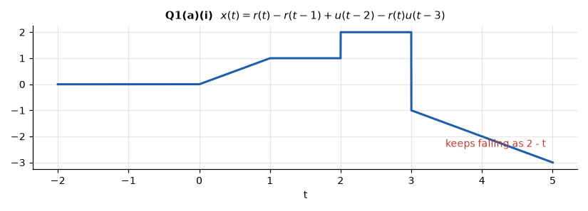
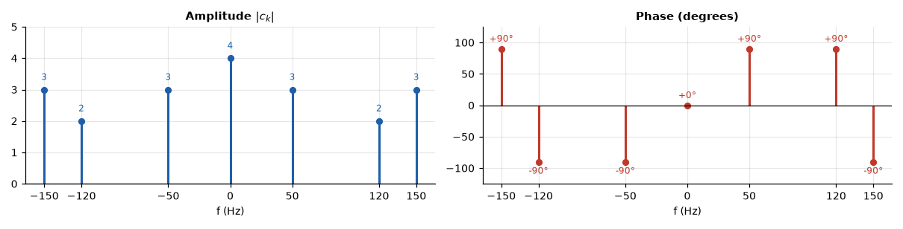
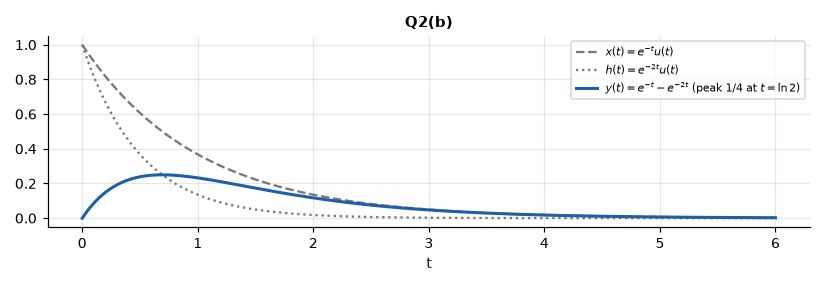
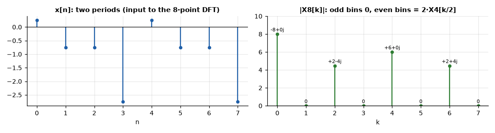
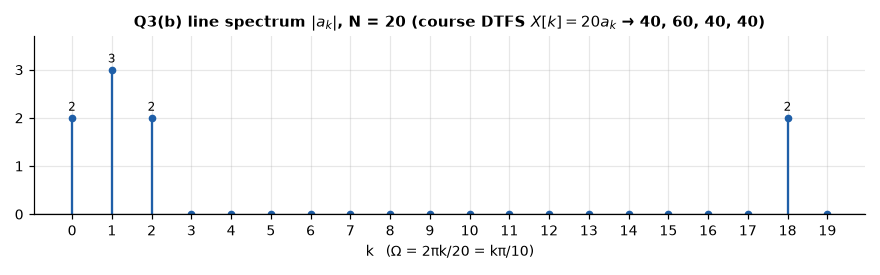

# SC3102 Past Paper Solutions: Semester 2, AY2025/26 (Apr/May 2026)

Paper: `../SC3102-25S2.pdf` · 4 questions × 25 marks · 2 hours · all questions compulsory

These are my own worked solutions; there is no official answer key. All numbers were re-checked by computer, and
the figures come from `make_figures.py`. Slide references use PDF page numbers in `SC3102/Slides/`.
The whole-course map is in [00_Exam_Guide.md](00_Exam_Guide.md).
**This is the most recent paper, set under the current Part 2 lecturer, so its Q3–Q4 style is the best guide to Monday.**

<b>Answer key: final answers only (open after attempting)</b>

| Part | Final answer |
|---|---|
| 1(a)(i) | $0$ for $t<0$; $t$ on $[0,1)$; $1$ on $[1,2)$; $2$ on $[2,3)$; $2-t$ for $t\ge3$ (jumps to −1 at $t=3$) |
| 1(a)(ii) | $E=\infty$ and $P=\infty$ (it grows like $t$), so **neither** |
| 1(b)(i) | $x=4+3je^{j2\pi50t}-3je^{-j2\pi50t}+2je^{j2\pi120t}-2je^{-j2\pi120t}-3je^{j2\pi150t}+3je^{-j2\pi150t}$ |
| 1(b)(ii) | Amplitudes $4\ (0),\ 3\ (\pm50),\ 2\ (\pm120),\ 3\ (\pm150)$. Phases $+90^\circ$ at $50, 120$, $-90^\circ$ at $150$ (opposite signs at negative $f$) |
| 1(b)(iii) | $f_{max}=150$ Hz, so $f_s>2f_{max}=300$ Hz |
| 2(a) | **Linear**; **time-variant**; **non-causal** |
| 2(b)(i) | $y(t)=(e^{-t}-e^{-2t})u(t)$ |
| 2(b)(ii) | $Y(f)=\frac{1}{(1+j2\pi f)(2+j2\pi f)}=\frac{1}{1+j2\pi f}-\frac{1}{2+j2\pi f}$, which inverts to the same $y$ |
| 3(a)(i) | $x[n]=\frac14\sum_kX[k]e^{j\pi kn/2}=-1+\frac12\cos\frac{\pi n}{2}+\sin\frac{\pi n}{2}+\frac34\cos\pi n$ |
| 3(a)(ii) | $x[n]=\{0.25,\ -0.75,\ -0.75,\ -2.75\}$ |
| 3(a)(iii) | $X_8[k]=\{-8,\ 0,\ 2-4j,\ 0,\ 6,\ 0,\ 2+4j,\ 0\}$ |
| 3(b) | $N=20$; lines at $k=0,1,2,18$ (i.e. $-2$) |
| 3(c) | $y_{ss}[n]=-\frac59+1.581\cos(\frac{\pi}{4}n-95.7^\circ)$ |
| 4(a) | Poles set the ROC and stability (CT: $b>0$; DT: $\lvert b\rvert<1$); zeros shape the response. Frequency response is on the $j\omega$-axis or the unit circle, and is valid only if that lies in the ROC |
| 4(b)(i) | $y(t)=-\frac{23}{24}-\frac{1}{24}e^{-2t}$, $t\ge0$ |
| 4(b)(ii) | $y(\infty)=\lim_{s\to0}sY(s)=\frac{49}{24}\approx2.042$ |

---

## Question 1 (Signals)

### 1(a)(i) Sketch $x(t)=r(t)-r(t-1)+u(t-2)-r(t)u(t-3)$ on $[-2,5]$ (5 marks)

**Topic:** singularity functions (Signals p.43–52).

1. **Rewrite the odd term.** For $t\ge3$, $r(t)=t$, so $r(t)u(t-3)=t\,u(t-3)$. That is a jump of 3 at $t=3$, followed by slope 1. (As steps and ramps it's $t\,u(t-3)=r(t-3)+3u(t-3)$.)
2. **Evaluate piecewise:**

   | interval | active terms | $x(t)$ |
   |---|---|---|
   | $t<0$ | none | 0 |
   | $0\le t<1$ | $r(t)$ | $t$ (ramp from 0 to 1) |
   | $1\le t<2$ | $t-(t-1)$ | 1 |
   | $2\le t<3$ | $1+1$ | 2 |
   | $t\ge3$ | $2-t$ | jumps to $-1$ at $t=3$, then falls with slope −1 (to $-3$ at $t=5$) |

### 1(a)(ii) Energy, power, or neither? (6 marks)

**Topic:** Signals p.17–21. The slide example "$x(t)=t$ is neither" (p.18) is the key idea.

1. **Energy:** $E=\int|x|^2dt\ge\int_3^\infty(t-2)^2dt=\left[\frac{(t-2)^3}{3}\right]_3^\infty=\infty$. Not an energy signal.
2. **Power:** for large $T$, the integral is dominated by the growing part:
   $$\frac1T\int_{-T/2}^{T/2}|x|^2dt\approx\frac1T\int_3^{T/2}(t-2)^2dt\approx\frac1T\cdot\frac{(T/2)^3}{3}=\frac{T^2}{24}\to\infty.$$
   Not a power signal.

**Answer:** **neither** an energy nor a power signal, because $|x(t)|$ grows without bound.

### 1(b) $x(t)=8\cos^2(120\pi t+\frac{\pi}{4})+12\cos(200\pi t)\sin(100\pi t)$

#### (i) Complex exponentials, frequencies, amplitudes and phases (6 marks)
**Topic:** trigonometric identities, then Euler (Signals p.37–42).

1. Use $\cos^2\theta=\frac{1+\cos2\theta}{2}$:
   $$8\cos^2(120\pi t+\tfrac{\pi}{4})=4+4\cos(240\pi t+\tfrac{\pi}{2}).$$
2. Use $\cos A\sin B=\frac{\sin(A+B)-\sin(A-B)}{2}$ with $A=200\pi t$, $B=100\pi t$:
   $$12\cos(200\pi t)\sin(100\pi t)=6\sin(300\pi t)-6\sin(100\pi t).$$
3. Write everything as cosines, the course convention ($\sin\theta=\cos(\theta-\frac{\pi}{2})$, $-\sin\theta=\cos(\theta+\frac{\pi}{2})$):
   $$x(t)=4+6\cos(2\pi\,50\,t+\tfrac{\pi}{2})+4\cos(2\pi\,120\,t+\tfrac{\pi}{2})+6\cos(2\pi\,150\,t-\tfrac{\pi}{2}).$$
4. Split each $a\cos(\omega t+\theta)$ into $\frac a2e^{j\theta}e^{j\omega t}+\frac a2e^{-j\theta}e^{-j\omega t}$:

| $f$ (Hz) | 0 | $+50$ | $-50$ | $+120$ | $-120$ | $+150$ | $-150$ |
|---|---|---|---|---|---|---|---|
| complex amplitude $c$ | $4$ | $3j$ | $-3j$ | $2j$ | $-2j$ | $-3j$ | $3j$ |
| $\lvert c\rvert$ | 4 | 3 | 3 | 2 | 2 | 3 | 3 |
| phase | $0$ | $+\frac{\pi}{2}$ | $-\frac{\pi}{2}$ | $+\frac{\pi}{2}$ | $-\frac{\pi}{2}$ | $-\frac{\pi}{2}$ | $+\frac{\pi}{2}$ |

$$\boxed{x(t)=4+3je^{j100\pi t}-3je^{-j100\pi t}+2je^{j240\pi t}-2je^{-j240\pi t}-3je^{j300\pi t}+3je^{-j300\pi t}}$$

**Check one pair:** $3je^{j100\pi t}-3je^{-j100\pi t}=3j(2j\sin100\pi t)=-6\sin(100\pi t)$ ✓. (All the lines were also confirmed with an FFT.)

#### (ii) Double-sided amplitude and phase spectra (4 marks)
Plot the $|c|$ and phase rows of the table. The amplitude spectrum is even and the phase spectrum is odd, because $x$ is real.

#### (iii) Minimum sampling frequency (4 marks)
**Topic:** Nyquist–Shannon (Signals p.64; L0 p.23–25).
- The highest frequency present is $f_{max}=150$ Hz. (Note that 120 Hz, not 240 Hz, comes from the $\cos^2$ term, because $240\pi t$ is $2\pi\cdot120\,t$.)
- So $f_s\ge2f_{max}=\mathbf{300}$ **Hz** (the Nyquist rate).

> **Fine print:** strictly you need $f_s>300$ Hz. The 150 Hz component is a pure **sine**, and sampling at exactly 300 Hz takes every sample at its zero crossings: $\sin(300\pi n/300)=\sin(\pi n)=0$. That component would then vanish. Writing "$f_s>300$ Hz, so the minimum is 300 Hz in the limit" covers both readings.

---

## Question 2 (Systems and convolution)

### 2(a) $y(t)=x(2t)+(t-1)x(t-1)-3x(t+2)$: linearity, time invariance, causality (10 marks)

**Topic:** Systems p.9–19; L0 p.43–50, 60.

**Linearity: yes.** Let $x_3=a\,x_1+b\,x_2$. Then
$$y_3(t)=\big[ax_1+bx_2\big](2t)+(t-1)\big[ax_1+bx_2\big](t-1)-3\big[ax_1+bx_2\big](t+2)=a\,y_1(t)+b\,y_2(t).$$
Every term is a scaled, shifted or compressed copy of $x$, and there's no constant term or nonlinearity. A time-varying gain $(t-1)$ does *not* break linearity.

**Time invariance: no.** There are two culprits: the time-scaling $x(2t)$ and the time-varying gain $(t-1)$.
- **General test:** input $x(t-t_0)$ gives $x(2t-t_0)+(t-1)x(t-1-t_0)-3x(t+2-t_0)$, but $y(t-t_0)=x(2t-2t_0)+(t-t_0-1)x(t-t_0-1)-3x(t-t_0+2)$. These differ in the first two terms.
- **Counterexample:** $x(t)=1$ for all $t$. Then $y(t)=1+(t-1)-3=t-3$. Delaying a constant input gives the same constant, so the output is still $t-3$. But a time-invariant system would have to output $y(t-t_0)=t-t_0-3\ne t-3$. ✗

**Causality: no.** $y(t)$ needs $x(t+2)$, the input 2 s in the future. (The term $x(2t)$ also looks ahead for $t>0$.)
- **Counterexample:** $y(0)=x(0)-x(-1)-3x(2)$ depends on $x(2)$. An input that is zero until $t=1$ and non-zero afterwards would still change $y(0)$.

**Answer:** linear, **time-variant**, **non-causal** (and it has memory).

### 2(b) $h(t)=e^{-2t}u(t)$, $x(t)=e^{-t}u(t)$

#### (i) Algebraic convolution (6 marks)
**Topic:** the convolution integral (Systems p.31–32).

1. $y(t)=\int_{-\infty}^{\infty}x(\tau)\,h(t-\tau)\,d\tau=\int e^{-\tau}u(\tau)\;e^{-2(t-\tau)}u(t-\tau)\,d\tau$.
2. **Limits:** $u(\tau)$ needs $\tau\ge0$ and $u(t-\tau)$ needs $\tau\le t$. So for $t<0$, $y=0$. For $t\ge0$, $\tau\in[0,t]$.
3. **Integrate** ($t\ge0$):
   $$y(t)=\int_0^te^{-\tau}e^{-2t}e^{2\tau}d\tau=e^{-2t}\int_0^te^{\tau}d\tau=e^{-2t}\big(e^{t}-1\big).$$

**Answer:** $\boxed{y(t)=\big(e^{-t}-e^{-2t}\big)\,u(t)}$. It starts at 0 and peaks at $\frac14$ when $t=\ln2$.

#### (ii) State the convolution theorem and verify (9 marks)
**Topic:** Transforms p.33.

**Convolution theorem:** if $x(t)\leftrightarrow X(f)$ and $h(t)\leftrightarrow H(f)$, then
$$x(t)*h(t)=\int_{-\infty}^{\infty}x(\tau)h(t-\tau)d\tau\ \longleftrightarrow\ X(f)\,H(f),$$
and dually $x(t)h(t)\leftrightarrow X(f)*H(f)$. Convolution in time is multiplication in frequency.

**Verification:**
1. $X(f)=\dfrac{1}{1+j2\pi f}$ and $H(f)=\dfrac{1}{2+j2\pi f}$, from the given pair with $a=1$ and $a=2$.
2. $Y(f)=X(f)H(f)=\dfrac{1}{(1+j2\pi f)(2+j2\pi f)}$.
3. Partial fractions with $p=j2\pi f$:
   $$\frac{1}{(1+p)(2+p)}=\frac{A}{1+p}+\frac{B}{2+p},\quad A=\frac{1}{2-1}=1,\quad B=\frac{1}{1-2}=-1.$$
4. $Y(f)=\dfrac{1}{1+j2\pi f}-\dfrac{1}{2+j2\pi f}$, which inverts term by term to $e^{-t}u(t)-e^{-2t}u(t)$.

This is identical to (i) ✓. **Reverse check:** $\mathcal F\{(e^{-t}-e^{-2t})u(t)\}=\frac{1}{1+j2\pi f}-\frac{1}{2+j2\pi f}=\frac{(2+j2\pi f)-(1+j2\pi f)}{(1+j2\pi f)(2+j2\pi f)}=\frac{1}{(1+j2\pi f)(2+j2\pi f)}=X(f)H(f)$ ✓.

---

## Question 3 (DFT, DTFS, frequency response)

### 3(a) 4-point DFT $X[k]=[-4,\ 1-2j,\ 3,\ 1+2j]$ of a periodic $x[n]$

#### (i) The equation for $x[n]$ (4 marks)
**Topic:** DFT synthesis / DTFS (L1 `lecture.pdf` p.53–56; L2 `lecture(1).pdf` p.13).

$$x[n]=\frac14\sum_{k=0}^{3}X[k]\,e^{j2\pi kn/4}=\frac14\Big[-4+(1-2j)e^{j\frac{\pi}{2}n}+3e^{j\pi n}+(1+2j)e^{j\frac{3\pi}{2}n}\Big].$$

Pair the conjugate terms. $e^{j\frac{3\pi}{2}n}=e^{-j\frac{\pi}{2}n}$ and $X[3]=X[1]^*$, so they add to $2\,\mathrm{Re}\{(1-2j)e^{j\frac{\pi}{2}n}\}=2\big[\cos\frac{\pi n}{2}+2\sin\frac{\pi n}{2}\big]$. Then
$$\boxed{x[n]=-1+\tfrac12\cos\tfrac{\pi n}{2}+\sin\tfrac{\pi n}{2}+\tfrac34\cos(\pi n)}$$
In amplitude–phase form: $1-2j=\sqrt5\angle{-63.4^\circ}$, so $x[n]=-1+\frac{\sqrt5}{2}\cos(\frac{\pi n}{2}-63.4^\circ)+\frac34(-1)^n$, periodic with $N=4$.

#### (ii) Values over one period (4 marks)

| $n$ | $-1$ | $+\frac12\cos\frac{\pi n}{2}$ | $+\sin\frac{\pi n}{2}$ | $+\frac34(-1)^n$ | $x[n]$ |
|---|---|---|---|---|---|
| 0 | −1 | 0.5 | 0 | 0.75 | **0.25** |
| 1 | −1 | 0 | 1 | −0.75 | **−0.75** |
| 2 | −1 | −0.5 | 0 | 0.75 | **−0.75** |
| 3 | −1 | 0 | −1 | −0.75 | **−2.75** |

**Checks:**
- $\sum x=-4=X[0]$ ✓
- $X[2]=0.25+0.75-0.75+2.75=3$ ✓
- $X[1]=0.25-0.75(-j)-0.75(-1)-2.75(j)=1-2j$ ✓

#### (iii) The 8-point DFT of two periods (4 marks)
1. $x_8=[x,x]=[0.25,-0.75,-0.75,-2.75,\ 0.25,-0.75,-0.75,-2.75]$.
2. Split the 8-point sum into its two halves, using $x[n+4]=x[n]$:
   $$X_8[k]=\sum_{n=0}^{7}x[n]e^{-j2\pi kn/8}=\sum_{n=0}^{3}x[n]e^{-j2\pi kn/8}\big(1+e^{-j\pi k}\big)=\big(1+(-1)^k\big)\sum_{n=0}^{3}x[n]e^{-j2\pi kn/8}.$$
3. **Odd $k$:** $1+(-1)^k=0$, so $X_8[k]=0$.
   **Even $k=2m$:** $X_8[2m]=2\sum_{n=0}^{3}x[n]e^{-j2\pi mn/4}=2X[m]$.

**Answer:** $\boxed{X_8[k]=\{-8,\ 0,\ 2-4j,\ 0,\ 6,\ 0,\ 2+4j,\ 0\}}$

**Why:** the signal only contains the frequencies $2\pi m/4=2\pi(2m)/8$, which are the even bins of the finer 8-point grid. The odd bins sit at frequencies that aren't present. Two periods give exactly an integer number of cycles, so there's **no leakage**. The values double because the course's DFT has no $1/N$ in the analysis sum, so twice as many samples add up to twice as much.

### 3(b) $x[n]=2-3e^{j(\frac{\pi}{10}n-\frac{\pi}{4})}+4\cos(\frac{\pi}{5}n+\frac{\pi}{3})$: DTFT → DTFS, $N$ and the indices $k$ (6 marks)

**Topic:** DTFS (L2 `lecture(1).pdf` p.5–13), DTFT (p.81–98), and periodicity of discrete sinusoids (L0 p.33).

**Modifications from the DTFT to the DTFS:**
1. **The signal must be periodic with an integer period $N$.** The DTFS describes one period; the DTFT is meant for aperiodic, absolutely summable signals. A periodic signal is not absolutely summable, so its DTFT exists only as **impulses**: $X(\Omega)=2\pi\sum_ka_k\,\delta(\Omega-\frac{2\pi k}{N})$, repeated every $2\pi$.
2. **Discretise the frequency axis:** continuous $\Omega\in[0,2\pi)$ becomes $N$ harmonics $\Omega_k=\frac{2\pi k}{N}$, $k=0,\dots,N-1$.
3. **Finite sums replace the infinite sum and the integral:**
   - Analysis: $X[k]=\sum_{n=0}^{N-1}x[n]e^{-j2\pi kn/N}$ (one period, not $n=-\infty..\infty$).
   - Synthesis: $x[n]=\frac1N\sum_{k=0}^{N-1}X[k]e^{j2\pi kn/N}$ (instead of $\frac{1}{2\pi}\int_{2\pi}X(\Omega)e^{j\Omega n}d\Omega$).
4. **An impulse of area $2\pi a_k$ at $\Omega_k$ becomes a spectral line** at index $k$, with $a_k=X[k]/N$. The result is a line spectrum instead of a continuous density.

**Finding $N$:** each term needs $\frac{\Omega}{2\pi}$ to be rational, and $N$ is the denominator in lowest terms.
- $2$: $\Omega=0$, any $N$.
- $e^{j\frac{\pi}{10}n}$: $\frac{\Omega}{2\pi}=\frac{1}{20}$, so $N_1=20$.
- $\cos(\frac{\pi}{5}n)$: $\frac{\Omega}{2\pi}=\frac{1}{10}$, so $N_2=10$.
- $N=\mathrm{lcm}(20,10)=\boxed{20}$, with fundamental $\Omega_0=\frac{2\pi}{20}=\frac{\pi}{10}$.

**Indices $k$** ($\Omega=k\Omega_0$):

| term | as harmonics of $\Omega_0=\pi/10$ | $k$ | $a_k$ | course $X[k]=20a_k$ |
|---|---|---|---|---|
| $2$ | DC | $0$ | $2$ | $40$ |
| $-3e^{-j\pi/4}e^{j\frac{\pi}{10}n}$ | $1\cdot\Omega_0$ | $1$ | $-3e^{-j\pi/4}=3e^{j3\pi/4}$ | $60e^{j3\pi/4}$ |
| $4\cos(\frac{\pi}{5}n+\frac{\pi}{3})=2e^{j\pi/3}e^{j2\Omega_0n}+2e^{-j\pi/3}e^{-j2\Omega_0n}$ | $\pm2\Omega_0$ | $2$ and $-2\equiv18$ | $2e^{\pm j\pi/3}$ | $40e^{\pm j\pi/3}$ |

**Answer:** $N=20$. The line spectrum has non-zero lines **only at $k=0,\ 1,\ 2,\ 18$** (equivalently $k=-2$ if you plot $-10\le k\le9$). All other $X[k]=0$. Note that $k=1$ has no partner at $k=19$, because the $e^{j\frac{\pi}{10}n}$ term is complex.

### 3(c) Steady state of $y[n]=-x[n]+\frac12x[n-1]+0.1y[n-1]$ for $x[n]=1+2\cos(\frac{\pi}{4}n+\frac{\pi}{3})$ (7 marks)

**Topic:** frequency response of an LCCDE (L2 `lecture(1).pdf` p.101–106; L4 `lecture(3).pdf` p.48–53).

1. **Frequency response.** $H(z)=\dfrac{-1+0.5z^{-1}}{1-0.1z^{-1}}$. The pole at $0.1$ is inside the unit circle, so the system is stable and $H(e^{j\Omega})$ is valid:
   $$H(e^{j\Omega})=\frac{-1+0.5e^{-j\Omega}}{1-0.1e^{-j\Omega}}.$$
2. **DC term** ($\Omega=0$): $H(1)=\dfrac{-1+0.5}{1-0.1}=-\dfrac59$, so the DC output is $1\times(-\frac59)=-\frac59$.
3. **Sinusoid** ($\Omega=\frac{\pi}{4}$, where $e^{-j\pi/4}=0.7071-0.7071j$):
   - Numerator: $-1+0.5(0.7071-0.7071j)=-0.6464-0.3536j$. Magnitude $0.7368$; angle $-180^\circ+28.68^\circ=-151.32^\circ$ (3rd quadrant).
   - Denominator: $1-0.1(0.7071-0.7071j)=0.9293+0.0707j$. Magnitude $0.9320$; angle $4.35^\circ$.
   - $|H|=\dfrac{0.7368}{0.9320}=0.7906$ and $\angle H=-151.32^\circ-4.35^\circ=-155.68^\circ$ ($-2.717$ rad).
4. **Output:** $2|H|=1.581$ and the phase is $60^\circ-155.68^\circ=-95.68^\circ$.

**Answer:**
$$\boxed{y_{ss}[n]=-\frac59+1.581\cos\!\Big(\frac{\pi}{4}n-95.7^\circ\Big)}\quad(\text{or }-0.556+1.581\cos(\tfrac{\pi}{4}n-1.670))$$
(Confirmed by simulating the recursion: after the $(0.1)^n$ transient dies, the error is below $10^{-13}$.)

> **Trap:** the numerator's real part is negative, so its angle is in the 3rd quadrant. A calculator's $\tan^{-1}(0.3536/0.6464)=28.7^\circ$ has to be corrected to $-151.3^\circ$.

---

## Question 4 (s vs z; Laplace with initial conditions)

### 4(a) $H(s)=\dfrac{s+a}{s+b}$ and $H(z)=\dfrac{z+a}{z+b}$, both causal

#### (i) Roles of poles and zeros; stability and ROC in CT and DT (6 marks)
**Topic:** L5 `lecture(4)` p.39, 57–59; L3 `lecture(2)` p.37, 55–57; L6/L4 causality and stability.

- **Zeros** ($s=-a$ or $z=-a$) are where $H=0$: inputs at that complex frequency are blocked. They shape the frequency response, giving a dip when the evaluation contour passes near a zero. They **don't affect stability or the ROC**. (A zero in the right half-plane, or outside the unit circle, only makes the system non-minimum-phase.)
- **Poles** ($s=-b$ or $z=-b$) are where $H\to\infty$. Each pole is a natural mode of the impulse response:
  - $-b$ in the s-plane gives $e^{-bt}u(t)$
  - $-b$ in the z-plane gives $(-b)^nu[n]$

  Poles **decide the ROC and stability**: the ROC never contains a pole, and its edges are set by poles.

| | Continuous time $H(s)$ | Discrete time $H(z)$ |
|---|---|---|
| Causal ROC | right of the rightmost pole: $\mathrm{Re}(s)>-b$ | outside the outermost pole: $\lvert z\rvert>\lvert b\rvert$ |
| Stable ⇔ | ROC contains the $j\omega$-axis ⇔ pole in the left half-plane ⇔ $b>0$ | ROC contains the unit circle ⇔ pole inside it ⇔ $\lvert b\rvert<1$ |
| Impulse response | $h(t)=\delta(t)+(a-b)e^{-bt}u(t)$ | $h[n]=\delta[n]+(a-b)(-b)^{n-1}u[n-1]$ |
| Pole–zero cancellation | if $a=b$, $H=1$ (no pole left) | same |

(The impulse responses come from $H=1+\frac{a-b}{s+b}$ and $H=1+\frac{a-b}{z+b}$.)

#### (ii) How the frequency response is evaluated, and when it's valid (6 marks)

| | Continuous time | Discrete time |
|---|---|---|
| Where to evaluate | on the imaginary axis, $s=j\omega$ | on the unit circle, $z=e^{j\Omega}$ |
| Formula | $H(j\omega)=\dfrac{j\omega+a}{j\omega+b}$ | $H(e^{j\Omega})=\dfrac{e^{j\Omega}+a}{e^{j\Omega}+b}$, $2\pi$-periodic |
| Low frequency | $H(0)=\frac ab$ | $H(e^{j0})=\frac{1+a}{1+b}$ |
| High frequency | $H(j\infty)=1$ | $\Omega=\pi$: $H(-1)=\frac{a-1}{b-1}$ |
| Geometry | $\lvert H\rvert=\dfrac{\text{distance from }j\omega\text{ to the zero}}{\text{distance from }j\omega\text{ to the pole}}$; $\angle H=\angle(\text{zero vector})-\angle(\text{pole vector})$ | the same, measured from the point $e^{j\Omega}$ on the circle |

**Validity conditions.** $H(j\omega)$ or $H(e^{j\Omega})$ is the true frequency response, i.e. the CTFT or DTFT of $h$, only if the **evaluation contour lies in the ROC**. For these causal systems that means **$b>0$** (CT) or **$|b|<1$** (DT), which is the same as BIBO stability. Then an input $e^{j\omega t}$ (or $e^{j\Omega n}$) produces the steady-state output $H\,e^{j\omega t}$. If the system is unstable you can still substitute $s=j\omega$ into the formula, but the number you get isn't a frequency response: $h$ has no Fourier transform, and the output blows up instead of settling.

### 4(b) $3\dfrac{dy}{dt}=x(t)$

#### (i) $y(0)=-1$, $x(t)=\frac14e^{-2t}u(t)$ (8 marks)
**Topic:** unilateral Laplace with initial conditions (L6 `lecture(5)` p.42–43).

1. Transform: $3\big(sY-y(0)\big)=X$, so $3sY+3=\dfrac{1}{4(s+2)}$.
2. Solve: $Y=\dfrac{1}{12\,s\,(s+2)}-\dfrac1s$.
3. Partial fractions: $\dfrac{1}{s(s+2)}=\dfrac12\left(\dfrac1s-\dfrac{1}{s+2}\right)$, so
   $$Y=\frac{1}{24}\left(\frac1s-\frac{1}{s+2}\right)-\frac1s=-\frac{23/24}{s}-\frac{1/24}{s+2}.$$

**Answer:** $\boxed{y(t)=-\frac{23}{24}-\frac{1}{24}e^{-2t},\quad t\ge0}$

**Checks:** $y(0)=-1$ ✓. $y'=\frac{1}{12}e^{-2t}$, so $3y'=\frac14e^{-2t}=x$ ✓.
**Interpretation:** the system is an integrator, $y=y(0)+\frac13\int x$. The input has total area $\frac14\cdot\frac12=\frac18$, so it raises $y$ by $\frac13\cdot\frac18=\frac{1}{24}$ in total.

#### (ii) $y(0)=2$: steady state via the Final Value Theorem (5 marks)
**Topic:** FVT and the pole check (L6 `lecture(5)` p.48–56).

1. $Y(s)=\dfrac{1}{12s(s+2)}+\dfrac2s$.
2. **Pole check** (needed before using the FVT): $sY(s)=\dfrac{1}{12(s+2)}+2$ has its only pole at $s=-2$, in the left half-plane. Equivalently, $Y$ has a simple pole at 0 and every other pole in the left half-plane. The theorem applies ✓.
3. Apply the FVT:
   $$y(\infty)=\lim_{s\to0}sY(s)=\frac{1}{12\cdot2}+2=\frac{1}{24}+2=\boxed{\frac{49}{24}\approx2.042}$$

**Check:** $y(t)=2+\frac{1}{24}(1-e^{-2t})\to\frac{49}{24}$ ✓. (Same idea as in (i): the initial value plus $\frac{1}{24}$.)

