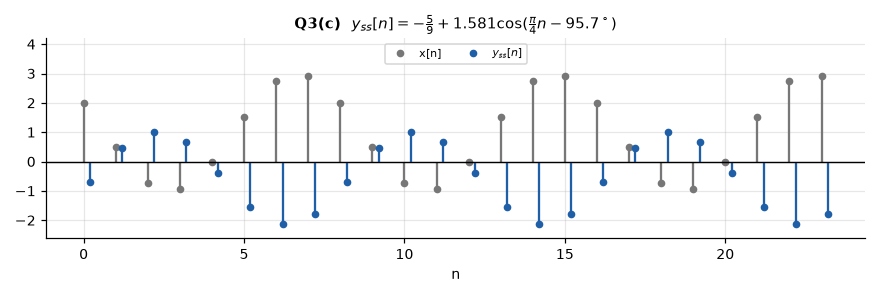
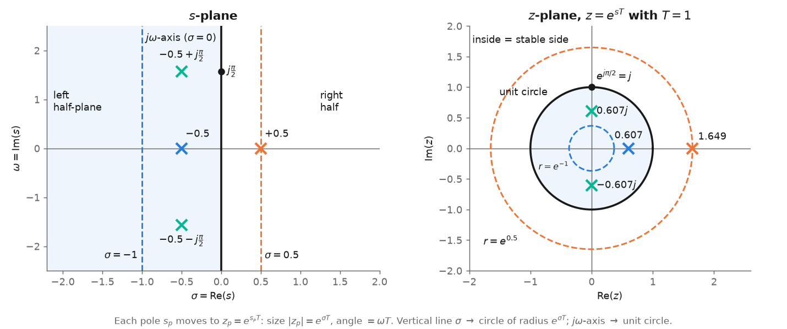
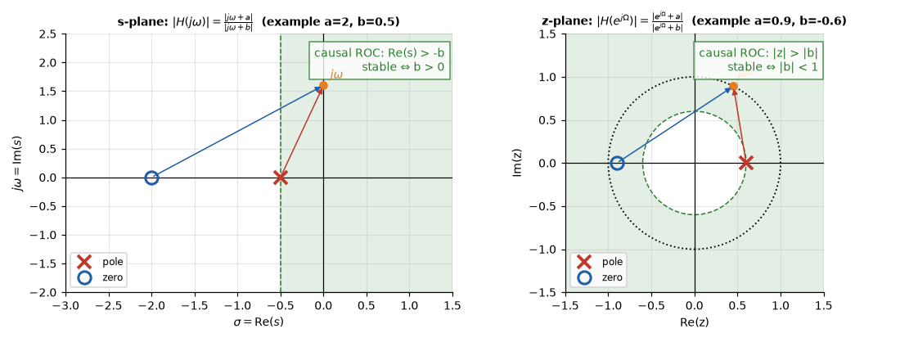
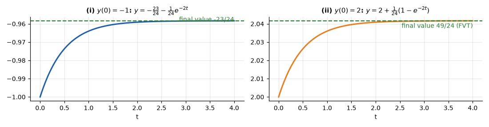

# SC3102 Past Paper Solutions: Semester 2, AY2025/26 (Apr/May 2026)

Paper: `../SC3102-25S2.pdf` · 4 questions × 25 marks · 2 hours · all questions compulsory

These are my own worked solutions; there is no official answer key. All numbers were re-checked by computer.
Most figures come from `make_figures.py`; `25S2_Q4a_s_to_z.png` was drawn separately for this write-up.
Slide references use PDF page numbers in `SC3102/Slides/`.
The whole-course map is in [00_Exam_Guide.md](00_Exam_Guide.md).
**This is the most recent paper, set under the current Part 2 lecturer, so its Q3–Q4 style is the best guide to the final.**

**How each part is laid out.** Every part has two blocks, in this order:
1. **Exam answer:** what to write on the paper. The question, what's given and asked, each step with the rule it uses, the boxed answer, and a one-line check.
2. **Explanation:** why each step works, what the ideas mean, common traps, and links to other parts. Read it after the exam answer.

<b>Answer key: final answers only (open after attempting)</b>

| Part | Final answer |
|---|---|
| 1(a)(i) | $0$ for $t<0$; $t$ on $[0,1)$; $1$ on $[1,2)$; $2$ on $[2,3)$; $2-t$ for $t\ge3$ (jumps to −1 at $t=3$) |
| 1(a)(ii) | $E=\infty$ and $P=\infty$ (it grows like $t$), so **neither** |
| 1(b)(i) | $x=4+3je^{j2\pi50t}-3je^{-j2\pi50t}+2je^{j2\pi120t}-2je^{-j2\pi120t}-3je^{j2\pi150t}+3je^{-j2\pi150t}$ |
| 1(b)(ii) | Amplitudes $4\ (0),\ 3\ (\pm50),\ 2\ (\pm120),\ 3\ (\pm150)$. Phases $+90^\circ$ at $50, 120$, $-90^\circ$ at $150$ (opposite signs at negative $f$) |
| 1(b)(iii) | $f_{max}=150$ Hz, so $f_s>2f_{max}=300$ Hz |
| 2(a) | **Linear**; **time-variant**; **non-causal** |
| 2(b)(i) | $y(t)=(e^{-t}-e^{-2t})u(t)$ |
| 2(b)(ii) | $Y(f)=\frac{1}{(1+j2\pi f)(2+j2\pi f)}=\frac{1}{1+j2\pi f}-\frac{1}{2+j2\pi f}$, which inverts to the same $y$ |
| 3(a)(i) | $x[n]=\frac14\sum_kX[k]e^{j\pi kn/2}=-1+\frac12\cos\frac{\pi n}{2}+\sin\frac{\pi n}{2}+\frac34\cos\pi n$ |
| 3(a)(ii) | $x[n]=\{0.25,\ -0.75,\ -0.75,\ -2.75\}$ |
| 3(a)(iii) | $X_8[k]=\{-8,\ 0,\ 2-4j,\ 0,\ 6,\ 0,\ 2+4j,\ 0\}$ |
| 3(b) | $N=20$; lines at $k=0,1,2,18$ (i.e. $-2$) |
| 3(c) | $y_{ss}[n]=-\frac59+1.581\cos(\frac{\pi}{4}n-95.7^\circ)$ |
| 4(a) | Poles set the ROC and stability (CT: $b>0$; DT: $\lvert b\rvert<1$); zeros shape the response. Frequency response is on the $j\omega$-axis or the unit circle, and is valid only if that lies in the ROC |
| 4(b)(i) | $y(t)=-\frac{23}{24}-\frac{1}{24}e^{-2t}$, $t\ge0$ |
| 4(b)(ii) | $y(\infty)=\lim_{s\to0}sY(s)=\frac{49}{24}\approx2.042$ |

---

## Question 1 (Signals)

### 1(a)(i) Sketch $x(t)=r(t)-r(t-1)+u(t-2)-r(t)u(t-3)$ on $[-2,5]$ (5 marks)

**Topic:** singularity functions (Signals p.43–52).

#### Exam answer

> *"A continuous-time signal is defined as: $x(t)=r(t)-r(t-1)+u(t-2)-r(t)u(t-3)$, where $u(t)$ is the unit step function and $r(t)$ is the ramp function. (i) Sketch $x(t)$ over the interval $[-2,5]$."*

**Given:** $x(t)$, with $u(t)=0$ for $t<0$ and $1$ for $t\ge0$, and the unit ramp $r(t)=t\,u(t)$ ($0$ for $t<0$, $t$ for $t\ge0$). **Asked:** a sketch on $[-2,5]$.

1. **Rewrite the product term.** $u(t-3)$ is 0 for $t<3$ and 1 for $t\ge3$. When $t\ge3$, $t$ is also $\ge0$, so $r(t)=t$. Therefore
   $$r(t)u(t-3)=\begin{cases}0,&t<3\\ t,&t\ge3\end{cases}\;=\;t\,u(t-3).$$
   Split $t=(t-3)+3$: $\;t\,u(t-3)=(t-3)u(t-3)+3u(t-3)=r(t-3)+3u(t-3)$. That is a **jump of 3** at $t=3$ plus a **slope of 1** from $t=3$. So
   $$x(t)=r(t)-r(t-1)+u(t-2)-r(t-3)-3u(t-3).$$
2. **Switch-on times** (a shifted step or ramp $g(t-c)$ switches on at $t=c$): $r(t)$ at 0, $r(t-1)$ at 1, $u(t-2)$ at 2, and the last two terms at 3.
3. **Add the terms that are on, interval by interval** (using the original form):

| interval | terms that are on | $x(t)$ |
|---|---|---|
| $t<0$ | none | $0$ |
| $0\le t<1$ | $r(t)=t$ | $t$ (ramp from 0 to 1) |
| $1\le t<2$ | $t-(t-1)$ | $t-t+1=1$ |
| $2\le t<3$ | $t-(t-1)+1$ | $1+1=2$ |
| $t\ge3$ | $t-(t-1)+1-t$ | $t-t+1+1-t=2-t$ |

4. **Values at the breakpoints:** $x(0)=0$; $x(1)=1$; just before 2, $x=1$, and at 2 it jumps to $2$; just before 3, $x=2$, and at 3 it is $2-3=-1$ (a drop of 3); $x(5)=2-5=-3$.

$$\boxed{x(t)=\begin{cases}0,&t<0\\ t,&0\le t<1\\ 1,&1\le t<2\\ 2,&2\le t<3\\ 2-t,&t\ge3\end{cases}\qquad\text{(jump }+1\text{ at }t=2,\ \text{jump }-3\text{ at }t=3)}$$

**Sketch:** zero on $[-2,0)$; a ramp from $(0,0)$ to $(1,1)$; flat at 1 up to $t=2$; a vertical jump to 2, flat to $t=3$; a vertical drop to $-1$; then a straight line of slope $-1$ down to $(5,-3)$.

**Check (slopes and jumps):** each ramp adds a slope from its start time and each step adds a jump.
- Slope on $[0,1)$: $+1$ (from $r(t)$). On $[1,3)$: $1-1=0$ (flat) ✓.
- From 3: $0-1=-1$ (from $-r(t-3)$) ✓.
- Jumps: $+1$ at $t=2$ (from $u(t-2)$) and $-3$ at $t=3$ (from $-3u(t-3)$) ✓. Both match the table.

#### Explanation

- **What a ramp is.** $r(t)$ is 0 before $t=0$ and then climbs with slope 1: $r(0.5)=0.5$, $r(2)=2$. It is the running area under the step: $\int_{-\infty}^tu(\tau)d\tau=t$ for $t\ge0$.
- **Reading a shifted term.** $g(t-c)$ is $g$ moved right by $c$, because at $t=c$ it gives $g(0)$. So $r(t-1)$ starts climbing at $t=1$: $r(1.5-1)=0.5$.
- **Why subtracting $r(t-1)$ makes it flat.** From $t=1$ on, $r(t)$ climbs at slope $+1$ and $-r(t-1)$ falls at slope $-1$. They cancel, leaving the constant $1$ (at $t=1.5$: $1.5-0.5=1$).
- **The trap: $r(t)u(t-3)$ is not $r(t-3)$.**
  - Multiplying by $u(t-3)$ *switches on* the existing ramp at $t=3$; it does not delay it. The switched-on ramp is already at height 3 when it appears.
  - At $t=4$: $r(t)u(t-3)=4\cdot1=4$, but $r(t-3)=r(1)=1$. The difference, 3, is the jump.
  - If you used $r(t-3)$, you'd get $x=2-(t-3)=5-t$ for $t\ge3$, which is continuous at $t=3$ (value 2). The real signal drops to $-1$ there.
- **Why rewriting as steps and ramps helps.** In that form every term is "switch on a slope" or "switch on a jump", so the sketch comes straight from the list, and the slope/jump check above is quick.
- **What the marker looks for:** labelled axes; the values $1$, $2$, $-1$, $-3$ at $t=1,2,3,5$; the two jumps drawn vertical; zero for $t<0$; and the window $[-2,5]$.
- **Link:** (ii) uses this table. The growing tail $2-t$ is what makes the signal "neither".

### 1(a)(ii) Energy, power, or neither? (6 marks)

**Topic:** Signals p.17–21. The slide example "$x(t)=t$ is neither" (p.18) is the key idea.

#### Exam answer

> *"(ii) Determine whether the signal $x(t)$ is an energy signal, a power signal, or neither. Justify using the formal definitions of energy and average power."*

**Given:** $x(t)$ from (i). **Asked:** classify it, using the definitions.

**Definitions** (Signals p.17, 19):
$$E=\int_{-\infty}^{\infty}|x(t)|^2dt=\lim_{T\to\infty}\int_{-T/2}^{T/2}|x(t)|^2dt,\qquad P=\lim_{T\to\infty}\frac1T\int_{-T/2}^{T/2}|x(t)|^2dt.$$
Energy signal: $0<E<\infty$. Power signal: $0<P<\infty$. If neither holds, the signal is **neither**.

1. **Energy inside the window $[-T/2,\,T/2]$.** Take $T>6$, so the window reaches past $t=3$. $x$ is real, so $|x|^2=x^2$, and $x=0$ for $t<0$. Split at the breakpoints, using the table from (i):
   $$E(T)=\int_0^1t^2\,dt+\int_1^21^2\,dt+\int_2^32^2\,dt+\int_3^{T/2}(2-t)^2\,dt.$$
2. **The first three pieces:**
   - $\int_0^1t^2dt=\left[\frac{t^3}{3}\right]_0^1=\frac13-0=\frac13$
   - $\int_1^21\,dt=2-1=1$
   - $\int_2^34\,dt=4\,(3-2)=4$
3. **The tail.** Squaring removes the sign, $(2-t)^2=(t-2)^2$. Substitute $w=t-2$, so $dw=dt$; $t=3$ gives $w=1$, and $t=T/2$ gives $w=\frac T2-2$:
   $$\int_3^{T/2}(t-2)^2dt=\int_1^{T/2-2}w^2\,dw=\left[\frac{w^3}{3}\right]_1^{T/2-2}=\frac{(T/2-2)^3}{3}-\frac13.$$
4. **Add the four pieces:** $\frac13+1+4-\frac13+\frac{(T/2-2)^3}{3}=5+\frac{(T/2-2)^3}{3}$. Tidy with $\frac T2-2=\frac{T-4}{2}$, so $\left(\frac T2-2\right)^3=\frac{(T-4)^3}{2^3}=\frac{(T-4)^3}{8}$:
   $$E(T)=5+\frac{(T-4)^3}{24}.$$
5. **Energy:** $E=\lim_{T\to\infty}E(T)=\infty$, because the cube grows without limit ($E(10)=5+\frac{6^3}{24}=5+9=14$; $E(100)=5+\frac{96^3}{24}=36869$). **Not an energy signal.**
6. **Power:** $P(T)=\dfrac{E(T)}{T}=\dfrac5T+\dfrac{(T-4)^3}{24T}$. For large $T$, $(T-4)^3\approx T^3$, so $P(T)\approx\frac{T^3}{24T}=\frac{T^2}{24}\to\infty$ ($P(10)=1.4$, $P(100)=368.7$, $P(1000)=41169$). **Not a power signal.**

$$\boxed{E=\infty\text{ and }P=\infty,\ \text{so }x(t)\text{ is neither an energy nor a power signal}}$$

**Check:** numerically integrating $x^2$ over $[-5,5]$ and $[-50,50]$ and dividing by $T$ gives $1.4$ and $368.69$, matching $P(10)$ and $P(100)$ ✓. It also fits the slide's rule (p.18): an infinite-duration signal whose size keeps increasing is neither.

#### Explanation

- **What the two numbers mean.** Energy $E$ is the total of "signal squared" over all time. Power $P$ is the average of "signal squared" per second over a long window. That's why $P(T)=E(T)/T$: the energy collected in a window of width $T$, divided by its width.
- **The three classes:**
  - energy signal: $E$ finite, so $P=0$ (dividing a fixed number by $T\to\infty$);
  - power signal: $P$ finite and nonzero, so $E=\infty$ (e.g. the constant 2 for $t\ge0$: $P(T)=\frac1T\cdot4\cdot\frac T2=2$);
  - neither: everything else.
- **Why this one is neither, and not a power signal.** A signal that settles at a fixed size, like the constant 2 above, has a fixed average. Here $|x|=|2-t|$ keeps growing, so $x^2$ keeps growing too: $x(10)^2=64$, $x(50)^2=2304$. The average over a longer window includes bigger values, so the average itself keeps climbing.
- **Why only the tail matters.** The first three pieces add the fixed amount $\frac{16}{3}=5.33$. If the signal stopped at $t=3$, then $E=5.33$ and it would be an energy signal. The ramp tail is what makes both $E$ and $P$ infinite.
- **The two flavours of "neither".**
  - Grows (this paper, and $x(t)=t$ on slide p.18): $P=\infty$.
  - Decays too slowly (slide p.21, $t^{-0.25}u(t-1)$): $E=\int_1^\infty t^{-0.5}dt=\infty$ but $P=\lim\frac1T\cdot2\big(\sqrt{T/2}-1\big)=0$.
- **Checking the integration rule:** $\int w^2dw=\frac{w^3}{3}$, because differentiating back gives $\frac{3w^2}{3}=w^2$ ✓. The substitution $w=t-2$ just slides the tail so it starts near 0.
- **Window form.** The slide also writes $P=\lim\frac{1}{2T}\int_{-T}^{T}|x|^2dt$. That's the same thing with a window of width $2T$ instead of $T$.
- **Traps:**
  - using the periodic formula $\frac1{T_0}\int_{T_0}|x|^2dt$: $x$ isn't periodic;
  - "infinite duration, so it's a power signal": a constant forever is a power signal, but a growing signal isn't;
  - forgetting to square, or dropping the sign wrongly: $(2-t)^2$ is always $\ge0$.

### 1(b) $x(t)=8\cos^2(120\pi t+\frac{\pi}{4})+12\cos(200\pi t)\sin(100\pi t)$

> *"A communication signal is given by $x(t)=8\cos^2\!\left(120\pi t+\frac{\pi}{4}\right)+12\cos(200\pi t)\sin(100\pi t)$."* Hint: $\cos^2\theta=\frac{1+\cos2\theta}{2}$; $\cos A\sin B=\frac{\sin(A+B)-\sin(A-B)}{2}$.

#### (i) Complex exponentials, frequencies, amplitudes and phases (6 marks)

**Topic:** trigonometric identities, then Euler (Signals p.37–42).

##### Exam answer

> *"(i) Express $x(t)$ as a sum of complex exponentials, and identify all frequency components (in Hz) along with their corresponding complex amplitudes and phases."*

**Given:** $x(t)$ and the two hint identities. **Asked:** $x(t)=\sum c\,e^{j2\pi ft}$, with every $f$ (Hz), $c$, $|c|$ and phase $\angle c$.

1. **First term** ($\cos^2$ identity with $\theta=120\pi t+\frac{\pi}{4}$):
   $$8\cos^2\theta=8\cdot\frac{1+\cos2\theta}{2}=4+4\cos2\theta.$$
   Double the angle: $2\theta=2\cdot120\pi t+2\cdot\frac{\pi}{4}=240\pi t+\frac{\pi}{2}$. So the first term is $4+4\cos\!\left(240\pi t+\frac{\pi}{2}\right)$.
2. **Second term** (product identity with $A=200\pi t$, $B=100\pi t$, so $A+B=300\pi t$ and $A-B=100\pi t$):
   $$12\cos A\sin B=12\cdot\frac{\sin(300\pi t)-\sin(100\pi t)}{2}=6\sin(300\pi t)-6\sin(100\pi t).$$
3. **Frequencies** (write each angle as $2\pi ft$): $240\pi t=2\pi(120)t$ → 120 Hz; $300\pi t=2\pi(150)t$ → 150 Hz; $100\pi t=2\pi(50)t$ → 50 Hz; and the constant 4 → 0 Hz (the DC, i.e. zero-frequency, term).
4. **Euler's formulas:** $\cos\phi=\dfrac{e^{j\phi}+e^{-j\phi}}{2}$ and $\sin\phi=\dfrac{e^{j\phi}-e^{-j\phi}}{2j}$, with $\dfrac1j=-j$ (because $j\cdot(-j)=-j^2=-(-1)=1$).
   - **120 Hz:** $4\cos\!\left(240\pi t+\frac\pi2\right)=2e^{j(240\pi t+\pi/2)}+2e^{-j(240\pi t+\pi/2)}$. Split each exponent with $e^{a+b}=e^ae^b$: $2e^{j\pi/2}e^{j240\pi t}+2e^{-j\pi/2}e^{-j240\pi t}$. Since $e^{j\pi/2}=\cos\frac\pi2+j\sin\frac\pi2=0+j=j$ and $e^{-j\pi/2}=-j$, this is $2j\,e^{j240\pi t}-2j\,e^{-j240\pi t}$.
   - **150 Hz:** $6\sin(300\pi t)=\dfrac{6}{2j}\left(e^{j300\pi t}-e^{-j300\pi t}\right)$, and $\dfrac{6}{2j}=\dfrac3j=3(-j)=-3j$. So $-3j\,e^{j300\pi t}+3j\,e^{-j300\pi t}$.
   - **50 Hz:** $-6\sin(100\pi t)=-\left(-3j\,e^{j100\pi t}+3j\,e^{-j100\pi t}\right)=3j\,e^{j100\pi t}-3j\,e^{-j100\pi t}$.
   - **0 Hz:** $4=4e^{j0}$.
5. **Table** ($|{\pm}3j|=3$; the angle of $+j$ is $+90^\circ$ and of $-j$ is $-90^\circ$):

| $f$ (Hz) | 0 | $+50$ | $-50$ | $+120$ | $-120$ | $+150$ | $-150$ |
|---|---|---|---|---|---|---|---|
| complex amplitude $c$ | $4$ | $3j$ | $-3j$ | $2j$ | $-2j$ | $-3j$ | $3j$ |
| $\lvert c\rvert$ | 4 | 3 | 3 | 2 | 2 | 3 | 3 |
| phase $\angle c$ | $0$ | $+\frac{\pi}{2}$ | $-\frac{\pi}{2}$ | $+\frac{\pi}{2}$ | $-\frac{\pi}{2}$ | $-\frac{\pi}{2}$ | $+\frac{\pi}{2}$ |

$$\boxed{x(t)=4+3je^{j100\pi t}-3je^{-j100\pi t}+2je^{j240\pi t}-2je^{-j240\pi t}-3je^{j300\pi t}+3je^{-j300\pi t}}$$

The same signal as cosines: $x(t)=4+6\cos(2\pi\,50\,t+\tfrac{\pi}{2})+4\cos(2\pi\,120\,t+\tfrac{\pi}{2})+6\cos(2\pi\,150\,t-\tfrac{\pi}{2})$.

**Check at $t=0$:** the original gives $8\cos^2\frac\pi4+12\cos0\sin0=8\left(\frac{1}{\sqrt2}\right)^2+0=8\cdot\frac12=4$. The exponential form gives (every $e^{(\cdot)}=1$) $4+(3j-3j)+(2j-2j)+(-3j+3j)=4$ ✓. A fast Fourier transform (FFT) of the signal, done by computer, also finds exactly these seven lines ✓.

##### Explanation

- **Why the identities come first.** Euler's formulas turn a single sine or cosine into exponentials. A square or a product isn't a single sinusoid, so you first turn it into a *sum* of single sinusoids. That's the whole job of the two hint identities.
- **Squaring doubles the frequency.** $120\pi t=2\pi(60)t$, so the original cosine is at **60 Hz**. Squaring it gives 0 Hz (the constant 4) and $2\times60=120$ Hz. The phase doubles too: $\frac\pi4\to\frac\pi2$. Listing 60 Hz is a common slip.
- **A product makes sum and difference frequencies.** $\cos(200\pi t)$ is 100 Hz and $\sin(100\pi t)$ is 50 Hz. Their product contains $100+50=150$ Hz and $100-50=50$ Hz, and **no** 100 Hz. Listing 100 Hz is the other common slip.
- **Why each real sinusoid gives two lines.** $a\cos(2\pi ft+\theta)=\frac a2e^{j\theta}e^{j2\pi ft}+\frac a2e^{-j\theta}e^{-j2\pi ft}$: half the amplitude at $+f$ with phase $+\theta$, and half at $-f$ with phase $-\theta$. The two complex amplitudes are conjugates ($3j$ and $-3j$), which is what keeps $x$ real. Check one pair: $3je^{j\phi}-3je^{-j\phi}=3j\left(e^{j\phi}-e^{-j\phi}\right)=3j\cdot2j\sin\phi=6j^2\sin\phi=-6\sin\phi$ ✓ (using $e^{j\phi}-e^{-j\phi}=2j\sin\phi$ and $j^2=-1$).
- **Reading amplitude and phase off $c$.** $c=3j=3e^{j\pi/2}$: amplitude 3, phase $+90^\circ$. $c=-3j=3e^{-j\pi/2}$: amplitude 3, phase $-90^\circ$. A positive real $c$ (the constant 4) has phase 0.
- **Why $\frac1j=-j$:** multiply top and bottom by $j$: $\frac1j=\frac{j}{j^2}=\frac{j}{-1}=-j$.
- **This is a Fourier series found by Euler.** All three frequencies are multiples of $10$ Hz (the greatest common divisor of 50, 120 and 150), so $x$ is periodic with $T_0=0.1$ s and the lines are the harmonics $k=0,\pm5,\pm12,\pm15$. Writing $x$ as a sum of exponentials reads the $c_k$ off directly, with no integral.
- **Power check (Parseval):** $P=\sum|c|^2=4^2+2(3^2+2^2+3^2)=16+2(22)=60$. The time-average of $x^2$, computed numerically, is also $60$ ✓.

#### (ii) Double-sided amplitude and phase spectra (4 marks)

##### Exam answer

> *"(ii) Sketch the double-sided amplitude and phase spectra of $x(t)$, clearly indicating the positions and values of spectral lines."*

**Given:** the table from (i). **Asked:** two line plots against $f$ (Hz), for negative and positive $f$.

1. **Amplitude spectrum:** a vertical line of height $|c|$ at each frequency: $4$ at $f=0$; $3$ at $\pm50$; $2$ at $\pm120$; $3$ at $\pm150$ Hz.
2. **Phase spectrum:** a line of height $\angle c$ at each frequency: $0$ at $f=0$; $+90^\circ$ at $+50$ and $+120$; $-90^\circ$ at $+150$; and the opposite signs at negative $f$ ($-90^\circ$ at $-50$ and $-120$, $+90^\circ$ at $-150$).
3. **Label** every line with its frequency and value.

**Check:** the amplitude plot is even ($|c(-f)|=|c(f)|$) and the phase plot is odd ($\angle c(-f)=-\angle c(f)$), as it must be for a real signal ✓.

##### Explanation

- **Double-sided vs single-sided.** Double-sided plots $|c|$ at both $\pm f$, so each cosine's amplitude is split in half between the two lines. Single-sided (Signals p.37) plots the full cosine amplitude $2|c|$ at $f>0$ only: $4$ at 0 Hz, $6$ at 50 Hz, $4$ at 120 Hz and $6$ at 150 Hz. The 0 Hz line is **not** doubled, because it has no partner.
- **Why the 50 Hz phase is $+90^\circ$.** The term is $-6\sin(100\pi t)$, and the minus sign matters: $-\sin\phi=\cos(\phi+\frac\pi2)$. Test at $t=0.005$ s, where $100\pi t=\frac\pi2$: $-6\sin\frac\pi2=-6$; $6\cos(\frac\pi2+\frac\pi2)=6\cos\pi=-6$ ✓; but $6\cos(\frac\pi2-\frac\pi2)=+6$ ✗. So $+90^\circ$ is right and $-90^\circ$ would be wrong.
- **Why the 0 Hz phase is 0.** $c=4$ is real and positive. A negative constant (say $-4$) would have phase $180^\circ$.
- **What the marker looks for:** line positions in Hz (not rad/s), the values written on the lines, and the sign flip of the phase at negative $f$.
- **Trap:** drawing the cosine amplitudes 6, 4, 6 on the double-sided plot.

#### (iii) Minimum sampling frequency (4 marks)

**Topic:** Nyquist–Shannon (Signals p.64; L0 p.23–25).

##### Exam answer

> *"(iii) Using the Nyquist sampling criterion, determine the minimum sampling frequency that allows perfect reconstruction of $x(t)$ from its samples."*

**Given:** the frequencies from (i). **Asked:** the smallest sampling rate $f_s$ that allows perfect reconstruction.

1. **Highest frequency present:** the largest $|f|$ with a nonzero line is $f_{max}=150$ Hz. So $x$ is band-limited to $B=150$ Hz.
2. **Nyquist criterion** (L0 p.24): $f_s>2B$ is sufficient for reconstruction. The Nyquist rate is $2B=2\times150=300$ Hz.

$$\boxed{f_{s,\min}=2f_{max}=300\text{ Hz, and strictly }f_s>300\text{ Hz}}$$

**Check (why strictly):** the 150 Hz component is a pure sine, $6\sin(300\pi t)$. Sampling at exactly 300 Hz means $t=\frac{n}{300}$, giving $6\sin\!\left(\frac{300\pi n}{300}\right)=6\sin(\pi n)=0$ for every whole $n$. The component would vanish, so you need slightly more than 300 Hz. Writing "$f_s>300$ Hz, i.e. 300 Hz in the limit" covers both readings.

##### Explanation

- **Why twice the top frequency.** Each cycle needs at least two samples, so that the samples catch both its up-half and its down-half. A 150 Hz wave has period $\frac{1}{150}=6.67$ ms; at 300 Hz the samples are $3.33$ ms apart, exactly half a period.
- **What goes wrong below the rate (aliasing).** At $f_s=250$ Hz the 150 Hz component gives exactly the same samples as a tone at $150-250=-100$ Hz, so it shows up as a false 100 Hz line (checked numerically).
- **Traps:**
  - reading $\omega$ as $f$: "$300\pi t$" is $2\pi(150)t$, i.e. 150 Hz, not 300 Hz (that slip gives 600 Hz);
  - using the frequencies before the identities (60 Hz from the $\cos^2$ term, 100 Hz from the product). Neither is in $x$;
  - forgetting the strict inequality for a sine at $f_{max}$.

---

## Question 2 (Systems and convolution)

### 2(a) $y(t)=x(2t)+(t-1)x(t-1)-3x(t+2)$: linearity, time invariance, causality (10 marks)

**Topic:** Systems p.9–19 (p.18: $y=g(t)x(t)$ is linear but time-variant); L0 p.43–50, 60.

#### Exam answer

> *"Consider the continuous-time system with input $x(t)$ and output $y(t)=x(2t)+(t-1)x(t-1)-3x(t+2)$. Analyze this system for linearity, time invariance, and causality. For each property, clearly state whether the system has the property and provide a brief justification or counterexample."*

**Given:** the input–output rule. **Asked:** linear? time-invariant? causal? Each with a reason or a counterexample.

**Linearity** (Systems p.11; L0 p.43). Test: does $a\,x_1+b\,x_2$ give $a\,y_1+b\,y_2$ for all constants $a,b$?
1. Feed $x_3(t)=a\,x_1(t)+b\,x_2(t)$. Replace $x$ by $x_3$ in every term:
   $$y_3(t)=\big[ax_1(2t)+bx_2(2t)\big]+(t-1)\big[ax_1(t-1)+bx_2(t-1)\big]-3\big[ax_1(t+2)+bx_2(t+2)\big].$$
2. Expand the brackets and collect the $a$-terms and the $b$-terms:
   $$y_3(t)=a\big[x_1(2t)+(t-1)x_1(t-1)-3x_1(t+2)\big]+b\big[x_2(2t)+(t-1)x_2(t-1)-3x_2(t+2)\big]=a\,y_1(t)+b\,y_2(t).$$

   **Linear ✓.** (Numbers: $x=1$ gives $1+(t-1)-3=t-3$; $x=2$ gives $2+2(t-1)-6=2t-6=2(t-3)$, double ✓.)

**Time invariance** (Systems p.13; L0 p.44). Test: does delaying the input by $t_0$ just delay the output by $t_0$?
1. **Output for the delayed input** $x_d(t)=x(t-t_0)$ (replace each $x(\cdot)$ by $x(\cdot-t_0)$):
   $$y_d(t)=x(2t-t_0)+(t-1)\,x(t-1-t_0)-3x(t+2-t_0).$$
2. **Delayed output** (replace every $t$ by $t-t_0$, including in the gain):
   $$y(t-t_0)=x(2t-2t_0)+(t-t_0-1)\,x(t-t_0-1)-3x(t-t_0+2).$$
3. **Compare:** the first terms differ ($x(2t-t_0)$ vs $x(2t-2t_0)$) and the gains differ ($t-1$ vs $t-t_0-1$). So $y_d(t)\ne y(t-t_0)$.

   **Counterexample:** $x(t)=1$ for all $t$ gives $y(t)=t-3$. Delaying a constant input by $t_0=1$ gives the same constant, so the output is still $t-3$. Time invariance would need $y(t-1)=t-4$. At $t=0$: $-3\ne-4$. **Time-variant ✗.**

**Causality** (Systems p.10; L0 p.60). Test: does $y(t)$ use only input values at times $\le t$?
1. The input times used at time $t$ are $2t$, $t-1$ and $t+2$.
2. $t+2>t$ for every $t$: the output needs the input 2 s in the future. ($2t>t$ when $t>0$ is a second culprit.)

   **Counterexample:** $x_1(t)=0$ for all $t$, and $x_2(t)=u(t-1)$ (zero until $t=1$). The two inputs are identical for $t<1$, so a causal system must give identical outputs for $t<1$. But $y_1(0)=0$, while
   $$y_2(0)=u(0-1)+(0-1)\,u(-1-1)-3u(0+2-1)=0-0-3(1)=-3\ne0.$$
   **Non-causal ✗.**

$$\boxed{\text{Linear: yes}\qquad\text{Time-invariant: no}\qquad\text{Causal: no}}$$

#### Explanation

- **The three properties in one line each:**
  - linear: scaling and adding inputs scales and adds outputs;
  - time-invariant: the system doesn't care *when* the input arrives;
  - causal: the output never needs the future.
- **Why the gain $(t-1)$ doesn't break linearity.** It multiplies $x$, but it doesn't depend on $x$. Doubling the input doubles that term at every $t$. What *does* break linearity is anything that treats the input nonlinearly or adds output that isn't caused by the input: $x^2$ (input 2 gives 4, not $2\times1$), $|x|$, products like $x(t)x(t-1)$, or an added constant ($y=x+5$ gives 5 for zero input).
- **Why $x(2t)$ breaks time invariance, with a pulse.** Put a narrow pulse in at $t=2$. The term $x(2t)$ is nonzero where $2t=2$, i.e. at $t=1$. Delay the pulse to $t=4$: now $2t=4$, i.e. $t=2$. The input moved by 2 but this part of the output moved by only 1. Compressing time compresses the delay too.
- **Why $(t-1)$ breaks it.** The gain reads the clock (Systems p.18: $y=g(t)x(t)$ is linear but time-variant). A pulse entering at time $\tau$ comes out of $(t-1)x(t-1)$ at $t=\tau+1$ with gain $(\tau+1)-1=\tau$. A pulse at $\tau=2$ gets gain 2; the same pulse at $\tau=5$ gets gain 5. Same input, different size of response.
- **Why the constant-input counterexample is so quick.** Delaying a constant changes nothing. So for a time-invariant system, the output of a constant must also be unchanged by any delay, i.e. it must itself be constant. $y=t-3$ isn't constant, so the system is time-variant. (The third term, $-3x(t+2)$, is time-invariant on its own; it is the first two that fail.)
- **Reading "future" in the causality test.** At time $t$, any input time larger than $t$ is the future. $x(t+2)$ looks 2 s ahead at every $t$. $x(2t)$ looks ahead only for $t>0$ (at $t=1$ it needs $x(2)$; at $t=-1$ it needs $x(-2)$, which is the past). One term that ever needs the future is enough to make the system non-causal.
- **Proof vs counterexample.** To show a property *holds*, you need the general algebra (any $a,b$, any $t_0$). To show it *fails*, one concrete example is enough. Give both for the failures if you have time: the general comparison shows *why*, the example makes it undeniable.
- **Extra (not asked):** it has memory (it uses $x(t-1)$, a past value; Systems p.9).
- **Traps:**
  - in the time-invariance test, shifting $t$ inside $x$ but not in the gain $(t-1)$;
  - writing the delayed version of $x(2t)$ as $x(2t-t_0)$ for the *delayed output*. The delayed output replaces $t$ by $t-t_0$ everywhere: $x(2(t-t_0))=x(2t-2t_0)$.
- **Link:** 25S1 Q2(a) *uses* linearity and time invariance to build an output; this question *tests* for them.

### 2(b) $h(t)=e^{-2t}u(t)$, $x(t)=e^{-t}u(t)$

> *"A linear time-invariant system (LTI) has impulse response $h(t)=e^{-2t}u(t)$ ... The input signal is $x(t)=e^{-t}u(t)$."* Hint: $e^{-at}u(t)\overset{\mathcal F}{\Leftrightarrow}\frac{1}{a+j2\pi f}$, $a>0$.

#### (i) Algebraic convolution (6 marks)

**Topic:** the convolution integral (Systems p.31–32).

##### Exam answer

> *"(i) Using algebraic method of convolution, compute the output $y(t)=x(t)\ast h(t)$. Show all integration steps clearly."*

**Given:** a linear time-invariant (LTI) system with $h(t)=e^{-2t}u(t)$; input $x(t)=e^{-t}u(t)$. **Asked:** $y=x\ast h$ by direct integration.

1. **Convolution integral** (Systems p.32):
   $$y(t)=\int_{-\infty}^{\infty}x(\tau)\,h(t-\tau)\,d\tau.$$
2. **Substitute.** $x(\tau)=e^{-\tau}u(\tau)$, and $h(t-\tau)$ is $h$ with $t$ replaced by $t-\tau$: $e^{-2(t-\tau)}u(t-\tau)$.
   $$y(t)=\int_{-\infty}^{\infty}e^{-\tau}u(\tau)\;e^{-2(t-\tau)}u(t-\tau)\,d\tau.$$
3. **Limits from the steps.** $u(\tau)=1$ needs $\tau\ge0$. $u(t-\tau)=1$ needs $t-\tau\ge0$, i.e. $\tau\le t$. Both are on only for $0\le\tau\le t$, which is possible only when $t\ge0$. So $y(t)=0$ for $t<0$, and for $t\ge0$:
   $$y(t)=\int_0^te^{-\tau}e^{-2(t-\tau)}\,d\tau.$$
4. **Combine the exponents** ($e^ae^b=e^{a+b}$): $-\tau-2(t-\tau)=-\tau-2t+2\tau=-2t+\tau$. So the integrand is $e^{-2t+\tau}=e^{-2t}e^{\tau}$.
5. **Take out the constant.** $e^{-2t}$ contains no $\tau$, so it comes outside the integral:
   $$y(t)=e^{-2t}\int_0^te^{\tau}d\tau=e^{-2t}\Big[e^{\tau}\Big]_0^t=e^{-2t}\big(e^{t}-e^{0}\big)=e^{-2t}\big(e^{t}-1\big).$$
6. **Multiply out** ($e^{-2t}e^{t}=e^{-2t+t}=e^{-t}$): $y(t)=e^{-t}-e^{-2t}$ for $t\ge0$.

$$\boxed{y(t)=\big(e^{-t}-e^{-2t}\big)\,u(t)}$$

**Check:** $y(0)=1-1=0$ ✓ (at $t=0$ the two functions don't yet overlap). At $t=1$: $e^{-1}-e^{-2}=0.3679-0.1353=0.2325$, and numerical integration of the convolution gives $0.2325$ ✓. The peak is $\frac14$ at $t=\ln2=0.693$.

##### Explanation

- **What the integral does.** Flip $h$, slide it to position $t$, multiply it point by point with $x$, and take the area. At $t=1$ the overlap is $\tau\in[0,1]$: the integrand there is $e^{-2}e^{\tau}$, from $e^{-2}=0.135$ at $\tau=0$ up to $e^{-1}=0.368$ at $\tau=1$, and its area is $0.2325$.
- **Why the limits are 0 to $t$.** On the $\tau$ axis, $x(\tau)$ lives on $\tau\ge0$, and the flipped, slid $h(t-\tau)$ lives on $\tau\le t$. They overlap only on $[0,t]$, and only once $t\ge0$. Reading the limits off the two step functions works for every "one-sided times one-sided" convolution.
- **The exponent step, slowly.** $-2(t-\tau)$ expands to $-2t+2\tau$ (minus times minus is plus). Adding $-\tau$ gives $-2t+\tau$.
- **Where the peak comes from.** Product rule is not needed, just $\frac{d}{dt}e^{-at}=-ae^{-at}$: $y'=-e^{-t}+2e^{-2t}$. Set it to 0: $e^{-t}=2e^{-2t}$. Multiply both sides by $e^{2t}$: $e^{t}=2$, so $t=\ln2$. Then $e^{-\ln2}=\frac{1}{e^{\ln2}}=\frac12$ and $e^{-2\ln2}=\frac14$, so $y_{max}=\frac12-\frac14=\frac14$.
- **Shape.** The output starts at 0, rises, then decays: the system smooths the input's sudden start.
- **General result** (worth having on your sheet): $e^{-at}u(t)\ast e^{-bt}u(t)=\dfrac{e^{-at}-e^{-bt}}{b-a}u(t)$ for $a\ne b$. Here $a=1$, $b=2$, so you divide by $2-1=1$. If $a=b$ the formula gives $\frac00$; the answer is then $te^{-at}u(t)$ (L5 `lecture(4)` p.67 has $e^{-t}u\ast e^{-t}u=te^{-t}u$).
- **Area check.** The area of a convolution is the product of the areas: $\int x=1$ and $\int h=\frac12$, so $\int y$ should be $\frac12$. Indeed $\int_0^\infty(e^{-t}-e^{-2t})dt=1-\frac12=\frac12$ ✓.
- **Traps:**
  - dropping $u(t)$ in the answer, which claims an output before the input starts;
  - integrating from $-\infty$ to $\infty$ without using the steps: $\int e^{\tau}d\tau$ over all $\tau$ is infinite;
  - writing $h(t-\tau)=e^{-2t-\tau}$ (the bracket must be kept: $e^{-2(t-\tau)}$).

#### (ii) State the convolution theorem and verify (9 marks)

**Topic:** Transforms p.33.

##### Exam answer

> *"(ii) State the convolution theorem and use it in the frequency domain to verify your time-domain results from Q2b(i)."*

**Given:** $x$, $h$, and the pair $e^{-at}u(t)\leftrightarrow\frac{1}{a+j2\pi f}$ for $a>0$. **Asked:** the theorem, then a frequency-domain check of (i).

**Convolution theorem** (Transforms p.33): if $x(t)\leftrightarrow X(f)$ and $h(t)\leftrightarrow H(f)$, then
$$y(t)=x(t)\ast h(t)=\int_{-\infty}^{\infty}x(\tau)h(t-\tau)\,d\tau\quad\longleftrightarrow\quad Y(f)=X(f)\,H(f).$$
Convolution in time is multiplication in frequency (and, dually, $x(t)h(t)\leftrightarrow X(f)\ast H(f)$).

1. **Transforms** (the given pair with $a=1$ and $a=2$, both $>0$ ✓):
   $$X(f)=\frac{1}{1+j2\pi f},\qquad H(f)=\frac{1}{2+j2\pi f}.$$
2. **Multiply** (convolution theorem):
   $$Y(f)=X(f)H(f)=\frac{1}{(1+j2\pi f)(2+j2\pi f)}.$$
3. **Partial fractions.** Write $p=j2\pi f$ to keep it short:
   $$\frac{1}{(1+p)(2+p)}=\frac{A}{1+p}+\frac{B}{2+p}.$$
   Cover-up method: for $A$, cover $(1+p)$ and set $p=-1$: $A=\dfrac{1}{2+(-1)}=1$. For $B$, cover $(2+p)$ and set $p=-2$: $B=\dfrac{1}{1+(-2)}=-1$. So
   $$Y(f)=\frac{1}{1+j2\pi f}-\frac{1}{2+j2\pi f}.$$
4. **Invert term by term** (the given pair read backwards, plus linearity): $\frac{1}{1+j2\pi f}\leftrightarrow e^{-t}u(t)$ and $\frac{1}{2+j2\pi f}\leftrightarrow e^{-2t}u(t)$.

$$\boxed{y(t)=e^{-t}u(t)-e^{-2t}u(t)=\big(e^{-t}-e^{-2t}\big)u(t)}$$

This is identical to (i) ✓.

**Check:** recombine the partial fractions over a common denominator: $\frac{(2+p)-(1+p)}{(1+p)(2+p)}=\frac{1}{(1+p)(2+p)}$ ✓. At $f=0$: $Y(0)=\frac{1}{1\cdot2}=0.5$, which equals the area of $y$ from (i), $1-\frac12=0.5$ ✓. At $f=0.1$ Hz, $X\cdot H$ and a numerical Fourier transform of (i)'s $y$ both give $0.2619-0.3075j$ ✓.

##### Explanation

- **Why the theorem holds** (a short derivation). Transform the convolution and swap the order of integration:
  $$\mathcal F\{x\ast h\}=\int_{-\infty}^{\infty}x(\tau)\left[\int_{-\infty}^{\infty}h(t-\tau)e^{-j2\pi ft}dt\right]d\tau.$$
  In the inner integral substitute $v=t-\tau$ (so $t=v+\tau$, $dt=dv$) and split the exponent with $e^{a+b}=e^ae^b$: $\int h(v)e^{-j2\pi f(v+\tau)}dv=e^{-j2\pi f\tau}\int h(v)e^{-j2\pi fv}dv=e^{-j2\pi f\tau}H(f)$. What's left is $\int x(\tau)e^{-j2\pi f\tau}d\tau\cdot H(f)=X(f)H(f)$.
- **Why it's useful.** An integral with a sliding window (part (i)) becomes one multiplication plus a table lookup. Partial fractions are the only algebra.
- **Where the given pair comes from:** $\int_0^\infty e^{-at}e^{-j2\pi ft}dt=\int_0^\infty e^{-(a+j2\pi f)t}dt=\left[\frac{e^{-(a+j2\pi f)t}}{-(a+j2\pi f)}\right]_0^\infty=0-\frac{1}{-(a+j2\pi f)}=\frac{1}{a+j2\pi f}$. The upper limit gives 0 only because $a>0$ (the $e^{-j2\pi ft}$ part always has size 1). That's the reason for the hint's "$a>0$".
- **Why the cover-up method works.** Multiply both sides of $\frac{1}{(1+p)(2+p)}=\frac{A}{1+p}+\frac{B}{2+p}$ by $(1+p)$: $\frac{1}{2+p}=A+\frac{B(1+p)}{2+p}$. Now set $p=-1$: the $B$ term has the factor $(1+p)=0$ and disappears, leaving $A=\frac{1}{2-1}=1$.
- **Why $p=j2\pi f$ is allowed.** Partial fractions are pure algebra; $p$ is just a placeholder. The same split works with any symbol, including the Laplace $s$: $\frac{1}{(s+1)(s+2)}=\frac{1}{s+1}-\frac{1}{s+2}$.
- **What "verify" needs.** Go all the way back to $y(t)$ and say it matches (i). Stopping at $Y(f)$ doesn't verify anything.
- **Traps:**
  - trying to invert $\frac{1}{(1+j2\pi f)(2+j2\pi f)}$ directly: a product isn't in the table, so split first;
  - $B=+1$ (sign slip in $1+(-2)$);
  - stating the theorem with the convolution on the wrong side: convolution in *time* ↔ product in *frequency*.
- **Link:** Q4 uses the Laplace version of the same idea, $Y(s)=H(s)X(s)$. On the $j\omega$-axis ($s=j2\pi f$) Laplace becomes this Fourier transform.

---

## Question 3 (DFT, DTFS, frequency response)

### 3(a) 4-point DFT $X[k]=[-4,\ 1-2j,\ 3,\ 1+2j]$ of a periodic $x[n]$

#### (i) The equation for $x[n]$ (4 marks)

**Topic:** DFT synthesis / DTFS (L1 `lecture.pdf` p.53–56; L2 `lecture(1).pdf` p.13).

##### Exam answer

> *"The 4 point DFT coefficients of a periodic discrete-time $x[n]$ are: $X[k]=[-4+j0,\ 1-2j,\ 3+j0,\ 1+2j]$. (i) Determine the equation representing $x[n]$."*

**Given:** a 4-point discrete Fourier transform (DFT), $N=4$: $X[0]=-4$, $X[1]=1-2j$, $X[2]=3$, $X[3]=1+2j$. **Asked:** a formula for $x[n]$.

1. **Synthesis equation** (inverse DFT, L1 p.55):
   $$x[n]=\frac1N\sum_{k=0}^{N-1}X[k]\,e^{j2\pi kn/N}.$$
   With $N=4$, $\frac{2\pi kn}{4}=\frac{\pi kn}{2}$:
   $$x[n]=\frac14\Big[-4\,e^{0}+(1-2j)\,e^{j\frac{\pi}{2}n}+3\,e^{j\pi n}+(1+2j)\,e^{j\frac{3\pi}{2}n}\Big].$$
2. **Rename $k=3$ as $k=-1$.** $e^{j\frac{3\pi}{2}n}=e^{j2\pi n}\,e^{-j\frac{\pi}{2}n}=e^{-j\frac{\pi}{2}n}$, because $e^{j2\pi n}=1$ for every whole $n$.
3. **The $k=2$ term.** $e^{j\pi n}=\left(e^{j\pi}\right)^n=(-1)^n=\cos(\pi n)$.
4. **Pair $k=1$ with $k=3$.** Let $\theta=\frac{\pi n}{2}$ and use Euler, $e^{\pm j\theta}=\cos\theta\pm j\sin\theta$. Expand term by term, with $j^2=-1$:
   - $(1-2j)(\cos\theta+j\sin\theta)=\cos\theta+j\sin\theta-2j\cos\theta-2j^2\sin\theta=(\cos\theta+2\sin\theta)+j(\sin\theta-2\cos\theta)$
   - $(1+2j)(\cos\theta-j\sin\theta)=\cos\theta-j\sin\theta+2j\cos\theta-2j^2\sin\theta=(\cos\theta+2\sin\theta)+j(2\cos\theta-\sin\theta)$
   - Sum: the imaginary parts cancel, leaving $2\cos\theta+4\sin\theta$.
5. **Collect and divide by 4:**
   $$x[n]=\frac14\Big[-4+2\cos\tfrac{\pi n}{2}+4\sin\tfrac{\pi n}{2}+3\cos(\pi n)\Big].$$

$$\boxed{x[n]=\frac14\sum_{k=0}^{3}X[k]e^{j\pi kn/2}=-1+\tfrac12\cos\tfrac{\pi n}{2}+\sin\tfrac{\pi n}{2}+\tfrac34\cos(\pi n)}$$

Amplitude–phase form (optional): $\frac12\cos\theta+\sin\theta=R\cos(\theta-\phi)$ with $R=\sqrt{(\frac12)^2+1^2}=\sqrt{\frac54}=\frac{\sqrt5}{2}=1.118$ and $\tan\phi=\frac{1}{1/2}=2$, so $\phi=63.4^\circ$. Hence $x[n]=-1+1.118\cos(\frac{\pi n}{2}-63.4^\circ)+\frac34(-1)^n$, periodic with $N=4$.

**Check at $n=0$:** the formula gives $-1+\frac12+0+\frac34=0.25$. The raw synthesis sum gives $\frac14\big[-4+(1-2j)+3+(1+2j)\big]=\frac14\big[1+(-2j+2j)\big]=\frac14=0.25$ ✓.

##### Explanation

- **What the synthesis equation says.** $x$ is a sum of $N=4$ "spinning arrows" $e^{j2\pi kn/4}$: $k=0$ doesn't spin (the average level), $k=1$ turns a quarter-turn per sample, $k=2$ a half-turn (the sign flips every sample), $k=3$ three quarter-turns. $X[k]/N$ is each arrow's size and starting angle. The course DFT puts the $\frac1N$ in the synthesis, not the analysis.
- **Why $k=3$ is the same as $k=-1$.** Three quarter-turns forward land in the same place as one quarter-turn back. At $n=1$: $e^{j3\pi/2}=\cos\frac{3\pi}{2}+j\sin\frac{3\pi}{2}=0-j=-j$, and $e^{-j\pi/2}=-j$ ✓.
- **Why $x$ comes out real.** $X[3]=1+2j$ is the conjugate of $X[1]=1-2j$, and $X[0]$, $X[2]$ are real. That pattern ($X[N-k]=X[k]^\ast$) is exactly what a real signal's DFT looks like, and it's why the imaginary parts cancelled in step 4. A leftover $j$ means an arithmetic slip.
- **Shortcut for real signals:** $x[n]=\frac14\Big[X[0]+X[2](-1)^n+2\,\mathrm{Re}\big\{X[1]e^{j\pi n/2}\big\}\Big]$. Step 4 computed exactly $2\,\mathrm{Re}\{\cdot\}=2\cos\theta+4\sin\theta$.
- **Why the question says "periodic".** The synthesis sum repeats every $N$ samples on its own (L2 p.11–12), because $e^{j2\pi k(n+4)/4}=e^{j2\pi kn/4}e^{j2\pi k}=e^{j2\pi kn/4}$. So the formula is valid for **all** $n$, not only $0..3$, and the $X[k]$ are the signal's discrete-time Fourier series (DTFS) coefficients (course convention: $X[k]=N\,a_k$).
- **Traps:** forgetting the $\frac14$; using $e^{-j\cdots}$ (that's the analysis equation); and sign slips in $-2j^2\sin\theta=+2\sin\theta$.

#### (ii) Values over one period (4 marks)

##### Exam answer

> *"(ii) Using the results above or any other method, calculate the values of $x[n]$ over one period."*

**Given:** the formula from (i). **Asked:** $x[0],\dots,x[3]$.

1. **Values of the three sinusoids** for $n=0,1,2,3$:
   - $\cos\frac{\pi n}{2}$: $1,\ 0,\ -1,\ 0$
   - $\sin\frac{\pi n}{2}$: $0,\ 1,\ 0,\ -1$
   - $\cos(\pi n)=(-1)^n$: $1,\ -1,\ 1,\ -1$
2. **Substitute:**

| $n$ | $-1$ | $+\frac12\cos\frac{\pi n}{2}$ | $+\sin\frac{\pi n}{2}$ | $+\frac34(-1)^n$ | $x[n]$ |
|---|---|---|---|---|---|
| 0 | −1 | 0.5 | 0 | 0.75 | **0.25** |
| 1 | −1 | 0 | 1 | −0.75 | **−0.75** |
| 2 | −1 | −0.5 | 0 | 0.75 | **−0.75** |
| 3 | −1 | 0 | −1 | −0.75 | **−2.75** |

$$\boxed{x[n]=\{0.25,\ -0.75,\ -0.75,\ -2.75\}\quad(n=0,1,2,3),\ \text{repeating every 4}}$$

**Check** with the forward discrete Fourier transform (DFT), $X[k]=\sum_nx[n](-j)^{kn}$ (since $e^{-j2\pi kn/4}=(e^{-j\pi/2})^{kn}=(-j)^{kn}$), using $(-j)^2=j^2=-1$ and $(-j)^3=(-j)^2(-j)=(-1)(-j)=j$:
- $X[0]=0.25-0.75-0.75-2.75=-4$ ✓
- $X[1]=0.25+(-0.75)(-j)+(-0.75)(-1)+(-2.75)(j)=0.25+0.75j+0.75-2.75j=1-2j$ ✓
- $X[2]=0.25-(-0.75)+(-0.75)-(-2.75)=0.25+0.75-0.75+2.75=3$ ✓

##### Explanation

- **The other method (straight from the sum).** With $e^{j\pi kn/2}=j^{kn}$: $x[n]=\frac14\big[-4+(1-2j)j^n+3(-1)^n+(1+2j)(-j)^n\big]$.
  - $n=1$: $(1-2j)j=j-2j^2=j+2$ and $(1+2j)(-j)=-j-2j^2=-j+2$. Sum: $-4+(2+j)-3+(2-j)=-3$, so $x[1]=-0.75$ ✓.
  - $n=3$ ($j^3=-j$, $(-j)^3=j$): $(1-2j)(-j)=-j+2j^2=-2-j$ and $(1+2j)j=j+2j^2=-2+j$. Sum: $-4+(-2-j)-3+(-2+j)=-11$, so $x[3]=-2.75$ ✓.
- **Quick checks you can do in seconds:**
  - $x[0]=\frac14\sum_kX[k]=\frac14(-4+1-2j+3+1+2j)=\frac14$ ✓
  - Parseval: $\sum_n|x[n]|^2=0.0625+0.5625+0.5625+7.5625=8.75$, and $\frac1N\sum_k|X[k]|^2=\frac14(16+5+9+5)=8.75$ ✓ ($|1\mp2j|^2=1+4=5$).
- **What $X[0]=-4$ means.** It is the sum of one period, so the mean is $-4/4=-1$, which is the constant $-1$ in (i).
- **Trap:** the powers of $-j$. Write them out once: $(-j)^0=1$, $(-j)^1=-j$, $(-j)^2=-1$, $(-j)^3=j$.

#### (iii) The 8-point DFT of two periods (4 marks)

##### Exam answer

> *"(iii) An 8-point DFT is applied to the sequence $x[n]$ obtained in Q3a(i). Using two periods of $x[n]$, determine the values of $X[k]$. Justify your answer."*

**Given:** $x[n]$ with period 4. **Asked:** the 8-point discrete Fourier transform (DFT) $X_8[k]$ of two periods, with a justification.

1. **The 8 samples:** $x_8=[0.25,-0.75,-0.75,-2.75,\ 0.25,-0.75,-0.75,-2.75]$, so $x_8[n+4]=x_8[n]$.
2. **Definition:** $X_8[k]=\displaystyle\sum_{n=0}^{7}x_8[n]\,e^{-j2\pi kn/8}$.
3. **Split the sum into its two halves.** In the second half write $n=m+4$ ($m=0..3$), use $x[m+4]=x[m]$, and split the exponent with $e^{a+b}=e^ae^b$:
   $$\sum_{m=0}^{3}x[m]\,e^{-j2\pi k(m+4)/8}=\sum_{m=0}^{3}x[m]\,e^{-j2\pi km/8}\cdot e^{-j2\pi k\cdot4/8}.$$
   The last factor is $e^{-j\pi k}=\left(e^{-j\pi}\right)^k=(-1)^k$. So
   $$X_8[k]=\big(1+(-1)^k\big)\sum_{n=0}^{3}x[n]\,e^{-j2\pi kn/8}.$$
4. **Odd $k$:** $1+(-1)=0$, so $X_8[k]=0$.
   **Even $k=2m$:** $1+1=2$, and $e^{-j2\pi(2m)n/8}=e^{-j2\pi mn/4}$, so $X_8[2m]=2\sum_{n=0}^{3}x[n]e^{-j2\pi mn/4}=2X[m]$.
5. **Values:** $X_8[0]=2X[0]=-8$; $X_8[2]=2X[1]=2-4j$; $X_8[4]=2X[2]=6$; $X_8[6]=2X[3]=2+4j$.

$$\boxed{X_8[k]=\{-8,\ 0,\ 2-4j,\ 0,\ 6,\ 0,\ 2+4j,\ 0\}}$$

**Check:** $X_8[0]$ is the sum of all 8 samples: $2\times(-4)=-8$ ✓. $X_8[4]=\sum x_8[n](-1)^n$ (because $e^{-j2\pi\cdot4n/8}=e^{-j\pi n}=(-1)^n$) $=2\,(0.25+0.75-0.75+2.75)=2\times3=6$ ✓. A computer fast Fourier transform (FFT) of the 8 samples gives the same list ✓.

##### Explanation

- **The frequency grids.** A 4-point DFT looks at $\Omega=\frac{2\pi k}{4}$: $0,\ \frac\pi2,\ \pi,\ \frac{3\pi}{2}$. An 8-point DFT looks at $\Omega=\frac{2\pi k}{8}$: $0,\ \frac\pi4,\ \frac\pi2,\ \frac{3\pi}{4},\dots$ The signal contains only $0,\frac\pi2,\pi,\frac{3\pi}2$, which are the **even** bins of the finer grid. The odd bins ($\frac\pi4,\frac{3\pi}4,\dots$) ask about frequencies that aren't there, so they are 0.
- **Seeing an odd bin cancel.** For $k=1$ the second half is multiplied by $e^{-j\pi}=-1$. So the $n=0$ term, $0.25$, is cancelled by the $n=4$ term, $0.25\cdot e^{-j2\pi\cdot4/8}=0.25\cdot(-1)=-0.25$, and the same happens for every pair $n$, $n+4$.
- **Why the values double.** The course DFT has no $\frac1N$ in the analysis sum. Twice as many samples of the same pattern add up to twice as much. The Fourier-series weights $a_k=X[k]/N$ don't change: $\frac{-8}{8}=\frac{-4}{4}=-1$.
- **No leakage.** Two periods is a whole number of periods, so every frequency in the signal lands exactly on a bin. General rule: $P$ periods in an $NP$-point DFT gives $X_{NP}[Pk]=P\,X_N[k]$, and every other bin is 0.
- **Trap: zero-padding is different.** Padding with zeros, $[0.25,-0.75,-0.75,-2.75,0,0,0,0]$, is *one* period followed by silence. Its 8-point DFT has the even bins equal to $X[m]$ (not doubled) and **nonzero** odd bins, e.g. $X_8[1]=1.664+3.225j$ (computed). The question says "two periods", so repeat, don't pad.

### 3(b) $x[n]=2-3e^{j(\frac{\pi}{10}n-\frac{\pi}{4})}+4\cos(\frac{\pi}{5}n+\frac{\pi}{3})$: DTFT → DTFS, $N$ and the indices $k$ (6 marks)

**Topic:** DTFS (L2 `lecture(1).pdf` p.5–13), DTFT (p.81–98), and periodicity of discrete sinusoids (L0 p.33).

#### Exam answer

> *"Given the discrete-time signal $x[n]=2-3e^{j\left(\frac{\pi}{10}n-\frac{\pi}{4}\right)}+4\cos\left(\frac{\pi}{5}n+\frac{\pi}{3}\right)$. State the modifications required to convert a DTFT representation of $x[n]$ into a DTFS representation. Determine a suitable value of the fundamental period $N$ for DTFS representation and list the corresponding discrete frequency indices $k$ (horizontal axis) for the resulting line spectrum."*

**Given:** $x[n]$. **Asked:** (1) the changes from the discrete-time Fourier transform (DTFT) to the discrete-time Fourier series (DTFS); (2) $N$; (3) the indices $k$ of the nonzero lines.

**Part 1: the modifications.** The two pairs side by side:
- DTFT (L2 p.98): $X(\Omega)=\displaystyle\sum_{n=-\infty}^{\infty}x[n]e^{-j\Omega n}$, $\quad x[n]=\dfrac{1}{2\pi}\displaystyle\int_{2\pi}X(\Omega)e^{j\Omega n}d\Omega$.
- DTFS (L2 p.13, course convention): $X[k]=\displaystyle\sum_{n=0}^{N-1}x[n]e^{-j2\pi kn/N}$, $\quad x[n]=\dfrac1N\displaystyle\sum_{k=0}^{N-1}X[k]e^{j2\pi kn/N}$.

1. **The signal must be periodic with a whole-number period $N$.** Check this first and find $N$ (Part 2). (The DTFT is meant for aperiodic, absolutely summable signals; a periodic signal isn't absolutely summable, so its DTFT exists only as impulses, $X(\Omega)=2\pi\sum_ka_k\,\delta(\Omega-\frac{2\pi k}{N})$, repeated every $2\pi$.)
2. **Discretise the frequency axis:** the continuous $\Omega\in[0,2\pi)$ is replaced by the $N$ harmonics $\Omega_k=\frac{2\pi k}{N}=k\Omega_0$, $k=0,\dots,N-1$.
3. **Finite sums replace the infinite sum and the integral:** analysis sums over one period ($n=0..N-1$) instead of all $n$; synthesis sums over $k=0..N-1$ with $\frac1N$ instead of integrating over $\Omega$ with $\frac{1}{2\pi}$.
4. **A continuous spectrum becomes a line spectrum:** each impulse of area $2\pi a_k$ at $\Omega_k$ becomes one line at index $k$, with $a_k=X[k]/N$.

**Part 2: the period $N$.** A discrete sinusoid at $\Omega$ is periodic only if $\frac{\Omega}{2\pi}$ is a fraction; $N$ is its denominator in lowest terms (L0 p.33).
- $2$: $\Omega=0$, periodic with any $N$.
- $e^{j\frac{\pi}{10}n}$: $\dfrac{\Omega}{2\pi}=\dfrac{\pi/10}{2\pi}=\dfrac{1}{20}$, so $N_1=20$.
- $\cos(\frac{\pi}{5}n+\dots)$: $\dfrac{\Omega}{2\pi}=\dfrac{\pi/5}{2\pi}=\dfrac{1}{10}$, so $N_2=10$.
- The sum repeats when every term does: $N=$ least common multiple $(20,10)=20$. Fundamental frequency $\Omega_0=\frac{2\pi}{20}=\frac{\pi}{10}$.

**Part 3: the indices.** Write every term as (constant) $\times\,e^{jk\Omega_0n}$:
- $2=2e^{j0n}$ → $k=0$, $a_0=2$.
- Split the exponent ($e^{a+b}=e^ae^b$): $-3e^{j(\frac{\pi}{10}n-\frac\pi4)}=-3e^{-j\pi/4}\,e^{j\frac{\pi}{10}n}$. $\frac{\pi}{10}=1\cdot\Omega_0$ → $k=1$. Make the amplitude positive with $-1=e^{j\pi}$: $a_1=3e^{j\pi}e^{-j\pi/4}=3e^{j3\pi/4}$.
- Euler on the cosine: $4\cos(\frac\pi5n+\frac\pi3)=2e^{j\pi/3}e^{j\frac\pi5n}+2e^{-j\pi/3}e^{-j\frac\pi5n}$. $\frac\pi5=2\Omega_0$ → $k=2$, $a_2=2e^{j\pi/3}$. $-\frac\pi5=-2\Omega_0$ → $k=-2$, which is the same as $k=-2+20=18$: $a_{18}=2e^{-j\pi/3}$.

| term | as harmonics of $\Omega_0=\pi/10$ | $k$ | $a_k$ | course $X[k]=20a_k$ |
|---|---|---|---|---|
| $2$ | zero frequency (DC) | $0$ | $2$ | $40$ |
| $-3e^{-j\pi/4}e^{j\frac{\pi}{10}n}$ | $1\cdot\Omega_0$ | $1$ | $3e^{j3\pi/4}$ | $60e^{j3\pi/4}$ |
| $2e^{j\pi/3}e^{j2\Omega_0n}$ | $2\Omega_0$ | $2$ | $2e^{j\pi/3}$ | $40e^{j\pi/3}$ |
| $2e^{-j\pi/3}e^{-j2\Omega_0n}$ | $-2\Omega_0$ | $-2\equiv18$ | $2e^{-j\pi/3}$ | $40e^{-j\pi/3}$ |

$$\boxed{N=20;\ \text{nonzero lines only at }k=0,\ 1,\ 2,\ 18\ (\text{i.e. }k=-2\text{ on a }-10\le k\le9\text{ axis})}$$

All other coefficients are 0. Line heights $|a_k|=2,\ 3,\ 2,\ 2$ (course $|X[k]|=40,\ 60,\ 40,\ 40$).

**Check at $n=0$:** from the lines, $x[0]=\sum_ka_k=2+3e^{j3\pi/4}+2e^{j\pi/3}+2e^{-j\pi/3}=2+(-2.121+2.121j)+2\cdot2\cos\frac\pi3=2-2.121+2.121j+2=1.879+2.121j$. Directly, $x[0]=2-3e^{-j\pi/4}+4\cos\frac\pi3=2-3(0.7071-0.7071j)+2=1.879+2.121j$ ✓. A 20-point fast Fourier transform (FFT) on the computer also finds exactly these four lines ✓.

#### Explanation

- **Why the DTFT of a periodic signal is made of impulses.** The DTFT sum needs $\sum|x[n]|<\infty$. A periodic signal adds the same amount every period, so the sum is infinite. All of its content sits at a few exact frequencies. Example: $e^{j\Omega_0n}$ has DTFT $2\pi\delta(\Omega-\Omega_0)$, because the synthesis integral then gives $\frac{1}{2\pi}\cdot2\pi\,e^{j\Omega_0n}=e^{j\Omega_0n}$ (sifting). The DTFS keeps just the areas of those impulses, as lines.
- **Why only $N$ harmonics.** $e^{j2\pi(k+N)n/N}=e^{j2\pi kn/N}\cdot e^{j2\pi n}=e^{j2\pi kn/N}$, since $e^{j2\pi n}=1$ for whole $n$. So $k=21$ is the same sequence as $k=1$, and $k=-2$ the same as $k=18$. Going back 2 steps on a 20-step dial is the same as going forward 18.
- **Why $N=20$ and not 10, with numbers.** The $e^{j\frac{\pi}{10}n}$ term changes sign after 10 samples: $e^{j\frac{\pi}{10}(n+10)}=e^{j\frac{\pi}{10}n}e^{j\pi}=-e^{j\frac{\pi}{10}n}$. Computed: $\max|x[n+10]-x[n]|=6$, but $x[n+20]=x[n]$ exactly.
- **Why there's no line at $k=19$.** The middle term is one complex exponential, not a cosine, so it has no mirror partner. The signal is complex, so its spectrum is not conjugate-symmetric. Adding a line at $k=19$ is the trap.
- **Keep amplitudes positive.** $a_1=-3e^{-j\pi/4}$ is correct but untidy; $-3=3e^{j\pi}$ moves the sign into the phase: $3\angle135^\circ$.
- **Shortcut that can fail.** "$N=\frac{2\pi}{\Omega}$" works here only because $\frac{2\pi}{\pi/10}=20$ is a whole number. For $\cos(\frac{3\pi}{10}n)$, $\frac{2\pi}{\Omega}=\frac{20}{3}$ is not a whole number; $\frac{\Omega}{2\pi}=\frac{3}{20}$ gives the true $N=20$.
- **What goes on the axes:** horizontal $k$ (or $\Omega=k\frac{\pi}{10}$), vertical $|a_k|$ or $|X[k]|$; state which convention you use.

### 3(c) Steady state of $y[n]=-x[n]+\frac12x[n-1]+0.1y[n-1]$ for $x[n]=1+2\cos(\frac{\pi}{4}n+\frac{\pi}{3})$ (7 marks)

**Topic:** frequency response of a linear constant-coefficient difference equation (L2 `lecture(1).pdf` p.101–106; L4 `lecture(3).pdf` p.48–53).

#### Exam answer

> *"Consider a causal, discrete-time, LTI system described by the following difference equation, $y[n]=-x[n]+\frac12x[n-1]+0.1y[n-1]$. Find the steady-state response of $y[n]$ of the system when the input is $x[n]=1+2\cos\left(\frac{\pi}{4}n+\frac{\pi}{3}\right)$."*

**Given:** a causal linear time-invariant (LTI) system and its difference equation; the input. **Asked:** the steady-state output.

1. **Transfer function** (zero initial conditions, as a transfer function is defined at rest; delay property $x[n-1]\leftrightarrow z^{-1}X(z)$, $y[n-1]\leftrightarrow z^{-1}Y(z)$):
   $$Y=-X+0.5z^{-1}X+0.1z^{-1}Y\ \Rightarrow\ Y-0.1z^{-1}Y=-X+0.5z^{-1}X\ \Rightarrow\ Y\big(1-0.1z^{-1}\big)=X\big(-1+0.5z^{-1}\big).$$
   $$H(z)=\frac{Y}{X}=\frac{-1+0.5z^{-1}}{1-0.1z^{-1}}=\frac{-z+0.5}{z-0.1}.$$
2. **Stability.** Pole: $z-0.1=0\Rightarrow z=0.1$. The system is causal and $|0.1|<1$ (inside the unit circle), so it is stable. Therefore a steady state exists and the frequency response $H(e^{j\Omega})$ is valid.
3. **Frequency response** (put $z=e^{j\Omega}$):
   $$H(e^{j\Omega})=\frac{-1+0.5e^{-j\Omega}}{1-0.1e^{-j\Omega}}.$$
4. **Superposition** (linearity): the input is a constant (DC, zero-frequency) part $1$ plus a sinusoid. Each passes through separately, by the rule
   $$A\cos(\Omega_0n+\theta)\ \mapsto\ A\,\big|H(e^{j\Omega_0})\big|\cos\!\big(\Omega_0n+\theta+\angle H(e^{j\Omega_0})\big),$$
   and a constant (frequency $\Omega=0$) is multiplied by $H(e^{j0})=H(1)$.
5. **DC part** ($z=1$): $H(1)=\dfrac{-1+0.5}{1-0.1}=\dfrac{-0.5}{0.9}=-\dfrac59\approx-0.556$. Output: $1\times\left(-\frac59\right)=-\frac59$.
6. **Sinusoid at $\Omega_0=\frac\pi4$.** $e^{-j\pi/4}=\cos\frac\pi4-j\sin\frac\pi4=0.7071-0.7071j$.
   - **Numerator:** $-1+0.5(0.7071-0.7071j)=-1+0.3536-0.3536j=-0.6464-0.3536j$.
     Size: $\sqrt{0.6464^2+0.3536^2}=\sqrt{0.4179+0.1250}=\sqrt{0.5429}=0.7368$.
     Angle: real and imaginary parts both negative, so it's in the 3rd quadrant. Reference angle $\tan^{-1}\frac{0.3536}{0.6464}=28.68^\circ$, so the angle is $-180^\circ+28.68^\circ=-151.32^\circ$.
   - **Denominator:** $1-0.1(0.7071-0.7071j)=1-0.0707+0.0707j=0.9293+0.0707j$.
     Size: $\sqrt{0.9293^2+0.0707^2}=\sqrt{0.8636+0.0050}=\sqrt{0.8686}=0.9320$. Angle (1st quadrant): $\tan^{-1}\frac{0.0707}{0.9293}=4.35^\circ$.
   - **Divide** (sizes divide, angles subtract): $|H|=\dfrac{0.7368}{0.9320}=0.7906$; $\angle H=-151.32^\circ-4.35^\circ=-155.68^\circ$ ($-2.717$ rad).
7. **Sinusoid output:** amplitude $2\times0.7906=1.581$; phase $\frac\pi3+\angle H=60^\circ-155.68^\circ=-95.68^\circ$.

$$\boxed{y_{ss}[n]=-\frac59+1.581\cos\!\Big(\frac{\pi}{4}n-95.7^\circ\Big)}\quad(\text{or }-0.556+1.581\cos(\tfrac{\pi}{4}n-1.670\text{ rad}))$$

**Check:**
- DC by itself: with $x[n]=1$ the output settles to a constant $c$ with $c=-1+0.5+0.1c$, so $0.9c=-0.5$ and $c=-\frac59$ ✓.
- Running the difference equation from rest for 200 samples: once the transient has died, the output matches the boxed formula to within $10^{-13}$ ✓.

#### Explanation

- **Why "sinusoid in, scaled sinusoid out".** Feed in $x[n]=e^{j\Omega n}$ and guess $y[n]=K\,e^{j\Omega n}$. Substitute into the difference equation:
  $$Ke^{j\Omega n}=-e^{j\Omega n}+0.5e^{j\Omega(n-1)}+0.1Ke^{j\Omega(n-1)}.$$
  Divide by $e^{j\Omega n}$ (using $e^{j\Omega(n-1)}/e^{j\Omega n}=e^{-j\Omega}$): $K=-1+0.5e^{-j\Omega}+0.1Ke^{-j\Omega}$, so $K(1-0.1e^{-j\Omega})=-1+0.5e^{-j\Omega}$ and $K=H(e^{j\Omega})$. The exponential comes out unchanged in shape, only scaled (L2 p.102).
- **Why a cosine picks up $|H|$ and $\angle H$.** $\cos\phi=\frac12(e^{j\phi}+e^{-j\phi})$. The equation has real coefficients, so $H(e^{-j\Omega})$ is the conjugate of $H(e^{j\Omega})$. The two halves come out as $\frac12|H|e^{j(\phi+\angle H)}+\frac12|H|e^{-j(\phi+\angle H)}=|H|\cos(\phi+\angle H)$.
- **Which initial conditions?** None are given, and for a stable system they don't affect the steady state anyway. From rest, the full output is the steady state plus a transient from the pole: here $y[n]-y_{ss}[n]=-1.288(0.1)^n$, i.e. $-1.288,\ -0.129,\ -0.013,\ -0.0013$ (checked by simulation). Any starting value $y[-1]$ only changes the $-1.288$; the $(0.1)^n$ still kills it within a few samples.
- **The three ways to split the output** (stable system): transient = natural = the $(0.1)^n$ part from the system's pole; steady state = forced = the part with the input's shape (DC and $\frac\pi4$).
- **The quadrant trap.** A calculator gives $\tan^{-1}\frac{-0.3536}{-0.6464}=\tan^{-1}(0.547)=28.68^\circ$, the same as for $0.6464+0.3536j$. The minus signs put the point in the 3rd quadrant, so subtract $180^\circ$: $-151.32^\circ$ (equivalently $+208.68^\circ$).
- **Why the DC gain is negative.** At $\Omega=0$ the numerator is $-1+0.5=-0.5$: the $-x[n]$ term wins. So a positive DC input gives a negative DC output (a phase of $180^\circ$).
- **Filter view.** $|H(1)|=0.556$ at $\Omega=0$, $0.791$ at $\frac\pi4$, $1.112$ at $\frac\pi2$, and $|H(-1)|=\left|\frac{-1-0.5}{1+0.1}\right|=1.364$ at $\Omega=\pi$. The gain rises with frequency: high-pass-like. The zero at $z=0.5$ sits near $z=1$ ($\Omega=0$) and pulls the low-frequency gain down. Compare 25S1 Q4(a), $y=x[n]+0.5x[n-1]+0.1y[n-1]$: its zero is at $-0.5$, near $z=-1$, so it is low-pass.
- **Where the region of convergence (ROC) fits in.** For a causal system the ROC is outside the outermost pole, $|z|>0.1$. It contains the unit circle, which is exactly why $H(e^{j\Omega})$ is the true frequency response (see Q4(a)(ii)).
- **Link:** 25S1 Q4(a)(iv) uses the same method at $\Omega=\pi$.

---

## Question 4 (s vs z; Laplace with initial conditions)

### 4(a) $H(s)=\dfrac{s+a}{s+b}$ and $H(z)=\dfrac{z+a}{z+b}$, both causal

> *"Consider two LTI, causal systems: $H(s)=\frac{s+a}{s+b}$, $H(z)=\frac{z+a}{z+b}$, where $H(s)$ and $H(z)$ are the transfer functions of continuous-time and discrete-time systems, respectively."*

#### (i) Roles of poles and zeros; stability and ROC in continuous and discrete time (6 marks)

**Topic:** L5 `lecture(4)` p.39, 57–59; L3 `lecture(2)` p.37, 55–57; causality and stability from the ROC: L4 `lecture(3)` p.40–45 (discrete time), L6 `lecture(5)` p.36–38 (continuous time).

##### Exam answer

> *"(i) Describe the roles of poles and zeros in each system. Explain how they influence system stability and the region of convergence (ROC) for both continuous-time and discrete-time cases."*

**Given:** the two causal linear time-invariant (LTI) systems. **Asked:** what poles and zeros do, and how they set stability and the region of convergence (ROC), in continuous time and in discrete time.

1. **Locate them.**
   - Continuous time: zero where $s+a=0$, i.e. $s=-a$; pole where $s+b=0$, i.e. $s=-b$.
   - Discrete time: zero at $z=-a$; pole at $z=-b$.
2. **Zeros: block and shape.** At a zero $H=0$, so an input of that exact complex frequency gives no output: $e^{s_0t}$ with $s_0=-a$, or $z_0^n$ with $z_0=-a$. Zeros shape the frequency response (a dip where the evaluation path passes near a zero) and set how much of each mode appears in $h$. They do **not** affect the ROC or stability.
3. **Poles: natural modes.** At a pole $H\to\infty$. Each pole is a pattern the system produces by itself after a kick:
   - continuous-time pole $-b$ → mode $e^{-bt}$;
   - discrete-time pole $-b$ → mode $(-b)^n$.

   The impulse responses show this:
   - **Continuous time** (long division, $s+a=(s+b)+(a-b)$): $H(s)=1+\dfrac{a-b}{s+b}$, so $h(t)=\delta(t)+(a-b)e^{-bt}u(t)$ (pair $e^{-bt}u(t)\leftrightarrow\frac{1}{s+b}$, causal).
   - **Discrete time** (same power on top and bottom, so divide by $z$ first; $b\ne0$): $\dfrac{H(z)}{z}=\dfrac{z+a}{z(z+b)}=\dfrac Az+\dfrac{B}{z+b}$. Cover-up: $A=\dfrac{0+a}{0+b}=\dfrac ab$; $B=\dfrac{-b+a}{-b}=\dfrac{b-a}{b}$. Multiply back by $z$: $H(z)=\dfrac ab+\dfrac{b-a}{b}\cdot\dfrac{z}{z+b}$, so $h[n]=\dfrac ab\,\delta[n]+\dfrac{b-a}{b}(-b)^nu[n]$ (pair $\frac{z}{z-p}\leftrightarrow p^nu[n]$ with $p=-b$).
4. **Poles set the ROC and, with causality, stability.** The ROC never contains a pole, and its edges pass through poles.

| | Continuous time $H(s)$ | Discrete time $H(z)$ |
|---|---|---|
| Causal ROC | right of the rightmost pole: $\mathrm{Re}(s)>-b$ | outside the outermost pole: $\lvert z\rvert>\lvert b\rvert$ |
| Stable ⇔ | ROC contains the $j\omega$-axis ⇔ $-b<0$ ⇔ $b>0$ (pole in the left half-plane) | ROC contains the unit circle ⇔ $\lvert b\rvert<1$ (pole inside the unit circle) |
| Stable example | $a=2$, $b=0.5$: pole $-0.5$, $h=\delta(t)+1.5e^{-0.5t}u(t)$ dies | $a=0.9$, $b=-0.6$: pole $0.6$, $h[n]=1,\ 1.5,\ 0.9,\ 0.54,\dots$ dies |
| Unstable example | $b=-1$: pole $+1$, ROC $\mathrm{Re}(s)>1$ misses the axis, $h=\delta(t)+3e^{t}u(t)$ grows | $b=-2$: pole $2$, ROC $\lvert z\rvert>2$ misses the circle, the mode $2^n$ grows |

5. **Pole–zero cancellation:** if $a=b$, then $H=1$ in both cases, there is no pole, $h$ is a single impulse, and the system is always stable.

$$\boxed{\begin{aligned}&\text{Zeros }(-a)\text{: block that frequency and shape the response; no effect on the ROC or stability.}\\&\text{Poles }(-b)\text{: natural modes; they bound the ROC. With causality:}\\&\quad\text{continuous time stable}\iff b>0\text{ (pole in the left half-plane)};\\&\quad\text{discrete time stable}\iff|b|<1\text{ (pole inside the unit circle).}\end{aligned}}$$

**Check:**
- Continuous time: $\frac{s+2}{s+0.5}$ at $s=0$ is $\frac{2}{0.5}=4$, and $1+\frac{1.5}{0+0.5}=1+3=4$ ✓.
- Discrete time: $H=\frac{1+0.9z^{-1}}{1-0.6z^{-1}}$ means $y[n]=x[n]+0.9x[n-1]+0.6y[n-1]$. Kick it with $\delta$: $h[0]=1$, $h[1]=0.9+0.6(1)=1.5$, $h[2]=0.6(1.5)=0.9$. The formula gives $h[0]=\frac{0.9}{-0.6}+\frac{-0.6-0.9}{-0.6}=-1.5+2.5=1$, $h[1]=2.5(0.6)=1.5$, $h[2]=2.5(0.36)=0.9$ ✓.

##### Explanation

- **Where the poles and zeros come from in the equations.**
  - $H(s)=\frac{s+a}{s+b}$ is the system $y'+by=x'+ax$ (derivative ↔ $\times s$).
  - $H(z)=\frac{z+a}{z+b}=\frac{1+az^{-1}}{1+bz^{-1}}$ is $y[n]+b\,y[n-1]=x[n]+a\,x[n-1]$ (delay ↔ $\times z^{-1}$).
  - In both, the $y$-side (feedback) gives the pole and the $x$-side gives the zero.
- **Why a pole is a mode.** After the kick the input is zero, so the system only follows $y'+by=0$, whose solution is $Ce^{-bt}$. With $b=0.5$: $1,\ 0.607,\ 0.368$ at $t=0,1,2$. Discrete time: $y[n]=-b\,y[n-1]$ gives $(-b)^n$. With $b=-0.6$: $1,\ 0.6,\ 0.36$.
- **Why zeros don't affect stability, with numbers.** With $b=0.5$, $a=2$ gives $h=\delta+1.5e^{-0.5t}$ and $a=10$ gives $h=\delta+9.5e^{-0.5t}$. The zero changes the *amount* $(a-b)$, never the *shape* $e^{-bt}$. Only the shape decides whether $h$ dies.
- **Why the ROC edge sits at the pole.** The transform of the mode converges only where the fade beats it:
  - continuous time: $\int_0^\infty e^{-bt}e^{-st}dt=\int_0^\infty e^{-(s+b)t}dt$ is finite only if $\mathrm{Re}(s+b)>0$, i.e. $\mathrm{Re}(s)>-b$;
  - discrete time: $\sum_{n\ge0}(-b)^nz^{-n}=\sum_{n\ge0}\left(-bz^{-1}\right)^n=\frac{1}{1+bz^{-1}}$ by the geometric series $\sum q^n=\frac{1}{1-q}$, valid only if $|q|<1$, i.e. $|b|/|z|<1$, i.e. $|z|>|b|$.
- **Why stability means the axis or the circle is in the ROC.** On $s=j\omega$, $|e^{-j\omega t}|=1$; on $|z|=1$, $|z^{-n}|=1$. So on those contours the transform needs no help from a fade: it converges there exactly when $h$ itself is absolutely integrable (summable), which is the bounded-input bounded-output (BIBO) stability test.
- **A negative discrete-time pole alternates.** $b=0.6$ puts the pole at $-0.6$: $(-0.6)^n=1,\ -0.6,\ 0.36,\ -0.216$. The sign flips every sample; this has no continuous-time twin.
- **The inversion choices for $H(z)$.** L3 p.59 lists three methods: inspection, partial fractions, series expansion (long division, where the ROC picks the direction, p.60–63). Here the top and bottom have the same power, so the default is to divide by $z$ first. The constant $\frac ab$ that appears is the $\delta[n]$ term (a constant in $H(z)$ ↔ an impulse in $h[n]$). Long division instead gives $H=1+\frac{a-b}{z+b}$, i.e. $h[n]=\delta[n]+(a-b)(-b)^{n-1}u[n-1]$, the same numbers ($1,\ 1.5,\ 0.9$ in the example). If $b=0$, $H=1+az^{-1}$ and $h=\delta[n]+a\,\delta[n-1]$: no feedback, pole at 0, always stable.
- **How $s$ and $z$ talk to each other** (L5 `lecture(4)` p.68–70):
  - **$z=e^{sT}$ comes from sampling.** Sample $e^{st}$ at $t=nT$: $e^{snT}=\left(e^{sT}\right)^n=z^n$. So $z$ is what the continuous exponential is multiplied by over one sample step. (The lecture uses $T=1$, so $z=e^s$.)
  - **$s$ ↔ derivative, $z^{-1}$ ↔ one-sample delay.** $\frac{d}{dt}e^{st}=s\,e^{st}$, so differentiating multiplies by $s$. $z^{n-1}=z^{-1}z^n$, so delaying multiplies by $z^{-1}$. And Laplace's delay rule, $x(t-T)\leftrightarrow e^{-sT}X(s)$, says a one-sample delay is $\times e^{-sT}=\times z^{-1}$.
  - **The difference approximates the derivative:** $\frac{y[n]-y[n-1]}{T}\leftrightarrow\frac{1-z^{-1}}{T}Y$, and $\frac{1-z^{-1}}{T}=\frac{1-e^{-sT}}{T}\approx s$ for small $T$ (from $e^{x}\approx1+x$). Numbers with $s=-2$: $T=0.01$ gives $-2.02$; $T=0.5$ gives $-3.44$, a poor match.
  - **Poles map:** a pole $s_p=\sigma+j\omega$ moves to $z_p=e^{s_pT}$, with size $e^{\sigma T}$ and angle $\omega T$. So the left half-plane ($\sigma<0$) goes inside the unit circle, the $j\omega$-axis onto it, and the right half outside. With $T=1$: $-0.5\to e^{-0.5}=0.607$; $+0.5\to e^{0.5}=1.649$; $-0.5\pm j\frac\pi2\to\pm0.607j$ (figure below).
  - **Only the poles map exactly.** Zeros and gain don't follow $z=e^{sT}$ so simply.
- **So the two $H$'s in the question are not the same system,** even though the formulas look alike. Their stability rules differ:
  - $b=2$: continuous pole $-2$ (stable), but discrete pole $-2$ with $|-2|=2>1$ (unstable);
  - $b=-0.5$: continuous pole $+0.5$ (unstable), but discrete pole $0.5$ (stable).

  A sampled version of $H(s)$ with $b=0.5$, $T=1$ would have its discrete pole at $e^{-0.5}=0.607$.

#### (ii) How the frequency response is evaluated, and when it's valid (6 marks)

**Topic:** Laplace on the imaginary axis = continuous-time Fourier transform (L5 `lecture(4)` p.17–19); Z on the unit circle = discrete-time Fourier transform (L3 `lecture(2)` p.15–17); frequency response (L2 `lecture(1)` p.101–106).

##### Exam answer

> *"(ii) Explain how the frequency response is evaluated for each system. What conditions must hold for the frequency response to be valid?"*

**Given:** the same two transfer functions. **Asked:** where and how to evaluate the frequency response; the validity conditions.

1. **Continuous time: put $s=j\omega$** (move up the imaginary axis, $\sigma=0$):
   $$H(j\omega)=\frac{j\omega+a}{j\omega+b},\qquad|H(j\omega)|=\frac{\sqrt{\omega^2+a^2}}{\sqrt{\omega^2+b^2}}\ \ (a,b\text{ real}).$$
   For $a,b>0$ the phase is $\angle H=\tan^{-1}\frac{\omega}{a}-\tan^{-1}\frac{\omega}{b}$. Ends: $H(j0)=\frac ab$; as $\omega\to\infty$, $\frac{j\omega+a}{j\omega+b}\to\frac{j\omega}{j\omega}=1$.
2. **Discrete time: put $z=e^{j\Omega}$** (go round the unit circle):
   $$H(e^{j\Omega})=\frac{e^{j\Omega}+a}{e^{j\Omega}+b},\quad\text{periodic in }\Omega\text{ with period }2\pi.$$
   Ends: $\Omega=0$ ($z=1$): $\frac{1+a}{1+b}$. $\Omega=\pi$ ($z=-1$), the highest discrete frequency: $\frac{-1+a}{-1+b}=\frac{a-1}{b-1}$.
3. **Geometric reading (both cases).** For a point on the path,
   $$|H|=\frac{\text{distance to the zero}}{\text{distance to the pole}},\qquad\angle H=\angle(\text{vector from the zero})-\angle(\text{vector from the pole}).$$
   A point near a zero gives a dip; a point near a pole gives a peak.
4. **Validity.** $H(j\omega)$ is the true frequency response (the continuous-time Fourier transform of $h$) **only if the $j\omega$-axis lies in the region of convergence (ROC)**. $H(e^{j\Omega})$ is the true frequency response (the discrete-time Fourier transform of $h$) **only if the unit circle lies in the ROC**. For these causal systems that means $b>0$ (continuous) or $|b|<1$ (discrete), i.e. the system is stable. The system must also be linear and time-invariant (so that a transfer function exists at all). Then the input $e^{j\omega t}$ (or $e^{j\Omega n}$) gives the steady-state output $H\,e^{j\omega t}$ (or $H\,e^{j\Omega n}$), because the pole's transient dies.

$$\boxed{\begin{aligned}&\text{Continuous time: }H(j\omega)\text{ on the }j\omega\text{-axis};\quad\text{discrete time: }H(e^{j\Omega})\text{ on the unit circle }(2\pi\text{-periodic}).\\&\text{Valid only if that path lies in the ROC}\iff(\text{causal})\ b>0\text{ or }|b|<1\iff\text{stable.}\end{aligned}}$$

**Example and check** (the figure's values):
- Continuous time, $a=2$, $b=0.5$ (stable): $H(j0)=\frac{2}{0.5}=4$; $H(j\infty)=1$. At $\omega=1$: distance to the zero $|j+2|=\sqrt{1+4}=\sqrt5=2.236$, distance to the pole $|j+0.5|=\sqrt{1+0.25}=1.118$, so $|H|=\frac{2.236}{1.118}=2.000$; phase $\tan^{-1}\frac12-\tan^{-1}\frac{1}{0.5}=26.57^\circ-63.43^\circ=-36.87^\circ$. Direct computation of $\frac{j+2}{j+0.5}$ gives $2.000\angle{-36.87^\circ}$ ✓.
- Discrete time, $a=0.9$, $b=-0.6$ (stable): $H(e^{j0})=\frac{1.9}{0.4}=4.75$ and $H(e^{j\pi})=\frac{-0.1}{-1.6}=0.0625$, so low frequencies pass and high ones are cut.

##### Explanation

- **Why the imaginary axis and the unit circle.** Laplace is the Fourier transform of the faded signal $h(t)e^{-\sigma t}$; $\sigma=0$ means no fade, so $H(j\omega)$ is the plain Fourier transform (L5 p.17). Z is the discrete-time Fourier transform of $h[n]r^{-n}$; $r=|z|=1$ means no fade (L3 p.15).
- **Why the path must be in the ROC, with a counterexample.** Take $a=2$, $b=-1$: $H(s)=\frac{s+2}{s-1}$, pole at $+1$, causal ROC $\mathrm{Re}(s)>1$, which misses the axis. The formula still gives a number at $\omega=0$: $H(j0)=\frac{2}{-1}=-2$. But feed in a constant (a step) and look at the output: $Y=\frac{s+2}{s(s-1)}=-\frac2s+\frac{3}{s-1}$ (cover-up: $\frac{0+2}{0-1}=-2$ at $s=0$; $\frac{1+2}{1}=3$ at $s=1$), so $y=-2+3e^{t}$: $6.15$ at $t=1$, $58.3$ at $t=3$. The "$-2$" never shows up; the growing $3e^t$ swamps it. So for an unstable system, $H(j\omega)$ is just a number, not a frequency response.
- **Why stability gives a steady state.** The output is (pole's transient) + (input-shaped part). The transient is $e^{-bt}$ or $(-b)^n$; it dies only if $b>0$ or $|b|<1$. Then only $H\times$(input) is left.
- **Why the discrete response repeats every $2\pi$:** $e^{j(\Omega+2\pi)}=e^{j\Omega}e^{j2\pi}=e^{j\Omega}$, the same point on the circle. Only $-\pi<\Omega\le\pi$ is distinct, and $\Omega=\pi$ (the sign flipping every sample) is the fastest discrete oscillation. The continuous axis never repeats.
- **The link through $z=e^{sT}$:** a point $j\omega$ on the axis maps to $e^{j\omega T}$ on the unit circle, so $\Omega=\omega T$ (figure in (i)).
- **This is what 3(c) used:** $H(e^{j\pi/4})$ on the unit circle, valid because the pole $0.1$ is inside.
- **Traps:**
  - mixing the paths: $H(s)$ is evaluated at $s=j\omega$, not at $e^{j\omega}$; $H(z)$ at $e^{j\Omega}$, not at $j\Omega$;
  - claiming an unstable system has a frequency response because the formula gives a finite number.

### 4(b) $3\dfrac{dy}{dt}=x(t)$

> *"Given the differential equation, $3\frac{dy(t)}{dt}=x(t)$ with the initial condition $y(0)=-1$."*

**Topic:** unilateral Laplace with initial conditions (L6 `lecture(5)` p.42–43): $\mathcal L\{y'\}=sY(s)-y(0)$.

#### (i) $y(0)=-1$, $x(t)=\frac14e^{-2t}u(t)$ (8 marks)

##### Exam answer

> *"(i) Using the Laplace transform, determine $y(t)$ when $x(t)=\frac14e^{-2t}u(t)$."*

**Given:** the ordinary differential equation (ODE) $3y'=x$, initial condition $y(0)=-1$, input $x(t)=\frac14e^{-2t}u(t)$. **Asked:** $y(t)$ for $t\ge0$, by Laplace.

**Method:** an output is asked and an initial value is given, so use the **unilateral** Laplace transform, whose derivative rule carries the initial condition (L6 p.43):
$$\mathcal L\{y'\}=sY(s)-y(0),\qquad\mathcal L\{e^{-at}u(t)\}=\frac{1}{s+a}.$$

1. **Transform each side:**
   - Left (linearity, then the derivative rule): $\mathcal L\{3y'\}=3\big[sY-y(0)\big]=3\big[sY-(-1)\big]=3sY+3$.
   - Right (the pair with $a=2$, times $\frac14$): $X(s)=\dfrac14\cdot\dfrac{1}{s+2}=\dfrac{1}{4(s+2)}$.
2. **Equate:** $3sY+3=\dfrac{1}{4(s+2)}$.
3. **Move the 3 across** (subtract 3 from both sides): $3sY=\dfrac{1}{4(s+2)}-3$.
4. **Divide by $3s$** and label where each part comes from:
   $$Y(s)=\underbrace{\frac{1}{12\,s\,(s+2)}}_{\text{zero-state (from the input)}}\ \underbrace{-\ \frac1s}_{\text{zero-input (from }y(0))}.$$
   (Here $\frac{3}{3s}=\frac1s$.)
5. **Partial fractions** on $\dfrac{1}{s(s+2)}=\dfrac As+\dfrac{B}{s+2}$. Cover-up: $A=\dfrac{1}{0+2}=\dfrac12$ (cover $s$, set $s=0$); $B=\dfrac{1}{-2}=-\dfrac12$ (cover $s+2$, set $s=-2$). So
   $$\frac{1}{12\,s(s+2)}=\frac{1}{12}\left(\frac{1/2}{s}-\frac{1/2}{s+2}\right)=\frac{1/24}{s}-\frac{1/24}{s+2}.$$
6. **Collect the $\frac1s$ terms:**
   $$Y(s)=\frac{1/24}{s}-\frac{1/24}{s+2}-\frac{1}{s}=\frac{\frac{1}{24}-\frac{24}{24}}{s}-\frac{1/24}{s+2}=-\frac{23/24}{s}-\frac{1/24}{s+2}.$$
7. **Invert** with $\frac1s\leftrightarrow u(t)$ and $\frac{1}{s+2}\leftrightarrow e^{-2t}u(t)$:

$$\boxed{y(t)=-\frac{23}{24}-\frac{1}{24}e^{-2t},\quad t\ge0}$$

**Checks:**
- $y(0)=-\frac{23}{24}-\frac{1}{24}e^{0}=-\frac{24}{24}=-1$ ✓
- Chain rule, $\frac{d}{dt}e^{-2t}=-2e^{-2t}$: $y'=-\frac{1}{24}(-2)e^{-2t}=\frac{1}{12}e^{-2t}$, so $3y'=\frac{3}{12}e^{-2t}=\frac14e^{-2t}=x$ ✓
- Initial value theorem (L6 p.44–47), $y(0^+)=\lim_{s\to\infty}sY$: $sY=\frac{1}{12(s+2)}-1\to0-1=-1$ ✓

##### Explanation

- **What the equation says: it is an integrator.** $3y'=x$ means "$y$ changes at rate $\frac x3$". Integrate both sides from 0 to $t$: $y(t)=y(0)+\frac13\int_0^tx(\tau)d\tau$. That gives a third check with no transforms:
  $$\frac13\cdot\frac14\int_0^te^{-2\tau}d\tau=\frac{1}{12}\left[\frac{e^{-2\tau}}{-2}\right]_0^t=\frac{1}{12}\left(\frac{e^{-2t}}{-2}-\frac{1}{-2}\right)=\frac{1}{24}\left(1-e^{-2t}\right),$$
  so $y=-1+\frac{1}{24}(1-e^{-2t})=-\frac{23}{24}-\frac{1}{24}e^{-2t}$ ✓.
- **Where $-y(0)$ comes from (integration by parts).** $\mathcal L\{y'\}=\int_0^\infty y'(t)e^{-st}dt$. Use $\int fg'=\big[fg\big]-\int f'g$ with $f=e^{-st}$ and $g'=y'$, so $f'=-se^{-st}$ and $g=y$:
  $$\int_0^\infty e^{-st}y'\,dt=\Big[e^{-st}y(t)\Big]_0^\infty-\int_0^\infty(-s)e^{-st}y(t)\,dt.$$
  - Upper limit: $e^{-st}y(t)\to0$ (the fade wins when $\mathrm{Re}(s)$ is large enough).
  - Lower limit: $e^{0}y(0)=y(0)$, which is subtracted.
  - The last integral: the two minus signs make a plus, giving $s\int_0^\infty y\,e^{-st}dt=sY$.

  So $\mathcal L\{y'\}=0-y(0)+sY=sY-y(0)$. In words: the unilateral transform only sees $t\ge0$, so it treats $y$ as jumping from 0 to $y(0)$ at $t=0$; the $-y(0)$ removes the spike that jump would add to the slope.
- **The sign trap.** $y(0)=-1$, so $-y(0)=+1$ and $3[sY-(-1)]=3sY+3$. Writing $3sY-3$ flips the zero-input part and gives $y=\frac{25}{24}-\frac{1}{24}e^{-2t}$, which starts at $+1$.
- **Zero-input = (initial-condition terms)/$A(s)$.** The characteristic polynomial is the $y$-side of the equation as a polynomial in $s$: $3y'\to A(s)=3s$. The initial-condition term is $3y(0)$. So $Y_{zi}=\frac{3y(0)}{3s}=\frac{y(0)}{s}$, i.e. $y_{zi}(t)=y(0)=-1$: with no input, an integrator just holds its starting value. $A(s)=3s$ is also the denominator of $H(s)=\frac{1}{3s}$, the same denominator as the zero-state part $H\cdot X$.
- **Zero-state = $H\cdot X$.** $\frac{1}{3s}\cdot\frac{1}{4(s+2)}=\frac{1}{12s(s+2)}$ → $\frac{1}{24}(1-e^{-2t})$. It starts at 0 and rises to $\frac{1}{24}$: the input's total area is $\int_0^\infty\frac14e^{-2t}dt=\frac14\cdot\frac12=\frac18$, and the integrator adds $\frac13$ of it, $\frac{1}{24}$.
- **Poles of $Y$ = the system's + the input's.** $s=0$ comes from the system ($3s$); $s=-2$ comes from the input ($\frac{1}{s+2}$). The zero-input part has only the system's pole.
- **Three ways to split the same $y$:**

| $t$ | 0 | 0.5 | 1 | $\infty$ |
|---|---|---|---|---|
| zero-input $-1$ | $-1$ | $-1$ | $-1$ | $-1$ |
| zero-state $\frac{1}{24}(1-e^{-2t})$ | $0$ | $0.0263$ | $0.0360$ | $0.0417$ |
| natural $-\frac{23}{24}$ (system pole 0) | $-0.9583$ | $-0.9583$ | $-0.9583$ | $-0.9583$ |
| forced $-\frac{1}{24}e^{-2t}$ (input pole $-2$) | $-0.0417$ | $-0.0153$ | $-0.0056$ | $0$ |
| total $y$ | $-1$ | $-0.9737$ | $-0.9640$ | $-0.9583$ |

  - *By cause:* zero-input + zero-state.
  - *By shape:* natural (the solution of $3y'=0$, a constant $C$) + forced (try $y_p=Ke^{-2t}$: $3(-2K)e^{-2t}=\frac14e^{-2t}$, so $K=-\frac{1}{24}$). Then $C$ comes from $y(0)$: $C-\frac{1}{24}=-1$, so $C=-\frac{23}{24}$.
  - *By time:* transient $-\frac{1}{24}e^{-2t}$ (dies) + steady state $-\frac{23}{24}$.
- **The twist: here the forced part is the transient.** Usually (a stable system with a steady input) transient = natural and steady state = forced. Here it's the other way round, for two reasons. The system's pole is at $s=0$, on the $j\omega$-axis, so its natural mode $e^{0t}=1$ never dies. And the input decays, so its forced part dies. The system is not bounded-input bounded-output stable: a step input gives $y=y(0)+\frac t3$, a ramp that grows forever.
- **Link:** 25S1 Q3(c) is the second-order version of the same method.

#### (ii) $y(0)=2$: steady state via the final value theorem (5 marks)

**Topic:** the final value theorem (FVT) and the pole check (L6 `lecture(5)` p.48–56).

##### Exam answer

> *"(ii) If the initial condition is changed to $y(0)=2$, determine the steady-state $y(t\to\infty)$ using the Final Value Theorem."*

**Given:** the same equation and input, now $y(0)=2$. **Asked:** $y(\infty)$ by the final value theorem (FVT): $\displaystyle\lim_{t\to\infty}y(t)=\lim_{s\to0}sY(s)$.

1. **Transform** (derivative rule with $y(0)=2$): $3\big[sY-2\big]=\dfrac{1}{4(s+2)}$, so $3sY-6=\dfrac{1}{4(s+2)}$.
2. **Solve for $Y$:** add 6, then divide by $3s$:
   $$3sY=\frac{1}{4(s+2)}+6\quad\Longrightarrow\quad Y(s)=\frac{1}{12\,s\,(s+2)}+\frac{2}{s}.$$
3. **Pole check** (L6 p.53–54: the theorem holds only if $Y$ is strictly proper, with every pole strictly in the left half-plane except at most one simple pole at $s=0$). Over a common denominator, $\frac2s=\frac{2\cdot12(s+2)}{12s(s+2)}=\frac{24(s+2)}{12s(s+2)}$, so
   $$Y(s)=\frac{1+24s+48}{12s(s+2)}=\frac{24s+49}{12\,s\,(s+2)}.$$
   - Top degree 1 < bottom degree 2: strictly proper ✓.
   - Poles: $s=0$ (simple) and $s=-2$ (left half-plane) ✓. **The FVT applies.**
4. **Multiply by $s$** (the $s$ cancels in both terms): $sY=\dfrac{s}{12s(s+2)}+\dfrac{2s}{s}=\dfrac{1}{12(s+2)}+2$.
5. **Let $s\to0$:** $\dfrac{1}{12(0+2)}+2=\dfrac{1}{24}+\dfrac{48}{24}=\dfrac{49}{24}$.

$$\boxed{y(\infty)=\lim_{s\to0}sY(s)=\frac{49}{24}\approx2.042}$$

**Check:** invert with the partial fractions from (i): $Y=\frac{1/24}{s}-\frac{1/24}{s+2}+\frac2s$, so $y(t)=2+\frac{1}{24}-\frac{1}{24}e^{-2t}=\frac{49}{24}-\frac{1}{24}e^{-2t}\to\frac{49}{24}$ ✓. Also $y(0)=\frac{49}{24}-\frac{1}{24}=2$ ✓, and the initial value theorem gives $\lim_{s\to\infty}sY=0+2=2$ ✓.

##### Explanation

- **Where the theorem comes from.** Take the derivative rule $\int_0^\infty y'(t)e^{-st}dt=sY-y(0)$ and let $s\to0$. The left side becomes $\int_0^\infty y'(t)dt=y(\infty)-y(0)$ (the total change). So $y(\infty)-y(0)=\lim_{s\to0}sY-y(0)$, i.e. $y(\infty)=\lim_{s\to0}sY$. This only makes sense if $y(\infty)$ exists, and that's what the pole check guarantees.
- **Why the pole check is not optional (L6 p.50–52), using this same system:**
  - Step input, $x=u(t)$: $Y=\frac{1}{3s^2}+\frac2s$ has a **double** pole at 0, so the check fails. Indeed $y=2+\frac t3$ ramps to infinity.
  - $x=\cos(t)\,u(t)$: $X=\frac{s}{s^2+1}$, so $Y=\frac{1}{3(s^2+1)}+\frac2s$. Blindly, $sY=\frac{s}{3(s^2+1)}+2\to2$. But $y=2+\frac13\sin t$ swings between $1.667$ and $2.333$ forever, so there is no final value. The poles $\pm j$ sit on the axis, and the check catches it.
- **Why a simple pole at 0 is allowed.** $\frac{c}{s}\leftrightarrow c\,u(t)$ is the constant that the signal settles to. Its coefficient *is* the final value: here $\frac{49}{24}$.
- **Why (i) and (ii) differ by exactly 3.** Only the zero-input part changes: $y(0)$ goes from $-1$ to $2$, a change of 3. The zero-state part, $\frac{1}{24}(1-e^{-2t})$, depends only on the input and is the same. So the final values differ by 3: $\frac{49}{24}-\left(-\frac{23}{24}\right)=\frac{72}{24}=3$ ✓. Because the system's pole is at $s=0$, the final value depends on the initial condition. For a system with every pole in the left half-plane, the initial conditions would not affect the steady state at all.
- **The FVT on (i) agrees too:** $\lim_{s\to0}\left[\frac{1}{12(s+2)}-1\right]=\frac{1}{24}-1=-\frac{23}{24}$ ✓.
- **Traps:**
  - taking $\lim_{s\to0}Y$ instead of $\lim_{s\to0}sY$ (that limit is infinite here);
  - skipping the pole check. The question names the theorem, so the check is where the method marks are.
